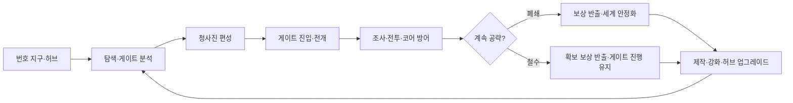

# 에르고스퀘어 종합 기획서

> [!IMPORTANT]
> **문서 상태**: 초안  
> **작성자**: 송예찬  
> **최종 수정일**: 2026-10-08<br>
> **프로젝트명**: `ERGOSQUARE: ARCHITECT` / `에르고스퀘어: 설계자`

이 문서는 프로젝트의 **단일 게임 기획 기준서**입니다. 게임 개요, 조작과 전투 규칙, 세계관 전체 이야기, 튜토리얼 시나리오와 검증 과제를 이어서 읽습니다. 표·데이터·원화·코드 설명은 부록으로 연결합니다. 문서 통합은 기존 가안을 승인하거나 구현 완료로 바꾸는 작업이 아닙니다.

## 문서 사용 규칙

구현할 기능을 구체화할 때는 [상세 명세 작성 기준과 튜토리얼 적용](../01_게임_기획/04_튜토리얼/제작/상세_명세_작성_기준과_1구간_적용.md)을 함께 사용합니다. 입력부터 결과까지의 조건, 데이터 소유자, 실패 처리와 재현 가능한 완료 기준을 기록하고, 기획 합의·코드 구현·플레이 검증 상태를 각각 표시합니다.

| 표기 | 의미 |
| --- | --- |
| `확정 방향` | 현재 프로젝트가 유지할 핵심 원칙 |
| `초안` | 방향은 유효하지만 세부 검증이 필요한 내용 |
| `가안` | 프로토타입을 위한 임시 수치·명칭·연출 |
| `TBD` | 아직 결정하지 않은 항목 |
| `기획 해설` | 해당 장면이나 규칙을 둔 이유 |

> [!NOTE]
> 규칙이 충돌하면 **이 문서의 명시된 규칙 → 부록의 비충돌 상세 → 과거 기록** 순으로 읽습니다. 이 문서에 없는 부록의 가안은 자동 확정하지 않습니다. 현재 코드의 동작은 구현 근거이며 기획 결정을 대신하지 않습니다. 게임 규칙 변경은 먼저 이 문서에, 수치·원화·기술 변경은 해당 부록에 기록합니다.

## Quick Links

[게임 개요](#overview) · [플레이 규칙](#gameplay) · [세계관 전체 이야기](#world-story) · [튜토리얼 시나리오](#tutorial-plots) · [구현·검증 현황](#implementation) · [미결정 사항](#decisions) · [데이터·원화·기술 부록](../01_게임_기획/README.md)

---

# 제1부. 종합 기획

<a id="overview"></a>

## 1. 게임 개요

### 1.1 기본 정보

| 항목 | 내용 | 상태 |
| --- | --- | --- |
| 프로젝트명 | `ERGOSQUARE: ARCHITECT` | 확정 방향 |
| 한국어명 | `에르고스퀘어: 설계자` | 확정 방향 |
| 개발 형태 | 1인 기획·개발 프로젝트 | 현재 상태 |
| 장르 | 월드 소유형 협동 샌드박스 / 실시간 액션 / 전략 배치 | 초안 |
| 플레이 인원 | 싱글 또는 1~4인 호스트 기반 친구 협동 | 초안 |
| 플랫폼 | PC Windows 우선 | 초안 |
| 엔진 | Unity / URP | 확정 방향 |
| 네트워크 | Photon PUN2 포함 기술 후보 검토 | TBD |
| 현재 단계 | 프리프로덕션 / 튜토리얼 버티컬 슬라이스 제작 | 현재 상태 |

### 1.2 한 줄 소개

> 지역과 사람의 기억을 읽어 이야기를 투영하는 게이트를 공략하고, 지나온 이야기의 힘을 파괴 가능한 전투 청사진으로 설계하는 1~4인 액션 RPG.

### 1.3 핵심 정의

> **인벤토리는 가방이 아니라 설계자의 전투 청사진이며, 전개된 강점은 동시에 지켜야 할 약점이다.**

플레이어는 코어, 장비, 수납, 방어와 보조 파츠를 격자형 청사진에 배치합니다. 청사진을 전개하면 파츠는 전장의 실제 구조물로 바뀌어 플레이어를 강화하지만 적에게 공격받을 수 있습니다. 따라서 빌드 구성, 공간 배치, 액션 전투와 전리품 보존이 하나의 판단으로 연결됩니다.

### 1.4 기획 의도

1. 플레이어가 만난 이야기와 존재의 힘을 조합해 자기 직군을 직접 설계합니다.
2. 강해지기 위해 전장에 약점을 노출하고, 그 약점을 지키는 긴장감을 만듭니다.
3. 장비 파밍을 단순 능력치 상승이 아니라 스킬 편성과 자원 호환의 선택으로 만듭니다.
4. 게이트의 설화와 폐쇄 조건을 전투 규칙에 연결합니다.
5. 철수와 월드 영구 사망을 통해 전진과 보존 사이의 판단을 유지합니다.

### 1.5 핵심 검증 질문

> 강한 빌드를 전장에 직접 꺼내고, 코어와 전리품을 지키면서 이야기의 힘을 조합하는 과정이 실제 플레이로 재미있는가?

---

## 2. 목표 사용자와 플레이 가치

### 2.1 핵심 사용자

- 액션 전투와 빌드 파밍을 함께 즐기는 플레이어
- 제한된 격자 안에서 장비와 공간을 최적화하는 플레이어
- 위험을 감수하고 더 깊이 진입하는 익스트랙션 구조를 선호하는 플레이어
- 신화·설화가 외형뿐 아니라 규칙으로 작동하는 세계를 선호하는 플레이어
- 싱글 완주와 소수 친구 협동을 모두 원하는 플레이어

### 2.2 제공 가치

| 가치 | 플레이 경험 |
| --- | --- |
| 설계 | 파츠를 배치해 자신의 아키텍처를 완성한다. |
| 긴장 | 코어와 주머니가 공격받기 때문에 강점과 전리품을 직접 지켜야 한다. |
| 발견 | 무기마다 다른 능력치와 스킬을 파밍하고 원하는 슬롯에 편성한다. |
| 관계 | 각성자·현현체와의 관계가 실제 설계 선택지로 남는다. |
| 재도전 | 철수 후 강화해 상위 몬스터와 게이트에 다시 도전한다. |
| 서사 | 전장을 조사하며 게이트가 기억을 왜곡한 과정을 알아낸다. |

### 2.3 현재 시장·운영 범위

시장 규모, 가격, 판매 목표와 경쟁작 정량 비교는 별도 조사 후 작성합니다. 현재 단계에서는 대규모 공용 월드, 거래소, UGC 시장과 청사진 라이선스 경제를 약속하지 않습니다.

---

<a id="world"></a>

## 3. 세계관 및 스토리

### 3.1 번호 지구

새 월드를 만들 때 고유 번호와 시드를 가진 지구가 생성됩니다. 주민에게 이곳은 복제 세계가 아니라 자신들이 살아온 유일한 현실입니다. 번호는 세이브와 관리자 시스템이 세계를 구분하기 위한 메타 식별자이며, 일반 주민은 인지하지 못합니다.

### 3.2 최초 침공과 대분기

최초의 외부 게이트 침공으로 인류가 멸망 위기에 놓였을 때 지구의 자아가 깨어났습니다. 지구는 가능한 현실을 예측하는 데 그치지 않고 실제 세계로 분기하여 침공을 분산시키고 서로 다른 생존 가능성을 만들었습니다. 이 사건을 `대분기`라고 부릅니다.

### 3.3 정본 지구

분기 중 하나는 자신만이 올바른 승리를 거둔 세계라고 주장하며 스스로를 `정본 지구`라 부릅니다. 정본 지구는 다른 번호 지구를 독립된 현실이 아니라 회수·병합할 수 있는 분기로 취급합니다.

정본 지구의 정확한 동기, 내부 세력과 생태계 붕괴 여부는 현재 `시나리오 초안`입니다. 단순한 자원 약탈자로 확정하기보다 자기 정당화와 생존 논리가 함께 작동하는 적대 세력으로 검토합니다.

### 3.4 게이트

게이트는 지역과 지성체에게 축적된 기억, 설화, 공포와 믿음을 읽어 이야기와 공간을 현실에 투영합니다.

| 유형 | 정의 |
| --- | --- |
| 정상 게이트 | 기억과 전승을 재료로 인물·사건·법칙을 투영합니다. |
| 폭주 게이트 | 이야기의 상징을 실제 육체·영혼으로 대체해 왜곡합니다. |
| 잠복 게이트 | 기존 예측 체계에 잡히지 않은 채 성장하다 돌발적으로 전조와 폭주를 일으킵니다. |
| 앵커 게이트 | 지구의 현실 좌표와 정본화 과정에 직접 연결된 핵심 거점입니다. |
| 최후의 게이트 | 정본화 관리자 시스템으로 향하는 최종 연결로입니다. |

게이트의 목표는 항상 섬멸이 아닙니다. 조사, 구조, 계약, 의식, 사건 해결, 보스 처치와 앵커 귀속 등 이야기마다 다른 폐쇄 조건을 가집니다.

### 3.5 이면

이면은 인간이 이해할 수 있는 이데아나 단일한 신이 아닙니다. 인간 또는 지성체가 되기를 원하는 무언가인지, 여러 존재가 살아가는 생태계인지조차 확정할 수 없는 심연입니다. 인간이 이면을 관측하자 이면 또한 인간을 관측했고, 이해할 수 없던 형상을 인간이 알아볼 수 있는 이야기와 물건의 모습으로 바꾸기 시작했습니다.

이면의 정체, 의도, 최초 관측, 게이트 생성 의지, 인간화에 성공한 존재와 공존 가능성은 본편 이후까지 남겨 둘 미스터리입니다.

### 3.6 각성자·설계자·현현체

| 명칭 | 정의 |
| --- | --- |
| 각성자 | 지구 각성 이후 초자연적 힘이 발현한 인간 전체의 총칭 |
| 설계자 | 에르고스퀘어를 운용하는 희귀 각성자에게 부여되는 작전 코드네임이자 플레이어 호칭 |
| 현현체 | 인간의 전승과 믿음에서 독립된 자아와 실체를 얻어 현실에 태어난 존재 |
| 게이트 투영체 | 게이트가 기억을 바탕으로 일시적으로 구현한 존재 |
| 폭주 유출 개체 | 폭주 규칙으로 만들어져 게이트 밖까지 유출된 개체 |

자연 발생 도깨비는 오랜 시간 사람의 정이 깃든 정상적인 현현체입니다. 폭주 게이트가 강제로 만든 영혼 주입형 개체와 구분합니다.

### 3.7 장기 목표

플레이어는 일반 게이트에서 공명 기록과 좌표를 모아 핵심 앵커 게이트를 찾습니다. 앵커를 파괴하는 대신 자신의 지구에 다시 귀속시키고, 최후의 게이트를 열어 관리자 시스템에서 자신의 지구를 정본화 대상에서 독립시킵니다.

앵커의 최종 개수와 문화권별 이야기 배치는 `TBD`입니다. 경계·기억·계약·재앙·생명은 기능 후보이며 반드시 5개로 고정하지 않습니다.

---

<a id="gameplay"></a>

## 4. 핵심 플레이 구조

### 4.1 전체 장기 루프



세부 기준은 [전체 장기 플레이 루프](../01_게임_기획/시스템_상세_부록.md#long-loop)를 따릅니다.

### 4.2 순간 전투 루프

```text
적의 패턴과 표적 확인
→ 이동·기본 공격으로 대응
→ 코어 위치와 손상 상태 확인
→ 생성 자원을 액티브 스킬에 소비
→ 플레이어·코어·주머니 중 무엇을 보호할지 선택
→ 전리품을 확보하고 다음 조우 또는 철수 판단
```

### 4.3 기본 조작

| 입력 | 기능 |
| --- | --- |
| 우클릭 / 길게 누르기 | 커서를 따라 지정 지점 이동 |
| 좌클릭 | 기본 공격 또는 위치 지정 아이템 확정 |
| `QWERASDF` | 편성한 액티브 스킬 8칸 |
| `Space` 길게 누르기 | 정신 집중: 행동을 멈추고 느리게 자원 회복 |
| `G` | 조사·대화·구조·장치 상호작용 |
| `1~4` | 소비 아이템 |
| `B` | 가방과 획득품 확인 |
| `Tab` | 에르고스퀘어 전개 모드 |
| `Alt` | 바닥 아이템 정보 |
| `Esc` | 현재 모드 취소 또는 메뉴 |

공통 회피 키는 두지 않습니다. 회피, 돌진, 방어와 반격은 장비에 붙은 액티브 스킬로 편성합니다. `Space` 정신 집중은 코어 전개 전후 모두 쓸 수 있지만 느리고 피격 위험이 큰 비효율적 보조 회복 수단입니다.

### 4.4 에르고스퀘어와 청사진

청사진은 파츠와 직접 수납 재료를 배치하는 격자입니다. `아키텍트`가 파츠를 조합해 완성한 전체 빌드를 `아키텍처`라고 부릅니다.

| 요소 | 역할 |
| --- | --- |
| 코어형 파츠 | 자원, 전개 계통, 활성 기초 능력치와 고유 메커니즘 제공 |
| 장비형 파츠 | 무기·방어구의 기초 성능과 액티브 스킬 제공 |
| 보조형 파츠 | 패시브, 코어 강화, 스킬 변형, 수납과 방호 제공 |
| 소비형 파츠 | 회복제·활성제처럼 사용 후 수량이 감소하는 편성 아이템 |
| 재료 | 제작·강화·복구와 허브 시설 업그레이드에 소비 |

전개된 파츠는 충돌과 내구도를 가진 월드 오브젝트입니다. 방패와 엄폐물로 쓸 수 있지만 파괴되면 기능을 잃습니다.

### 4.5 청사진 공간 경제

튜토리얼의 설계자 1레벨 청사진은 `3×3`입니다. 근접 계통은 중앙 한 칸이 설계자 원점으로 고정되므로 실제 배치 가능 공간은 8칸입니다.

| 레벨 예시 | 청사진 크기 | 설계 의도 |
| ---: | ---: | --- |
| 1 | `3×3` | 코어·전투·수납·방어의 기본 경쟁 |
| 2 | `3×4` | 한 줄 확장 |
| 3 | `4×4` | 복수 기능 조합 시작 |
| 4 | `4×5` | 수납·방호 선택 확대 |
| 5 | `5×5` | 중형 아키텍처 구성 |

5레벨 이후 최종 크기와 확장 방향은 `TBD`입니다. 청사진 칸이 늘어도 액티브 스킬 입력은 `QWERASDF` 8개로 유지합니다.

### 4.6 전개 계통

근접·투사·영역은 고정 직업이나 무기 제한이 아니라 코어에 붙는 전개 거리 규칙입니다. 같은 코어 원형도 서로 다른 계통으로 드롭될 수 있으며 코어를 교체하면 현재 직군이 바뀝니다.

| 계통 | 전개 규칙 | 핵심 위험 |
| --- | --- | --- |
| 근접 | 플레이어 주변에 전개 | 자신과 코어가 함께 전선에 노출 |
| 투사 | 플레이어 주변 `3×3` 바깥에 공격 설계 전개 | 최소 사거리·사선·분리된 코어 관리 |
| 영역 | 원거리 지점에 지속 현상과 구조 전개 | 범위와 발동 시점, 아군 영향 관리 |

### 4.7 코어

코어는 직군, 자원 종류, 활성 기초 능력치와 문화권별 성장 메커니즘을 연결하는 빌드의 중심입니다.

- 같은 코어 원형에도 근접·투사·영역 중 하나의 계통이 드롭 결과로 붙을 수 있습니다.
- 공격력, 체력, 방어력, 이동·공격 속도 등 기초 능력치 범위에 랜덤성을 줄 수 있습니다.
- 고유 행동을 바꾸는 효과는 기초 옵션이 아니라 별도의 특수 능력으로 관리합니다.
- 손상되면 자원 생성 효율이 낮아지고 파괴되면 자원·스킬·활성 능력치가 정지합니다.
- 코어 파괴 후에도 이동, 기본 공격과 상호작용은 유지되어 철수를 시도할 수 있습니다.
- 게이트 내부 완전 복구는 불가능하며 허브 시설에서 수리합니다.

튜토리얼 보장 코어 가안은 `낡은 정기의 혼 코어 [근접]`, 크기 `1×1`입니다.

### 4.8 장비·스킬·자원 호환

장비에는 드롭 시 기초 능력치와 액티브 스킬 후보가 무작위로 부여됩니다. 플레이어는 원하는 스킬을 8개 슬롯에 편성합니다. 기본 공격은 자원을 소비하지 않지만 액티브 스킬은 연결된 코어 자원을 소비합니다.

문화권과 계통에 따라 자원 표현과 성장 문법이 달라집니다.

- 한국 도깨비 장비: 물건과의 유대가 쌓이며 장비가 성장하는 방향
- 한국 무속 장비: 한과 신력의 배분, 신과의 관계를 코어 운용에 연결하는 방향
- 중국 무공 장비: 무기 사용과 수행이 내공 코어를 강화하는 방향
- 중국 강시 계통: 강시를 장비화했다면 코어보다 해당 개체의 강화가 중심이 될 수 있음

위 항목은 문화권을 단일 이미지로 고정하지 않는 `설계 방향 초안`입니다. 조사와 플레이 검증 전까지 세부 사실로 확정하지 않습니다.

자원 각인이 다른 장비는 자동 변환되지 않습니다. 플레이어는 해당 자원을 생성하는 코어로 교체하거나, 장비를 해체해 재료와 각인 요소를 얻은 뒤 현재 코어에 맞게 재제작합니다. 이 규칙은 서로 다른 문화권 빌드를 섞는 데 비용과 준비를 부여합니다.

### 4.9 수납과 주머니

재료는 주머니 없이도 운반할 수 있지만 기본 가안에서는 재료 하나가 청사진 한 칸을 차지합니다. 주머니는 여러 재료를 적은 공간에 압축 수납하지만 전개 후 공격받습니다.

- 주머니가 파괴되면 내부 재료는 반출할 수 없습니다.
- 여러 작은 주머니는 위험을 분산하지만 더 많은 칸을 차지합니다.
- 큰 주머니는 공간 효율이 좋지만 한 번의 손실이 큽니다.
- 방어 플레이트를 코어에 둘지 주머니에 둘지가 빌드 판단이 됩니다.

### 4.10 소비 아이템

초기 소비 아이템은 두 종류만 사용합니다.

| 아이템 | 기능 |
| --- | --- |
| 응급 회복제 | 플레이어 체력 회복 |
| 코어 활성제 | 현재 전개된 코어 자원을 즉시 일정량 충전 |

코어 전개 시 보유 자원은 초기화되지 않습니다. 모든 빌드가 처음부터 자동 생성 자원을 확보하는 것은 아니므로 정신 집중과 코어 활성제가 초반 스킬 사용을 보조합니다.

### 4.11 적 AI와 위협도

플레이어, 코어, 주머니와 주요 전개물은 각각 위협도와 표적 가중치를 가집니다. 초기 예시는 코어의 기본 위협도 `50`, 플레이어 스킬 사용 `+30`, 공격 적중 `+30`, 초당 `-5` 감소입니다. 정확한 수치는 `가안`입니다.

적 유형에 따라 위협도 반응을 다르게 합니다.

- 일반 적: 가장 높은 유효 위협 대상을 선택
- 코어 압박형: 코어 고정 가중치가 높음
- 약탈형: 주머니와 수납 파츠를 우선
- 반격형: 자신을 공격한 플레이어의 가중치가 크게 증가
- 보스: 패턴별로 표적 규칙을 명시적으로 전환

### 4.12 철수·사망·월드 종료

- 게이트는 전멸 전이라면 언제든 철수를 시도할 수 있습니다.
- 철수는 짧은 연결 시간이 필요하고 피격 또는 다른 행동으로 취소됩니다.
- 철수해도 게이트는 열린 채 시간과 폭주 단계가 진행됩니다.
- 싱글 사망 또는 협동 파티 전멸은 해당 번호 지구의 게임오버입니다.
- 종료된 월드의 장비, 자원과 해금은 새 지구로 이전하지 않습니다.
- 협동에서 개인 체력 0은 즉시 사망이 아니라 `중상`이며 아군 구조 또는 파티 철수를 기다립니다.

### 4.13 보상과 성장

하위 몬스터를 반복 처치하면 같은 단계의 장비와 일반 재료를 얻습니다. 상위 강화와 등급 돌파에는 정예·보스 등 더 강한 적의 장비 또는 촉매가 필요합니다. 하위 재료의 양만으로 상위 단계를 건너뛸 수 없습니다.

```text
현재 단계 몬스터 공략
→ 장비·재료 확보
→ 철수 또는 게이트 폐쇄
→ 허브에서 제작·강화·복구
→ 상위 몬스터와 게이트 도전
```

정해진 허브의 시설을 업그레이드하는 구조를 사용합니다. 완전 자유 건축형 하우징은 현재 범위가 아닙니다.

#### 도깨비 조합과 유대 유지

동행 중인 물건 도깨비에 추가 파밍 재료를 조합해 스킬 동작을 확장합니다. 빗자루는 1자루일 때 짧은 돌진과 왼쪽 쓸기, 2자루 조합 시 좌우 두 번, 3자루 조합 시 좌우 쓸기와 자루 찌르기까지 같은 키로 연계합니다. 세 개를 청사진에 따로 배치하는 방식이 아닙니다. 3단계 이후에는 피해·쿨타임·소모 자원 강화와 다른 물건의 재료를 이용한 분기를 검토합니다.

빗자루는 조합으로 연계 횟수가 늘어나는 하나의 스킬이며, 모든 조합 단계의 공통 기본 쿨타임은 Q1 승인부터 10초입니다. 기존 쿨타임 강화 배율은 유지합니다. Q2·Q3에는 별도 쿨타임 없이 순서대로 이어갑니다. Q1부터 Q2를 6초간 기다리며, 3단계에서 Q2를 승인하면 그 시점부터 Q3 대기 6초를 새로 시작합니다. Q2는 대기 제한만 갱신하고 Q1의 쿨타임은 다시 시작하지 않습니다. 마지막 해금 타격 또는 다음 타 대기 만료 시 Q1 대기로 돌아오지만, 남은 쿨타임이 끝나야 재사용할 수 있습니다. 예를 들어 강화 없이 Q1 후 입력하지 않으면 6초에 연계가 초기화되고 쿨타임은 4초 남습니다. 쿨타임이 끝나도 연계 대기가 유효하면 새 Q1 대신 Q3를 먼저 사용합니다.

조합과 분기는 기존 도깨비의 고유 ID·유대·성장 이력을 유지합니다. 유대가 있는 별도 개체를 자동 재료화하지 않습니다. 현재는 동일 물건의 추가 획득을 유대 없는 재료로 취급하는 단일 보유 프로토타입이며, 정식 다중 개체 보관과 분해 확인 UI는 후속 범위입니다. 월도 조각 분기는 기존 월도 도깨비 보상과 다른 재료로 설계하며 아직 비활성 초안입니다.

[도깨비 조합과 성장 상세 명세](../01_게임_기획/01_핵심_플레이/장비_코어_스킬/도깨비_조합_성장_명세.md)에 입력·상태·수치 가안·엑셀 JSON 데이터와 시험 조건을 관리합니다. 유대 전투 보상과 장정형 성장은 조합 단계와 별도의 후속 설계입니다.

### 4.14 상태별 기능과 자원 처리

아래는 기존 합의를 모은 규칙입니다. 정확한 수치와 상태 전환 프레임은 플레이 검증 전까지 가안입니다.

| 상태 | 자원 | 허용·제한 |
| --- | --- | --- |
| 정상 코어 보유·미전개 | 정신 집중으로 같은 코어 에너지 풀 회복 | 이동·기본 공격·상호작용 유지. 자원이 충분하면 호환 스킬 사용 |
| 코어 정상 전개 | 기존 자원 유지 + 자동 생성 | 호환 스킬 사용, 정신 집중도 가능하지만 효율상 불리 |
| 코어 손상 | 자동 생성 효율 감소 | 감소 단계·비율 TBD. 코어 상태와 생성량 경고 |
| 코어 파괴 | 생성과 회복 수단 중단 | 장비 스킬·활성 능력치·정신 집중·활성제 중단. 기본 행동으로 철수 후 허브 복구 |
| 정신 집중 중 | 초당 10 회복 가안, 별도 게이지 없음 | 준비시간 없이 누르는 동안 발동. 이동·공격·스킬 제한, 받는 피해 1.5배 가안 |

`코어 미전개`와 `코어 파괴`는 다릅니다. 코어를 아예 획득하지 않은 첫 구간에서 사용하는 임시 자원 공급은 프로토타입 예외이며 정식 지급 시점을 결정해야 합니다. 코어 교체 시 서로 다른 자원 풀을 어떻게 보관·소멸시킬지는 TBD이고, 자동 환전은 허용하지 않습니다.

### 4.15 편성·수납과 성장의 경계

- 설계자 레벨은 청사진 공간을 확장하는 축이며 기초 전투 능력치를 직접 올리는 축과 구분합니다. 2레벨 이후 표는 확장 가안입니다.
- 근접 3×3 중앙 한 칸 예약은 투사·영역에 일반화하지 않습니다. 짝수 크기 확장 시 기존 원점과 파츠의 상대 좌표 보존을 검토합니다.
- 액티브 슬롯은 최대 8개입니다. 패시브·코어 강화·수납·방어 파츠는 액티브 슬롯 대신 청사진 공간을 소비합니다.
- 주머니 없이도 재료 1개를 빈 칸 1개에 넣어 운반할 수 있습니다. 직접 수납 재료의 월드 피격·스택 정책은 TBD입니다.
- 주머니 파괴 시 내용물은 반출 불가입니다. 미전개 주머니의 신규 수납 불가, 손상 중 수납 유지와 벨트 아이템 보존은 상세 초안이며 실전 검증이 필요합니다.
- 유대가 쌓인 도깨비 파츠 해체 시 대상·유대 손실을 경고하고 취소할 수 있게 합니다. 유대를 보존하며 강화하는 대체 경로는 추후 설계합니다.

### 4.16 표적 선택과 실패 처리 보강

위협도 60이 초당 5씩 감소하면 2초 뒤 코어의 50과 **동점**입니다. 동점 시 코어 우선이라는 가안을 적용할 때만 그 시점에 코어로 전환합니다. 경로·시야·유효 표적을 먼저 거르고, 진행 중 공격의 종료 시점과 표적 재평가 주기·전환 임계값을 정해야 합니다.

협동 중상자는 즉시 월드에서 사출하지 않습니다. 아군 구조 또는 중상자를 포함한 파티 철수를 지원하는 방향이며, 전원 중상 시 월드 게임오버입니다. 중상 중 코어가 파괴되었다면 구조만으로 코어 능력을 복구하지 않습니다. 연결 끊김은 사망으로 바로 판정하지 않고 재접속·호스트 처리 정책을 별도로 정합니다.

철수 성공 시 보존된 전리품을 허브 재고에 반영하는 시점, 저장과 보상 중복 방지, 사망과 폐쇄가 같은 프레임에 발생할 때의 우선순위는 구현 전 결정해야 합니다. 월드 종료는 게임 규칙이며 실제 저장 파일을 즉시 삭제하라는 기술 지시가 아닙니다.

---

## 5. 인터페이스 구성

### 5.1 인게임 HUD

- 하단 중앙: `QWERASDF` 액티브 스킬 8칸
- 스킬 영역 인접: `Space` 정신 집중 안내
- 하단 좌측: 플레이어 체력
- 하단 우측 또는 코어 인접 영역: 현재 자원과 코어 상태
- 별도 단축 영역: `1~4` 소비 아이템
- 상호작용 대상: 대상 위에 `G`와 행동 동사 표시
- 전리품 위험: 주머니 손상·파괴와 반출 가능 변화 우선 경고

정신 집중 전용 게이지는 만들지 않습니다. 정신 집중은 별도 자원이 아니라 현재 코어 자원을 회복하는 입력입니다.

### 5.2 청사진 편집

- 보유 파츠를 선택한 뒤 좌클릭으로 배치할 수 있습니다.
- 보유 파츠에서 청사진으로 직접 드래그 앤 드롭할 수 있습니다.
- 장비형 파츠 위에 커서를 올린 채 `QWERASDF`를 눌러 스킬 슬롯을 할당합니다.
- 코어, 주머니, 방어 플레이트와 장비가 같은 격자 공간을 경쟁합니다.
- 파츠의 크기, 회전, 점유 칸, 연결과 파괴 시 손실을 미리 보여줍니다.

### 5.3 전개 화면

`Tab`을 누르면 게임을 가리는 별도 인벤토리 화면이 아니라 현재 필드 위에 전개 오버레이가 나타납니다.

- 필드 전체에 같은 셀 크기의 옅은 격자가 투영됩니다.
- 현재 코어 계통과 위치에서 전개 가능한 범위만 강조합니다.
- `2×2` 파츠는 서로 다른 크기의 셀이 아니라 동일한 네 칸을 하나의 파츠 영역으로 묶어 표시합니다.
- 배치 가능, 충돌, 경사, 차단과 위험 상태를 색상뿐 아니라 선·아이콘으로도 구분합니다.
- 근접 계통의 중앙은 설계자 원점이지만 투사·영역 계통은 각 계통 규칙에 맞는 별도 안내를 사용합니다.

#### 5.3.1 전개 확정 피드백 — SFX 없이 구분하기

청사진 편집의 **편성 완료**와 필드의 **실제 전개 완료**는 다른 상태입니다. 편집창을 닫거나 Tab을 누른 것만으로 성공을 표시하지 않습니다.

| 상태 | 필드 표현 | Canvas HUD | 판정 |
| --- | --- | --- | --- |
| 미전개 | 설치물 없음 | `미전개 · Tab 전개 화면` | 아직 실제 설치 인스턴스 없음 |
| 미리보기 | 반투명 파츠, 가능/불가 색 구분 | `전개 미리보기 · 좌클릭으로 설치 / Tab 닫기` | 설치 전 후보 위치 |
| 전개 성공 | 원본 파츠 외형으로 실체화, 해당 셀 외곽선 한 번 점멸 | `청사진 전개 완료` 2.5초 | 필드 설치 인스턴스 생성 후에만 발생 |
| 전개 유지 | Tab 종료 후에도 설치물과 안정된 외곽선 유지 | `전개 중 · 빗자루 설치됨` 지속 | 실제 설치물이 남아 있음 |
| 전개 실패 | 성공 연출 없음, 미리보기 유지 | 중앙 잠금·범위 밖·장애물 충돌 등의 이유 표시 | 실패 시 설치하지 않음 |

- 점멸 시간 0.6초와 알림 시간 2.5초는 프로토타입 조정값입니다.
- UI 클릭은 필드 설치로 전달하지 않습니다. 확정 시 현재 위치의 충돌을 다시 검사합니다.
- 현재 구현 대상은 **빗자루 1개 전개 피드백**입니다. 전체 파츠 일괄 전개, 코어 자원 생성·내구도·파괴 연출까지 완성된 것으로 해석하지 않습니다.
- SFX는 이번 범위에서 제외합니다. 추후 실제 전개 성공 이벤트에 추가하되 소리가 없어도 상태가 식별되어야 합니다.
- 청사진 편집 문구는 `청사진에 편성했습니다(필드 미전개)`로 구분합니다.

수용 시험: 빗자루 획득 → Tab → 편집·스킬 할당 → 편집 종료 → 반투명 미리보기 확인 → 좌클릭 → 완료 알림·테두리 점멸 확인 → Tab 종료 후 설치물·상태 표시 유지 확인. 장애물 충돌과 UI 클릭에서는 설치 성공이 발생하지 않아야 합니다. 설치물을 제거하면 지속 HUD도 미전개로 돌아와야 합니다.

검증 상태: 코드 반영 후 문서·컴파일 검사를 수행하며, 실제 플레이에서 가독성·가림·점멸 강도는 별도로 확인합니다.

### 5.4 해상도 대응

Unity Canvas와 `Canvas Scaler`를 기준으로 HUD를 구성하고 앵커를 화면 가장자리와 중앙 기능군에 맞춥니다. 단일 해상도에 맞춘 이미지 한 장을 UI로 사용하지 않습니다. 콘셉트 이미지는 배경·아이콘·장식 에셋으로 분리해 사용합니다.

---

## 6. 맵 및 콘텐츠 디자인

### 6.1 장기 월드

- 플레이어 소유의 번호 지구와 고정 허브
- 게이트 발생 지역 탐색
- 일반 게이트에서 좌표·공명 기록 수집
- 핵심 앵커 게이트 발견과 귀속
- 최후의 게이트 개방

월드의 실제 규모, 절차 생성 범위와 지역 수는 `TBD`입니다.

### 6.2 게이트 콘텐츠 제작 원칙

1. 지역의 기억과 전승이 공간·적·규칙에 반영되어야 합니다.
2. 원전 조사와 게임적 재해석을 구분해 기록합니다.
3. 문화권은 단순 외형 스킨이 아니라 자원, 성장과 금기의 작동 방식에 영향을 줍니다.
4. 한 문화의 존재를 선악 또는 하나의 직군으로 고정하지 않습니다.
5. 게이트 투영체, 폭주 개체와 현실의 현현체를 구분합니다.

### 6.3 한국 콘텐츠의 현재 방향

도깨비 계통은 사람의 정이 밴 물건과 유대의 성장을 중심으로 검토합니다. 평상형 물건 도깨비는 파란 도깨비불과 본체 물건이 하나의 개체를 이루며, 친근한 첫인상을 통해 플레이어가 장비와 관계를 맺게 합니다.

터주신·성주신·조왕신 등의 가신과 장승·서낭·솟대 등의 마을 수호 전승은 도깨비와 다른 `터전 수호 계통`으로 관리합니다. 가택 수호와 마을 경계라는 공간 규칙을 전개 계통과 연결할 수 있습니다.

### 6.4 튜토리얼 맵 방향

- 전체 분위기: 현실 기억이 뒤틀린 동굴형 게이트
- 초반: 좁은 이동·조사 구간
- 중반: 코어·주머니·방어 플레이트를 전개할 평탄한 전투 구간
- 후반: 토벌팀 시체와 기록이 이어지는 탐사 구간
- 종점: 초가집과 월도를 든 병사가 보이는 보스 구역
- 보스방: 근접 `3×3` 전개와 월도 횡베기를 읽을 수 있는 원형 또는 팔각형 공간

`서울 지하상가`는 안티그래비티 초안에서 제시된 대체 도입 배경이지만 현재 튜토리얼 기준으로 확정하지 않습니다. 현실 도입 세트와 동굴형 내부를 분리할지 후속 레벨 디자인에서 결정합니다.

---

## 7. 개발 전략

### 7.1 현재 P0 목표

> 평범한 생존자가 잠복 게이트에서 에르고스퀘어를 처음 전개하고, 코어와 전리품을 지키며 월도를 처치한 뒤 게이트를 닫는 15~25분 규모의 싱글 튜토리얼을 완주 가능하게 만든다.

### 7.2 튜토리얼 포함 범위

| 영역 | P0 범위 |
| --- | --- |
| 조작 | 우클릭 이동, 좌클릭 기본 공격, `QWERASDF`, `Space`, `G`, `Tab`, `B`, `1~2` |
| 카메라 | 아이소메트릭 쿼터뷰, Cinemachine 기반 추적 |
| 청사진 | 1레벨 `3×3`, 중앙 원점, 1×1 근접 코어, 주머니, 방어 플레이트 |
| 장비 | 첫 무기와 빗자루 파츠 프로토타입, 스킬 편성 |
| 자원 | 정신 집중, 코어 자동 생성, 코어 활성제 |
| 적 | 기억 투영형·영혼 주입형 도깨비, 월도 보스 |
| 서사 | 기억 파편, 토벌팀 기록, 영혼 안정화, 설계자 명명 |
| UI | HUD, 상호작용 안내, 청사진 편집, 필드 전개 오버레이 |

### 7.3 제외 범위

- 본격적인 허브 업그레이드와 오픈월드
- 1~4인 네트워크 동기화
- 다수 문화권과 앵커 게이트 본편
- 완성형 제작 경제와 장기 희귀도
- 거래소, UGC 시장과 청사진 판매
- 컨트롤러 최종 매핑

### 7.4 권장 구현 순서

1. 이동·카메라·충돌·상호작용
2. 기본 공격·피격·적 표적
3. 아이템 획득과 빗자루 파츠 데이터
4. 청사진 편집과 스킬 슬롯 할당
5. 필드 격자와 파츠 전개
6. 코어 자원·정신 집중·스킬 소비
7. 코어·주머니·방어 플레이트 피격과 파괴
8. 튜토리얼 TUT-00~08 진행 상태
9. 일반 도깨비 조우와 월도 보스
10. 결과·폐쇄·복귀와 저장

### 7.5 주요 위험

| 위험 | 대응 방향 |
| --- | --- |
| 청사진과 액션의 규칙 과밀 | 튜토리얼에서 기능을 필요 직전에 하나씩 개방 |
| 파츠 파괴가 불쾌한 손실로만 작동 | 위험 예고, 철수 선택과 배치 수정 정보를 제공 |
| 문화권 혼합이 피상적인 스킨이 됨 | 자원·성장·관계·금기까지 시스템으로 구분 |
| 월드 영구 사망의 피로 | 언제든 철수 가능, 실패 원인과 다음 판단을 명확히 제공 |
| 원화의 실시간 구현 비용 | 실루엣·전조·핵심 상징부터 단계적으로 구현 |
| 협동이 싱글을 훼손 | 모든 필수 기능은 싱글로 완주 가능하게 설계 |

---

## 8. 운영 및 확장 방향

### 8.1 콘텐츠 확장

- 한국 이후 중국, 일본, 미국 등 문화권별 장비·코어·스킬 문법 확장
- 일반 게이트와 앵커 게이트의 목적·폐쇄 조건 다양화
- 각성자 NPC와 현현체 관계를 통한 안정 설계 해금
- 서로 다른 계통의 해체·재제작을 통한 융합 아키텍처
- 다른 번호 지구와 이면은 본편 완료 이후 후보로 보류

### 8.2 제작 범위 통제

모든 조합에 전용 스킬을 만들지 않습니다. 공통 태그가 범위·속성·발동 조건을 변형하고, 의미가 강하게 맞물리는 일부 조합만 고유 이름과 연출을 가진 `융합 설계`로 제작합니다.

### 8.3 현재 비목표

- MMORPG형 상시 공용 월드
- 대규모 공개 매칭 중심 구조
- 플레이어 간 자유 거래 경제
- 현금 가치와 연결되는 아이템 소유권
- 무제한 생성형 퀘스트를 핵심 콘텐츠로 사용

---

# 제2부. 메인 시나리오

<a id="world-story"></a>

## 9. 세계관 전체 스토리

> 개발용 전체 스포일러를 포함합니다. 용어를 누르면 설명 부록으로 이동합니다.

### 1. 인간이 심연을 바라보기 전

인류가 지금의 세계를 유일한 현실이라고 믿고 살아가던 시기에도, 현실 바깥에는 인간의 언어와 인식으로 설명할 수 없는 [이면](../02_세계관_및_콘텐츠/세계관_용어집.md#이면)이 존재했습니다.

이면이 하나의 의식인지, 수많은 존재가 살아가는 생태계인지, 또는 지성이라는 개념조차 적용할 수 없는 현상인지는 알 수 없습니다. 중요한 것은 이면이 인간이 상상한 완전한 원형이나 이데아가 아니라는 점입니다. 그것은 인간과 같지 않았고, 같을 수도 없었기에 이면이었습니다.

그러나 인간이 심연을 관측하기 시작하면서 관계가 바뀌었습니다. 인간이 이면을 들여다보았을 때 이면 역시 인간을 바라보았습니다. 인간에게 인식될 수 없던 형상은 이야기, 사물, 얼굴과 신체를 닮기 시작했습니다.

그 모방은 정확하지 않았습니다. 이면이 빗자루를 이해한다면 손잡이와 빗살의 기능을 그대로 복제하는 대신, 척추뼈에 사람의 얼굴을 매달고 그 머리카락을 빗살처럼 사용하는 것을 `빗자루`라고 부를 수도 있습니다. 인간이 알아볼 수 있는 결과에 도달했지만 그 과정과 구조는 인간의 사고와 전혀 다릅니다.

이면이 왜 지성체를 닮으려 하는지, 그것이 의도인지 반사 작용인지, 인간처럼 되는 데 성공한 존재가 있는지는 아직 아무도 알지 못합니다.

> [!NOTE]
> 이면의 완전한 설명은 본편에서 제공하지 않습니다. 이해할 수 없음 자체가 세계관의 장기적 공포로 남습니다.

---

### 2. 최초의 게이트 침공

어느 시점부터 이면과 현실 사이에 [게이트](../02_세계관_및_콘텐츠/세계관_용어집.md#게이트)가 열리기 시작했습니다. 게이트는 단순한 공간 통로가 아니었습니다. 지역과 사람에게 축적된 기억, 신화, 설화, 공포와 믿음을 읽어 하나의 이야기와 규칙을 현실에 투영했습니다.

게이트 안에서는 이야기가 자연법칙처럼 작동했습니다. 어떤 게이트는 괴물을 쓰러뜨려야 닫혔고, 어떤 게이트는 억울하게 죽은 존재의 이름을 되찾아야 했습니다. 계약을 완성하거나 금기를 지키고, 사람을 구조하고, 반복되는 사건의 결말을 바꾸어야 닫히는 게이트도 있었습니다.

인류는 처음에 이를 자연재해나 외계 침공으로 여겼습니다. 하지만 게이트마다 서로 다른 문화의 기억을 재현하고, 인간이 의미를 부여한 이야기의 조건에 반응한다는 사실이 드러났습니다. 전쟁은 단순한 화력 대결이 아니라 현실의 의미와 좌표를 지키는 싸움으로 변했습니다.

게이트의 침공은 전 세계로 확대되었습니다. 도시와 국가가 무너지고 기존의 대응만으로는 인류가 멸망할 가능성이 커졌습니다. 그때 행성의 생명, 기억과 집단 무의식이 결집한 [지구 자아](../02_세계관_및_콘텐츠/세계관_용어집.md#지구-자아)가 깨어났습니다.

---

### 3. 대분기와 번호 지구의 탄생

지구 자아는 단 하나의 미래를 선택하지 않았습니다. 가능한 현실들을 실제 세계로 분리하는 [대분기](../02_세계관_및_콘텐츠/세계관_용어집.md#대분기)를 일으켰습니다.

분기된 세계들은 침공의 압력을 나누어 받았고 서로 다른 방식으로 생존을 시도했습니다. 어떤 세계는 과학 기술로 게이트를 봉쇄했고, 어떤 세계는 각성자와 현현체의 힘을 받아들였습니다. 패배한 세계도, 간신히 살아남은 세계도, 전혀 다른 문명으로 발전한 세계도 생겨났습니다.

각 분기는 복제품이나 가상 시뮬레이션이 아니었습니다. 분기 순간부터 모두 독립된 역사와 생명을 가진 현실이 되었습니다. 게임에서 새 월드가 생성될 때 부여되는 [번호 지구](../02_세계관_및_콘텐츠/세계관_용어집.md#번호-지구)의 번호는 이 세계들을 구별하기 위한 관리자 시스템과 플레이어 관점의 식별자입니다.

그 세계에 사는 사람들은 자신들의 지구를 번호로 부르지 않습니다. 그들에게 자신의 세계는 태어나고 살아온 단 하나의 지구입니다.

대분기 이후 지구 자아의 각성은 인간과 이야기에도 변화를 일으켰습니다. 일부 인간에게 초자연적 능력이 발현되어 [각성자](../02_세계관_및_콘텐츠/세계관_용어집.md#각성자)가 태어났습니다. 동시에 오랜 시간 인간의 믿음과 정이 깃든 존재들이 현실에서 독립된 자아를 얻어 [현현체](../02_세계관_및_콘텐츠/세계관_용어집.md#현현체)로 나타나기 시작했습니다.

자연 발생한 도깨비, 영물, 신령과 신화적 존재는 현현체가 될 수 있습니다. 신내림을 받은 무당처럼 힘이 발현한 인간은 각성자로 분류합니다. 이들은 게이트가 임시로 만든 투영체와 달리 현실에서 스스로 선택하고 관계를 맺습니다. 인간을 돕는 존재도, 관심을 보이지 않는 존재도, 적대하는 존재도 있습니다.

---

### 4. 정본 지구의 선언

분기 세계 가운데 하나는 자신들만이 최초 침공을 올바르게 극복했다고 주장하기 시작했습니다. 그들은 자신의 분기 번호를 지우고 스스로를 [정본 지구](../02_세계관_및_콘텐츠/세계관_용어집.md#정본-지구)라고 선언했습니다.

정본 지구는 다른 번호 지구를 동등한 생명과 역사를 가진 현실로 인정하지 않았습니다. 다른 분기는 실패했거나 오염된 가능성이며, 하나의 올바른 현실로 회수되어야 한다고 주장했습니다. 그들이 다른 지구를 자신의 현실에 합치는 과정을 [정본화](../02_세계관_및_콘텐츠/세계관_용어집.md#정본화)라고 부릅니다.

정본화가 완료된 세계가 실제로 어떻게 되는지는 초반의 사람들에게 알려지지 않았습니다. 기록과 존재가 정본 지구에 흡수되는지, 일부만 남고 원래 세계가 붕괴하는지, 주민의 자아가 유지되는지도 불분명했습니다. 분명한 것은 번호 지구가 독립된 현실로 존재할 권리를 잃는다는 사실입니다.

정본 지구의 내부 사정과 정확한 동기는 아직 시나리오 초안입니다. 전쟁으로 망가진 세계를 복구하기 위한 생존 논리, 차원 붕괴를 막기 위한 통합 명분, 자신들만이 정답이라는 오만이 함께 작동하는 방향을 검토합니다. 그들을 단순히 악해서 악한 집단으로만 설명하지 않되, 다른 세계의 생존권을 부정하는 선택은 명확한 적대 행위로 다룹니다.

---

### 5. 게이트 대응 시대

각 번호 지구의 인류는 게이트 전조를 관측하고 발생 지점을 예측하는 체계를 만들었습니다. 각성자와 일반 전투원으로 구성된 토벌팀이 전조 단계에 출동해 유출 개체를 제거하고 게이트 내부의 폐쇄 조건을 해결했습니다.

게이트가 지역의 기억을 읽어 만든 존재는 [게이트 투영체](../02_세계관_및_콘텐츠/세계관_용어집.md#게이트-투영체)입니다. 이것은 현실의 자연 발생 도깨비나 다른 현현체와 구분됩니다. 정상적인 게이트는 기억과 전승만으로 투영체를 만들며 실제 인간의 영혼을 필요로 하지 않습니다.

하지만 게이트가 폭주하면 이야기의 상징을 현실의 육체와 영혼으로 대체할 수 있습니다. `사람의 정과 생명이 물건에 깃든다`는 전승을 `사람의 영혼을 물건에 강제로 넣는다`는 규칙으로 오독하는 식입니다. 이렇게 만들어진 [영혼 주입형](../02_세계관_및_콘텐츠/세계관_용어집.md#영혼-주입형) 개체는 정상적인 현현체가 아닙니다.

기관은 대부분의 게이트를 전조 단계에서 발견할 수 있다고 믿었습니다. 그러나 관측되지 않은 채 이면 깊은 곳에서 성장하다 갑자기 현실을 삼키는 [잠복 게이트](../02_세계관_및_콘텐츠/세계관_용어집.md#잠복-게이트)가 나타나면서 기존 대응 체계의 한계가 드러납니다.

---

### 6. 최초의 잠복 게이트 폭주

플레이어는 특별한 전투원이 아니라 아르바이트를 마치고 귀가하던 평범한 시민이었습니다. 그날 지역에 숨어 있던 잠복 게이트가 아무런 사전 예측 없이 전조를 일으켰습니다.

거리 위에 존재하지 않던 구조의 윤곽이 겹치고 조명과 통신이 불안정해졌습니다. 게이트 밖으로 도깨비의 모습을 한 [폭주 유출 개체](../02_세계관_및_콘텐츠/세계관_용어집.md#폭주-유출-개체)가 튀어나왔습니다. 기관은 토벌팀을 급파해 외부 개체를 제거한 뒤 내부로 진입했습니다.

그러나 게이트 안의 규칙은 외부에서 관측한 것과 달랐습니다. 지역의 도깨비 전승을 읽은 게이트는 흡인한 시민의 영혼을 생활 도구에 주입하고 있었습니다. 토벌팀은 내부 개체가 단순한 기억 투영체가 아니라 실제 인간을 품고 있다는 사실을 뒤늦게 발견했습니다.

팀은 조사 기록과 폐쇄 인증을 남기며 더 깊이 진입했지만 거대한 월도를 중심으로 형성된 병사형 도깨비를 쓰러뜨리지 못하고 전멸했습니다. 보스만 남은 상태에서 게이트의 폭주는 계속되었습니다.

그 뒤 플레이어와 주변 시민이 게이트 내부로 흡인됩니다. 플레이어는 기억을 잃은 채 동굴처럼 뒤틀린 공간에서 눈을 뜹니다.

---

### 7. 에르고스퀘어의 발현

플레이어는 흩어진 흔적을 조사하며 귀가, 전조, 유출 개체와 흡인의 순간을 짧은 기억 파편으로 되찾습니다. 첫 도깨비 투영체에게 쫓겨 죽음에 가까워진 순간, 플레이어의 자기 인식이 현실에서 사라지지 않고 하나의 좌표로 고정됩니다.

손상된 시스템은 플레이어를 생존 개체로 인식하고 현실 고정 권한을 요청합니다. 바닥에 동일한 크기의 격자가 퍼지고 개인 좌표계 [에르고스퀘어](../02_세계관_및_콘텐츠/세계관_용어집.md#에르고스퀘어)가 발현됩니다.

에르고스퀘어는 단순한 인벤토리나 소환 마법이 아닙니다. 플레이어가 미리 구성한 [청사진](../02_세계관_및_콘텐츠/세계관_용어집.md#청사진)을 현실의 구조물로 바꾸는 권한입니다. 코어, 무기, 방어 플레이트와 주머니는 전장에 실체화되어 기능하는 동시에 적의 공격을 받습니다.

플레이어를 강하게 만드는 설계가 곧 지켜야 할 약점이 됩니다. [코어](../02_세계관_및_콘텐츠/세계관_용어집.md#코어)가 파괴되면 자원 생성, 장비 스킬과 활성 능력치가 중단됩니다. [주머니](../02_세계관_및_콘텐츠/세계관_용어집.md#주머니)가 파괴되면 그 안에 보관한 재료를 현실로 반출할 수 없습니다.

플레이어는 토벌팀의 시체와 기록을 따라가며 이동, 전투, 스킬 편성, 코어 전개와 영혼 안정화를 배웁니다. 이 과정에서 게이트가 사람의 기억을 재현한 것이 아니라 실제 사람을 이야기의 재료로 사용했다는 사실을 알아냅니다.

---

### 8. 사람을 죽인 도깨비 — 월도

게이트의 끝에는 초가집과 그 앞을 지키는 거대한 병사 형상이 있습니다. 병사의 손에는 조선 시대에 제작된 것으로 추정되는 월도가 들려 있습니다.

지역에서는 그 월도를 전쟁 당시 한 병사가 사용했다고 전해지지만 이를 입증할 기록은 없습니다. 월도의 날에 전쟁에서 죽은 사람들의 피가 남아 있고, 밤이 되면 죽은 병사가 무기를 되찾으러 온다는 구전만 전해집니다.

폭주 게이트는 `많은 생명을 죽인 무기`를 `많은 생명을 담을 수 있는 그릇`으로 해석했습니다. 흡인한 시민의 영혼을 월도에 계속 주입하면서 얼굴 없는 거대한 병사의 모습을 만들었습니다. 이것이 [사람을 죽인 도깨비 — 월도](../02_세계관_및_콘텐츠/세계관_용어집.md#월도)입니다.

플레이어는 월도의 넓은 공격을 피하면서 코어와 주머니를 지켜야 합니다. 보스는 플레이어만 공격하지 않고 코어로 돌진하거나 수납 파츠를 노립니다. 플레이어는 스킬을 사용해 위협을 끌어오고, 자원을 소비해 보스를 공격하며, 자신의 강점이 파괴되지 않도록 전장의 우선순위를 바꿉니다.

월도의 육체가 무너져도 게이트는 닫히지 않습니다. 플레이어는 남은 다중 영혼 결박핵을 안정화하고 영혼을 해방해야 합니다. 전투에서 이기는 것과 이야기의 사건을 해결하는 것이 서로 다른 단계라는 사실을 처음으로 보여주는 순간입니다.

---

### 9. 설계자의 탄생

영혼이 해방되고 폐쇄 조건이 완성되자 게이트의 공간은 무너지고 현실이 돌아옵니다. 기관은 잠복 게이트에서 살아 돌아온 플레이어와 현장에 남은 격자 전개 흔적을 조사합니다.

플레이어의 능력은 기존 각성 유형과 달랐습니다. 하나의 불, 무기나 신령을 다루는 것이 아니라 여러 힘의 원리와 물건을 구조로 배치하고 현실에 전개했습니다. 기관은 이 새로운 유형의 각성자에게 [설계자](../02_세계관_및_콘텐츠/세계관_용어집.md#설계자)라는 코드네임을 부여합니다.

모든 설계자는 각성자지만 모든 각성자가 설계자인 것은 아닙니다. 다른 각성자는 도깨비와 소통하거나 신과 관계를 맺고, 무공을 수련하거나 특정 신화의 힘을 직접 사용합니다. 설계자는 그 존재에게서 힘을 빼앗지 않습니다. 가르침, 신뢰, 계약, 수행과 유물 연구를 통해 힘의 원리를 이해하고 파츠와 스킬의 형태로 모사합니다.

설계자는 지나온 이야기의 힘을 청사진에 남깁니다. 산군의 발톱과 무당의 강신을 결합해 몸에 산군을 내리는 근접 설계를 만들 수도 있고, 도깨비 계약과 제단을 연결해 대제사를 유지하는 영역 설계를 만들 수도 있습니다.

---

### 10. 허브와 반복되는 게이트

튜토리얼 이후 플레이어는 자신의 번호 지구에서 정해진 [허브](../02_세계관_및_콘텐츠/세계관_용어집.md#허브) 시설을 복구하고 업그레이드합니다. 허브는 완전 자유 건축 공간이 아니라 코어 복구, 파츠 제작·강화, 게이트 분석과 현현체 관계를 지원하는 고정 시설들의 집합입니다.

플레이어는 일반 게이트를 조사해 그 안의 이야기와 폐쇄 조건을 파악한 뒤 청사진을 편성합니다. 게이트 안에서 얻은 장비와 재료는 살아서 돌아와야 허브에 저장됩니다. 전투가 위험해지면 언제든 [철수](../02_세계관_및_콘텐츠/세계관_용어집.md#철수)를 시도할 수 있지만, 철수한 게이트의 시간과 폭주는 멈추지 않습니다.

같은 하위 몬스터를 수백 번 처치해도 같은 단계의 장비와 재료만 얻습니다. 더 강해지려면 현재 장비를 강화해 상위 몬스터를 쓰러뜨리고, 그 적이 가진 새로운 장비와 재료를 얻어야 합니다.

장비는 드롭될 때 기초 능력치와 스킬 후보가 달라집니다. 플레이어는 원하는 스킬을 `QWERASDF` 여덟 칸에 편성합니다. 장비의 자원과 현재 코어의 자원이 다르면 자동으로 변환되지 않습니다. 코어를 교체하거나 장비를 해체하고 현재 자원에 맞게 다시 제작해야 합니다.

이 과정에서 문화권은 단순한 외형이 아니라 힘을 성장시키는 문법이 됩니다. 한국의 물건 도깨비는 유대가 쌓이며 성장할 수 있고, 무속 계통은 한과 신력 및 신과의 관계를 중심으로 운용할 수 있습니다. 중국 무공 계통은 무기 사용과 수행을 내공 코어의 성장으로 연결하는 방향을 검토합니다. 세부 규칙은 문화 자료 조사와 플레이 검증 후 확정합니다.

---

### 11. 앵커 게이트의 발견

일반 게이트를 닫을 때마다 플레이어는 공명 기록과 좌표의 일부를 얻습니다. 흩어진 좌표를 연결하면 현실 깊숙이 박혀 있는 [앵커 게이트](../02_세계관_및_콘텐츠/세계관_용어집.md#앵커-게이트)의 존재가 드러납니다.

앵커는 일반 게이트보다 거대하고 지구의 현실 좌표에 직접 연결되어 있습니다. 기관은 처음에 앵커를 파괴하려 하지만, 파괴할 경우 연결된 지역의 현실까지 붕괴할 수 있다는 사실이 밝혀집니다.

설계자는 앵커를 부수는 대신 에르고스퀘어를 통해 통제 권한을 해석하고 자신의 번호 지구에 다시 귀속시킵니다. 첫 앵커가 귀속되자 정본화 진행과 다른 앵커의 흔적이 보이기 시작합니다.

경계, 기억, 계약, 재앙과 생명은 현재 앵커의 기능 후보입니다. 최종 개수와 각 기능에 대응할 문화권·신화는 아직 확정하지 않습니다. 어떤 설화를 사용하든 앵커의 기능과 게이트 안의 이야기 조건이 실제 플레이 규칙으로 연결되어야 합니다.

---

### 12. 우리는 실패작이 아니다

여러 앵커를 귀속하고 관리자 기록을 복원하면서 플레이어는 침공 주체가 이면의 괴물만이 아니라 대분기에서 갈라진 또 다른 지구라는 사실을 알게 됩니다.

정본 지구는 자신들이 유일하게 성공한 세계이며 다른 분기는 정리되어야 할 실패 가능성이라고 주장합니다. 그러나 플레이어가 살아온 세계에는 독립된 역사와 관계, 죽음과 선택이 존재합니다. 번호가 붙었다는 이유로 덜 진짜인 현실이 되는 것은 아닙니다.

플레이어의 에르고스퀘어 역시 정본 지구가 계획한 완전한 권한이 아닙니다. 자신의 세계가 병합되는 것을 막기 위해 플레이어 지구의 자아가 만들어 낸 생존 권한일 가능성이 드러납니다. 정확한 발현 조건과 시스템의 기원은 후반 시나리오에서 확정할 항목입니다.

기관과 현현체, 각성자 세력은 정본화에 대응하는 방식을 두고 갈등합니다. 모든 게이트를 파괴하려는 세력, 권한을 독점하려는 세력, 정본 지구의 통합이 생존에 필요하다고 믿는 세력이 나타날 수 있습니다. 세력의 수와 명칭은 `TBD`입니다.

---

### 13. 최후의 게이트

필요한 앵커가 플레이어 지구에 귀속되면 연결의 방향을 뒤집을 수 있습니다. 정본 지구가 일방적으로 열던 침공 통로를 역으로 이용해 [최후의 게이트](../02_세계관_및_콘텐츠/세계관_용어집.md#최후의-게이트)를 엽니다.

현실에 남은 동료와 세력은 앵커를 방어하고, 플레이어는 혼자 또는 최대 4명의 설계자 팀으로 관리자 시스템에 진입합니다. 최종 전투는 단순히 더 거대한 괴물을 쓰러뜨리는 싸움이 아닙니다. 상대 역시 청사진과 현실 편집 권한을 사용하며, 서로의 코어와 설계 구조를 읽고 파괴하는 `설계자 대 설계자`의 전투가 됩니다.

플레이어는 관리자 시스템의 중심에 도달해 자신의 지구에 내려진 병합 명령을 해제합니다. 정본 지구를 반드시 파괴하는 대신 자신의 세계를 독립된 정규 현실로 등록하는 것이 현재 핵심 결말입니다.

선택 분기와 정본 지구의 최종 처리, 다른 번호 지구를 어디까지 구할 수 있는지는 `TBD`입니다. 어떤 변형을 사용하더라도 플레이어가 지켜 온 자신의 지구가 독립한다는 본편의 승리는 유지합니다.

---

### 14. 우리가 살아가는 현실

정본화가 중단되면서 하늘의 균열과 무작위 침공형 게이트가 안정됩니다. 주민은 자신들이 번호 지구에 살았다는 사실을 모른 채 파괴된 거리와 일상을 복구합니다.

플레이어는 기관과 현현체 사이에서 자신의 지구를 지킨 설계자로 인정받습니다. 남겨진 게이트를 관리하고 허브를 성장시키며 함께 싸운 존재들과 새로운 관계를 이어갑니다.

그러나 관리자 시스템에는 다른 번호 지구에서 온 구조 신호가 남아 있을 수 있습니다. 더 깊은 곳에서는 인간의 이야기와 형상을 학습한 이면이 여전히 현실을 바라보고 있습니다.

그것이 새로운 침공의 시작인지, 인간이 아닌 존재와 처음으로 대화할 기회인지, 또는 인간이 이해해서는 안 되는 모방인지는 아직 알 수 없습니다.

> 인간이 심연을 들여다보았을 때, 심연 역시 인간을 들여다보았다.<br>
> 그리고 이제 심연은 인간에게 보일 수 있는 얼굴을 만들기 시작했다.

---

### 15. 확정하지 않은 이야기

- 이면이 하나의 의식인지 여러 존재의 생태계인지
- 이면이 지성체가 되려는 이유
- 인간과 이면의 최초 상호 관측 시점
- 게이트가 이면의 의도적인 창조물인지 여부
- 인간이 되는 데 성공한 이면 개체의 존재
- 이면과의 구원·공존 가능성
- 정본 지구의 정확한 생존 상황과 내부 세력
- 앵커 게이트의 최종 개수와 문화권별 이야기
- 관리자 시스템과 최초 설계자의 관계
- 결말 이후 다른 번호 지구로 이동할 수 있는지 여부

이 항목은 오류가 아니라 현재 의도적으로 열어 둔 장기 미스터리와 제작 범위입니다.

## 10. 정보 공개 구조

| 단계 | 플레이어가 아는 것 | 아직 숨기는 것 |
| --- | --- | --- |
| 튜토리얼 | 게이트는 사람을 삼키며 자신은 공간을 전개할 수 있다. | 대분기·정본 지구·이면의 정체 |
| 초반 | 게이트마다 이야기와 폐쇄 조건이 다르다. | 앵커와 병합 과정 |
| 중반 | 앵커가 지구의 현실 좌표에 연결되어 있다. | 침공 주체의 정체와 목적 |
| 후반 | 정본 지구가 다른 지구를 병합하고 있다. | 관리자 시스템 내부와 최종 선택 |
| 결말 | 자신의 지구를 독립시킬 수 있다. | 이면과 다른 번호 지구의 장기적 결말 |

## 11. 본편 장 구성 초안

### 프롤로그 — 최초의 잠복 게이트 생환

도깨비 잠복 게이트에서 에르고스퀘어가 발현되고 플레이어가 설계자로 분류됩니다. 상세 내용은 제3부 튜토리얼 플롯을 따릅니다.

### 제1장 — 반복되는 게이트와 허브

플레이어는 기관의 관찰 아래 일반 게이트를 해결하고 고정 허브 시설을 복구합니다. 현실의 자연 발생 도깨비, 각성자와 현현체를 만나며 게이트 투영체와 독립된 존재의 차이를 배웁니다. 관계와 연구가 새로운 파츠·스킬 설계를 해금합니다.

### 제2장 — 최초의 앵커

일반 게이트에서 모은 공명 기록이 핵심 앵커의 위치를 가리킵니다. 앵커를 파괴하면 지역의 현실 좌표가 함께 무너질 수 있음을 알아내고, 설계자 권한으로 통제권을 자신의 지구에 귀속시키는 방법을 찾습니다.

### 제3장 — 앵커 공략

서로 다른 지역과 문화권의 기억을 가진 앵커 게이트를 공략합니다. `경계·기억·계약·재앙·생명`은 앵커 기능 후보이며 최종 개수, 순서와 설화 배치는 제작 범위에 맞춰 결정합니다.

### 제4장 — 정본화의 진실

회수한 관리자 기록을 통해 침공 주체가 대분기에서 갈라진 형제 지구임을 확인합니다. 정본 지구의 명분과 내부 갈등을 공개하고, 플레이어 지구가 실패작이나 복제물이 아니라 독립된 현실임을 서사의 중심에 둡니다.

### 최종장 — 최후의 게이트

귀속한 앵커로 연결의 방향을 뒤집고 관리자 시스템에 진입합니다. 최종 적과의 충돌은 단순 화력전뿐 아니라 서로의 청사진을 노출하고 파괴하는 설계자 대 설계자의 전투로 구성합니다.

### 에필로그 — 우리가 살아가는 현실

플레이어의 지구는 정본화 대상에서 벗어납니다. 주민은 번호를 알지 못한 채 자신들의 일상을 회복합니다. 다른 번호 지구의 신호와 이면의 시선은 확장 가능성으로 남기되 본편의 승리를 무효화하지 않습니다.

---

# 제3부. 튜토리얼 시나리오와 기획 해설

<a id="tutorial"></a>

## 12. 튜토리얼 개요

### 12.1 목표

> 잠복 게이트에 흡인된 평범한 생존자가 에르고스퀘어를 처음 전개해 영혼을 구조하고 게이트를 닫은 뒤 설계자로 판명되는 과정을 하나의 플레이 가능한 튜토리얼로 만든다.

### 12.2 사건 배경

기관은 기존 게이트가 열릴 지점을 전조 단계에서 예측해 대응해 왔습니다. 그러나 이번 게이트는 관측되지 않은 채 잠복하다 갑자기 전조와 폭주를 일으켰습니다. 기관은 토벌팀을 급파해 외부로 유출된 개체를 제압하고 내부로 진입시켰지만, 팀은 보스 월도를 남긴 채 전멸했습니다.

플레이어는 그 뒤 게이트에 흡인되어 토벌팀의 시체와 기록을 하나씩 발견합니다. 기록은 사건을 설명하는 내레이션이 아니라 플레이어의 이동 경로와 기능 보상을 유도하는 레벨 디자인 장치로 사용합니다.

### 12.3 유물 기록

```text
[유물 조사 기록]

조선 시대에 제작된 것으로 추정되는 월도.
지역에서는 전쟁 당시 한 병사가 사용한 무기라고 전해지지만,
이를 입증할 기록은 발견되지 않았다.
```

```text
[구전 기록]

월도의 날에는 전쟁에서 죽은 사람들의 피가 남아 있으며,
밤이 되면 죽은 병사가 무기를 되찾으러 온다고 전해진다.
```

튜토리얼 종료 후 기관 분석 장면에서 다음 해석을 공개합니다.

```text
[이면 해석 기록]

게이트는 ‘많은 생명을 죽인 무기’를
‘많은 생명을 담을 수 있는 그릇’으로 해석했다.
흡인한 시민의 영혼이 월도에 계속 주입되면서
거대한 병사 형태의 도깨비가 형성되었다.
```

> [!NOTE]
> 월도를 특정 전쟁의 실사용 무기로 단정하지 않습니다. 역사적 기록이 아니라 지역 구전과 게이트가 읽은 기억이 보스 형상의 재료가 되었다고 설명합니다.

<a id="tutorial-plots"></a>

## 13. 플롯별 시나리오

> **대원 조사부터 시작하는 첫 전투 흐름 (기존 2026-09-26 시험 순서 대체):** 쓰러진 대원 G 조사 → 기록 열람 → `남겨진 무기 챙기기` → Tab 장비 탭에서 직접 장착 → 자원 없는 좌클릭으로 빗자루 도깨비 처치 → 처치 위치에서 빗자루 G 획득 → 청사진 배치·스킬 할당 → 푸른 표식과 기존 코어 획득 구간으로 연결합니다. 첫 전투 전에는 빗자루 파츠를 지급하지 않습니다.

### 쓰러진 대원 조사 명세

- **2026-09-27 발견 동선 보완:** 대원은 시작점 바로 옆이 아닌 월드 좌표 `(-2, 0.3, -3)`에 배치합니다. 시작점 `(0, 1, -17)`에서 수평 약 14m, 첫 전투 차단벽 이전입니다. `TutorialStageOneController.fallenTrooperPosition`에서 조정합니다. 실제 카메라의 첫 노출 시점과 발견 거리감은 수동 검토가 남아 있습니다.
- **상호작용 안내 보완:** 기록·장비·청사진 편집 등에서 게임플레이 입력을 차단하면 G 안내도 즉시 숨기고 대상 탐색을 중단합니다. 창을 닫아 모든 입력 차단이 해제되면 주변 대상을 다시 탐색합니다. 대원의 획득 전/후 안내 문구도 갱신합니다. 관련 3개 어셈블리 컴파일 통과이며 이번 수정의 플레이 회귀 검증은 미완료입니다.
- 작성자: 송예찬. 기록 문구는 검토용 서사 초안입니다.
- 조사 범위 안에서 `G — 쓰러진 대원 조사`를 표시합니다. 획득 이후에는 `대원의 기록 다시 읽기`로 바뀝니다.
- 기록 창을 열면 청사진·장비 메뉴를 닫고 게임플레이 입력을 차단합니다. 시간 전체를 정지시키지는 않습니다.
- `닫기`는 보상 없이 종료합니다. 재조사가 가능하므로 진행이 막히지 않습니다.
- `남겨진 무기 챙기기`는 훈련검을 한 번만 지급하고 창을 닫습니다. 자동 장착하지 않으며 장비 탭 장착 안내로 이어집니다.
- 획득 후에도 기록은 다시 열리지만 획득 버튼은 비활성화됩니다.
- 첫 적 처치만으로 다음 구간을 열지 않습니다. 빗자루 획득·배치·스킬 할당까지 완료해야 기존 코어 구간을 엽니다.
- 대원은 누운 캡슐 자리 표시자, 기록 창은 해상도 대응 Canvas입니다. 최종 인물 모델·음성·도깨비불 변신 연출·적 반격 AI는 이번 변경에 포함하지 않습니다.
- 검증: 별도 Unity 플레이 모드에서 코드 호출 기반 14개 검사 통과(`TROOPER_FLOW_SUCCESS`). 조사만으로 보상이 지급되지 않음, 보상 없이 닫기·재조사, 입력 차단/복원, 수동 장착, 중복 획득 차단, 처치 전 빗자루 숨김, 처치 보상, 청사진 배치·스킬 할당 후 다음 구간 해금을 확인했습니다. 에디터 검색 인덱서 예외는 별도 발생했으며 시험은 성공 종료했습니다. 실제 G 입력·마우스 클릭과 화면 가독성은 수동 확인이 남아 있습니다.

#### 현장 기록 초안

> 쓰러진 대원의 손 옆에 기록 장치와 훈련검이 놓여 있다.
>
> 내부는 동굴이었다. 그런데 더 안쪽에서 사람이 살던 집을 발견했다.
>
> 인기척은 없었다. 빗자루가 저절로 움직이기 전까지는.
> 우리는 단순한 잔류 현상으로 판단했다. 그 판단이 틀렸다.
>
> 마지막으로 확인한 것은 집 앞을 지키던, 긴 칼을 든 형체였다.

### 스토리 구현 경계와 다음 작업 (2026-09-27)

현재 이야기 전달은 **대원 기록 창의 현장 묘사·일지 초안**과 단계별 목표 안내 수준입니다. 장비 획득 → 첫 처치 → 빗자루 획득·편성 → 코어 구간으로 이어지는 기능은 구현했지만, 이를 완성된 스토리 연출로 간주하지 않습니다.

- 미구현: 기상 암전·독백, 대원 발견 반응, 첫 도깨비 조우 연출, 처치 후 푸른 도깨비불과 유대 장면, 에르고스퀘어 각성·코어 발견의 서사 연출, 후반 월도전과 결말.
- 임시 공격 모션은 현 상태를 유지하며 정식 애니메이션 작업은 뒤로 미룹니다.
- 구조물 투명화는 **검토한 후속 작업이며 미구현**입니다. 이전 프로젝트 코드를 조사한 뒤 재사용 여부를 결정합니다. 카메라와 플레이어 사이를 가리는 벽·기둥·아치만 부드럽게 흐리게 하고 충돌은 유지하는 방향입니다. 대원·적은 투명화 대상에서 제외하며, 미발견 구간이 너무 일찍 드러나는지 확인해야 합니다. 구체적 재질·차폐 판정 방식은 아직 확정하지 않았습니다.

### 직접 착용 장비·Tab 탭 구현 기준 (2026-09-26)

- 장비창은 직접 착용하는 무기, 청사진은 파츠 편성과 전개 공간으로 분리합니다. 기존 코어·스킬 슬롯을 소비하지 않습니다.
- Tab을 열면 청사진 탭이며 상단에서 장비 탭으로 전환합니다. 장비 탭은 격자·전개 미리보기를 닫고 이동·집중·스킬·상호작용 입력을 차단합니다. Tab으로 닫거나 청사진 탭으로 돌아갑니다.
- 탭 전환은 필드 설치물을 회수하지 않습니다. 기존 거리 자동 회수 규칙은 계속 적용됩니다.
- 평상시 좌클릭은 커서 방향 기본 공격, 전개 중에는 설치, UI 위에서는 UI 조작입니다. 빗자루 스킬 실행 중 기본 검 표현은 숨깁니다.
- 임시 무기 `대원의 훈련검`: 피해 15, 간격 0.65초, 수평 사거리 2m, 전방 100도. 수치는 검증 가안이며 `PrototypeEquipment`에서 관리합니다.
- 기본 공격은 코어 자원을 소모하지 않으며 코어 파괴로 무기 슬롯이 해제되지 않습니다. 벽 차폐와 중복 콜라이더 타격을 검사합니다. 스킬과 기본 공격의 동시 실행은 차단합니다.
- **2026-09-28 도트 베기 시안:** [캐릭터·훈련검 적용 기록](../04_프로젝트_관리/개발_일지/2026-09-28_남성_플레이어_도트_시안_적용.md)에 따라 별도 몸 4프레임과 검 이미지를 연결합니다. 기본 공격은 시작 즉시 피해가 아니라 0.20초 타격 프레임에서 범위 피해를 한 번 적용하며 0.48초에 모션을 끝냅니다. 타격 전 이동·회전·장비 해제·이동 차단은 취소 사유입니다. 한 방향 및 좌우 반전 시안이며 정식 다방향 모션은 아닙니다.
- **2026-10-02 갱신:** 방향별 공격 자세를 8방향으로 연결하고, 좌클릭 추가 입력으로 횡베기→올려베기→내려베기 3단 연속기를 구현했습니다. 별도 알파 PNG 궤적 3종이 검의 근사 경로와 피해 시간을 공유하며, 이동·집중·메뉴·장비 해제 시 예약과 남은 피해를 취소합니다. 세 타 피해·범위는 기존 값이고 3타 보너스는 없습니다. 몸은 기존 자세 재배열을 이용한 프로토타입이므로 정식 연결 원화 완성을 뜻하지 않습니다. 시간·입력·표현·검증 기준은 [3단 기본 공격 상세](../01_게임_기획/시스템_상세_부록.md#basic-combo-trail)를 따릅니다.
- 현재 획득처와 손의 무기는 런타임 생성 임시 메시입니다. 대원 시체·정식 검 모델·애니메이터 모션·SFX는 아직 제작하지 않았습니다.
- 현재는 고유 훈련검 1개의 보유/착용 상태만 지원합니다. 장착 해제 시 보유 상태로 돌아오며 여분 장비의 청사진 수납·다종 장비 교체·방어구·저장/로드는 범위 밖입니다. 이 임시 보유 상태를 일반 무제한 보관함 규칙으로 확장하지 않습니다.
- 확인 순서: G 조사 → 기록 창에서 무기 챙기기 → Tab 장비 장착 → Tab 닫기 → 적 근처에서 좌클릭 → 자원 변화 없이 피해 확인 → 장비/편집/전개 클릭 시 공격 없음 → 해제 후 공격 불가.
- **검증:** 2026-09-26 별도 Unity 시험 17개 검사 통과(`EQUIPMENT_SMOKE_SUCCESS`). 미장착 차단, 획득 중복 방지, 장비 입력 차단·Tab 닫기, 자원 없는 피해, 중복 콜라이더, 공격 간격, 장비/전개 중 공격 차단, 벽 차폐, 코어 파괴 후 기본 공격을 확인했습니다. 시험은 코드 호출 기반이며 실제 키보드·마우스 조작과 화면 가독성은 수동 확인이 필요합니다. 검증 에디터 검색 인덱서 예외는 별도 발생했으나 진행 시험은 성공 종료했습니다.

> **연출 검토:** [구간별 시나리오·연출 검토안](../01_게임_기획/04_튜토리얼/시나리오/플롯별_상세_연출_및_구현_명세.md#review-scenes)의 R-00~10은 후속 연출 후보입니다. 첫 획득 순서는 위의 사용자 승인 흐름(대원 조사·무기 장착 → 첫 처치 → 빗자루 획득)을 우선합니다. 그 외 필수 기록 수와 후반 연출은 계속 검토 대상입니다.

### TUT-00. 기상

암전 속에서 비명, 금속 마찰음과 거대한 흡인음이 겹칩니다. 플레이어는 차가운 동굴 바닥에서 눈을 뜹니다. 기억은 끊겨 있고, 멀리 파란 불빛과 부서진 생활 도구가 보입니다.

플레이어는 우클릭으로 첫 흔적까지 이동합니다. 카메라는 캐릭터를 따라가되 출구 대신 안쪽으로 이어지는 길과 이상한 격자 잔상을 한 번 보여줍니다.

> [!TIP]
> **기획 해설**: 컷신으로 세계관을 설명하지 않고 이동 자체로 `갇혔다`는 상태를 먼저 이해시킵니다. 이 장면에서는 이동 외의 새 조작을 요구하지 않습니다.

### TUT-01. 기억의 파편

플레이어는 휴대전화, 작업용 명찰과 떨어진 신발 같은 세 개의 흔적을 `G`로 조사합니다. 각 조사마다 아르바이트 종료, 불안정한 조명, 거리 위에 겹친 낯선 윤곽과 사람들의 흡인이 2~5초의 파편으로 재생됩니다.

마지막 회상에서 플레이어는 자신도 사람들과 함께 게이트로 끌려왔음을 깨닫습니다.

> [!TIP]
> **기획 해설**: 기억 파편은 서사 회수와 상호작용 학습을 겸합니다. 긴 회상을 반복 재생하지 않도록 조사 완료 상태를 저장합니다.

### TUT-02. 첫 위협

작고 파란 도깨비불이 낡은 빗자루 곁에서 모습을 드러냅니다. 처음에는 귀엽고 장난스러워 보이지만 게이트의 명령에 끌려 플레이어를 공격합니다. 플레이어는 우클릭 이동으로 쓸기 전조를 피하고, 임시 무기 또는 첫 장비형 파츠의 기본 공격을 좌클릭으로 사용합니다.

위기가 커지면 손상된 시스템 메시지가 나타납니다.

```text
[현실 좌표를 확인할 수 없습니다.]
[생존 개체 확인.]
[개체의 자기 인식이 유지되고 있습니다.]
[현실 고정 권한을 요청합니다.]
[긴급 현실 고정 인터페이스를 전개합니다.]
```

> [!TIP]
> **기획 해설**: 물건 도깨비의 첫인상은 완전한 공포가 아니라 관계와 성장 가능성을 남기는 귀여움이어야 합니다. 이후 영혼 주입형의 왜곡이 같은 소재를 얼마나 비극적으로 바꾸는지 대비시킵니다.

### TUT-03. 좌표 고정

플레이어 앞의 바닥에 옅은 격자가 퍼집니다. `Tab`을 누르면 필드 전체의 동일한 크기 셀이 보이고, 현재 근접 코어가 허용하는 `3×3`만 강하게 강조됩니다. 중앙 칸에는 설계자 원점이 고정됩니다.

플레이어는 획득한 장비 스킬을 청사진 편집 화면에서 확인하고 원하는 `QWERASDF` 슬롯에 할당합니다.

> [!TIP]
> **기획 해설**: 출격 전 준비 화면과 현장 전개 화면을 구분합니다. 편집은 HUD의 `청사진 편집`에서 수행하고, `Tab`은 준비된 청사진을 현재 필드에 전개하는 입력입니다.

### TUT-04. 첫 전개

플레이어는 `낡은 정기의 혼 코어 [근접]`, 작은 주머니와 방어 플레이트를 제한된 칸에 배치합니다. 코어는 `1×1`, 방어 플레이트는 `1×2` 가안이며 중앙 설계자 원점에는 어떤 파츠도 둘 수 없습니다.

전개 전 정신 집중으로 모은 자원이 있다면 그대로 유지됩니다. 코어가 활성화되면 더 빠른 자동 생성이 시작되고 장비 액티브 스킬을 사용할 수 있습니다.

> [!TIP]
> **기획 해설**: 정신 집중은 별도 게이지나 성장 축이 아니라 코어 전후에 사용할 수 있는 느리고 위험한 보조 회복입니다. 코어를 전개하는 이유는 자원 초기화가 아니라 압도적인 효율 차이에서 나옵니다.

### TUT-05. 전개물 방어

새로운 도깨비 무리가 플레이어와 코어를 번갈아 노립니다. 플레이어가 스킬을 사용하고 공격을 적중시키면 위협도가 상승해 적의 시선을 가져올 수 있습니다. 시간이 지나면 위협도가 떨어져 적이 다시 코어를 노립니다.

일부 적은 작은 주머니를 압박합니다. 플레이어는 코어, 전리품과 자신의 체력 중 무엇을 먼저 지킬지 선택합니다. 전투대원과 기술요원의 흔적에서 응급 회복제와 코어 활성제를 얻어 `1`, `2` 입력을 익힙니다.

> [!TIP]
> **기획 해설**: 코어는 보호 대상이면서 임시 방패입니다. 주머니는 파밍 욕구를 공간적 위험으로 바꿉니다. 이 전투에서 두 대상의 경고가 동시에 너무 많이 발생하지 않도록 순차적으로 가르칩니다.

### TUT-06. 남겨진 토벌팀

전투가 잦아든 길을 따라 토벌팀 시체가 순서대로 배치되어 있습니다. 정찰대원은 외부 유출 개체에 영혼 반응이 없었다는 기록을, 전투대원은 내부 개체가 기존 투영체와 다르다는 기록을 남겼습니다. 기술요원의 장비는 물건 내부에서 인간 생존 신호를 검출합니다.

플레이어는 쓰러진 영혼 주입형 도깨비의 잔해에서 `G`를 길게 눌러 영혼을 안정화합니다. 조사관의 시체에서는 월도 유물 조사 기록을, 팀장의 시체에서는 보스와 교전하지 말라는 철수 경고와 게이트 폐쇄 인증을 얻습니다.

멀리 초가집과 그 앞에 선 거대한 병사 형상이 보입니다. 병사의 손에는 월도가 들려 있습니다.

> [!TIP]
> **기획 해설**: 토벌팀의 죽음은 기관의 무능을 위한 장치가 아닙니다. 예상하지 못한 잠복 게이트, 외부 토벌 후 내부 진입, 폭주 규칙의 뒤늦은 발견이라는 순서로 희생의 개연성을 만듭니다. 기록마다 기능 아이템을 함께 배치해 탐색 보상을 유지합니다.

### TUT-07. 사람을 죽인 도깨비 — 월도

월도는 얼굴 없는 거대한 병사 형상이며 낡은 갑옷 안쪽에 여러 영혼이 결박되어 있습니다. 가슴의 결박핵과 무기는 선으로 연결되어 있습니다. 여러 병사의 발걸음이 겹쳐 들리며 보스가 전진합니다.

1페이즈에서는 횡베기, 처형 내려찍기와 전진 베기로 이동과 전조 판독을 시험합니다. 2페이즈에서는 영혼 결박과 코어 돌진으로 플레이어와 코어 사이의 선택을 만듭니다. 3페이즈에서는 기존 패턴을 빠르게 연결하고 주머니를 압박해 전리품 보존 판단까지 시험합니다.

월도의 체력이 0이 되어도 게이트는 자동으로 닫히지 않습니다. 병사 형상이 무너진 자리에 월도 잔해와 다중 영혼 결박핵이 남습니다.

> [!TIP]
> **기획 해설**: 보스는 새 시스템을 추가하는 구간이 아니라 튜토리얼에서 배운 이동, 스킬 자원, 코어와 주머니 방어를 종합하는 시험입니다. `어둑시니`를 월도와 병기하는 안은 현재 채택하지 않습니다.

### TUT-08. 영혼 해방과 복귀

플레이어는 결박핵에 `G`를 길게 눌러 영혼을 해방합니다. 월도 잔해와 폐쇄 인증이 반응하며 게이트의 이야기 조건이 끝납니다. 격자가 무너지고 공간이 현실의 거리로 되돌아갑니다.

통제선 너머의 기관 조사관과 각성자 요원이 플레이어의 전개 흔적을 확인합니다.

> “등록된 각성 유형과 일치하지 않습니다. 현장 자체를 설계한 것에 가깝습니다.”
>
> `신규 각성 분류 등록 — ARCHITECT / 코드네임: 설계자`

기관 분석 과정에서 게이트가 월도를 `많은 생명을 담는 그릇`으로 오독했다는 이면 해석 기록을 제시합니다. 플레이어가 다음 게이트를 닫아야 하는 이유와 자신이 잠복 게이트의 유일한 생환자라는 위치를 남기고 튜토리얼을 끝냅니다.

> [!TIP]
> **기획 해설**: 보스 처치, 영혼 구조와 게이트 폐쇄를 분리해 전투 승리가 곧 사건 해결은 아니라는 게임의 원칙을 보여줍니다. 이면과 정본 지구의 정답은 아직 설명하지 않습니다.

## 14. 튜토리얼 드롭과 기능 보상

| 구간 | 보상 | 학습 기능 |
| --- | --- | --- |
| TUT-02 | 첫 장비형 파츠 / 기본 공격 | 좌클릭 공격 |
| TUT-03 | 장비 부여 스킬 | `QWERASDF` 편성 |
| TUT-04 | 1×1 근접 코어·주머니·방어 플레이트 | 청사진과 전개 |
| TUT-05 | 응급 회복제·코어 활성제 | 소비 아이템과 자원 보완 |
| TUT-05~06 | 기억 잔재·도구 파편 | 직접 수납과 주머니 위험 |
| TUT-06 | 영혼 결박 파편·폐쇄 인증·조사 기록 | 보호 슬롯과 사건 이해 |
| TUT-07~08 | 월도 잔해·폭주 좌표 기록 | 보스 결과와 다음 이야기 |

첫 장비를 `임시 현실 고정봉`, `녹슨 검`, `낡은 빗자루` 중 무엇으로 가르칠지는 현재 문서 간 후보가 공존합니다. 튜토리얼 전투 데이터 확정 시 하나의 지급 흐름으로 통합합니다.

## 15. 튜토리얼 완료 조건

- [ ] 플레이어가 우클릭 이동, 좌클릭 기본 공격과 `G` 상호작용을 익힙니다.
- [ ] 장비 스킬을 `QWERASDF` 중 원하는 슬롯에 편성합니다.
- [ ] 정신 집중과 코어 자동 생성의 효율 차이를 이해합니다.
- [ ] 필드 위 격자에서 `3×3` 청사진을 전개합니다.
- [ ] 코어와 주머니가 공격받고 파괴될 수 있음을 경험합니다.
- [ ] 토벌팀 기록을 통해 정상 투영과 영혼 주입형을 구분합니다.
- [ ] 월도 보스에게서 이동·자원·코어 방어 판단을 종합합니다.
- [ ] 보스 처치 후 영혼 해방과 폐쇄 상호작용을 완료합니다.
- [ ] 현실 복귀 후 `설계자` 코드네임을 부여받습니다.

---

# 제4부. 통합 판정과 남은 결정

## 16. 기존 문서 통합 판정

| 과거·초안 내용 | 현재 종합 판정 | 이유 |
| --- | --- | --- |
| `지구-164991`를 주민도 아는 고정 세계명으로 사용 | 번호는 메타·관리자 식별자로만 사용 | 각 월드가 독립된 실제 현실이라는 설정 유지 |
| 멀티플레이 우선 PvE | 싱글 완주 우선, 1~4인 협동 확장 | 개인 개발과 튜토리얼 검증 범위에 맞춤 |
| 뱅가드·거너·리액터·링커 고정 직업 | 근접·투사·영역 전개 계통 | 코어 교체와 자유 빌드가 핵심 |
| `Q/E` 중심 스킬 | `QWERASDF` 8개 액티브 슬롯 | 현재 조작 기준 |
| `Space` 공통 회피 | `Space` 정신 집중, 회피는 장비 스킬 | 직군·장비별 기동 차별화 |
| 자유 기지 건설 | 정해진 허브 시설 업그레이드 | 현재 장기 루프 기준 |
| 일반 인벤토리와 전개 구조 분리 | 청사진에 파츠와 직접 수납 재료를 함께 배치 | 공간 경제와 위험·보상 통합 |
| 모든 자원 자동 변환 | 코어 교체 또는 해체·재제작 필요 | 문화권과 빌드 선택 비용 유지 |
| 죽으면 작전만 실패 | 싱글 사망·협동 전멸 시 월드 게임오버 | 월드 소유형 영구 사망 방향 |
| 어둑시니/월도 복합 보스 | 월도 단독 보스 | 기존 튜토리얼 서사와 보스 명세 우선 |
| 5개 앵커와 특정 신화 고정 | 기능·개수·문화권 배치 TBD | 제작 범위와 월드 변주 여지 유지 |
| 거래소·UGC·라이선스 경제 | 현재 비목표 | 핵심 루프 검증 이전 과도한 범위 방지 |

<a id="decisions"></a>

## 17. 우선 결정이 필요한 항목

### P0 — 튜토리얼 구현 전

1. 첫 장비를 임시 현실 고정봉, 녹슨 검과 낡은 빗자루 중 무엇으로 시작할지
2. 첫 액티브 스킬을 고정 지급할지 제한된 무작위 선택으로 보여줄지
3. 튜토리얼 코어 자원의 정식 표시명과 최대량·생성량
4. 코어 손상 단계와 생성 효율 감소 수치
5. 정신 집중 중 행동 제한과 받는 피해 증가 수치
6. 튜토리얼에서 주머니 파괴를 필수 사건으로 보여줄지 선택 결과로 남길지
7. 월도 처치 후 안정화·영혼 해방·폐쇄 인증의 정확한 입력 순서
8. 현실 도입 배경과 동굴형 내부의 연결 방식

### 이번 통합에서 발견한 우선 충돌

| ID | 항목 | 현재 처리 / 다음 결정 |
| --- | --- | --- |
| DEC-01 | 코어 전개 시 자원 0 시작 | 폐기. 전개 전 모은 자원을 유지하며 상세 부록도 수정 |
| DEC-02 | 모든 직군 중앙 칸 예약 | 근접 튜토리얼에만 적용. 투사·영역의 원점 배치는 별도 확정 |
| DEC-03 | 상세 연출의 F 전개 안내 | 폐기. F는 스킬 슬롯. Tab HUD에서 전개하며 최종 확정 버튼은 TBD |
| DEC-04 | Q/E 회전과 호버 스킬 할당 충돌 | 편집 호버는 Q/E 스킬 할당. 회전 입력과 입력 모드 우선순위 TBD |
| DEC-05 | Tab 실시간 / 0.1배 슬로모션 | 아직 합의되지 않음. 현 프로토타입과 정식 튜토리얼 시간 정책을 구분 |
| DEC-06 | 전투 중 할당 해제로 적이 꺼짐 | 현재 1구간 상태 회귀 동작. 편집 제한 또는 전투 상태 고정 여부 결정 필요 |
| DEC-07 | 토벌팀 기록 3개 / 월도 기록 추가 필수 | 진행 잠금 조건 TBD. 시나리오와 런타임 조건을 같은 표에서 확정 |
| DEC-08 | 국가별 수호력 재활성화 초기화 후보 | 공통 자원 보존 규칙의 예외로 승인하지 않음. 해당 코어 고유 소모 규칙으로 별도 검토 |

먼저 DEC-06을 결정하고 현재 첫 전투를 끝까지 시험한 뒤, 실제 코어 전개·손상·파괴와 수납을 붙이는 순서를 권장합니다. 첫 구간 완주 전 월도·전체 시나리오까지 동시에 확장하지 않습니다.

### P1 — 버티컬 슬라이스 이후

1. 허브 시설 종류와 업그레이드 경제
2. 코어 드롭의 기초 능력치 범위와 희귀도
3. 문화권별 자원·성장 메커니즘의 조사 기준
4. 협동 중상·구조·철수의 시간과 보상 규칙
5. 일반 게이트의 종류와 앵커 발견 조건
6. 앵커 개수, 기능, 순서와 문화권 배치

### 장기 미스터리

- 이면은 하나의 의식인가, 여러 존재의 생태계인가?
- 이면은 왜 지성체가 되려 하는가?
- 최초의 상호 관측은 언제였는가?
- 게이트를 의도적으로 만들었는가?
- 인간과 같아지는 데 성공한 개체가 존재하는가?
- 이면을 구원하거나 공존할 수 있는가?

이 질문은 설정 공백이 아니라 의도적으로 남기는 공포와 확장 가능성입니다. 답을 정하더라도 본편에서 모두 설명하지 않습니다.

## 18. 관련 부록

| 영역 | 기준 문서 |
| --- | --- |
| 프로젝트 핵심 | [게임 핵심 기획서](#overview) |
| 장기 진행 | [전체 장기 플레이 루프](../01_게임_기획/시스템_상세_부록.md#long-loop) |
| 조작 | [조작 시스템](../01_게임_기획/시스템_상세_부록.md#controls) |
| 전투 | [전투 시스템](../01_게임_기획/시스템_상세_부록.md#combat) |
| 아이템 용어 | [아이템·파츠 시스템](../01_게임_기획/시스템_상세_부록.md#items) |
| 장비·코어·스킬 | [통합 문서](../01_게임_기획/01_핵심_플레이/장비_코어_스킬/README.md) |
| 전개 계통 | [설계자 빌드 시스템](../01_게임_기획/시스템_상세_부록.md#deployment) |
| 청사진 공간 | [청사진 성장 및 공간 경제](../01_게임_기획/시스템_상세_부록.md#space-economy) |
| 실패·철수 | [실패·철수·사망](../01_게임_기획/시스템_상세_부록.md#failure) |
| 전체 시나리오 | [시나리오 개요](#world-story) |
| 튜토리얼 | [튜토리얼 프로토타입](../01_게임_기획/04_튜토리얼/README.md) |
| 도깨비 게이트 | [콘텐츠 기획](../01_게임_기획/04_튜토리얼/콘텐츠/도깨비_게이트_콘텐츠_기획.md) |
| 몬스터·월도 | [몬스터 및 보스 명세](../01_게임_기획/04_튜토리얼/콘텐츠/몬스터_및_보스_명세.md) |
| 드롭 | [튜토리얼 아이템 및 드롭](../01_게임_기획/04_튜토리얼/콘텐츠/아이템_및_드롭_테이블.md) |

<a id="implementation"></a>

## 19. 구현·검증 현황과 다음 작업

기준 근거: [9월 7일 개발일지](../04_프로젝트_관리/개발_일지/2026-09-07_튜토리얼_1구간_맵과_진행_흐름_구축.md)와 [1구간 코드 확인·수용 시험](../01_게임_기획/04_튜토리얼/제작/상세_명세_작성_기준과_1구간_적용.md). 9월 25일 사용자가 첫 몬스터 처치와 푸른 표식까지 이동을 확인했습니다. 아래 2구간 확장은 코드 반영과 컴파일 확인 단계이며 새 연속 플레이 검증과 구분합니다.

| 범위 | 구현 근거 | 검증 상태 |
| --- | --- | --- |
| 동굴 1구간·이동·G 안내 | 전용 씬, 블록아웃, NavMesh, 목표 HUD | 기존 기록상 일부 확인 |
| 빗자루 획득 → 배치·할당 → 적 전투 → 완료 표식 | FindBroom / ConfigureBlueprint / DefeatDokkaebi / Completed | 사용자 처치·표식 이동 확인 |
| 2구간 코어 학습·동굴 연장 | 코어 획득·편성·전개·자동 회복·두 번째 전투 | 격리 Unity 자동 진행 시험 통과, 수동 UI·가독성 확인 필요 |
| 비활성 적 코루틴 오류 방어 | 활성 상태 검사 수정 기록 | 수정 후 처치 재현 시험 필요 |
| 물리적 코어·주머니·플레이트 전개와 파괴 | 정식 튜토리얼 기획 범위 | 현재 1구간 완료로 간주하지 않음 |
| 월도·영혼 해방·폐쇄·복귀·저장 | TUT-00~08 목표 | 현재 1구간 완료로 간주하지 않음 |

### 기능 명세와 완료 판정 작성 방식

**2026-10-06 보스 종료·첫 귀환 구간 갱신:** 위 표는 기존 1구간 검토 기준의 기록입니다. 이후 프로토타입에서는 월도 처치 → G 영혼 해방 → G 월도 파츠 획득 → 대청 기록 확인 → 은빛 출구 → 별도 임시 통제·구호 구역 → 통제 요원 확인 → 구호소 상태 확인 → 조사실 분석까지 연결했습니다. 첫 귀환 맵은 시작·옵션·종료 메뉴인 로비와 다르며 기관 본부도 아닙니다. 보상 획득과 튜토리얼 완료를 구분하고 폭주 원리의 분석은 실제 귀환 후 조사실에서 공개합니다. 파츠·배치·스킬·일반 장비·체력·정기는 같은 세션에서 인계하며 안전 구역에서는 전투만 차단하고 이동과 Tab 탐색은 유지합니다. 상세 조건은 [R-10~11 종료·첫 귀환 구간](../01_게임_기획/04_튜토리얼/시나리오/플롯별_상세_연출_및_구현_명세.md)과 [게이트 종료 프로토타입](../01_게임_기획/04_튜토리얼/콘텐츠/도깨비_게이트_콘텐츠_기획.md)을 따릅니다. 본부 시설·공식 분류 등록·다음 임무·폐쇄 인증 소비·영구 저장은 아직 후속 제작입니다.

#### TUT-CORE-02: 첫 전투 이후 코어 전개 학습

- **목적:** 정신집중은 비효율적인 공용 회복 수단으로 유지하고, 실제 코어 전개로 더 빠른 자동 회복을 체험합니다.
- **선행 조건:** 첫 빗자루 도깨비 처치 후 기존 푸른 표식의 수평 반경 3m 안으로 이동.
- **진행:** 표식 도착 → 앞쪽 코어 G 획득 → Tab 편집에서 코어와 빗자루를 서로 다른 칸에 편성 → 편집 종료 → 필드 좌클릭 전개 → 실제 자동 회복 5 이상 확인 → 두 번째 훈련형 도깨비 활성화 → 처치 → 마지막 표식 도착 및 프로토타입 종료 안내.
- **데이터:** `Part_OldJeonggiCore` 고정 보상 1개, 정기·근접·1×1. 액티브 스킬이 없어 QWERASDF 슬롯을 차지하지 않습니다. 랜덤 능력치·직군 드롭은 아직 적용하지 않습니다.
- **임시 수치:** 정상 코어 초당 정기 20, 기존 풀 최대 100. 실제 생성량은 남은 내구도 비율에 비례합니다. 전개 시 기존 자원은 초기화하지 않습니다. Space 정신집중도 계속 사용 가능합니다.
- **실패·취소:** 코어와 빗자루 중 하나라도 미편성이면 전개 불가. 중앙 칸·장애물·바닥 없음은 설치 실패. UI 클릭은 전개로 취급하지 않습니다. Tab 취소는 보유 파츠와 편성을 보존합니다.
- **표현:** 보유 파츠에 코어 카드 추가, 클릭·드래그 편성 지원. 필드에서는 두 파츠를 반투명으로 확인하고 실제 설치 후 완료 알림·테두리·자동 회복 HUD를 표시합니다. 코어 구체는 원화 확정 전 임시 표현입니다.
- **맵:** 기존 바닥의 시작점 Z=-21은 유지하고 끝을 Z=53까지 연장. 코어 획득 Z=24, 전개 연습 공간 Z=30~36, 두 번째 적 Z=39, 마지막 표식 Z=49. 종단 벽 이동, 좌우 벽 연장, 안내 조명·바위 추가. 바닥만 늘리고 이동이 막히는 일이 없도록 NavMesh도 다시 생성합니다.
- **조립 방식:** 기존 튜토리얼 씬의 첫 구간·사용자 배치를 보존하기 위해 2구간 지형은 플레이 시작 시 런타임 블록아웃으로 조립합니다. 편집 모드의 원본 배치는 유지되며, 기존 씬 빌더도 코어 데이터 참조를 연결하도록 보완합니다.
- **청사진 회수 (2026-09-26 추가):** 전개 후 Tab HUD의 `청사진 회수` 버튼으로 필드 설치물을 함께 회수합니다. 회수 후 Tab을 다시 열어 새 위치에서 재전개할 수 있습니다.
- **거리 자동 회수:** 설치 시점의 설계자 격자 중심을 고정 원점으로 삼고 수평 거리 **12m 초과** 시 자동 회수합니다. 12m는 검증용 임시값이며 `PrototypeBroomPlacementPresenter > Automatic Recall Distance`에서 조정합니다. HUD에 현재 거리/한계를 표시하고 80%부터 주황색으로 경고합니다.
- **보존/중지 규칙:** 보유 파츠·청사진 편성·스킬 배정·현재 정기는 유지하고 코어 자동 생성만 중지합니다. Space 정신집중은 기존 규칙을 따릅니다. 코어 내구도도 유지되며, 회수/재전개는 수리나 파괴 상태 해제가 아닙니다.
- **회수 검증:** 수동 회수 후 설치물·외곽선 제거, 자동 생성 중지, 자원/편성 유지, 재전개 시 내구도 유지, 제한 이내 유지/초과 자동 회수, 회수 클릭으로 즉시 재전개되지 않음을 확인합니다.
- **범위 제외:** 새 공격·추격·어그로 AI, 코어 복구 시설, 주머니·플레이트, 보스와 허브 복귀. 코어 파괴 시 자원 사용을 막는 기초 처리는 있으나 이번 적은 기존 정지형 훈련 적입니다.

수용 시험:

1. 첫 전투 전에 코어 보상이 나타나지 않고, 처치·표식 도착 후에만 획득할 수 있는지 확인.
2. G 획득만으로 편집창이 열리지 않는지, 코어 카드 클릭·드래그와 빗자루 스킬 배정이 함께 작동하는지 확인.
3. 기존 끝 벽을 지나 마지막 표식까지 우클릭 경로 이동이 가능한지 확인.
4. 전개 실패·취소 시 자동 회복이 시작되지 않고, 성공 시 기존 자원을 유지하며 회복하는지 확인.
5. 자원이 가득 차면 스킬로 소비 후 자동 회복을 관찰해 다음 단계로 진행할 수 있는지 확인.
6. 두 번째 적 처치 시 부활 없이 종료 안내가 뜨고, 플레이 재시작 시 두 구간이 초기화되는지 확인.

**2026-09-25 자동 검증:** 별도 복제 프로젝트에서 Unity 6000.3.7f1을 실행하여 첫 표식의 단계 전환, G 상호작용의 코어 획득 처리, 코어 편성, 코어의 스킬 슬롯 배정 거부, 전개 프레젠터의 실제 설치, 기존 자원 보존·자동 회복, 두 번째 적 활성화·처치 완료, 확장 NavMesh의 끝 지점까지 완전 경로를 확인했습니다. 입력은 테스트 코드로 전달했고 시각 가독성·실제 마우스 드래그는 수동 검증 대상입니다. 검증용 에디터 시작 시 검색 인덱서 예외가 별도로 발생했으나 게임 진행 시험은 성공 종료했습니다.

#### 공통 완료 판정

추가 기능마다 `ID / 목적 / 선행 조건 / 입력 / 상태 전환 / 데이터 원본 / 실패·취소 / HUD·연출 / 수용 시험 / 남은 결정`을 기록합니다. 기획 합의, 코드 구현, 플레이 검증은 별도 열로 관리합니다.

- [ ] G 획득만으로 편집 창이 자동으로 뜨지 않고 목표만 갱신되는지 확인
- [ ] Tab HUD의 편집 버튼에서 선택·좌클릭·드래그 배치와 호버 QWERASDF 할당 확인
- [ ] 배치와 할당이 모두 만족해야 차단막이 열리는지 확인
- [ ] 자원 회복과 스킬 사용으로 적을 처치하고 오류 없이 완료 표식이 나타나는지 확인
- [ ] 전투 중 편집·중복 처치 이벤트·사망 경합·씬 재진입의 정책 확정 후 경계 시험

## Revision History

| 날짜 | 버전 | 변경 내용 | 작성자 |
| --- | --- | --- | --- |
| 2026-09-06 | v0.1 | 기존 종합 기획서 형식과 현재 저장소·안티그래비티 초안을 대조하여 프로젝트 종합 기획, 메인 시나리오, 튜토리얼 플롯과 통합 판정 작성 | 송예찬 |
| 2026-09-14 | v0.2 | 상세 명세 작성 기준과 튜토리얼 1구간 적용 문서 연결 | 송예찬 |
| 2026-09-14 | v0.3 | 단일 종합 기준서로 전환, 용어 링크를 유지한 전체 스토리 통합, 상태·예외·충돌과 구현 검증 범위 보강, 상세 12문서를 단일 부록으로 통합 | 송예찬 |
| 2026-09-25 | v0.4 | SFX 없는 전개 피드백, 편성과 전개 구분, 빗자루 프로토타입 범위 및 수용 시험 추가 | 송예찬 |
| 2026-09-25 | v0.5 | 코어 전개 학습 2구간과 런타임 동굴 확장, 고정 보상·수치·제외 범위·수용 시험 기록 | 송예찬 |
| 2026-10-02 | v0.6 | 훈련검 8방향·3단 기본 공격, 별도 궤적 에셋, 입력 예약·취소와 검증 범위 보완 | 송예찬 |
| 2026-10-08 | v0.7 | 같은 도깨비를 유지하는 빗자루 1·2·3단계 조합과 수치 강화 방향, 비활성 월도 조각 분기 및 엑셀 데이터 명세 연결 | 송예찬 |
| 2026-10-08 | v0.8 | Q1부터 쿨타임 계산, 마지막 해금 타격 또는 Q1 후 고정 6초에 연계 종료하는 규칙 명시 | 송예찬 |
| 2026-10-08 | v0.9 | 빗자루 공통 기본 쿨타임 10초, 직전 타 승인부터 다음 타 대기 6초 갱신 규칙으로 대체 | 송예찬 |
