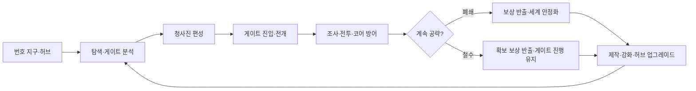

# 에르고스퀘어 종합 기획서

> [!IMPORTANT]
> **문서 상태**: 초안  
> **작성자**: 송예찬  
> **최종 수정일**: 2026-09-06  
> **프로젝트명**: `ERGOSQUARE: ARCHITECT` / `에르고스퀘어: 설계자`

이 문서는 프로젝트 전체를 처음부터 끝까지 읽을 수 있도록 정리한 종합 입문서입니다. 실제 수치, 예외 처리와 구현 완료 상태는 링크된 세부 기준 문서를 우선합니다.

## 문서 사용 규칙

| 표기 | 의미 |
| --- | --- |
| `확정 방향` | 현재 프로젝트가 유지할 핵심 원칙 |
| `초안` | 방향은 유효하지만 세부 검증이 필요한 내용 |
| `가안` | 프로토타입을 위한 임시 수치·명칭·연출 |
| `TBD` | 아직 결정하지 않은 항목 |
| `기획 해설` | 해당 장면이나 규칙을 둔 이유 |

> [!NOTE]
> 종합 기획서는 세부 명세를 대체하지 않습니다. 같은 내용이 충돌하면 조작은 [조작 시스템](../01_게임_기획/01_핵심_플레이/조작.md), 아이템은 [아이템·파츠 시스템](../01_게임_기획/01_핵심_플레이/아이템.md), 전개 계통은 [설계자 빌드 시스템](../01_게임_기획/02_에르고스퀘어/설계자_빌드.md), 튜토리얼은 [튜토리얼 프로토타입](../01_게임_기획/04_튜토리얼/README.md)을 우선합니다.

## Quick Links

[한 장 기획서](./프로젝트_한장_기획서.md) · [게임 핵심 기획서](./게임_핵심_기획서.md) · [통합 세계관 초안](./통합_세계관.md) · [핵심 플레이](../01_게임_기획/01_핵심_플레이/README.md) · [에르고스퀘어](../01_게임_기획/02_에르고스퀘어/README.md) · [튜토리얼](../01_게임_기획/04_튜토리얼/README.md) · [시나리오 개요](../02_세계관_및_콘텐츠/시나리오_개요.md)

---

# 제1부. 종합 기획

## 1. 게임 개요

### 1.1 기본 정보

| 항목 | 내용 | 상태 |
| --- | --- | --- |
| 프로젝트명 | `ERGOSQUARE: ARCHITECT` | 확정 방향 |
| 한국어명 | `에르고스퀘어: 설계자` | 확정 방향 |
| 개발 형태 | 1인 기획·개발 프로젝트 | 현재 상태 |
| 장르 | 월드 소유형 협동 샌드박스 / 실시간 액션 / 전략 배치 | 초안 |
| 플레이 인원 | 싱글 또는 1~4인 호스트 기반 친구 협동 | 초안 |
| 플랫폼 | PC Windows 우선 | 초안 |
| 엔진 | Unity / URP | 확정 방향 |
| 네트워크 | Photon PUN2 포함 기술 후보 검토 | TBD |
| 현재 단계 | 프리프로덕션 / 튜토리얼 버티컬 슬라이스 제작 | 현재 상태 |

### 1.2 한 줄 소개

> 지역과 사람의 기억을 읽어 이야기를 투영하는 게이트를 공략하고, 지나온 이야기의 힘을 파괴 가능한 전투 청사진으로 설계하는 1~4인 액션 RPG.

### 1.3 핵심 정의

> **인벤토리는 가방이 아니라 설계자의 전투 청사진이며, 전개된 강점은 동시에 지켜야 할 약점이다.**

플레이어는 코어, 장비, 수납, 방어와 보조 파츠를 격자형 청사진에 배치합니다. 청사진을 전개하면 파츠는 전장의 실제 구조물로 바뀌어 플레이어를 강화하지만 적에게 공격받을 수 있습니다. 따라서 빌드 구성, 공간 배치, 액션 전투와 전리품 보존이 하나의 판단으로 연결됩니다.

### 1.4 기획 의도

1. 플레이어가 만난 이야기와 존재의 힘을 조합해 자기 직군을 직접 설계합니다.
2. 강해지기 위해 전장에 약점을 노출하고, 그 약점을 지키는 긴장감을 만듭니다.
3. 장비 파밍을 단순 능력치 상승이 아니라 스킬 편성과 자원 호환의 선택으로 만듭니다.
4. 게이트의 설화와 폐쇄 조건을 전투 규칙에 연결합니다.
5. 철수와 월드 영구 사망을 통해 전진과 보존 사이의 판단을 유지합니다.

### 1.5 핵심 검증 질문

> 강한 빌드를 전장에 직접 꺼내고, 코어와 전리품을 지키면서 이야기의 힘을 조합하는 과정이 실제 플레이로 재미있는가?

---

## 2. 목표 사용자와 플레이 가치

### 2.1 핵심 사용자

- 액션 전투와 빌드 파밍을 함께 즐기는 플레이어
- 제한된 격자 안에서 장비와 공간을 최적화하는 플레이어
- 위험을 감수하고 더 깊이 진입하는 익스트랙션 구조를 선호하는 플레이어
- 신화·설화가 외형뿐 아니라 규칙으로 작동하는 세계를 선호하는 플레이어
- 싱글 완주와 소수 친구 협동을 모두 원하는 플레이어

### 2.2 제공 가치

| 가치 | 플레이 경험 |
| --- | --- |
| 설계 | 파츠를 배치해 자신의 아키텍처를 완성한다. |
| 긴장 | 코어와 주머니가 공격받기 때문에 강점과 전리품을 직접 지켜야 한다. |
| 발견 | 무기마다 다른 능력치와 스킬을 파밍하고 원하는 슬롯에 편성한다. |
| 관계 | 각성자·현현체와의 관계가 실제 설계 선택지로 남는다. |
| 재도전 | 철수 후 강화해 상위 몬스터와 게이트에 다시 도전한다. |
| 서사 | 전장을 조사하며 게이트가 기억을 왜곡한 과정을 알아낸다. |

### 2.3 현재 시장·운영 범위

시장 규모, 가격, 판매 목표와 경쟁작 정량 비교는 별도 조사 후 작성합니다. 현재 단계에서는 대규모 공용 월드, 거래소, UGC 시장과 청사진 라이선스 경제를 약속하지 않습니다.

---

## 3. 세계관 및 스토리

### 3.1 번호 지구

새 월드를 만들 때 고유 번호와 시드를 가진 지구가 생성됩니다. 주민에게 이곳은 복제 세계가 아니라 자신들이 살아온 유일한 현실입니다. 번호는 세이브와 관리자 시스템이 세계를 구분하기 위한 메타 식별자이며, 일반 주민은 인지하지 못합니다.

### 3.2 최초 침공과 대분기

최초의 외부 게이트 침공으로 인류가 멸망 위기에 놓였을 때 지구의 자아가 깨어났습니다. 지구는 가능한 현실을 예측하는 데 그치지 않고 실제 세계로 분기하여 침공을 분산시키고 서로 다른 생존 가능성을 만들었습니다. 이 사건을 `대분기`라고 부릅니다.

### 3.3 정본 지구

분기 중 하나는 자신만이 올바른 승리를 거둔 세계라고 주장하며 스스로를 `정본 지구`라 부릅니다. 정본 지구는 다른 번호 지구를 독립된 현실이 아니라 회수·병합할 수 있는 분기로 취급합니다.

정본 지구의 정확한 동기, 내부 세력과 생태계 붕괴 여부는 현재 `시나리오 초안`입니다. 단순한 자원 약탈자로 확정하기보다 자기 정당화와 생존 논리가 함께 작동하는 적대 세력으로 검토합니다.

### 3.4 게이트

게이트는 지역과 지성체에게 축적된 기억, 설화, 공포와 믿음을 읽어 이야기와 공간을 현실에 투영합니다.

| 유형 | 정의 |
| --- | --- |
| 정상 게이트 | 기억과 전승을 재료로 인물·사건·법칙을 투영합니다. |
| 폭주 게이트 | 이야기의 상징을 실제 육체·영혼으로 대체해 왜곡합니다. |
| 잠복 게이트 | 기존 예측 체계에 잡히지 않은 채 성장하다 돌발적으로 전조와 폭주를 일으킵니다. |
| 앵커 게이트 | 지구의 현실 좌표와 정본화 과정에 직접 연결된 핵심 거점입니다. |
| 최후의 게이트 | 정본화 관리자 시스템으로 향하는 최종 연결로입니다. |

게이트의 목표는 항상 섬멸이 아닙니다. 조사, 구조, 계약, 의식, 사건 해결, 보스 처치와 앵커 귀속 등 이야기마다 다른 폐쇄 조건을 가집니다.

### 3.5 이면

이면은 인간이 이해할 수 있는 이데아나 단일한 신이 아닙니다. 인간 또는 지성체가 되기를 원하는 무언가인지, 여러 존재가 살아가는 생태계인지조차 확정할 수 없는 심연입니다. 인간이 이면을 관측하자 이면 또한 인간을 관측했고, 이해할 수 없던 형상을 인간이 알아볼 수 있는 이야기와 물건의 모습으로 바꾸기 시작했습니다.

이면의 정체, 의도, 최초 관측, 게이트 생성 의지, 인간화에 성공한 존재와 공존 가능성은 본편 이후까지 남겨 둘 미스터리입니다.

### 3.6 각성자·설계자·현현체

| 명칭 | 정의 |
| --- | --- |
| 각성자 | 지구 각성 이후 초자연적 힘이 발현한 인간 전체의 총칭 |
| 설계자 | 에르고스퀘어를 운용하는 희귀 각성자에게 부여되는 작전 코드네임이자 플레이어 호칭 |
| 현현체 | 인간의 전승과 믿음에서 독립된 자아와 실체를 얻어 현실에 태어난 존재 |
| 게이트 투영체 | 게이트가 기억을 바탕으로 일시적으로 구현한 존재 |
| 폭주 유출 개체 | 폭주 규칙으로 만들어져 게이트 밖까지 유출된 개체 |

자연 발생 도깨비는 오랜 시간 사람의 정이 깃든 정상적인 현현체입니다. 폭주 게이트가 강제로 만든 영혼 주입형 개체와 구분합니다.

### 3.7 장기 목표

플레이어는 일반 게이트에서 공명 기록과 좌표를 모아 핵심 앵커 게이트를 찾습니다. 앵커를 파괴하는 대신 자신의 지구에 다시 귀속시키고, 최후의 게이트를 열어 관리자 시스템에서 자신의 지구를 정본화 대상에서 독립시킵니다.

앵커의 최종 개수와 문화권별 이야기 배치는 `TBD`입니다. 경계·기억·계약·재앙·생명은 기능 후보이며 반드시 5개로 고정하지 않습니다.

---

## 4. 핵심 플레이 구조

### 4.1 전체 장기 루프



세부 기준은 [전체 장기 플레이 루프](../01_게임_기획/01_핵심_플레이/전체_장기_플레이_루프.md)를 따릅니다.

### 4.2 순간 전투 루프

```text
적의 패턴과 표적 확인
→ 이동·기본 공격으로 대응
→ 코어 위치와 손상 상태 확인
→ 생성 자원을 액티브 스킬에 소비
→ 플레이어·코어·주머니 중 무엇을 보호할지 선택
→ 전리품을 확보하고 다음 조우 또는 철수 판단
```

### 4.3 기본 조작

| 입력 | 기능 |
| --- | --- |
| 우클릭 / 길게 누르기 | 커서를 따라 지정 지점 이동 |
| 좌클릭 | 기본 공격 또는 위치 지정 아이템 확정 |
| `QWERASDF` | 편성한 액티브 스킬 8칸 |
| `Space` 길게 누르기 | 정신 집중: 행동을 멈추고 느리게 자원 회복 |
| `G` | 조사·대화·구조·장치 상호작용 |
| `1~4` | 소비 아이템 |
| `B` | 가방과 획득품 확인 |
| `Tab` | 에르고스퀘어 전개 모드 |
| `Alt` | 바닥 아이템 정보 |
| `Esc` | 현재 모드 취소 또는 메뉴 |

공통 회피 키는 두지 않습니다. 회피, 돌진, 방어와 반격은 장비에 붙은 액티브 스킬로 편성합니다. `Space` 정신 집중은 코어 전개 전후 모두 쓸 수 있지만 느리고 피격 위험이 큰 비효율적 보조 회복 수단입니다.

### 4.4 에르고스퀘어와 청사진

청사진은 파츠와 직접 수납 재료를 배치하는 격자입니다. `아키텍트`가 파츠를 조합해 완성한 전체 빌드를 `아키텍처`라고 부릅니다.

| 요소 | 역할 |
| --- | --- |
| 코어형 파츠 | 자원, 전개 계통, 활성 기초 능력치와 고유 메커니즘 제공 |
| 장비형 파츠 | 무기·방어구의 기초 성능과 액티브 스킬 제공 |
| 보조형 파츠 | 패시브, 코어 강화, 스킬 변형, 수납과 방호 제공 |
| 소비형 파츠 | 회복제·활성제처럼 사용 후 수량이 감소하는 편성 아이템 |
| 재료 | 제작·강화·복구와 허브 시설 업그레이드에 소비 |

전개된 파츠는 충돌과 내구도를 가진 월드 오브젝트입니다. 방패와 엄폐물로 쓸 수 있지만 파괴되면 기능을 잃습니다.

### 4.5 청사진 공간 경제

튜토리얼의 설계자 1레벨 청사진은 `3×3`입니다. 근접 계통은 중앙 한 칸이 설계자 원점으로 고정되므로 실제 배치 가능 공간은 8칸입니다.

| 레벨 예시 | 청사진 크기 | 설계 의도 |
| ---: | ---: | --- |
| 1 | `3×3` | 코어·전투·수납·방어의 기본 경쟁 |
| 2 | `3×4` | 한 줄 확장 |
| 3 | `4×4` | 복수 기능 조합 시작 |
| 4 | `4×5` | 수납·방호 선택 확대 |
| 5 | `5×5` | 중형 아키텍처 구성 |

5레벨 이후 최종 크기와 확장 방향은 `TBD`입니다. 청사진 칸이 늘어도 액티브 스킬 입력은 `QWERASDF` 8개로 유지합니다.

### 4.6 전개 계통

근접·투사·영역은 고정 직업이나 무기 제한이 아니라 코어에 붙는 전개 거리 규칙입니다. 같은 코어 원형도 서로 다른 계통으로 드롭될 수 있으며 코어를 교체하면 현재 직군이 바뀝니다.

| 계통 | 전개 규칙 | 핵심 위험 |
| --- | --- | --- |
| 근접 | 플레이어 주변에 전개 | 자신과 코어가 함께 전선에 노출 |
| 투사 | 플레이어 주변 `3×3` 바깥에 공격 설계 전개 | 최소 사거리·사선·분리된 코어 관리 |
| 영역 | 원거리 지점에 지속 현상과 구조 전개 | 범위와 발동 시점, 아군 영향 관리 |

### 4.7 코어

코어는 직군, 자원 종류, 활성 기초 능력치와 문화권별 성장 메커니즘을 연결하는 빌드의 중심입니다.

- 같은 코어 원형에도 근접·투사·영역 중 하나의 계통이 드롭 결과로 붙을 수 있습니다.
- 공격력, 체력, 방어력, 이동·공격 속도 등 기초 능력치 범위에 랜덤성을 줄 수 있습니다.
- 고유 행동을 바꾸는 효과는 기초 옵션이 아니라 별도의 특수 능력으로 관리합니다.
- 손상되면 자원 생성 효율이 낮아지고 파괴되면 자원·스킬·활성 능력치가 정지합니다.
- 코어 파괴 후에도 이동, 기본 공격과 상호작용은 유지되어 철수를 시도할 수 있습니다.
- 게이트 내부 완전 복구는 불가능하며 허브 시설에서 수리합니다.

튜토리얼 보장 코어 가안은 `낡은 정기의 혼 코어 [근접]`, 크기 `1×1`입니다.

### 4.8 장비·스킬·자원 호환

장비에는 드롭 시 기초 능력치와 액티브 스킬 후보가 무작위로 부여됩니다. 플레이어는 원하는 스킬을 8개 슬롯에 편성합니다. 기본 공격은 자원을 소비하지 않지만 액티브 스킬은 연결된 코어 자원을 소비합니다.

문화권과 계통에 따라 자원 표현과 성장 문법이 달라집니다.

- 한국 도깨비 장비: 물건과의 유대가 쌓이며 장비가 성장하는 방향
- 한국 무속 장비: 한과 신력의 배분, 신과의 관계를 코어 운용에 연결하는 방향
- 중국 무공 장비: 무기 사용과 수행이 내공 코어를 강화하는 방향
- 중국 강시 계통: 강시를 장비화했다면 코어보다 해당 개체의 강화가 중심이 될 수 있음

위 항목은 문화권을 단일 이미지로 고정하지 않는 `설계 방향 초안`입니다. 조사와 플레이 검증 전까지 세부 사실로 확정하지 않습니다.

자원 각인이 다른 장비는 자동 변환되지 않습니다. 플레이어는 해당 자원을 생성하는 코어로 교체하거나, 장비를 해체해 재료와 각인 요소를 얻은 뒤 현재 코어에 맞게 재제작합니다. 이 규칙은 서로 다른 문화권 빌드를 섞는 데 비용과 준비를 부여합니다.

### 4.9 수납과 주머니

재료는 주머니 없이도 운반할 수 있지만 기본 가안에서는 재료 하나가 청사진 한 칸을 차지합니다. 주머니는 여러 재료를 적은 공간에 압축 수납하지만 전개 후 공격받습니다.

- 주머니가 파괴되면 내부 재료는 반출할 수 없습니다.
- 여러 작은 주머니는 위험을 분산하지만 더 많은 칸을 차지합니다.
- 큰 주머니는 공간 효율이 좋지만 한 번의 손실이 큽니다.
- 방어 플레이트를 코어에 둘지 주머니에 둘지가 빌드 판단이 됩니다.

### 4.10 소비 아이템

초기 소비 아이템은 두 종류만 사용합니다.

| 아이템 | 기능 |
| --- | --- |
| 응급 회복제 | 플레이어 체력 회복 |
| 코어 활성제 | 현재 전개된 코어 자원을 즉시 일정량 충전 |

코어 전개 시 보유 자원은 초기화되지 않습니다. 모든 빌드가 처음부터 자동 생성 자원을 확보하는 것은 아니므로 정신 집중과 코어 활성제가 초반 스킬 사용을 보조합니다.

### 4.11 적 AI와 위협도

플레이어, 코어, 주머니와 주요 전개물은 각각 위협도와 표적 가중치를 가집니다. 초기 예시는 코어의 기본 위협도 `50`, 플레이어 스킬 사용 `+30`, 공격 적중 `+30`, 초당 `-5` 감소입니다. 정확한 수치는 `가안`입니다.

적 유형에 따라 위협도 반응을 다르게 합니다.

- 일반 적: 가장 높은 유효 위협 대상을 선택
- 코어 압박형: 코어 고정 가중치가 높음
- 약탈형: 주머니와 수납 파츠를 우선
- 반격형: 자신을 공격한 플레이어의 가중치가 크게 증가
- 보스: 패턴별로 표적 규칙을 명시적으로 전환

### 4.12 철수·사망·월드 종료

- 게이트는 전멸 전이라면 언제든 철수를 시도할 수 있습니다.
- 철수는 짧은 연결 시간이 필요하고 피격 또는 다른 행동으로 취소됩니다.
- 철수해도 게이트는 열린 채 시간과 폭주 단계가 진행됩니다.
- 싱글 사망 또는 협동 파티 전멸은 해당 번호 지구의 게임오버입니다.
- 종료된 월드의 장비, 자원과 해금은 새 지구로 이전하지 않습니다.
- 협동에서 개인 체력 0은 즉시 사망이 아니라 `중상`이며 아군 구조 또는 파티 철수를 기다립니다.

### 4.13 보상과 성장

하위 몬스터를 반복 처치하면 같은 단계의 장비와 일반 재료를 얻습니다. 상위 강화와 등급 돌파에는 정예·보스 등 더 강한 적의 장비 또는 촉매가 필요합니다. 하위 재료의 양만으로 상위 단계를 건너뛸 수 없습니다.

```text
현재 단계 몬스터 공략
→ 장비·재료 확보
→ 철수 또는 게이트 폐쇄
→ 허브에서 제작·강화·복구
→ 상위 몬스터와 게이트 도전
```

정해진 허브의 시설을 업그레이드하는 구조를 사용합니다. 완전 자유 건축형 하우징은 현재 범위가 아닙니다.

---

## 5. 인터페이스 구성

### 5.1 인게임 HUD

- 하단 중앙: `QWERASDF` 액티브 스킬 8칸
- 스킬 영역 인접: `Space` 정신 집중 안내
- 하단 좌측: 플레이어 체력
- 하단 우측 또는 코어 인접 영역: 현재 자원과 코어 상태
- 별도 단축 영역: `1~4` 소비 아이템
- 상호작용 대상: 대상 위에 `G`와 행동 동사 표시
- 전리품 위험: 주머니 손상·파괴와 반출 가능 변화 우선 경고

정신 집중 전용 게이지는 만들지 않습니다. 정신 집중은 별도 자원이 아니라 현재 코어 자원을 회복하는 입력입니다.

### 5.2 청사진 편집

- 보유 파츠를 선택한 뒤 좌클릭으로 배치할 수 있습니다.
- 보유 파츠에서 청사진으로 직접 드래그 앤 드롭할 수 있습니다.
- 장비형 파츠 위에 커서를 올린 채 `QWERASDF`를 눌러 스킬 슬롯을 할당합니다.
- 코어, 주머니, 방어 플레이트와 장비가 같은 격자 공간을 경쟁합니다.
- 파츠의 크기, 회전, 점유 칸, 연결과 파괴 시 손실을 미리 보여줍니다.

### 5.3 전개 화면

`Tab`을 누르면 게임을 가리는 별도 인벤토리 화면이 아니라 현재 필드 위에 전개 오버레이가 나타납니다.

- 필드 전체에 같은 셀 크기의 옅은 격자가 투영됩니다.
- 현재 코어 계통과 위치에서 전개 가능한 범위만 강조합니다.
- `2×2` 파츠는 서로 다른 크기의 셀이 아니라 동일한 네 칸을 하나의 파츠 영역으로 묶어 표시합니다.
- 배치 가능, 충돌, 경사, 차단과 위험 상태를 색상뿐 아니라 선·아이콘으로도 구분합니다.
- 근접 계통의 중앙은 설계자 원점이지만 투사·영역 계통은 각 계통 규칙에 맞는 별도 안내를 사용합니다.

### 5.4 해상도 대응

Unity Canvas와 `Canvas Scaler`를 기준으로 HUD를 구성하고 앵커를 화면 가장자리와 중앙 기능군에 맞춥니다. 단일 해상도에 맞춘 이미지 한 장을 UI로 사용하지 않습니다. 콘셉트 이미지는 배경·아이콘·장식 에셋으로 분리해 사용합니다.

---

## 6. 맵 및 콘텐츠 디자인

### 6.1 장기 월드

- 플레이어 소유의 번호 지구와 고정 허브
- 게이트 발생 지역 탐색
- 일반 게이트에서 좌표·공명 기록 수집
- 핵심 앵커 게이트 발견과 귀속
- 최후의 게이트 개방

월드의 실제 규모, 절차 생성 범위와 지역 수는 `TBD`입니다.

### 6.2 게이트 콘텐츠 제작 원칙

1. 지역의 기억과 전승이 공간·적·규칙에 반영되어야 합니다.
2. 원전 조사와 게임적 재해석을 구분해 기록합니다.
3. 문화권은 단순 외형 스킨이 아니라 자원, 성장과 금기의 작동 방식에 영향을 줍니다.
4. 한 문화의 존재를 선악 또는 하나의 직군으로 고정하지 않습니다.
5. 게이트 투영체, 폭주 개체와 현실의 현현체를 구분합니다.

### 6.3 한국 콘텐츠의 현재 방향

도깨비 계통은 사람의 정이 밴 물건과 유대의 성장을 중심으로 검토합니다. 평상형 물건 도깨비는 파란 도깨비불과 본체 물건이 하나의 개체를 이루며, 친근한 첫인상을 통해 플레이어가 장비와 관계를 맺게 합니다.

터주신·성주신·조왕신 등의 가신과 장승·서낭·솟대 등의 마을 수호 전승은 도깨비와 다른 `터전 수호 계통`으로 관리합니다. 가택 수호와 마을 경계라는 공간 규칙을 전개 계통과 연결할 수 있습니다.

### 6.4 튜토리얼 맵 방향

- 전체 분위기: 현실 기억이 뒤틀린 동굴형 게이트
- 초반: 좁은 이동·조사 구간
- 중반: 코어·주머니·방어 플레이트를 전개할 평탄한 전투 구간
- 후반: 토벌팀 시체와 기록이 이어지는 탐사 구간
- 종점: 초가집과 월도를 든 병사가 보이는 보스 구역
- 보스방: 근접 `3×3` 전개와 월도 횡베기를 읽을 수 있는 원형 또는 팔각형 공간

`서울 지하상가`는 안티그래비티 초안에서 제시된 대체 도입 배경이지만 현재 튜토리얼 기준으로 확정하지 않습니다. 현실 도입 세트와 동굴형 내부를 분리할지 후속 레벨 디자인에서 결정합니다.

---

## 7. 개발 전략

### 7.1 현재 P0 목표

> 평범한 생존자가 잠복 게이트에서 에르고스퀘어를 처음 전개하고, 코어와 전리품을 지키며 월도를 처치한 뒤 게이트를 닫는 15~25분 규모의 싱글 튜토리얼을 완주 가능하게 만든다.

### 7.2 튜토리얼 포함 범위

| 영역 | P0 범위 |
| --- | --- |
| 조작 | 우클릭 이동, 좌클릭 기본 공격, `QWERASDF`, `Space`, `G`, `Tab`, `B`, `1~2` |
| 카메라 | 아이소메트릭 쿼터뷰, Cinemachine 기반 추적 |
| 청사진 | 1레벨 `3×3`, 중앙 원점, 1×1 근접 코어, 주머니, 방어 플레이트 |
| 장비 | 첫 무기와 빗자루 파츠 프로토타입, 스킬 편성 |
| 자원 | 정신 집중, 코어 자동 생성, 코어 활성제 |
| 적 | 기억 투영형·영혼 주입형 도깨비, 월도 보스 |
| 서사 | 기억 파편, 토벌팀 기록, 영혼 안정화, 설계자 명명 |
| UI | HUD, 상호작용 안내, 청사진 편집, 필드 전개 오버레이 |

### 7.3 제외 범위

- 본격적인 허브 업그레이드와 오픈월드
- 1~4인 네트워크 동기화
- 다수 문화권과 앵커 게이트 본편
- 완성형 제작 경제와 장기 희귀도
- 거래소, UGC 시장과 청사진 판매
- 컨트롤러 최종 매핑

### 7.4 권장 구현 순서

1. 이동·카메라·충돌·상호작용
2. 기본 공격·피격·적 표적
3. 아이템 획득과 빗자루 파츠 데이터
4. 청사진 편집과 스킬 슬롯 할당
5. 필드 격자와 파츠 전개
6. 코어 자원·정신 집중·스킬 소비
7. 코어·주머니·방어 플레이트 피격과 파괴
8. 튜토리얼 TUT-00~08 진행 상태
9. 일반 도깨비 조우와 월도 보스
10. 결과·폐쇄·복귀와 저장

### 7.5 주요 위험

| 위험 | 대응 방향 |
| --- | --- |
| 청사진과 액션의 규칙 과밀 | 튜토리얼에서 기능을 필요 직전에 하나씩 개방 |
| 파츠 파괴가 불쾌한 손실로만 작동 | 위험 예고, 철수 선택과 배치 수정 정보를 제공 |
| 문화권 혼합이 피상적인 스킨이 됨 | 자원·성장·관계·금기까지 시스템으로 구분 |
| 월드 영구 사망의 피로 | 언제든 철수 가능, 실패 원인과 다음 판단을 명확히 제공 |
| 원화의 실시간 구현 비용 | 실루엣·전조·핵심 상징부터 단계적으로 구현 |
| 협동이 싱글을 훼손 | 모든 필수 기능은 싱글로 완주 가능하게 설계 |

---

## 8. 운영 및 확장 방향

### 8.1 콘텐츠 확장

- 한국 이후 중국, 일본, 미국 등 문화권별 장비·코어·스킬 문법 확장
- 일반 게이트와 앵커 게이트의 목적·폐쇄 조건 다양화
- 각성자 NPC와 현현체 관계를 통한 안정 설계 해금
- 서로 다른 계통의 해체·재제작을 통한 융합 아키텍처
- 다른 번호 지구와 이면은 본편 완료 이후 후보로 보류

### 8.2 제작 범위 통제

모든 조합에 전용 스킬을 만들지 않습니다. 공통 태그가 범위·속성·발동 조건을 변형하고, 의미가 강하게 맞물리는 일부 조합만 고유 이름과 연출을 가진 `융합 설계`로 제작합니다.

### 8.3 현재 비목표

- MMORPG형 상시 공용 월드
- 대규모 공개 매칭 중심 구조
- 플레이어 간 자유 거래 경제
- 현금 가치와 연결되는 아이템 소유권
- 무제한 생성형 퀘스트를 핵심 콘텐츠로 사용

---

# 제2부. 메인 시나리오

## 9. 전체 시놉시스

최초의 외부 침공 당시 지구의 자아는 인류를 보존하기 위해 현실을 여러 번호 지구로 분기했습니다. 시간이 흐른 뒤 한 분기 세계가 자신을 유일한 정본이라 선언하고 다른 지구를 강제로 병합하기 시작합니다.

플레이어는 예측되지 않은 잠복 게이트 폭주에 휘말린 평범한 시민입니다. 게이트 내부에서 자기 인식을 잃지 않은 플레이어에게 현실을 격자로 고정하는 에르고스퀘어가 발현됩니다. 플레이어는 토벌팀의 기록을 따라 폭주 게이트가 시민의 영혼을 물건에 주입했다는 사실을 알아내고, 월도의 기억으로 만들어진 거대한 병사형 도깨비를 쓰러뜨려 영혼을 해방합니다.

현실로 돌아온 플레이어는 기관으로부터 `설계자`라는 코드네임을 받습니다. 이후 일반 게이트를 해결하며 현현체와 각성자를 만나고, 이들의 힘을 빼앗는 대신 관계·계약·연구를 통해 자신의 청사진으로 모사합니다. 수집한 공명 기록은 현실 깊숙이 박힌 앵커 게이트와 정본화 관리자 시스템의 존재를 드러냅니다.

플레이어는 앵커를 무작정 파괴하지 않고 자신의 지구에 귀속시킵니다. 최후의 게이트를 통해 관리자 시스템에 도달한 뒤 자신의 지구를 독립된 현실로 등록하여 강제 병합을 중단합니다. 다른 번호 지구의 구조 신호와 인간을 닮아 가는 이면은 엔딩 이후의 미스터리로 남습니다.

## 10. 정보 공개 구조

| 단계 | 플레이어가 아는 것 | 아직 숨기는 것 |
| --- | --- | --- |
| 튜토리얼 | 게이트는 사람을 삼키며 자신은 공간을 전개할 수 있다. | 대분기·정본 지구·이면의 정체 |
| 초반 | 게이트마다 이야기와 폐쇄 조건이 다르다. | 앵커와 병합 과정 |
| 중반 | 앵커가 지구의 현실 좌표에 연결되어 있다. | 침공 주체의 정체와 목적 |
| 후반 | 정본 지구가 다른 지구를 병합하고 있다. | 관리자 시스템 내부와 최종 선택 |
| 결말 | 자신의 지구를 독립시킬 수 있다. | 이면과 다른 번호 지구의 장기적 결말 |

## 11. 본편 장 구성 초안

### 프롤로그 — 최초의 잠복 게이트 생환

도깨비 잠복 게이트에서 에르고스퀘어가 발현되고 플레이어가 설계자로 분류됩니다. 상세 내용은 제3부 튜토리얼 플롯을 따릅니다.

### 제1장 — 반복되는 게이트와 허브

플레이어는 기관의 관찰 아래 일반 게이트를 해결하고 고정 허브 시설을 복구합니다. 현실의 자연 발생 도깨비, 각성자와 현현체를 만나며 게이트 투영체와 독립된 존재의 차이를 배웁니다. 관계와 연구가 새로운 파츠·스킬 설계를 해금합니다.

### 제2장 — 최초의 앵커

일반 게이트에서 모은 공명 기록이 핵심 앵커의 위치를 가리킵니다. 앵커를 파괴하면 지역의 현실 좌표가 함께 무너질 수 있음을 알아내고, 설계자 권한으로 통제권을 자신의 지구에 귀속시키는 방법을 찾습니다.

### 제3장 — 앵커 공략

서로 다른 지역과 문화권의 기억을 가진 앵커 게이트를 공략합니다. `경계·기억·계약·재앙·생명`은 앵커 기능 후보이며 최종 개수, 순서와 설화 배치는 제작 범위에 맞춰 결정합니다.

### 제4장 — 정본화의 진실

회수한 관리자 기록을 통해 침공 주체가 대분기에서 갈라진 형제 지구임을 확인합니다. 정본 지구의 명분과 내부 갈등을 공개하고, 플레이어 지구가 실패작이나 복제물이 아니라 독립된 현실임을 서사의 중심에 둡니다.

### 최종장 — 최후의 게이트

귀속한 앵커로 연결의 방향을 뒤집고 관리자 시스템에 진입합니다. 최종 적과의 충돌은 단순 화력전뿐 아니라 서로의 청사진을 노출하고 파괴하는 설계자 대 설계자의 전투로 구성합니다.

### 에필로그 — 우리가 살아가는 현실

플레이어의 지구는 정본화 대상에서 벗어납니다. 주민은 번호를 알지 못한 채 자신들의 일상을 회복합니다. 다른 번호 지구의 신호와 이면의 시선은 확장 가능성으로 남기되 본편의 승리를 무효화하지 않습니다.

---

# 제3부. 튜토리얼 시나리오와 기획 해설

## 12. 튜토리얼 개요

### 12.1 목표

> 잠복 게이트에 흡인된 평범한 생존자가 에르고스퀘어를 처음 전개해 영혼을 구조하고 게이트를 닫은 뒤 설계자로 판명되는 과정을 하나의 플레이 가능한 튜토리얼로 만든다.

### 12.2 사건 배경

기관은 기존 게이트가 열릴 지점을 전조 단계에서 예측해 대응해 왔습니다. 그러나 이번 게이트는 관측되지 않은 채 잠복하다 갑자기 전조와 폭주를 일으켰습니다. 기관은 토벌팀을 급파해 외부로 유출된 개체를 제압하고 내부로 진입시켰지만, 팀은 보스 월도를 남긴 채 전멸했습니다.

플레이어는 그 뒤 게이트에 흡인되어 토벌팀의 시체와 기록을 하나씩 발견합니다. 기록은 사건을 설명하는 내레이션이 아니라 플레이어의 이동 경로와 기능 보상을 유도하는 레벨 디자인 장치로 사용합니다.

### 12.3 유물 기록

```text
[유물 조사 기록]

조선 시대에 제작된 것으로 추정되는 월도.
지역에서는 전쟁 당시 한 병사가 사용한 무기라고 전해지지만,
이를 입증할 기록은 발견되지 않았다.
```

```text
[구전 기록]

월도의 날에는 전쟁에서 죽은 사람들의 피가 남아 있으며,
밤이 되면 죽은 병사가 무기를 되찾으러 온다고 전해진다.
```

튜토리얼 종료 후 기관 분석 장면에서 다음 해석을 공개합니다.

```text
[이면 해석 기록]

게이트는 ‘많은 생명을 죽인 무기’를
‘많은 생명을 담을 수 있는 그릇’으로 해석했다.
흡인한 시민의 영혼이 월도에 계속 주입되면서
거대한 병사 형태의 도깨비가 형성되었다.
```

> [!NOTE]
> 월도를 특정 전쟁의 실사용 무기로 단정하지 않습니다. 역사적 기록이 아니라 지역 구전과 게이트가 읽은 기억이 보스 형상의 재료가 되었다고 설명합니다.

## 13. 플롯별 시나리오

### TUT-00. 기상

암전 속에서 비명, 금속 마찰음과 거대한 흡인음이 겹칩니다. 플레이어는 차가운 동굴 바닥에서 눈을 뜹니다. 기억은 끊겨 있고, 멀리 파란 불빛과 부서진 생활 도구가 보입니다.

플레이어는 우클릭으로 첫 흔적까지 이동합니다. 카메라는 캐릭터를 따라가되 출구 대신 안쪽으로 이어지는 길과 이상한 격자 잔상을 한 번 보여줍니다.

> [!TIP]
> **기획 해설**: 컷신으로 세계관을 설명하지 않고 이동 자체로 `갇혔다`는 상태를 먼저 이해시킵니다. 이 장면에서는 이동 외의 새 조작을 요구하지 않습니다.

### TUT-01. 기억의 파편

플레이어는 휴대전화, 작업용 명찰과 떨어진 신발 같은 세 개의 흔적을 `G`로 조사합니다. 각 조사마다 아르바이트 종료, 불안정한 조명, 거리 위에 겹친 낯선 윤곽과 사람들의 흡인이 2~5초의 파편으로 재생됩니다.

마지막 회상에서 플레이어는 자신도 사람들과 함께 게이트로 끌려왔음을 깨닫습니다.

> [!TIP]
> **기획 해설**: 기억 파편은 서사 회수와 상호작용 학습을 겸합니다. 긴 회상을 반복 재생하지 않도록 조사 완료 상태를 저장합니다.

### TUT-02. 첫 위협

작고 파란 도깨비불이 낡은 빗자루 곁에서 모습을 드러냅니다. 처음에는 귀엽고 장난스러워 보이지만 게이트의 명령에 끌려 플레이어를 공격합니다. 플레이어는 우클릭 이동으로 쓸기 전조를 피하고, 임시 무기 또는 첫 장비형 파츠의 기본 공격을 좌클릭으로 사용합니다.

위기가 커지면 손상된 시스템 메시지가 나타납니다.

```text
[현실 좌표를 확인할 수 없습니다.]
[생존 개체 확인.]
[개체의 자기 인식이 유지되고 있습니다.]
[현실 고정 권한을 요청합니다.]
[긴급 현실 고정 인터페이스를 전개합니다.]
```

> [!TIP]
> **기획 해설**: 물건 도깨비의 첫인상은 완전한 공포가 아니라 관계와 성장 가능성을 남기는 귀여움이어야 합니다. 이후 영혼 주입형의 왜곡이 같은 소재를 얼마나 비극적으로 바꾸는지 대비시킵니다.

### TUT-03. 좌표 고정

플레이어 앞의 바닥에 옅은 격자가 퍼집니다. `Tab`을 누르면 필드 전체의 동일한 크기 셀이 보이고, 현재 근접 코어가 허용하는 `3×3`만 강하게 강조됩니다. 중앙 칸에는 설계자 원점이 고정됩니다.

플레이어는 획득한 장비 스킬을 청사진 편집 화면에서 확인하고 원하는 `QWERASDF` 슬롯에 할당합니다.

> [!TIP]
> **기획 해설**: 출격 전 준비 화면과 현장 전개 화면을 구분합니다. 편집은 HUD의 `청사진 편집`에서 수행하고, `Tab`은 준비된 청사진을 현재 필드에 전개하는 입력입니다.

### TUT-04. 첫 전개

플레이어는 `낡은 정기의 혼 코어 [근접]`, 작은 주머니와 방어 플레이트를 제한된 칸에 배치합니다. 코어는 `1×1`, 방어 플레이트는 `1×2` 가안이며 중앙 설계자 원점에는 어떤 파츠도 둘 수 없습니다.

전개 전 정신 집중으로 모은 자원이 있다면 그대로 유지됩니다. 코어가 활성화되면 더 빠른 자동 생성이 시작되고 장비 액티브 스킬을 사용할 수 있습니다.

> [!TIP]
> **기획 해설**: 정신 집중은 별도 게이지나 성장 축이 아니라 코어 전후에 사용할 수 있는 느리고 위험한 보조 회복입니다. 코어를 전개하는 이유는 자원 초기화가 아니라 압도적인 효율 차이에서 나옵니다.

### TUT-05. 전개물 방어

새로운 도깨비 무리가 플레이어와 코어를 번갈아 노립니다. 플레이어가 스킬을 사용하고 공격을 적중시키면 위협도가 상승해 적의 시선을 가져올 수 있습니다. 시간이 지나면 위협도가 떨어져 적이 다시 코어를 노립니다.

일부 적은 작은 주머니를 압박합니다. 플레이어는 코어, 전리품과 자신의 체력 중 무엇을 먼저 지킬지 선택합니다. 전투대원과 기술요원의 흔적에서 응급 회복제와 코어 활성제를 얻어 `1`, `2` 입력을 익힙니다.

> [!TIP]
> **기획 해설**: 코어는 보호 대상이면서 임시 방패입니다. 주머니는 파밍 욕구를 공간적 위험으로 바꿉니다. 이 전투에서 두 대상의 경고가 동시에 너무 많이 발생하지 않도록 순차적으로 가르칩니다.

### TUT-06. 남겨진 토벌팀

전투가 잦아든 길을 따라 토벌팀 시체가 순서대로 배치되어 있습니다. 정찰대원은 외부 유출 개체에 영혼 반응이 없었다는 기록을, 전투대원은 내부 개체가 기존 투영체와 다르다는 기록을 남겼습니다. 기술요원의 장비는 물건 내부에서 인간 생존 신호를 검출합니다.

플레이어는 쓰러진 영혼 주입형 도깨비의 잔해에서 `G`를 길게 눌러 영혼을 안정화합니다. 조사관의 시체에서는 월도 유물 조사 기록을, 팀장의 시체에서는 보스와 교전하지 말라는 철수 경고와 게이트 폐쇄 인증을 얻습니다.

멀리 초가집과 그 앞에 선 거대한 병사 형상이 보입니다. 병사의 손에는 월도가 들려 있습니다.

> [!TIP]
> **기획 해설**: 토벌팀의 죽음은 기관의 무능을 위한 장치가 아닙니다. 예상하지 못한 잠복 게이트, 외부 토벌 후 내부 진입, 폭주 규칙의 뒤늦은 발견이라는 순서로 희생의 개연성을 만듭니다. 기록마다 기능 아이템을 함께 배치해 탐색 보상을 유지합니다.

### TUT-07. 사람을 죽인 도깨비 — 월도

월도는 얼굴 없는 거대한 병사 형상이며 낡은 갑옷 안쪽에 여러 영혼이 결박되어 있습니다. 가슴의 결박핵과 무기는 선으로 연결되어 있습니다. 여러 병사의 발걸음이 겹쳐 들리며 보스가 전진합니다.

1페이즈에서는 횡베기, 처형 내려찍기와 전진 베기로 이동과 전조 판독을 시험합니다. 2페이즈에서는 영혼 결박과 코어 돌진으로 플레이어와 코어 사이의 선택을 만듭니다. 3페이즈에서는 기존 패턴을 빠르게 연결하고 주머니를 압박해 전리품 보존 판단까지 시험합니다.

월도의 체력이 0이 되어도 게이트는 자동으로 닫히지 않습니다. 병사 형상이 무너진 자리에 월도 잔해와 다중 영혼 결박핵이 남습니다.

> [!TIP]
> **기획 해설**: 보스는 새 시스템을 추가하는 구간이 아니라 튜토리얼에서 배운 이동, 스킬 자원, 코어와 주머니 방어를 종합하는 시험입니다. `어둑시니`를 월도와 병기하는 안은 현재 채택하지 않습니다.

### TUT-08. 영혼 해방과 복귀

플레이어는 결박핵에 `G`를 길게 눌러 영혼을 해방합니다. 월도 잔해와 폐쇄 인증이 반응하며 게이트의 이야기 조건이 끝납니다. 격자가 무너지고 공간이 현실의 거리로 되돌아갑니다.

통제선 너머의 기관 조사관과 각성자 요원이 플레이어의 전개 흔적을 확인합니다.

> “등록된 각성 유형과 일치하지 않습니다. 현장 자체를 설계한 것에 가깝습니다.”
>
> `신규 각성 분류 등록 — ARCHITECT / 코드네임: 설계자`

기관 분석 과정에서 게이트가 월도를 `많은 생명을 담는 그릇`으로 오독했다는 이면 해석 기록을 제시합니다. 플레이어가 다음 게이트를 닫아야 하는 이유와 자신이 잠복 게이트의 유일한 생환자라는 위치를 남기고 튜토리얼을 끝냅니다.

> [!TIP]
> **기획 해설**: 보스 처치, 영혼 구조와 게이트 폐쇄를 분리해 전투 승리가 곧 사건 해결은 아니라는 게임의 원칙을 보여줍니다. 이면과 정본 지구의 정답은 아직 설명하지 않습니다.

## 14. 튜토리얼 드롭과 기능 보상

| 구간 | 보상 | 학습 기능 |
| --- | --- | --- |
| TUT-02 | 첫 장비형 파츠 / 기본 공격 | 좌클릭 공격 |
| TUT-03 | 장비 부여 스킬 | `QWERASDF` 편성 |
| TUT-04 | 1×1 근접 코어·주머니·방어 플레이트 | 청사진과 전개 |
| TUT-05 | 응급 회복제·코어 활성제 | 소비 아이템과 자원 보완 |
| TUT-05~06 | 기억 잔재·도구 파편 | 직접 수납과 주머니 위험 |
| TUT-06 | 영혼 결박 파편·폐쇄 인증·조사 기록 | 보호 슬롯과 사건 이해 |
| TUT-07~08 | 월도 잔해·폭주 좌표 기록 | 보스 결과와 다음 이야기 |

첫 장비를 `임시 현실 고정봉`, `녹슨 검`, `낡은 빗자루` 중 무엇으로 가르칠지는 현재 문서 간 후보가 공존합니다. 튜토리얼 전투 데이터 확정 시 하나의 지급 흐름으로 통합합니다.

## 15. 튜토리얼 완료 조건

- [ ] 플레이어가 우클릭 이동, 좌클릭 기본 공격과 `G` 상호작용을 익힙니다.
- [ ] 장비 스킬을 `QWERASDF` 중 원하는 슬롯에 편성합니다.
- [ ] 정신 집중과 코어 자동 생성의 효율 차이를 이해합니다.
- [ ] 필드 위 격자에서 `3×3` 청사진을 전개합니다.
- [ ] 코어와 주머니가 공격받고 파괴될 수 있음을 경험합니다.
- [ ] 토벌팀 기록을 통해 정상 투영과 영혼 주입형을 구분합니다.
- [ ] 월도 보스에게서 이동·자원·코어 방어 판단을 종합합니다.
- [ ] 보스 처치 후 영혼 해방과 폐쇄 상호작용을 완료합니다.
- [ ] 현실 복귀 후 `설계자` 코드네임을 부여받습니다.

---

# 제4부. 통합 판정과 남은 결정

## 16. 기존 문서 통합 판정

| 과거·초안 내용 | 현재 종합 판정 | 이유 |
| --- | --- | --- |
| `지구-164991`를 주민도 아는 고정 세계명으로 사용 | 번호는 메타·관리자 식별자로만 사용 | 각 월드가 독립된 실제 현실이라는 설정 유지 |
| 멀티플레이 우선 PvE | 싱글 완주 우선, 1~4인 협동 확장 | 개인 개발과 튜토리얼 검증 범위에 맞춤 |
| 뱅가드·거너·리액터·링커 고정 직업 | 근접·투사·영역 전개 계통 | 코어 교체와 자유 빌드가 핵심 |
| `Q/E` 중심 스킬 | `QWERASDF` 8개 액티브 슬롯 | 현재 조작 기준 |
| `Space` 공통 회피 | `Space` 정신 집중, 회피는 장비 스킬 | 직군·장비별 기동 차별화 |
| 자유 기지 건설 | 정해진 허브 시설 업그레이드 | 현재 장기 루프 기준 |
| 일반 인벤토리와 전개 구조 분리 | 청사진에 파츠와 직접 수납 재료를 함께 배치 | 공간 경제와 위험·보상 통합 |
| 모든 자원 자동 변환 | 코어 교체 또는 해체·재제작 필요 | 문화권과 빌드 선택 비용 유지 |
| 죽으면 작전만 실패 | 싱글 사망·협동 전멸 시 월드 게임오버 | 월드 소유형 영구 사망 방향 |
| 어둑시니/월도 복합 보스 | 월도 단독 보스 | 기존 튜토리얼 서사와 보스 명세 우선 |
| 5개 앵커와 특정 신화 고정 | 기능·개수·문화권 배치 TBD | 제작 범위와 월드 변주 여지 유지 |
| 거래소·UGC·라이선스 경제 | 현재 비목표 | 핵심 루프 검증 이전 과도한 범위 방지 |

## 17. 우선 결정이 필요한 항목

### P0 — 튜토리얼 구현 전

1. 첫 장비를 임시 현실 고정봉, 녹슨 검과 낡은 빗자루 중 무엇으로 시작할지
2. 첫 액티브 스킬을 고정 지급할지 제한된 무작위 선택으로 보여줄지
3. 튜토리얼 코어 자원의 정식 표시명과 최대량·생성량
4. 코어 손상 단계와 생성 효율 감소 수치
5. 정신 집중 중 행동 제한과 받는 피해 증가 수치
6. 튜토리얼에서 주머니 파괴를 필수 사건으로 보여줄지 선택 결과로 남길지
7. 월도 처치 후 안정화·영혼 해방·폐쇄 인증의 정확한 입력 순서
8. 현실 도입 배경과 동굴형 내부의 연결 방식

### P1 — 버티컬 슬라이스 이후

1. 허브 시설 종류와 업그레이드 경제
2. 코어 드롭의 기초 능력치 범위와 희귀도
3. 문화권별 자원·성장 메커니즘의 조사 기준
4. 협동 중상·구조·철수의 시간과 보상 규칙
5. 일반 게이트의 종류와 앵커 발견 조건
6. 앵커 개수, 기능, 순서와 문화권 배치

### 장기 미스터리

- 이면은 하나의 의식인가, 여러 존재의 생태계인가?
- 이면은 왜 지성체가 되려 하는가?
- 최초의 상호 관측은 언제였는가?
- 게이트를 의도적으로 만들었는가?
- 인간과 같아지는 데 성공한 개체가 존재하는가?
- 이면을 구원하거나 공존할 수 있는가?

이 질문은 설정 공백이 아니라 의도적으로 남기는 공포와 확장 가능성입니다. 답을 정하더라도 본편에서 모두 설명하지 않습니다.

## 18. 관련 세부 기준 문서

| 영역 | 기준 문서 |
| --- | --- |
| 프로젝트 핵심 | [게임 핵심 기획서](./게임_핵심_기획서.md) |
| 장기 진행 | [전체 장기 플레이 루프](../01_게임_기획/01_핵심_플레이/전체_장기_플레이_루프.md) |
| 조작 | [조작 시스템](../01_게임_기획/01_핵심_플레이/조작.md) |
| 전투 | [전투 시스템](../01_게임_기획/01_핵심_플레이/전투.md) |
| 아이템 용어 | [아이템·파츠 시스템](../01_게임_기획/01_핵심_플레이/아이템.md) |
| 장비·코어·스킬 | [통합 문서](../01_게임_기획/01_핵심_플레이/장비_코어_스킬/README.md) |
| 전개 계통 | [설계자 빌드 시스템](../01_게임_기획/02_에르고스퀘어/설계자_빌드.md) |
| 청사진 공간 | [청사진 성장 및 공간 경제](../01_게임_기획/02_에르고스퀘어/청사진_성장_및_공간_경제.md) |
| 실패·철수 | [실패·철수·사망](../01_게임_기획/01_핵심_플레이/실패_철수_사망.md) |
| 전체 시나리오 | [시나리오 개요](../02_세계관_및_콘텐츠/시나리오_개요.md) |
| 튜토리얼 | [튜토리얼 프로토타입](../01_게임_기획/04_튜토리얼/README.md) |
| 도깨비 게이트 | [콘텐츠 기획](../01_게임_기획/04_튜토리얼/콘텐츠/도깨비_게이트_콘텐츠_기획.md) |
| 몬스터·월도 | [몬스터 및 보스 명세](../01_게임_기획/04_튜토리얼/콘텐츠/몬스터_및_보스_명세.md) |
| 드롭 | [튜토리얼 아이템 및 드롭](../01_게임_기획/04_튜토리얼/콘텐츠/아이템_및_드롭_테이블.md) |

## Revision History

| 날짜 | 버전 | 변경 내용 | 작성자 |
| --- | --- | --- | --- |
| 2026-09-06 | v0.1 | 기존 종합 기획서 형식과 현재 저장소·안티그래비티 초안을 대조하여 프로젝트 종합 기획, 메인 시나리오, 튜토리얼 플롯과 통합 판정 작성 | 송예찬 |
