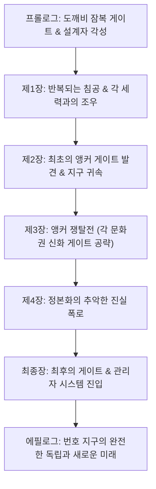

# 통합 세계관 및 시나리오 기획서

> [!IMPORTANT]
> **문서 상태**: 기준 초안 (v1.0)  
> **책임/작성자**: 송예찬  
> **핵심 슬로건**: *공간에 휘말리지 말라. 공간을 설계하라.*  
> **핵심 정의**: *인벤토리는 가방이 아니라 설계자의 전투 청사진이며, 전개된 강점은 동시에 지켜야 할 약점이다.*

## Quick Links

[세계관 전체 스토리](../02_세계관_및_콘텐츠/세계관_전체_스토리.md) · [세계관 용어집](../02_세계관_및_콘텐츠/세계관_용어집.md) · [세계관 설정](../02_세계관_및_콘텐츠/세계관_설정.md) · [시나리오 개요](../02_세계관_및_콘텐츠/시나리오_개요.md)

---

## 1. 세계관 기본 구조 & 메타 설정

### 1.1 번호 지구 (The Numbered Earth)
- **플레이어만의 메타 인지**: 게임 속 모든 주민과 NPC들은 자신이 살아가는 세계가 복제품이 아닌 유일하고 온전한 '지구'라고 굳게 믿고 살아갑니다. 그러나 세이브 파일과 로컬/호스트 월드마다 부여되는 고유 관리 번호(예: 지구-164991)는 **오직 플레이어와 시스템(관리자)만이 인지할 수 있는 제4의 벽 너머의 식별자**입니다.
- **다양한 가능성의 평행 세계**: 모든 번호 지구는 과거 동일한 하나의 지구에서 갈라져 나왔으며, 저마다 독자적인 문명, 지형, 기후, 그리고 게이트 공략 역사를 써 내려가고 있습니다.

### 1.2 자칭 원본 지구 (The Self-Proclaimed Prime Earth / 정본 지구)
- **오만의 기원**: 과거 외차원의 침공을 막아낸 승전 분기 중 하나인 이 세계는 오직 우리만이 진정한 승리를 거두었다. 다른 분기들은 오염되었거나 실패한 찌꺼기에 불과하다고 선언하며 자신의 분기 번호를 스스로 지우고 원본 지구(정본 지구)라 자칭하기 시작했습니다.
- **강제 병합(정본화)의 명분**: 전쟁으로 인해 황폐화된 자신들의 행성을 복구하고, 차원 붕괴를 막는다는 명목 하에 다른 번호 지구들을 '복구용 자원 데이터'로 격하하여 강제로 흡수·병합하려 합니다.

### 1.3 지구 자아 (Planetary Consciousness) & 대분기 계획
- **지구 자아의 방어 본능**: 최초 외차원의 게이트 침공 당시, 인류의 멸망을 막기 위해 지구 행성 자체의 기억, 생명력, 집단 무의식이 하나로 결집한 초거대 보존 의지입니다.
- **대분기 계획 (The Great Divergence)**: 최초 침공 당시 미래를 단순 예지하는 것만으로는 멸망을 피할 수 없자, 지구 자아는 가능한 현실들을 실제 차원으로 무수히 분기하여 침략자의 화력을 분산시키고 각 세계선마다 서로 다른 극복 가능성을 시험했습니다.

### 1.4 각성자, 현현체, 그리고 설계자 (Architect)
- **각성자 (Awakened)**: 지구 자아의 각성 이후 초자연적 힘을 얻은 인류의 총칭. 문화권에 따라 신내림을 받은 자(무속), 주술사, 성직자, 이능력자 등으로 불립니다.
- **설계자 (Architect)**: 
  - 본 게임에서 **플레이어를 지칭하는 고유한 시그니처 칭호/핵심 타이틀**입니다.
  - 침식 공간의 역할을 거부하고 자신만의 개인 아공간 격자 좌표계인 에르고스퀘어(ERGOSQUARE)를 열어 현실에 직접 전투 청사진을 구축하고 편집할 수 있는 극히 희귀한 각성자입니다.
- **현현체 (Manifestation)**: 
  - 지구 자아의 각성과 함께 인류가 수천 년간 전승하고 믿어온 신화·설화·우화에서 독립된 자아를 얻어 현실에 태어난 실체적 존재입니다 (도깨비, 무당, 신령, 영물, 천사/악마 등).
  - 게이트가 닫히면 사라지는 일회성 투영체와 달리, 현실 세계에 정착하여 플레이어와 대화하고, 계약을 맺거나 적대하는 **핵심 서사 등장인물(주요 NPC)**로 기능합니다.

### 1.5 게이트 (Gate)와 기억 공명 (Memory Resonance)
- **작동 원리**: 광활한 차원 속에서 단순한 숫자는 세계를 식별할 뿐이지만, **이야기(신화·설화·기억)는 세계를 연결하는 공명 좌표**가 됩니다.
- **게이트의 형태 구분**:
  - *정상 게이트*: 지역과 사람들의 기억 및 설화를 바탕으로 인물과 법칙을 순수하게 투영한 공간.
  - *폭주 게이트*: 현실과의 경계가 무너져 전승 속 상징을 실제 무고한 시민들의 영혼이나 육체로 강제 결박·대체한 비극적 공간 (예: 영혼 주입형 도깨비).
  - *잠복 게이트 (Lurking Gate)*: 지상에 전조 예측 신호 없이 이면 깊은 곳에서 성장하여 돌발적으로 현실을 삼켜버리는 위험 게이트.
- **개발진용 심층 설정 (이면)**:
  - 인간이 게이트 너머를 관측하자 심연(이면) 또한 인간을 관측하며 형태를 모방하기 시작한 미지의 영역.
  - 이면의 진짜 동기나 정체는 본편 내에서 완전히 규명되지 않는 장기적 미스터리로 남겨둡니다.

---

## 2. 전체 메인 시나리오 흐름

---

### [프롤로그] 최초의 생환: 도깨비 잠복 게이트
- **도입**:
  - 평범한 일상을 살아가던 주인공(플레이어)은 고된 아르바이트를 마치고 귀가하던 도중, 도심 한복판(서울 지하상가)에서 전조 없이 발생한 잠복 게이트의 폭주에 휘말립니다.
  - 건물은 그대로 남겨진 채 사람들의 영혼과 의식만 게이트 안으로 빨려 들어가고, 주인공은 기억을 잃은 채 기괴하게 뒤틀린 공간 속에서 눈을 뜹니다.
- **사건의 전개**:
  - 내부에 진입해 있던 선발 토벌팀의 처참한 시체, 조사 기록, 유류 장비를 수습하며 참상을 파악합니다.
  - 이곳은 단순한 설화 투영이 아닌, 무고한 사람들의 영혼을 사물에 결박하여 억지로 빚어낸 **영혼 주입형 도깨비**들이 들끓는 폭주 지대였습니다.
- **보스전과 각성**:
  - 수많은 원혼을 흡수하여 폭주한 보스 **'사람을 죽인 도깨비 - 월도'**와 마주합니다.
  - 절체절명의 순간, 주인공의 내면에서 잠들어 있던 지구 자아의 보존 의지가 반응하며 개인 아공간 **에르고스퀘어(ERGOSQUARE)**가 발현합니다.
  - 플레이어는 인벤토리 청사진을 실제 전장에 방벽과 코어로 전개하여 월도를 토벌하고, 갇혀 있던 영혼들을 해방하며 게이트를 닫고 현실로 생환합니다.
- **후일담**:
  - 생환한 주인공을 수습한 정부/각성자 통제 기관은 현장 자체의 법칙을 재설계한 주인공의 능력을 분석한 후, 작전 코드네임 **설계자(Architect)**를 부여합니다.

---

### [제1장] 반복되는 침공: 허브 구축과 현현체와의 인연
- **일반 게이트의 공략**:
  - 게이트를 한 번 닫았다고 해서 위협이 끝나지 않습니다. 세계 곳곳에서 기억 공명에 의한 게이트들이 잇따라 발생합니다.
  - 플레이어는 자신의 번호 지구를 지키기 위해 안전 거점(허브 시설)을 복구하고 시설을 확장합니다.
- **독립된 현현체들과의 조우**:
  - 게이트 밖 현실에서 살아가는 '자연 발생 도깨비', 영험한 신내림을 받은 '박수무당', 신비로운 고대 '신물' 등 다양한 현현체들과 조우합니다.
  - 이들은 단순한 퀘스트 수주용 NPC가 아니라, 플레이어와의 교류·계약·수행을 통해 자신들의 권능(강신, 부적, 도깨비불 등)을 설계자 청사진 파츠와 융합 스킬로 모사할 수 있게 해주는 든든한 동료가 됩니다.
- **다양한 인간 세력의 대립**:
  - 무조건적 무력 봉쇄를 주장하는 군사 방위 세력, 게이트와 설계자 권한을 연구해 독점하려는 연구 세력, 침공을 거스를 수 없는 섭리로 보고 투항하려는 내부 '귀환파' 세력이 등장하여 긴장감을 형성합니다.

---

### [제2장] 최초의 앵커 게이트: 게이트를 전환하라
- **진실의 첫 조각**:
  - 일반 게이트들을 해결하며 수집한 공명 기록과 좌표 데이터를 분석하던 중, 현실 깊숙이 박혀 있는 거대한 기둥 형태의 **앵커 게이트(Anchor Gate)**를 발견합니다.
- **파괴의 위험과 귀속**:
  - 기관은 앵커 게이트를 파괴하려 하지만, 앵커를 부술 경우 그 지역의 현실 좌표계 전체가 붕괴하여 대참사가 일어난다는 사실을 설계자가 밝혀냅니다.
  - 설계자는 앵커를 파괴하는 대신, 에르고스퀘어를 전개해 침략자(원본 지구)의 통제 권한을 해킹하고 **앵커 게이트의 주권을 자신의 번호 지구로 전환(귀속)**시키는 기적을 이뤄냅니다.
- **시야의 확장**:
  - 첫 앵커가 귀속되자 하늘에 드리웠던 차원 균열이 안정되고, 월드 전역에 흩어져 있는 나머지 핵심 앵커들의 위치와 '정본화 병합 진행도'가 플레이어 시스템 HUD에 명확하게 드러납니다.

---

### [제3장] 앵커 쟁탈전: 신화와 기억의 대서사시
- **다양한 문화권의 신화 앵커 게이트 공략**:
  - 플레이어는 자신의 선택에 따라 전 세계에 박힌 5대 핵심 앵커 게이트를 차례로 공략합니다. 각 앵커는 서로 다른 문화권의 거대한 신화적 테마와 폐쇄 조건을 가지고 있습니다.
  1. **경계 앵커 (서구/그리스 미궁 전승)**: 미궁의 괴수 미노타우로스와 문지기 시험을 돌파하고 지구의 외곽 방벽 좌표를 고정.
  2. **기억 앵커 (동아시아 저승/바리데기 설화)**: 망각의 강을 건너며 침식체들에게 빼앗긴 주민들의 존재 기억과 명부를 탈환.
  3. **계약 앵커 (북유럽 오딘/룬 문자 설화)**: 지혜와 희생의 대가를 요구하는 고대 신적 존재와의 엄격한 계약 성립.
  4. **재앙 앵커 (대홍수/수메르·메소포타미아 전승)**: 차오르는 침식의 바다를 막고 무너지는 하늘을 떠받치는 극한의 방어전.
  5. **생명 앵커 (세계수/토착 정령 전승)**: 지구 자아의 생명력과 맥이 닿아 있는 신성한 뿌리를 침식체로부터 정화.
- **설계의 진화**:
  - 각 문화권의 앵커를 정복할 때마다 그리스의 첨탑 궁술, 북유럽의 룬 방패벽, 동양의 저승사자 영혼 제어술 등 강력한 융합 설계 아키텍처가 플레이어의 청사진에 추가됩니다.

---

### [제4장] 폭로된 진실: 우리는 실패작이 아니다
- **원본 지구의 정체 폭로**:
  - 앵커들을 장악해 가며 회수한 고위 관리자 데이터 코어를 복원한 결과, 플레이어는 충격적인 역사를 마주합니다.
  - 현재 침공을 주도하는 주체는 외계 생명체가 아니라, 과거 최초 침공 당시 함께 갈라져 나갔던 또 다른 형제 세계인 **지구-[기록말살]**이었습니다.
  - 그들은 스스로를 '유일하게 검증된 정본'이라 포장했지만, 실상은 침략과의 전쟁으로 행성 생태계가 회복 불능 수준으로 파괴되자 다른 번호 지구의 생명과 자원을 약탈해 연명하려는 절박하고도 오만한 침략자에 불과했습니다.
- **설계자 권한의 본질**:
  - 플레이어의 에르고스퀘어 능력 역시 우연한 사고가 아니라, 자신들의 세계를 집어삼키려는 정본화 프로세스에 저항하기 위해 **플레이어 번호 지구의 자아가 직접 부여한 '세계 보존의 권한'**이었음이 밝혀집니다.

---

### [최종장] 최후의 게이트: 관리자 시스템의 심장부로
- **전선 역전과 가교 형성**:
  - 5개의 핵심 앵커 게이트가 모두 플레이어 지구에 귀속되자 차원 연결의 극성이 완전히 역전됩니다.
  - 원본 지구가 일방적으로 열어젖히던 침공 통로가 뒤집히며, 그들의 차원 병합 중추인 **정본화 관리자 시스템**으로 직통하는 **최후의 게이트**가 강제로 개방됩니다.
- **총력전 (The Final Stand)**:
  - 동료 현현체들, 각성자 기관, 그리고 지금까지 플레이어와 인연을 맺어온 세력들이 현실에 남아 핵심 앵커들을 사수하는 방어전을 펼칩니다.
  - 플레이어(설계자)는 단신으로(또는 4인 설계자 협동 파티와 함께) 최후의 게이트를 넘어 적의 본진인 관리자 성채로 돌입합니다.
- **최종 결전**:
  - 정본화 관리 시스템을 수호하는 최고위 회수관이자, 과거 대분기 당시 최초 설계자의 의지를 계승했다고 자부하는 **'관리자 아키텍트'**와 현실 편집 권한을 건 에르고스퀘어 격돌을 벌입니다.
- **궁극의 결말**:
  - 플레이어는 상대의 청사진을 무너뜨리고 관리자 시스템의 코어 콘솔에 도달합니다.
  - 플레이어의 선택은 원본 지구를 멸망시키는 복수가 아닙니다. 시스템 루트 권한을 재작성하여 **우리 지구(지구-XXXXXX)에 대한 모든 강제 병합 및 회수 명령을 영구 해제하고, 독립된 정규 현실로 등록**합니다.

---

### [에필로그] 우리가 살아가는 현실
- **평화와 새로운 과제**:
  - 하늘을 뒤덮었던 거대한 차원 균열이 닫히고, 세계는 정본화의 공포에서 완전히 해방됩니다.
  - 인게임 주민들은 여전히 시스템 번호 따위는 알지 못한 채, 자신들이 지켜낸 아름다운 일상을 살아가며 거리를 재건합니다.
- **설계자의 위상**:
  - 플레이어는 기관과 현현체들 사이에서 전설적인 설계자로 인정받으며, 남겨진 안정화 게이트들을 관리하고 동료들과 함께 허브를 더욱 번영시켜 나갑니다.
- **미래를 향한 암시 (쿠키/확장 여지)**:
  - 관리자 시스템 구석에서 반짝이는 또 다른 번호 지구들의 구조 신호(SOS).
  - 그리고 심연 깊은 곳에서 인간의 형상을 흉내 내며 조용히 미소 짓는 **이면**의 시선이 비치며, 게임은 깊은 여운과 함께 본편의 막을 내립니다.

---

## Revision History

| 날짜 | 버전 | 변경 내용 | 작성자 |
| --- | --- | --- | --- |
| 2026-09-06 | v1.0 | 통합 세계관 및 전체 메인 시나리오(프롤로그~에필로그) 초안 집대성 | 송예찬 |
