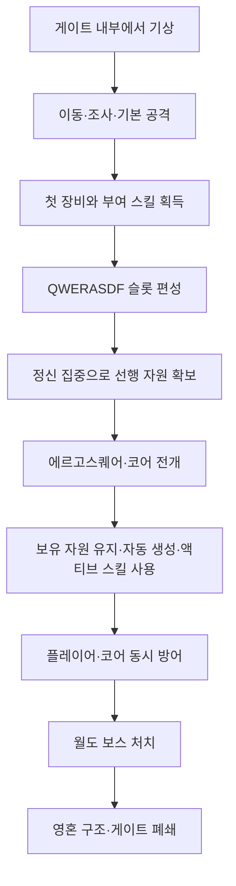

# 핵심 플레이 루프

> **2026-09-14 통합 안내:** 게임 규칙·세계관 이야기·튜토리얼 흐름은 [종합 기획서](../../00_프로젝트_개요/에르고스퀘어_종합_기획서_초안.md)가 단일 기준입니다. 이 페이지는 부록 탐색용이며 아래 과거 상태 표는 현재 구현 완료를 뜻하지 않습니다.


> [!IMPORTANT]
> 문서 상태: 튜토리얼 우선 초안. 현재는 첫 튜토리얼에서 실제로 구현·검증할 인게임 조작과 진행 흐름을 기준으로 합니다.

## Quick Links

[게임 기획](../README.md) · [조작](../시스템_상세_부록.md#controls) · [인게임 HUD](인게임_HUD_구현_명세.md) · [아이템·파츠](../시스템_상세_부록.md#items) · [장비·코어·스킬](장비_코어_스킬/README.md) · [코어 획득·능력치](../시스템_상세_부록.md#core-drop) · [튜토리얼 적용](../04_튜토리얼/README.md)

## 문서 상태

| 기준 문서 | 상태 | 담당 규칙 |
| --- | --- | --- |
| [조작](../시스템_상세_부록.md#controls) | 기본 매핑 확정 | 키보드·마우스 입력 |
| [아이템·파츠](../시스템_상세_부록.md#items) | 용어 확정·시스템 초안 | 파츠·재료·격자 |
| [장비·코어·스킬](장비_코어_스킬/README.md) | 튜토리얼 검증 초안 | 자원·스킬·호환 |
| [실패·철수·사망](../시스템_상세_부록.md#failure) | 기준 초안 | 영구 사망·중상·철수 |
| [적 AI](../시스템_상세_부록.md#enemy-ai) | 초안 | 위협도와 표적 전환 |
| [인게임 HUD 구현 명세](인게임_HUD_구현_명세.md) | 튜토리얼 기준 시안 | HUD 배치·에셋화·런타임 연결 |

## 문서 역할

플레이어가 인게임에서 무엇을 조작하고, 어떤 순서로 기능을 익히며, 무기 스킬과 코어 자원을 이용해 전투 목표를 해결하는지 정의하는 게임 기획의 기준 문서입니다.

세부 자료는 이 문서 아래에서 다음 순서로 관리합니다.

1. 현재 문서: 인게임 조작과 진행 흐름
2. [아이템·파츠](../시스템_상세_부록.md#items): 아키텍트·청사진·파츠·아키텍처·재료의 용어와 격자 규칙
3. [장비·코어·스킬](장비_코어_스킬/README.md): 장비형·코어형·보조형·소비형 파츠, 스킬 편성과 자원 호환
4. [코어 획득 및 능력치](../시스템_상세_부록.md#core-drop): 코어 드롭, 현재 직군, 기초 능력치와 튜토리얼 보장 결과
5. 통합 문서 내부의 [국가별 하위 문서](장비_코어_스킬/국가별/README.md): 힘의 계보별 장비·코어·스킬 연결 규칙
6. [실패·철수·사망](../시스템_상세_부록.md#failure): 월드 영구 사망, 협동 중상과 게이트 철수

## 인게임 조작

| 입력 | 일반 상태에서의 기능 | 튜토리얼에서 배우는 시점 |
| --- | --- | --- |
| 우클릭 / 길게 누르기 | 지정 지점으로 이동 | 기상 직후 |
| 좌클릭 | 장착 무기의 기본 공격 | 첫 적 조우 |
| `QWERASDF` | 편성한 액티브 스킬 사용 | 무기 스킬 획득 후 |
| `Space` 길게 누르기 | 정신 집중으로 느린 수동 자원 회복 | 첫 장비·코어 연결 후 |
| `G` | 조사·구조·장치 상호작용 | 기억 흔적 조사 |
| `Tab` | 에르고스퀘어 전개 모드 진입·종료 | 인터페이스 발현 후 |
| `B` | 가방·획득품 확인 | 수납 파츠 전개 후 |
| `1~4` | 소비 아이템 사용 | 전투 후반 |
| `Esc` | 현재 지정·전개 상태 취소 또는 메뉴 | 필요 시 |

세부 입력 상태와 충돌 규칙은 [조작](../시스템_상세_부록.md#controls)을 기준으로 합니다. 이동, 기본 공격과 일반 상호작용은 코어 자원이 없어도 사용할 수 있습니다. 회피·방어·기동은 장비 스킬로 편성합니다.

## 튜토리얼 진행 흐름



## 순간 전투 루프

```text
기본 공격과 편성한 기동·방어 스킬로 적의 패턴 확인
→ 코어 위치와 안전 상태 확인
→ 생성 자원을 액티브 스킬에 소비
→ 적의 표적이 플레이어와 코어 사이에서 바뀌는 것에 대응
→ 코어를 보호하거나 전투를 빠르게 끝낼지 판단
→ 전리품 확인과 다음 조우 준비
```

## 튜토리얼에 포함할 핵심 규칙

- 무기는 자원을 쓰지 않는 기본 공격과 편성 가능한 액티브 스킬을 제공합니다.
- 첫 무기인 녹슨 검의 스킬 후보는 종베기, 횡베기와 찌르기입니다.
- 획득한 액티브 스킬은 `QWERASDF` 중 플레이어가 선택한 슬롯에 할당합니다.
- 공통 회피 키는 없으며 회피·방어·기동도 장비 액티브 스킬로 편성합니다.
- `Space` 정신 집중은 전개 전후 모두 초당 `10`의 자원을 회복하는 비효율적인 공용 수단입니다.
- 정신 집중으로 모은 자원은 코어 전개 시 초기화되지 않습니다.
- 액티브 스킬은 정신 집중 또는 전개된 코어가 생성한 단일 전투 자원을 소비합니다.
- 코어는 전장에 존재하며 피격·손상·파괴될 수 있습니다.
- 코어 손상은 생성 효율을 낮추고, 파괴는 축적 자원·스킬·활성 장비 능력과 신규 생성을 중단합니다.
- 코어가 파괴되어도 기본 조작은 유지되어 허브로 철수할 수 있어야 합니다.

## 플레이어가 반복해서 내리는 판단

- 획득한 무기 스킬을 어느 전투 슬롯에 편성할지
- 코어를 안전한 후방과 위험한 전선 중 어디에 전개할지
- 생성 자원을 즉시 소비할지 강한 스킬을 위해 비축할지
- 적을 공격할지 코어 방어와 복구에 행동을 사용할지
- 현재 전리품으로 빌드를 유지할지 교체할지

튜토리얼 이후에는 필요하지 않은 장비를 해체하고 자원 매개체와 스킬 각인을 회수해 현재 코어에 맞게 재제작합니다. 다른 코어의 장비를 혼합하는 장기 빌드 구성은 [장비·코어·스킬](장비_코어_스킬/README.md)을 기준으로 하며 이번 튜토리얼 구현 범위에는 포함하지 않습니다.

## 이번 구현 범위

- 녹슨 검 1종과 기본 공격
- 종베기·횡베기·찌르기 중 튜토리얼에서 가르칠 액티브 스킬
- `QWERASDF` 슬롯 편성과 스킬 발동
- `Space` 정신 집중, 행동 제한·피해 증가와 전개 시 자원 유지
- `낡은 정기의 혼 코어 [근접]` 1×1 보장 결과의 전개와 단일 전투 자원 생성
- 스킬의 자원 소비와 부족 피드백
- 코어 정상·손상·파괴 상태와 적의 코어 공격
- 월도 보스전에서 스킬 사용과 코어 보호 판단

다수 무기 계열, 다중 자원, 국가별 전용 규칙, 완성형 희귀도와 장기 성장은 튜토리얼 이후로 미룹니다.

## 완료 기준

- [ ] 플레이어가 무기 스킬을 원하는 슬롯에 편성할 수 있습니다.
- [ ] 정신 집중은 느리고 위험하며 코어 전개가 효율적인 자원 생성 수단임을 이해합니다.
- [ ] 코어의 정상·손상·파괴 상태를 구분할 수 있습니다.
- [ ] 코어 파괴 후에도 이동과 기본 공격으로 진행 불가 상태를 벗어날 수 있습니다.
- [ ] 보스전에서 자원 소비와 코어 보호 사이의 판단이 최소 한 번 발생합니다.

## 열린 질문

- 녹슨 검의 첫 스킬을 고정 지급할지 무작위로 제시할지
- 한 회차에서 종베기·횡베기·찌르기 중 몇 개를 가르칠지
- 코어 손상에 따른 생성 저하를 몇 단계로 보여줄지
- 코어 파괴 후 튜토리얼 안전 철수를 어느 시점에 안내할지
- 진행 불가 방지를 위해 자동 복구, 수리 도구 또는 재전개 중 무엇을 제공할지

## 관련 문서

- [전체 장기 플레이 루프](../시스템_상세_부록.md#long-loop)
- [튜토리얼 목표 및 범위](../../00_프로젝트_개요/에르고스퀘어_종합_기획서_초안.md#tutorial)
- [튜토리얼 플롯별 플레이 흐름](../../00_프로젝트_개요/에르고스퀘어_종합_기획서_초안.md#tutorial-plots)
- [전투](../시스템_상세_부록.md#combat)
- [조작](../시스템_상세_부록.md#controls)

## Revision History

| 날짜 | 버전 | 변경 내용 | 작성자 |
| --- | --- | --- | --- |
| 2026-08-15 | v0.1 | 튜토리얼 우선 인게임 조작·진행·전투 루프 작성 | 송예찬 |
| 2026-08-15 | v0.2 | 튜토리얼 이후 해체·재제작 빌드 확장 경로 연결 | 송예찬 |
| 2026-08-15 | v0.3 | 무기·자원 링크를 장비·코어·스킬 통합 문서로 변경 | 송예찬 |
| 2026-08-15 | v0.4 | 실패·철수·사망 기준 문서 연결 | 송예찬 |
| 2026-08-16 | v0.5 | 아이템·파츠 용어 기준 문서를 핵심 플레이 인덱스에 연결 | 송예찬 |
| 2026-08-16 | v0.6 | 코어 획득·능력치 명세와 튜토리얼 보장 코어 연결 | 송예찬 |
| 2026-08-17 | v0.7 | Quick Links, 기준 문서 상태 표와 튜토리얼 흐름도 추가 | 송예찬 |
| 2026-08-17 | v0.8 | Space 정신 집중, 전개 자원 유지와 장비 스킬 기반 생존 행동 반영 | 송예찬 |
