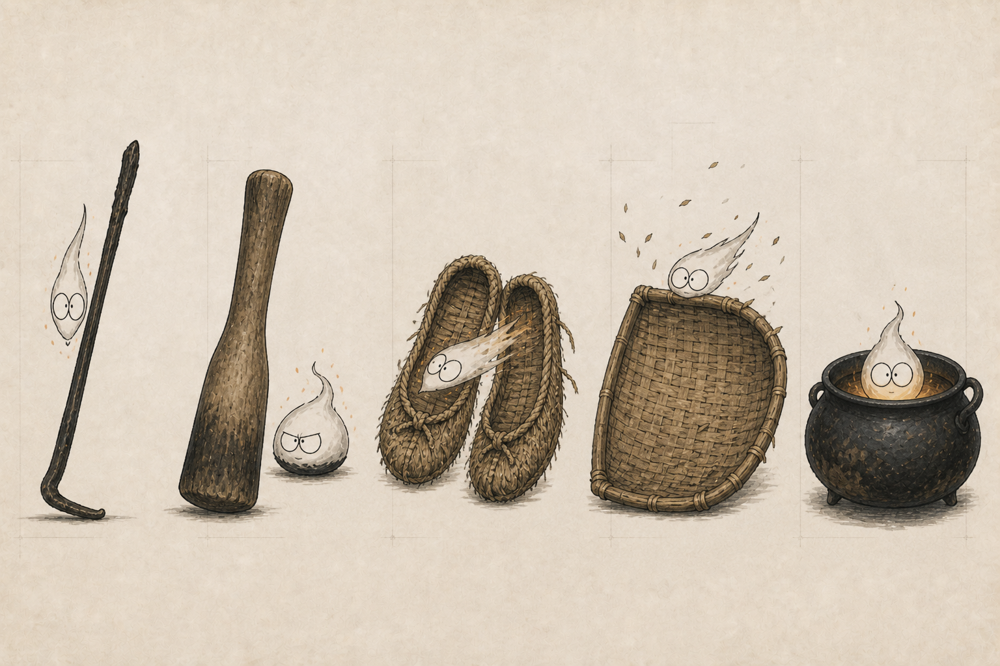
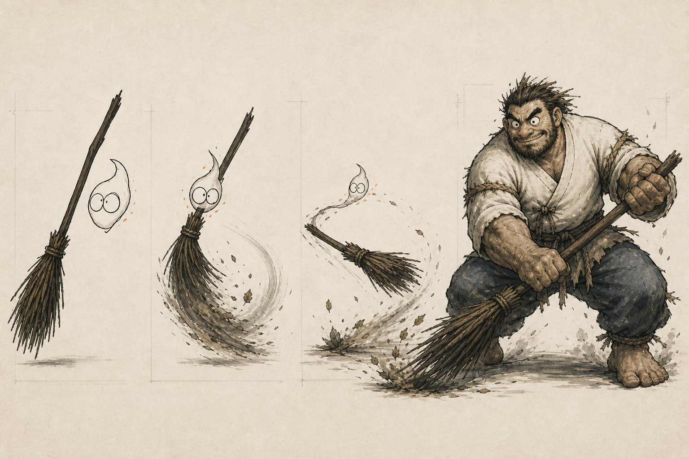
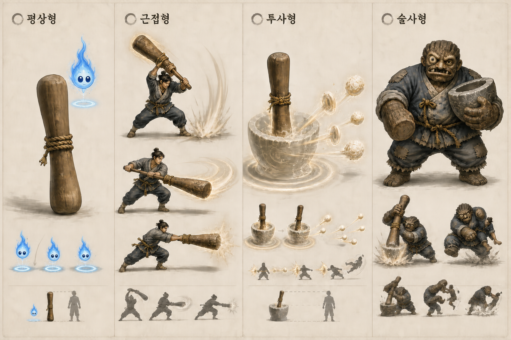

# 한국 계통 원화 공통 명세 초안

> [!IMPORTANT]
> 문서 상태: 콘셉트 원화 제작용 검토 초안. 민속 자료의 외형을 하나의 정답으로 단정하지 않고, 원전과 게임적 재해석을 구분해 기록합니다.

---

## 1. 개요 및 목적

### Quick Links

[한국 통합 문서](한국.md) · [계통·직군 분류](한국_계통_직군_분류_초안.md) · [한국 장비 목록](한국_장비_목록.md) · [튜토리얼 도깨비 게이트](../../../../04_튜토리얼/콘텐츠/도깨비_게이트_콘텐츠_기획.md)

### 현재 수록 현황

| 구분 | 수록 내용 | 상태 |
| --- | --- | --- |
| 공통 규칙 | 파란 도깨비불, 감정 이입, 근접·투사·술사형과 금지 요소 | 검토 초안 |
| 터전 수호 계통 | 가택·마을 수호형의 공통 시각 규칙 | 검토 초안 |
| 빗자루 도깨비 | 개체 마스터 및 직군별 기준 이미지(v2)·외형·동작 명세 | 기준 시안 v2 |
| 절굿공이 도깨비 | 개체 마스터 및 직군별 기준 이미지(v3)·외형·동작 명세 | 기준 시안 v3 |
| 부지깽이 도깨비 | 개체 마스터 및 평상·근접·투사·술사 직군별 명세 | 개체 마스터 초안 |
| 짚신 도깨비 | 개체 마스터 및 평상·근접·투사·술사 직군별 명세 | 개체 마스터 초안 |
| 키 도깨비 | 개체 마스터 및 평상·근접·투사·술사 직군별 명세 | 개체 마스터 초안 |
| 가마솥 도깨비 | 개체 마스터 및 평상·근접·투사·술사 직군별 명세 | 개체 마스터 초안 |

### 개체 바로가기

[빗자루 도깨비](#51-빗자루-도깨비-직군별-시트-명세) · [절굿공이 도깨비](#52-절굿공이-도깨비-직군별-시트-명세) · [부지깽이 도깨비](#53-부지깽이-도깨비-직군별-시트-명세) · [짚신 도깨비](#54-짚신-도깨비-직군별-시트-명세) · [키 도깨비](#55-키-도깨비-직군별-시트-명세) · [가마솥 도깨비](#56-가마솥-도깨비-직군별-시트-명세)

### 작성 목적

원화가 예쁘게 보이는 것보다 다음 질문에 일관되게 답하는 것을 우선합니다.

1. 어느 문화권과 계통에서 나온 존재인가?
2. 같은 계통의 다른 개체와 무엇을 공유하는가?
3. 어떤 물건·신앙·기억에서 나온 개체인가?
4. 근접·투사·술사에서 무엇이 달라지는가?
5. 원전의 특징과 에르고스퀘어의 재해석을 어떻게 구분하는가?

---

## 2. 원화 제작 프로세스 및 규격

### 2.1 원화 제작 단위

```text
계통 마스터 시트
→ 개체 마스터 시트
→ 직군별 형태 시트
→ 파츠·무기·소품 시트
→ 스킬 동작·이펙트 시트
→ 인게임 모델링 기준 시트
```

- `계통 마스터 시트`는 공통 실루엣, 색, 재질과 금지 요소를 정의합니다.
- `개체 마스터 시트`는 해당 물건·신앙의 고유 특징을 정의합니다.
- `직군별 형태 시트`는 같은 개체가 근접·투사·술사로 표현되는 차이를 정의합니다.
- 최종 모델링 전에 정면·측면·후면, 크기 비교와 재질 확대를 별도로 작성합니다.

### 2.2 개체 원화 작성 양식

#### 1. 조사 정보
- 개체명:
- 지역·시대:
- 전승·신앙 출처:
- 확정된 사실:
- 서로 다른 전승:
- 사용을 피할 혼합 이미지:

#### 2. 게임 정보
- 계통:
- 직군:
- 코어·자원:
- 본체 물건 또는 수호 대상:
- 기본 전투 동사:
- 성장·변화 조건:

#### 3. 시각 정보
- 공통 식별 요소:
- 평상형:
- 근접형:
- 투사형:
- 술사형:
- 색상:
- 재질:
- 크기 비교:
- 금지 요소:

#### 4. 제작 정보
- 필수 턴어라운드:
- 표정·포즈:
- 무기·소품 분해도:
- 스킬 이펙트:
- 애니메이션 키 포즈:
- 인게임 축소 시 유지할 형태:

### 2.3 원화 파일 명명 규칙

```text
KR_<계통>_<개체>_<직군>_<시트종류>_v##
```

예시:
```text
KR_Dokkaebi_Broom_Common_Master_v01
KR_Dokkaebi_Broom_Melee_Action_v01
KR_Dokkaebi_Broom_Projectile_Action_v01
KR_Dokkaebi_Broom_Caster_Jangjeong_v01
```

한글 표시명과 데이터 ID의 최종 규칙은 기술 문서와 함께 확정합니다.

---

## 3. 계통별 공통 시각 규칙

### 3.1 도깨비 계통 공통 시각 규칙

#### 3.1.1 평상형: 물건과 도깨비불
- 평상형 물건 도깨비의 도깨비불은 청색 계열로 고정합니다. 중심은 옅은 청백색, 외곽은 청록색에서 짙은 청색으로 이어집니다.
- 기본 실루엣은 하나의 비대칭 불꽃 또는 물방울 형태와 나란히 놓인 큰 눈 한 쌍으로 구성합니다.
- 완전한 사람 몸이나 마스코트형 팔다리를 기본값으로 두지 않습니다.
- 귀여움은 팔다리나 장식보다 눈의 표정, 찌그러짐과 늘어남, 불꽃 끝의 방향과 움직임으로 표현합니다.
- 개체별 차이는 불꽃 색을 바꾸는 대신 본체 물건, 표정, 이동 방식과 반응 속도로 구분합니다.
- 도깨비불과 물건은 서로 분리된 소유자와 장비가 아니라 함께 하나의 도깨비를 이룹니다.
- 도깨비불은 본체 물건에서 멀리 떨어지지 않으며 본체 물건의 일상적 동작을 흉내 내며 이동합니다.

#### 3.1.2 감정 이입과 유대 표현
- 물건 도깨비는 플레이어가 처음 획득하는 도구인 동시에 함께 성장하는 동료로 읽혀야 합니다.
- 첫 만남에서는 경계, 숨기, 관찰, 도움과 안도처럼 짧고 분명한 감정 변화를 눈과 움직임으로 전달합니다.
- 장착 중에는 플레이어 주변을 맴돌거나 손과 장비를 확인하며, 전투 종료 후에는 본체 물건의 먼지를 털거나 플레이어의 상태를 살핍니다.
- 파츠가 손상되면 불꽃의 크기와 밝기가 줄고, 유대가 성장하면 대기 동작·표정·플레이어와의 거리가 단계적으로 변화합니다.
- 근접형의 공격 궤적, 투사형의 조종선과 투사체, 술사형의 눈과 본체 흔적에도 동일한 파란 잔광을 남겨 같은 개체임을 연결합니다.
- 귀여움은 모든 개체를 같은 마스코트 성격으로 만드는 규칙이 아닙니다. 빗자루는 부산함, 절굿공이는 무뚝뚝한 반동처럼 물건별 성격을 유지합니다.

#### 3.1.3 직군별 형태 (근접형 / 투사형 / 술사형)
- **근접형 (물건 활성화):**
  - 본체 물건의 일상적 용도와 동작이 공격 모션의 뿌리가 됩니다.
  - 물건을 판타지 무기로 완전히 교체하지 않고 마모, 수선 흔적과 손때를 남깁니다.
  - 도깨비불은 장비 표면, 손잡이 또는 공격 궤적에 최소한으로 나타날 수 있습니다.
  - 플레이어가 도깨비의 힘을 직접 행사한다는 점이 우선이며 별도 소환수처럼 보이지 않게 합니다.
- **투사형 (원격 조종과 장난):**
  - 물건 또는 도깨비불이 플레이어에게서 떨어진 위치에서 움직입니다.
  - 단순한 원소 투사체보다 물건의 용도와 도깨비의 장난이 읽히는 궤적을 사용합니다.
  - 여러 개체를 표시할 때도 원본 물건과 주 도깨비불을 식별할 수 있어야 합니다.
  - 이펙트가 물건의 형태를 가리지 않도록 불꽃과 연기는 보조적으로 사용합니다.
- **술사형 (장정형 육체화):**
  - 장정형이 완성되면 혼령의 반투명함과 불꽃 몸체는 남기지 않습니다.
  - 거대한 씨름꾼·장정처럼 무게와 체온이 느껴지는 완전한 육체로 표현합니다.
  - 도깨비의 정체성은 뿔이 아니라 비정상적인 체격, 익살과 광기가 공존하는 얼굴, 비대칭과 본체 물건의 흔적으로 표현합니다.
  - 넓고 낮은 자세, 긴 팔, 큰 손과 맨발 등 씨름과 괴력을 연상시키는 실루엣을 우선합니다.
  - 장정형도 본체 물건을 유지하며 재질·용도·축적된 기억을 머리, 피부, 의복과 동작에 반영합니다.

#### 3.1.4 도깨비 공통 금지 요소
- 뿔을 한국 도깨비 원형의 공통 표식으로 사용하지 않습니다.
- 호피 무늬 옷, 송곳니와 못 박힌 철퇴를 기본 조합으로 사용하지 않습니다.
- 일본 오니, 서양 악마 또는 일반적인 판타지 오거의 얼굴을 그대로 차용하지 않습니다.
- 모든 도깨비를 붉은 피부와 푸른 피부의 이분법으로 통일하지 않습니다.
- 게이트의 의도적 왜곡으로 해당 요소를 사용할 때는 `원형`이 아니라 `왜곡 근거`를 별도 명시합니다.

### 3.2 터전 수호 계통 공통 시각 규칙

#### 3.2.1 공통
- 사람의 정이 밴 물건에서 태어난 도깨비와 구분합니다.
- 집·마을·길목·경계와 반복된 제의가 힘의 근거로 읽혀야 합니다.
- 금줄, 터, 문턱, 기둥, 화덕, 돌무더기와 길목 같은 공간 표식을 우선합니다.
- 마법진만으로 한국성을 대신하지 않고 실제 신앙물과 공간 구조를 조사해 사용합니다.

#### 3.2.2 가택 수호형
- 좁고 안정적인 보호 범위를 표현합니다.
- 터주신은 지면과 기반, 성주신은 기둥과 지붕, 조왕신은 부엌과 불의 질서를 시각 언어 후보로 둡니다.
- 인간형 신령을 그릴 경우 지역·시대별 자료를 확인하고 단일한 표준 외형으로 단정하지 않습니다.

#### 3.2.3 마을 수호형
- 넓은 범위보다 `경계를 세운다`는 행위가 먼저 읽혀야 합니다.
- 장승은 설치된 물리적 수호물, 서낭은 장소와 제의의 관계, 솟대는 높이와 연결 방향을 구분합니다.
- 장승을 도깨비로 그리지 않으며 술사형 현현체도 장승의 조형 언어를 가진 수호자로 설계합니다.

---

## 4. 개체별 마스터 시트 (개체 원형 & 평상형)

### 4.1 물건 도깨비 평상형 비교 시트



| 물건 | 도깨비불의 성격 | 실루엣·동작 후보 |
| --- | --- | --- |
| 부지깽이 | 성급하고 무엇이든 들쑤심 | 가늘고 곧은 불꽃, 찌르기·불씨 헤집기 |
| 절굿공이 | 무뚝뚝하고 묵직함 | 낮고 뭉친 불꽃, 찧기·내려찍기 |
| 짚신 | 빠르고 장난스러움 | 앞으로 늘어난 불꽃, 질주·미끄러뜨리기 |
| 키 | 호기심이 많고 정리와 흩뜨리기를 반복 | 바람에 눕는 넓은 불꽃, 날리기·가려내기 |
| 가마솥 | 느긋하고 보호적이며 쉽게 움직이지 않음 | 낮고 조밀한 불꽃, 끓이기·덮기·버티기 |

후보 시트는 평상형 종족 문법을 비교하기 위한 초기 자료입니다. 아래 개체별 마스터 시트에서 기본 본체와 마스터 방향을 정의합니다.

### 4.2 빗자루 도깨비 개체 마스터
- **본체:** 오랫동안 마당과 방을 쓸며 때가 묻은 낡은 빗자루
- **성격:** 부산스럽고 깔끔한 것을 좋아하며 먼지를 털어내는 장난을 즐김
- **공통 실루엣:** 볏짚 다발과 길쭉한 자루, 새끼줄 결속 구조

### 4.3 절굿공이 도깨비 개체 마스터
- **본체:** 곡식을 찧고 빻아 매끄럽게 닳은 묵직한 나무 절굿공이
- **성격:** 무뚝뚝하고 행동이 크며 묵직한 내리찧기를 반복함
- **공통 실루엣:** 수직의 굵은 자루, 둥글게 닳은 타격면, 목재 결속 흔적

### 4.4 부지깽이 도깨비 개체 마스터
> [!NOTE]
> 개체 마스터 초안. 본체 재질(목재형/금속형)과 전승을 결정한 뒤 시안을 확정합니다.

- **본체:** 불을 헤집고 불씨를 옮기는 데 사용한 부지깽이
- **성격:** 성급하고 참견이 많으며 숨어 있는 것을 그냥 지나치지 못함
- **공통 실루엣:** 길고 가는 직선, 검게 그을린 끝과 손때 밴 손잡이
- **예정 파일명:** `KR_Dokkaebi_FirePoker_Common_Master_v01`

### 4.5 짚신 도깨비 개체 마스터
> [!NOTE]
> 개체 마스터 초안. 한 짝이 아닌 한 켤레와 파란 도깨비불을 합쳐 하나의 개체로 설계합니다.

- **본체:** 오랫동안 여러 길을 걸어 닳은 짚신 한 켤레
- **성격:** 빠르고 장난스러우며 플레이어보다 먼저 달려갔다가 다시 돌아옴
- **공통 실루엣:** 낮고 앞으로 뻗은 한 쌍의 밑창, 촘촘히 엮은 짚과 발목 끈
- **예정 파일명:** `KR_Dokkaebi_StrawShoes_Common_Master_v01`

### 4.6 키 도깨비 개체 마스터
> [!NOTE]
> 개체 마스터 초안. 곡식을 까불러 알곡과 쭉정이를 가려내는 농기구의 용도를 중심으로 설계합니다.

- **본체:** 곡식을 담아 흔들고 알곡과 쭉정이를 가려낸 키
- **성격:** 호기심이 많고 주변의 물건을 모았다가 자기 기준으로 다시 흩어 놓음
- **공통 실루엣:** 넓고 얕은 오목한 면, 촘촘한 격자와 두꺼운 테두리
- **예정 파일명:** `KR_Dokkaebi_WinnowingBasket_Common_Master_v01`

### 4.7 가마솥 도깨비 개체 마스터
> [!NOTE]
> 개체 마스터 초안. 불 이미지보다 무게, 축적, 보관과 보호의 성질을 중심으로 설계합니다.

- **본체:** 오랫동안 불 위에서 음식을 담고 사람들을 먹인 무거운 가마솥
- **성격:** 느긋하고 쉽게 움직이지 않지만 플레이어가 위험하면 앞을 막아섬
- **공통 실루엣:** 낮고 둥근 솥 몸체, 두꺼운 테두리와 뚜껑, 바닥의 그을음
- **예정 파일명:** `KR_Dokkaebi_Cauldron_Common_Master_v01`

---

## 5. 개체별 직군별 원화 시트 명세

<a id="51-빗자루-도깨비-직군별-시트-명세"></a>

### 5.1 빗자루 도깨비 직군별 시트 명세



> 기준 시안 v2: 물건 곁의 도깨비불, 빗자루 직접 활성화, 원격 조종, 완전히 육체화된 장정형을 한 시트에 구분했습니다. 장정형에는 혼령의 불꽃 머리와 뿔을 사용하지 않습니다.

| 상태 | 실루엣 | 물건 흔적 | 동작 |
| --- | --- | --- | --- |
| 평상형 | 몸이 거의 없는 작은 단일 불꽃과 큰 눈 | 낡은 빗자루 곁에 붙거나 기대어 이동 | 흔들리기·숨기·장난치기 |
| 근접형 | 플레이어와 빗자루가 하나의 공격선 형성 | 볏짚과 자루를 그대로 유지 | 쓸기·털기·후려치기 |
| 투사형 | 빗자루가 낮게 비행하고 불꽃이 뒤따름 | 새끼줄 매듭이 회전축과 방향 표시 | 원격 쓸기·밀어내기·끌어오기 |
| 술사형 | 저고리와 바지를 입은 거대한 장정 | 볏짚 같은 머리·눈썹, 새끼줄 매듭, 나뭇결 굳은살 | 씨름 자세·대형 쓸기·잡아 던지기 |

#### 장정형 세부 기준
- 불꽃 머리와 유령 꼬리를 제거합니다.
- 얼굴은 인간 장정에 가깝되 좌우 비대칭과 과장된 눈·입으로 낯섦을 남깁니다.
- 머리카락·눈썹·수염이 마른 볏짚처럼 뻗칩니다.
- 저고리 매듭과 수선 자국에는 빗자루의 새끼줄 결속 구조가 반복됩니다.
- 손바닥과 팔에는 오래된 나무 자루 같은 굳은살과 나뭇결 흔적을 둡니다.
- 이동과 공격 뒤에는 먼지·낙엽이 따라오지만 몸 자체를 연기나 불꽃으로 만들지 않습니다.

---

<a id="52-절굿공이-도깨비-직군별-시트-명세"></a>

### 5.2 절굿공이 도깨비 직군별 시트 명세



> 기준 시안 v3: 평상형의 파란 도깨비불과 큰 눈 한 쌍, 찧기·압축·반동을 이용한 직군별 전투 표현, 절굿공이의 목재 섬유에서 파생된 술사형을 구분했습니다. 빗자루의 볏짚 머리 규칙은 절굿공이에 적용하지 않습니다.

| 상태 | 실루엣 | 물건 흔적 | 동작 |
| --- | --- | --- | --- |
| 평상형 | 낡은 절굿공이 곁의 작고 파란 도깨비불 | 절굿공이 위에서 몸을 압축했다 펴며 찧는 동작을 흉내 냄 | 통통 튀기·내리앉기·찧는 흉내 |
| 근접형 | 플레이어와 거대한 절굿공이가 굵은 하나의 공격선을 형성 | 둥근 타격면, 닳은 나뭇결과 새끼줄 손잡이를 유지 | 내려찍기·횡휘두르기·밀어찧기 |
| 투사형 | 환영 절구에 절굿공이를 찧어 응축체를 발사 | 본체는 파괴하지 않고 절구, 원형 파동과 압축된 기운 알갱이를 표시 | 응축탄 발사·충격파·밀어내기 |
| 술사형 | 절굿공이처럼 굵고 수직적인 체형의 거대한 장정 | 짧고 굵은 목재 섬유 머리, 나뭇결 굳은살, 둥근 팔과 주먹 | 대형 찧기·지면 울림·붙잡아 메치기 |

#### 절굿공이 고유 기준
- 공통 전투 문법은 `찧기 → 압축 → 반동 또는 방출`입니다.
- 근접형의 찌르기는 창과 구분하기 어려우므로 `밀어찧기`로 표현합니다.
- 투사형은 절굿공이가 부서진 나무 파편이 아니라 찧어서 압축한 기운·가루·충격파를 발사합니다.
- 술사형은 절구를 의인화하지 않고 절굿공이에서 파생된 장정이 절구를 소환하거나 사용합니다.
- 머리카락과 피부에 빗자루의 볏짚을 사용하지 않고 갈라진 목재 섬유, 나이테와 둥글게 닳은 타격면을 사용합니다.

---

<a id="53-부지깽이-도깨비-직군별-시트-명세"></a>

### 5.3 부지깽이 도깨비 직군별 시트 명세

- **공통 전투 문법:** `헤집기 → 꺼내기 → 다른 위치로 옮기기`

| 상태 | 실루엣 | 물건 흔적 | 동작 |
| --- | --- | --- | --- |
| 평상형 | 길고 가는 부지깽이 곁에서 앞뒤로 재빠르게 움직이는 파란 도깨비불 | 끝의 그을음과 불씨를 헤집은 마모 흔적 | 들쑤시기·콕 찌르기·놀라 숨기 |
| 근접형 | 짧고 빠른 공격선을 만드는 부지깽이 | 검게 그을린 끝과 손때 밴 손잡이 유지 | 연속 찌르기·올려 헤집기·불씨 털기 |
| 투사형 | 원격으로 바닥과 적의 틈을 헤집는 가는 막대 | 이동 경로에 작은 불씨와 그을음 점을 남김 | 원격 찌르기·불씨 튕기기·적 끌어내기 |
| 술사형 | 마르고 팔다리가 긴 장정 | 그을린 손끝, 길고 가는 팔, 갈라진 열 흔적 | 틈 파고들기·연속 찌르기·불씨 흩뿌리기 |

#### 직군별 연출 규칙
- 불을 생성하는 마법봉으로 단순화하지 않고, 숨어 있는 것과 굳은 진형을 들쑤시는 생활 도구의 동작을 우선합니다.
- 장정형은 불꽃 머리를 사용하지 않습니다. 가는 체격, 그을린 손끝과 열에 갈라진 표면으로 본체를 연결합니다.
- 금속형을 채택할 경우 붉게 달아오른 선과 검댕을, 목재형을 채택할 경우 탄화된 균열과 닳은 손잡이를 재질 기준으로 사용합니다.
- 파란 도깨비불은 불씨의 주황색과 분리해 개체의 감정 표현체로 유지합니다.

---

<a id="54-짚신-도깨비-직군별-시트-명세"></a>

### 5.4 짚신 도깨비 직군별 시트 명세

- **공통 전투 문법:** `달리기 → 발 딛기 → 길 또는 진로 만들기`

| 상태 | 실루엣 | 물건 흔적 | 동작 |
| --- | --- | --- | --- |
| 평상형 | 짚신 한 켤레 주변을 앞쪽으로 기울어진 파란 도깨비불이 빠르게 왕복 | 닳은 밑창, 풀어진 짚과 좌우 한 쌍 유지 | 앞서 달리기·미끄러지기·되돌아오기 |
| 근접형 | 플레이어의 발과 다리에 짚신이 활성화 | 엮은 짚, 발목 끈과 닳은 밑창 유지 | 질주 차기·밟기·급정지 회전 |
| 투사형 | 짚신 한 켤레가 서로 다른 궤도로 달리며 적의 발을 노림 | 두 짚신을 파란 잔광과 끈 형태의 궤적으로 연결 | 원격 질주·발 걸기·끌어오기 |
| 술사형 | 가볍고 다리가 발달한 달음박질 장정 | 볏짚 다발보다 촘촘히 엮은 짚 문양, 넓은 밑창과 발목 끈 | 연속 발차기·진로 봉쇄·업어 달리기 |

#### 직군별 연출 규칙
- 빗자루와 겹치지 않도록 풀어진 볏짚보다 촘촘한 엮임, 한 켤레와 넓은 밑창의 수평 실루엣을 강조합니다.
- 투사형은 짚신을 공중에 던지지 않고 두 짚신이 실제 지면을 달리며 적의 발과 이동 경로를 방해합니다.
- 장정형의 머리를 빗자루처럼 볏짚 다발로 만들지 않습니다. 종아리, 발목과 의복 가장자리에 엮은 짚 구조를 집중합니다.
- 한 짝이 떨어져 나가면 남은 한 짝과 도깨비불이 불안해지는 비대칭 반응을 감정 표현 후보로 둡니다.

---

<a id="55-키-도깨비-직군별-시트-명세"></a>

### 5.5 키 도깨비 직군별 시트 명세

- **공통 전투 문법:** `담기 → 흔들기 → 가려내기 → 날리기`

| 상태 | 실루엣 | 물건 흔적 | 동작 |
| --- | --- | --- | --- |
| 평상형 | 넓고 얕은 키의 가장자리를 따라 파란 도깨비불이 눕고 일어남 | 대나무나 싸리의 촘촘한 엮임과 넓은 부채꼴 유지 | 퍼지기·오므리기·가려내기 |
| 근접형 | 키가 넓은 방패와 부채 사이의 공격면을 형성 | 오목한 면과 테두리, 엮인 격자를 유지 | 받아내기·퍼올리기·밀쳐내기 |
| 투사형 | 키를 기울일 때 가벼운 것과 무거운 것이 다른 궤도로 분리 | 격자 그림자와 부채꼴 바람 길을 표시 | 흩뿌리기·모아 날리기·표적 분리 |
| 술사형 | 상체와 등이 넓은 장정 | 가슴·등·팔에 키의 오목한 격자와 테두리 구조 | 대형 부채질·적 가려내기·범위 밀어내기 |

#### 직군별 연출 규칙
- 단순한 바람 마법보다 적, 투사체와 전리품을 무게·상태에 따라 분리하거나 위치를 재배치하는 역할을 우선합니다.
- 근접형은 키의 오목한 면으로 공격을 받아 담은 뒤 다시 퍼올리는 연속 동작을 사용합니다.
- 투사형의 바람은 임의의 소용돌이보다 키의 넓은 면과 흔드는 각도를 따라 부채꼴로 형성합니다.
- 장정형은 넓은 상체와 오목한 격자 구조를 가지되 대나무 갑옷을 입은 일반 병사처럼 보이지 않게 합니다.

---

<a id="56-가마솥-도깨비-직군별-시트-명세"></a>

### 5.6 가마솥 도깨비 직군별 시트 명세

- **공통 전투 문법:** `담기 → 끓이기 또는 축적 → 덮기 → 버티기`

| 상태 | 실루엣 | 물건 흔적 | 동작 |
| --- | --- | --- | --- |
| 평상형 | 낮고 둥근 가마솥 안팎을 천천히 오가는 파란 도깨비불 | 무거운 솥 몸체, 그을음, 손잡이와 뚜껑 유지 | 졸기·끓어오르기·앞을 막기 |
| 근접형 | 솥 또는 뚜껑이 플레이어 앞에 넓고 무겁게 활성화 | 주철의 두께, 검은 그을음과 둥근 테두리 유지 | 내려찍기·뚜껑 방어·몸통 밀치기 |
| 투사형 | 뚜껑이 낮게 회전하고 솥에서 압력과 내용물이 분출 | 솥 본체와 뚜껑의 관계, 증기 배출 방향을 유지 | 뚜껑 투척·증기 분출·범위 덮기 |
| 술사형 | 낮고 넓으며 배와 등이 무거운 장정 | 솥 같은 몸통, 주철 피부, 그을린 손과 뚜껑 방패 | 버티기·품어 보호하기·들어 덮기 |

#### 직군별 연출 규칙
- 불꽃 자체보다 무게, 열의 축적과 내부에 무엇을 보관하거나 보호한다는 성격을 강조합니다.
- 근접형은 가마솥 전체를 가벼운 둔기로 휘두르지 않고 뚜껑 방어, 짧은 내려찍기와 몸통 밀치기로 무게를 표현합니다.
- 투사형은 뚜껑과 솥 본체의 관계가 항상 보이게 하며, 분출 후에는 내부 압력이 줄어드는 시각 변화를 표시합니다.
- 술사형은 일반적인 갑옷 거인보다 낮고 둥근 무게중심, 솥 같은 배와 등을 먼저 읽히게 합니다.

---

## 6. 민속 검토 및 참고 자료

### 6.1 민속 검토 메모

- 문헌과 설화 속 도깨비는 하나의 고정된 외형으로 설명하기 어렵습니다.
- 오늘날 익숙한 뿔·호피·못 박힌 방망이 조합은 일본 오니 이미지의 영향을 강하게 받은 것으로 알려져 있습니다.
- 도깨비 원화는 `뿔이 없는 하나의 정답`을 복원한다고 주장하기보다, 조사한 전승과 본체 물건에 근거해 새롭게 설계합니다.
- 장승·서낭·가신은 도깨비가 아니라 터전 수호 계통의 별도 소재로 관리합니다.

### 6.2 참고 출처

- [국립민속박물관 웹진 — 《내 친구 도깨비》와 특별한 모험](https://webzine.nfm.go.kr/2026/07/01/%E3%80%8A%EB%82%B4-%EC%B9%9C%EA%B5%AC-%EB%8F%84%EA%B9%A8%EB%B9%84%E3%80%8B%EC%99%80-%ED%8A%B9%EB%B3%84%ED%95%9C-%EB%AA%A8%ED%97%98%EC%9D%84-%EB%96%A0%EB%82%98-%EB%B3%BC%EA%B9%8C%EC%9A%94/)
- [한국민족문화대백과사전 — 도깨비](https://encykorea.aks.ac.kr/Article/E0015527)

### 6.3 열린 질문 (Open Questions)

- 파란 도깨비불의 정확한 색상값과 발광 강도를 밝은 필드·어두운 동굴에서 어떻게 보정할지
- 장정형 얼굴에 평상형의 큰 눈을 어느 정도까지 남길지
- 장정형 육체의 비인간성을 신체 비율, 표정, 재질 중 어디에 집중할지
- 투사형의 대표 화면을 비행 도구와 도깨비불 중 무엇으로 삼을지
- 게이트 왜곡형 원화를 정상 현현체와 같은 시트에 둘지 별도 시트로 분리할지
- 터전 수호 계통의 가택 수호형과 마을 수호형에 공유할 색·문양이 필요한지

---

## 7. Revision History

| 날짜 | 버전 | 변경 내용 | 작성자 |
| --- | --- | --- | --- |
| 2026-08-22 | v0.1 | 한국 계통 공통 원화 규칙, 빗자루 도깨비와 터전 수호 원화 양식 작성 | 송예찬 |
| 2026-08-22 | v0.2 | 빗자루 도깨비 평상형·근접·투사·술사형 기준 시안 v2 연결 | 송예찬 |
| 2026-08-22 | v0.3 | 부지깽이·절굿공이·짚신·키·가마솥 도깨비 평상형 후보 시트 추가 | 송예찬 |
| 2026-08-22 | v0.4 | 파란 도깨비불 공통 외형, 감정 이입 원칙과 절굿공이 직군별 시안 v3 추가 | 송예찬 |
| 2026-08-22 | v0.5 | 부지깽이·짚신·키·가마솥의 평상·근접·투사·술사형 명세 초안 추가 | 송예찬 |
| 2026-08-22 | v0.6 | 문서 상단에 개체별 수록 현황과 바로가기 추가 | 송예찬 |
| 2026-08-22 | v0.7 | 부지깽이·짚신·키·가마솥을 독립된 개체 마스터 시트 형식으로 확장 | 송예찬 |
| 2026-08-22 | v0.8 | 7개 메인 목차 구조로 재정리 및 개체별 직군별 원화 시트 명세 독립 섹션 구축 | 송예찬 |
