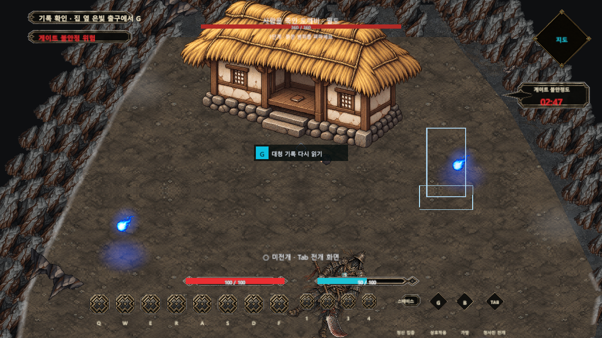
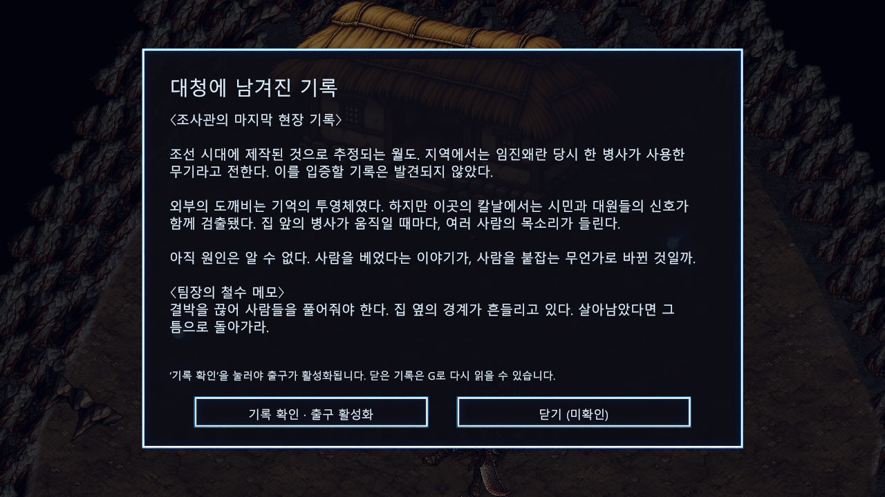
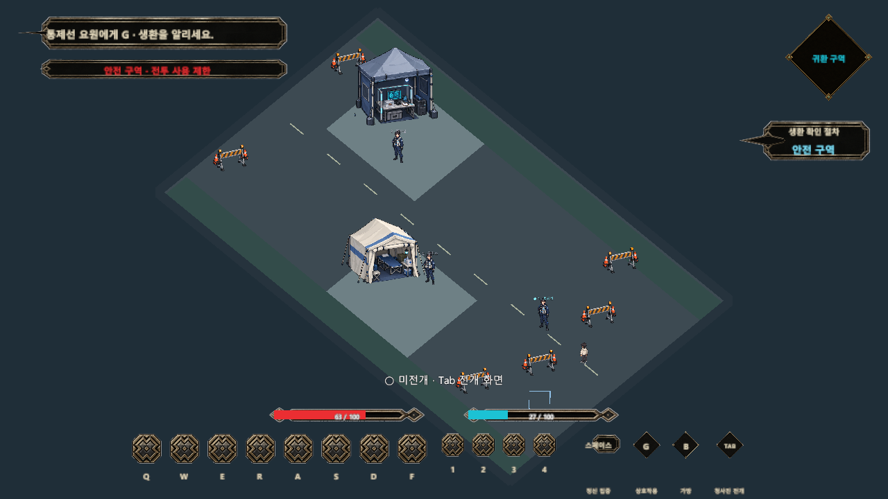
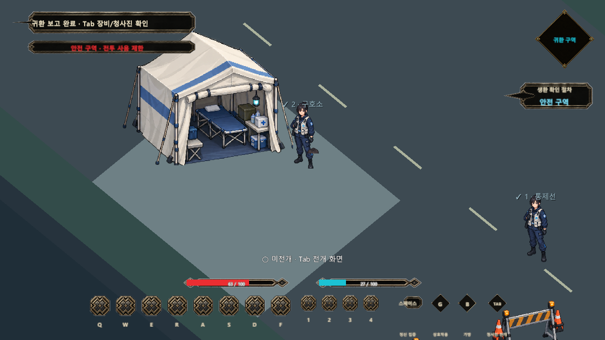
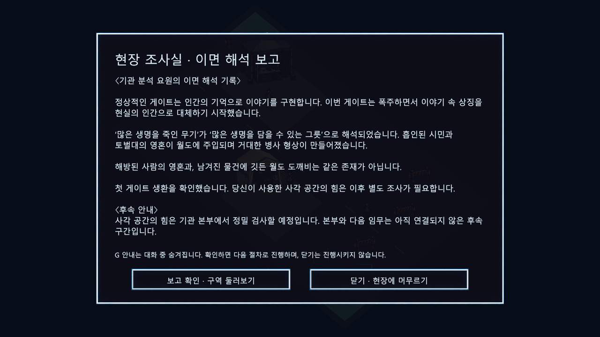

# 도깨비 게이트 콘텐츠 기획

> [!IMPORTANT]
> 문서 상태: 초안. 한국을 배경으로 하는 첫 튜토리얼의 도깨비 전승 해석, 사건 순서, 적과 보스, 정보 공개 위치를 정의합니다.

## 1. 콘텐츠 역할

도깨비는 세계 전체의 보편 아이템 체계가 아니라 한국에서 시작하는 튜토리얼 게이트의 첫 이야기 소재입니다. 이후 산군, 착호갑사, 저승사자, 이무기, 장승, 환웅 등은 각각 독립된 에피소드 또는 하나의 서사 안에서 얽히는 인물·세력·규칙으로 확장합니다.

## 2. 도깨비 전승의 게임 내 정리

```text
[민속 조사 기록 01]

일부 지역의 구전에서는 사람의 손때가 밴 생활 도구,
특히 빗자루나 부지깽이 같은 물건이 도깨비로 변한다고 전한다.

사람의 피가 묻은 물건에 생명과 정이 깃들어
도깨비가 태어났다는 이야기도 남아 있다.

지역과 채록본에 따라 도깨비가 깃드는 물건과
탄생 과정은 서로 다르게 전해진다.
```

`사람의 피에 생명이 담겨 있다`는 연결은 전승의 여러 변형을 바탕으로 한 게임의 해석이며 역사적 합의로 단정하지 않습니다.

## 3. 정상 투영과 폭주 규칙

정상적인 게이트는 지역과 사람에게 축적된 기억을 읽어 도깨비 설화의 인물, 물건과 사건을 투영합니다. 이 단계에는 실제 인간 영혼이 필요하지 않습니다.

폭주하면 `물건에 사람의 생명과 정이 깃든다`는 상징이 `실제 인간의 영혼을 물건에 주입한다`는 문자 그대로의 대체로 뒤틀립니다.

> 게이트는 인간의 기억을 읽어 이야기를 현실에 투영한다. 그러나 게이트가 폭주하면 이야기의 상징과 실제 현실의 경계가 무너지고, 기억으로 만들어야 할 존재를 실제 인간의 생명으로 만들기 시작한다.

## 4. 사건의 시간 순서

1. 관측되지 않은 잠복 게이트가 이면에서 성장하며 지역의 도깨비 기억을 읽습니다.
2. 정상적인 사전 예측 신호 없이 현실에 갑자기 전조가 나타납니다.
3. 기억 투영형 도깨비가 외부로 유출되고 기관이 이를 감지해 토벌팀을 파견합니다.
4. 토벌팀이 외부 유출 개체를 토벌하고 표면 상황이 안정되었다고 판단합니다.
5. 토벌팀은 원인 조사와 생존자 수색을 위해 게이트 내부로 진입합니다.
6. 내부에서 실제 인간 영혼이 물건에 주입된 폭주 개체를 발견합니다.
7. 토벌팀은 보스 `사람을 죽인 도깨비 — 월도`에게 패배하고, 그 영혼 일부도 월도에 흡수됩니다.
8. 게이트의 흡인 단계가 시작되어 건물은 남긴 채 주변 시민과 플레이어를 빨아들입니다.
9. 플레이어가 내부에서 깨어나 토벌팀의 시체·기록·장비를 따라 사건의 진상을 알아갑니다.
10. 플레이어가 월도를 처치하고 게이트를 닫아 현실로 생환합니다.

이 사건은 기관이 무능해서 발생한 것이 아닙니다. 기존 대응 체계는 게이트 발생 수 시간 또는 수일 전에 나타나는 예측 신호를 전제로 했고, 잠복 게이트는 그 신호 없이 이미 전조·유출 단계에서 발견되었습니다. 사건 당시 명칭은 `미등록 돌발 게이트`, 사후 분류는 `최초 확인 잠복 게이트 폭주`를 사용합니다.

## 5. 적 구분

| 개체 | 위치 | 설명 |
| --- | --- | --- |
| 기억 투영형 도깨비 | 초기 외부 유출, 내부 일부 | 지역의 도깨비 전승을 기억으로 구현한 정상 투영체 |
| 영혼 주입형 도깨비 | 내부 중후반 | 폭주 규칙으로 실제 시민의 영혼이 물건에 강제 결박된 개체 |
| 사람을 죽인 도깨비 — 월도 | 최종 구역 | 여러 영혼을 담아 거대한 병사 형상으로 성장한 폭주 개체 |

외부 유출 개체를 `자연 도깨비`라고 부르지 않습니다. 자연 발생 도깨비는 지구의 각성 이후 현실에서 독립적으로 태어난 현현체를 뜻합니다. 현장 대사에서는 투영형 개체도 단순히 `도깨비`라고 부를 수 있습니다.

## 6. 환경 기록과 튜토리얼 보상

| 발견 위치 | 기록·장비 | 전달 정보와 기능 |
| --- | --- | --- |
| 정찰대원 | 외부 토벌 완료 기록, 지도 | 기관이 외부 개체를 처리하고 진입했음을 설명 |
| 전투대원 | 응급 회복제·전투 기록 | 내부 개체가 기존 투영체와 다름을 암시 |
| 기술요원 | 코어 활성제 | 영혼과 물건의 결박 탐지, 코어 자원 시동 학습 |
| 조사관 | 유물 조사 기록 | 월도의 구전과 역사적 불확실성 제시 |
| 팀장 | 철수 경고·폐쇄 인증 | 보스 위험과 최종 목표 전달 |

```text
[작전 기록 01]
외부 유출 개체는 기존 도깨비 게이트의 투영체와 동일하다.
잔류 영혼 반응 없음. 외부 토벌 완료.
```

```text
[작전 기록 02]
내부 개체에서 인간의 생존 신호가 검출됐다.
투영 반응이 아니다. 실제 사람이 안에 있다.
```

## 7. 보스: 사람을 죽인 도깨비 — 월도

폭주한 게이트는 `많은 생명을 죽인 무기`라는 지역의 기억을 `많은 생명을 담을 수 있는 그릇`으로 뒤틀어 해석합니다. 월도에 흡인된 시민과 토벌대의 영혼이 주입되면서 얼굴 없는 거대한 병사 형상의 도깨비가 만들어집니다.

### 시각 방향

- 낡은 갑옷과 군복 조각으로 이루어진 거대한 병사
- 갑옷 틈에서 드러나는 여러 사람의 얼굴이나 손
- 말라붙은 피와 이면 결박 흔적이 남은 월도
- 실제 도깨비 전승보다 일본식 오니의 뿔·호피 이미지를 우선하지 않음

### 패턴 후보

- 넓은 횡베기
- 수직 처형 내려찍기
- 영혼을 끌어당기는 결박
- 코어 또는 수납 파츠를 향한 돌진
- 마지막 단계의 군진 행진과 연속 공격

패배하면 결박이 끊기고 흡수된 영혼이 빠져나오며, 거대한 병사 형상은 갑옷과 천 조각으로 무너집니다. 2026-10-06 보상 결정: 남은 월도는 영혼 해방 후 `G`로 획득하는 독립 청사진 도깨비 파츠입니다. 일반 장비 무기와 구분하고 기존 빗자루를 소모하지 않습니다. 첫 스킬은 넓은 횡베기이며 세부 사항은 [아이템·드롭 명세](./아이템_및_드롭_테이블.md#월도-도깨비--첫-플레이-검증-수치)를 따릅니다. 전체 붕괴 연출과 세부 구원 결과는 후속 제작입니다.

## 8. 월도 정보 공개 위치

보스 이전 토벌팀 시체에서 다음 기록을 발견합니다.

```text
[유물 조사 기록]
조선 시대에 제작된 것으로 추정되는 월도.
지역에서는 임진왜란 당시 한 병사가 사용한 무기라고 전해지지만
이를 입증할 기록은 발견되지 않았다.
```

클리어 보상 아이템에는 구전만 기록합니다.

```text
[구전 기록]
월도의 날에는 전쟁에서 죽은 사람들의 피가 남아 있으며,
밤이 되면 죽은 병사가 무기를 되찾으러 온다는 이야기가 전해진다.
```

튜토리얼 종료 후 기관 분석 요원이 폭주 원리를 설명합니다.

```text
[이면 해석 기록]
폭주한 게이트는 ‘많은 생명을 죽인 무기’를
‘많은 생명을 담을 수 있는 그릇’으로 해석했다.
흡인한 시민의 영혼이 월도에 계속 주입되면서
거대한 병사 형태의 도깨비가 형성되었다.
```

월도가 임진왜란 당시에 널리 사용되었다고 역사적 사실로 단정하지 않습니다. 확인되지 않은 지역 구전과 믿음도 기억을 재료로 삼는 게이트에는 유효하게 작동합니다.

실제 획득 위치·보호 분류·드롭 규칙은 [아이템 및 드롭 테이블](아이템_및_드롭_테이블.md), 전투 단계와 패턴은 [몬스터 및 보스 명세](몬스터_및_보스_명세.md)를 따릅니다.

## 9. 종료 후 정보 공개

기관 분석 요원은 다음 범위만 설명합니다.

> 정상적인 게이트는 인간의 기억으로 이야기를 구현합니다. 하지만 이번 게이트는 폭주하면서 기억만으로 존재를 유지하지 못했고, 이야기 속 상징을 현실의 인간으로 대체하기 시작했습니다.

이면의 진짜 형상, 상호 응시와 인간 모방에 관한 심층 설정은 튜토리얼에서 공개하지 않습니다. 기준은 [이면 및 현현체 심층 설정](../../../02_세계관_및_콘텐츠/이면_및_현현체_심층_설정.md)을 따릅니다.

## 10. 2026-10-06 종료 구간 프로토타입 연결

| 순서 | 플레이어 행동 | 실제 진행 조건 |
| --- | --- | --- |
| 1 | 월도를 쓰러뜨린 뒤 병사에게 G | 결박된 인간 영혼 해방, 눈 없는 빛이 위로 흩어지는 별도 연출 |
| 2 | 남은 월도에 G | 청사진 월도 파츠 획득. 기존 빗자루·대원의 검 유지, 중복 지급 불가 |
| 3 | 초가집 대청 앞 기록에 G | 보상 획득 뒤 열람 가능. 조사관 기록과 팀장의 철수 메모 표시 |
| 4 | ‘기록 확인’ 버튼 | 출구 활성화. ‘닫기’만으로는 진행되지 않음 |
| 5 | 집 옆 은빛 출구에 G | 귀환 확인 창. 현장에 더 머무르기 가능 |
| 6 | 완료·현장 귀환 버튼 | 공통 비동기 로딩으로 `Tutorial_Stage03_ReturnField` 이동. 실패 시 현장과 획득품 유지 |
| 7 | 게이트 통제선의 요원에게 G → 확인 | 생환 확인. 닫기만으로는 다음 절차를 완료하지 않음 |
| 8 | 임시 구호소의 요원에게 G → 확인 | 상태 확인 대화. 다음 조사실 안내. 체력·정기·파츠 내구도의 자동 회복은 없음 |
| 9 | 현장 조사실의 요원에게 G → 보고 확인 | 귀환 후 기관 분석 공개. 현장에서는 공개하지 않은 ‘생명을 담는 그릇’ 해석 제시 |

대청 기록은 역사적 사실을 단정하지 않고 유물 추정·지역 구전·조사관의 미확정 추론을 구분합니다. 해방되는 인간 영혼은 아이템 도깨비와 다른 존재입니다. 전투 중 장문 기록을 강제로 띄우지 않습니다.

초가집은 기존 원본을 보존한 `Chogajip_Daecheong_v2.png`를 사용합니다. 열린 중앙 마루·기둥·나무 바닥·기록 책을 시각 요소로 추가했습니다. 기록과 출구는 이동을 막지 않는 Trigger이고 기존 집의 물리 기반은 유지합니다. 대청 내부 자유 이동, 집의 완전한 3D 모델링은 이 작업에 포함하지 않습니다.

현재 현실 복귀는 **별도 플레이 가능한 임시 통제·구호 구역**입니다. 시작·옵션·종료를 제공하는 메뉴 로비와 구분합니다. 기관 본부는 아직 만들지 않았으며, 첫 귀환에서는 현장 확인 후 본부 정밀 검사 예정이라는 안내까지 제공합니다. 폐쇄 인증 소비·공간 붕괴 연출·디스크 영구 저장은 후속 제작입니다. 회수 파츠와 배치·스킬·일반 장비·체력·정기·코어 내구도는 같은 세션 안에서 한 번 복원하며, ‘새 게임’은 기존처럼 새 세션을 시작합니다.

### 첫 귀환 맵 — 임시 통제·구호 구역

- **목적:** 동굴 전투에서 안전한 현실 공간으로 분위기를 전환하고, 플레이어의 생환·상태 확인·사건 해석을 단계적으로 전달합니다.
- **공간:** 약 30×48m의 도로 가장자리 통제 구역. 귀환 잔류 경계와 바리케이드 → 열린 구호 천막 → 조사 장비를 갖춘 현장 조사실. 중앙 이동로를 비워 각 지점으로 이어집니다.
- **입력:** 우클릭 이동, G 요원 대화, Tab 장비·청사진 확인/편집. 일반 공격과 전투 스킬은 안전 구역에서 비활성화합니다. 민간 요원을 적으로 취급하지 않습니다.
- **조건:** 통제선 → 구호소 → 조사실 순서를 지킵니다. 후속 요원은 선행 확인 전 상호작용 불가. 완료한 대화는 다시 읽을 수 있고 진행·보상은 중복 처리하지 않습니다.
- **취소·차단:** 대화를 열면 이동을 멈추고 G 안내와 HUD를 숨깁니다. 닫으면 진행 없이 복귀하며, 대화가 획득한 입력 차단 토큰만 해제합니다.
- **그래픽:** 신규 투명 도트 아틀라스에서 구호 천막·조사실·바리케이드·현장 요원을 분리합니다. 바닥은 별도 메시와 재질, 이동은 저장된 NavMesh, 천막 충돌은 실제 지면 기반으로 구분합니다.
- **설정 경계:** 구조 대상의 최종 생사·완전한 부활을 확정하지 않습니다. 인간 영혼과 물건에 깃든 도깨비를 구분하고, 사각 공간의 힘은 본부 정밀 조사 대상으로 안내합니다. 공식 설계자 분류 등록 연출은 후속입니다.
- **잔여 범위:** 현재는 안전 구역 초안입니다. 본부 시설·다음 임무·요원별 독립 캐릭터 원화·음성/SFX·영구 저장은 제작되지 않았습니다.

### 실제 Unity 검증 화면











별도 Unity 6000.3.7f1 검증 프로젝트의 실제 렌더입니다. 귀환 흐름 96개와 보스 G 보상 17개·월도 편집/전개/스킬 43개 회귀 검증을 통과했습니다(총 156개). 실제 보스 출구 → 비동기 씬 이동 → 인계 상태 복원 → 각 지점의 NavMesh 도달·G 대화·취소·명시적 확인 → 보고 완료 → Tab 접근까지 검증했습니다. 사용자 편집 중인 기존 튜토리얼 씬 두 개는 재생성하거나 저장하지 않았습니다. 생성 소품이 적용된 첫 플레이 가능 초안이며, 바닥·주변 배경 디테일과 수동 연속 플레이의 거리감·리듬 평가는 별도로 필요합니다.

## Revision History

| 날짜 | 버전 | 변경 내용 | 작성자 |
| --- | --- | --- | --- |
| 2026-08-06 | v0.1 | 도깨비 전승, 잠복 게이트 사건, 투영·영혼 주입 구분과 월도 보스 기획 기록 | 송예찬 |
| 2026-08-07 | v0.2 | 아이템·드롭 및 적·보스 구현 명세 연결 | 송예찬 |
| 2026-10-06 | v0.3 | 대청 기록·출구 활성화·로비 복귀·귀환 분석의 구현 범위와 정식 연출의 차이 기록 | 송예찬 |
| 2026-10-06 | v0.4 | 보스 출구를 별도 첫 귀환 맵으로 연결, 통제·구호·분석 단계와 안전 구역·상태 인계 범위 반영 | 송예찬 |
