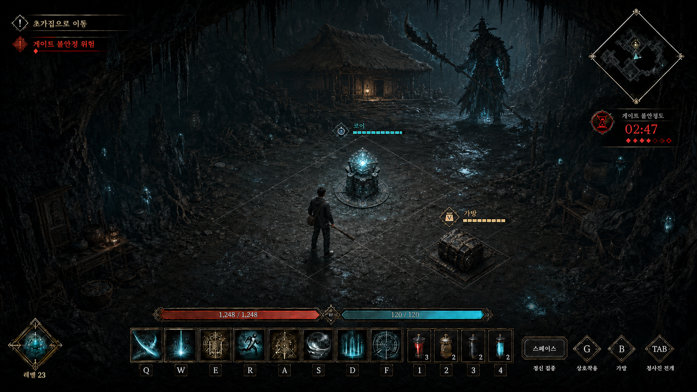
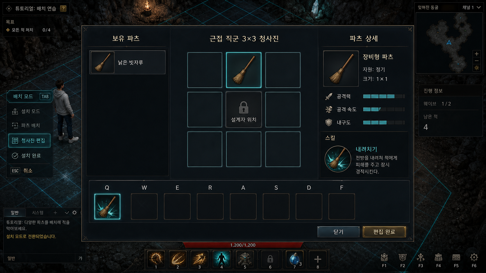
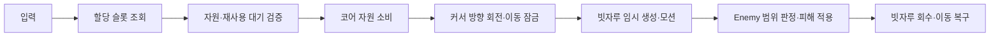

# 청사진 편집 및 빗자루 스킬 프로토타입

> [!IMPORTANT]
> 문서 상태: 프로토타입. `TestMap`에서 입력·데이터·UI·연출 연결과 Unity 컴파일을 검증한 현재 구현 기준입니다. 수치와 임시 모션은 플레이테스트 후 조정합니다.

## Quick Links

[튜토리얼](../README.md) · [구현 시스템 목록](./구현_시스템_목록.md) · [조작 학습 및 UI 안내](./조작_학습_및_UI_안내.md) · [인게임 HUD 구현 명세](../../01_핵심_플레이/인게임_HUD_구현_명세.md) · [장비·코어·스킬](../../01_핵심_플레이/장비_코어_스킬/README.md)

## 검증 목표

`낡은 빗자루` 하나로 다음 흐름을 끊김 없이 확인합니다.

## 기준 이미지

### 인게임 HUD

정신 집중은 별도 게이지를 만들지 않고 기존 코어 에너지의 비효율적 수동 회복 수단으로 표시합니다. 전투 중에는 중앙 하단에서 체력·코어 에너지·스킬 슬롯을 함께 확인합니다.

### 청사진 편집

시안은 정보 배치와 조작 흐름의 기준입니다. 실제 Unity 화면의 한글, 키 바인딩, 능력치와 슬롯 상태는 런타임 UI로 조립합니다.

## 현재 조작 흐름

| 입력 | 현재 동작 | 예외·주의 |
| --- | --- | --- |
| `G` | 범위 안의 `낡은 빗자루` 획득 | 획득 직후 편집 창을 자동으로 열지 않음 |
| `Tab` | 전개 HUD 열기·닫기 | 필드에는 옅은 전체 격자와 강조된 근접 `3×3` 유효 영역 표시 |
| `청사진 편집` | 보유 파츠·격자·상세 정보 화면 열기 | 전개 HUD 안의 명시적 버튼으로 진입 |
| 보유 파츠 좌클릭 후 격자 좌클릭 | 선택한 파츠 배치 | 근접 직군의 중앙 칸은 설계자 위치로 잠금 |
| 보유 파츠 드래그 앤 드롭 | 대상 격자에 즉시 배치 | 유효하지 않은 셀에는 배치하지 않음 |
| 배치 파츠 호버 + `QWERASDF` | 해당 파츠의 액티브 스킬을 슬롯에 할당 | 슬롯 직접 선택은 보조 입력으로 유지 |
| 할당된 `QWERASDF` | 스킬 사용 | 자원·재사용 대기·배치 상태 검증 후 실행 |

## 빗자루 파츠 프로토타입

- 빗자루는 획득 가능한 장비형 파츠입니다.
- 같은 원형에서 기초 능력치와 액티브 스킬을 무작위로 부여할 수 있는 정식 파밍 구조를 시험합니다.
- 현재 프로토타입은 `내려치기`, `쓸어치기`, `찌르기` 계열 중 하나를 가집니다.
- 튜토리얼의 첫 필수 획득 결과를 고정할지는 [아이템 및 드롭 테이블](../콘텐츠/아이템_및_드롭_테이블.md)의 보정 규칙을 따릅니다.
- 빗자루는 상시 손에 들지 않습니다. 스킬 사용 순간에만 임시 손 위치에 나타나 공격 모션을 수행한 뒤 사라집니다.

## 스킬 실행 규칙

| 스킬 | 자원 비용 가안 | 재사용 대기 가안 | 프로토타입 역할 |
| --- | ---: | ---: | --- |
| 내려치기 | 50 | 1.2초 | 전방 단일 지점에 강한 타격 |
| 쓸어치기 | 60 | 1.8초 | 전방의 넓은 범위를 횡으로 공격 |
| 찌르기 | 45 | 0.9초 | 좁고 긴 전방 범위를 빠르게 공격 |

정신 집중으로 모은 코어 에너지는 전개할 때 초기화하지 않습니다. 코어 전개 후에도 정신 집중은 사용할 수 있지만, 자동 생성보다 위험하고 비효율적인 보조 회복 수단으로 남깁니다.

## 구현 경계

| 계층 | 책임 | 현재 구현 |
| --- | --- | --- |
| 입력 | `SkillQ/W/E/R/A/S/D/F`, `G`, `Tab` 신호 제공 | Input Actions와 입력 판독기 연결 |
| 게임플레이 | 할당 조회, 자원·쿨다운·피해 규칙 | 프레젠테이션을 직접 참조하지 않는 실행 흐름 |
| 프레젠테이션 | 편집 UI, 빗자루 표시와 임시 모션 | Canvas UI와 Transform 기반 모션 |
| 데이터 | 파츠, 무작위 능력치, 보유 스킬과 슬롯 | 튜토리얼용 런타임 데이터로 검증 |
| 씬 조립 | 프리팹·손 위치·컴포넌트 참조 연결 | 반복 실행 가능한 에디터 빌더로 `TestMap` 갱신 |

## 검증 결과

- Unity 스크립트 컴파일과 어셈블리 재로드를 통과했습니다.
- `TestMap`에 청사진 편집 UI, 임시 손 위치, 스킬 실행기와 빗자루 연출 참조가 연결됐습니다.
- 플레이 모드 진입 후 누락 참조·Null·컴파일 오류가 발생하지 않는 것을 확인했습니다.
- 에디터가 플레이 모드인 상태에서는 씬 조립 빌더를 실행할 수 없으므로, 플레이 모드를 종료한 뒤 빌더를 다시 실행하는 절차를 확인했습니다.

## 남은 검증

- 실제 적 프리팹을 대상으로 각 공격 범위와 피해를 플레이테스트합니다.
- Transform 기반 임시 모션을 캐릭터 Animator와 Animation Event 기반 장착·타격·회수로 교체합니다.
- 자원 부족, 재사용 대기, 잘못된 배치와 슬롯 중복의 HUD 피드백을 추가합니다.
- 클릭 배치와 드래그 앤 드롭이 해상도·UI 스케일 변화에서도 같은 셀을 선택하는지 확인합니다.
- 근접 외 직군의 원점과 유효 영역은 해당 직군 문서가 확정된 뒤 별도 규칙으로 구현합니다.

## Revision History

| 날짜 | 버전 | 변경 내용 | 작성자 |
| --- | --- | --- | --- |
| 2026-08-18 | v0.1 | 빗자루 획득·청사진 편집·슬롯 할당·스킬 실행 프로토타입과 기준 시안 기록 | 송예찬 |
