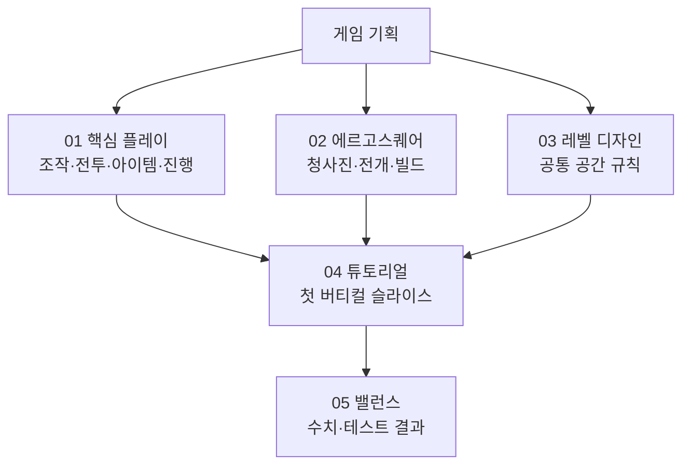

# 게임 기획

> [!IMPORTANT]
> 이 폴더는 플레이어 경험과 게임 규칙의 기준 문서를 관리합니다. 튜토리얼은 전체 규칙을 복제하지 않고 적용 범위만 기록합니다.

## Quick Links

[프로젝트 홈](../README.md) · [핵심 플레이](./01_핵심_플레이/README.md) · [에르고스퀘어](./02_에르고스퀘어/README.md) · [튜토리얼](./04_튜토리얼/README.md) · [세계관](../02_세계관_및_콘텐츠/README.md) · [기술 문서](../03_기술_문서/README.md)

## 기획 구조

## 읽기 순서

1. [핵심 플레이](./01_핵심_플레이/README.md): 인게임 조작, 진행과 전투 루프
2. [에르고스퀘어](./02_에르고스퀘어/README.md): 설계자 빌드와 전개 규칙
3. [레벨 디자인](./03_레벨_디자인/README.md): 공통 공간 설계 기준
4. [튜토리얼](./04_튜토리얼/README.md): 첫 버티컬 슬라이스 적용 기획
5. [밸런스](./05_밸런스/README.md): 수치 검증 자료

## 영역 상태

| 영역 | 상태 | 현재 초점 | 다음 판정 |
| --- | --- | --- | --- |
| 핵심 플레이 | 튜토리얼 우선 초안 | 코어·파츠·스킬과 익스트랙션 | 실제 조작 프로토타입 |
| 에르고스퀘어 | 기준 초안 | 3×3 원점, 1×1 코어와 공간 경제 | 편성·전개 UX 검증 |
| 레벨 디자인 | 아이디어 | 전개 위치와 코어 방어 공간 | 튜토리얼 블록아웃 |
| 튜토리얼 | 초안 | 도깨비 잠복 게이트 버티컬 슬라이스 | 구현 명세 확정 |
| 밸런스 | 운영 틀 | 수치 기록 형식 | 첫 전투 데이터 입력 |

## 문서 경계

- 전체 게임 규칙은 `01_핵심_플레이`과 `02_에르고스퀘어`에 한 번만 정의합니다.
- 튜토리얼은 기능을 언제 가르치고 어떤 장면에서 검증하는지만 정의합니다.
- 세계관의 사실과 사건은 `02_세계관_및_콘텐츠`, 구현 구조는 `03_기술_문서`를 기준으로 합니다.
- 미확정 사항은 `TBD`, 플레이테스트 전 수치는 `가안`으로 표시합니다.

## Revision History

| 날짜 | 버전 | 변경 내용 | 작성자 |
| --- | --- | --- | --- |
| 2026-08-15 | v0.1 | 게임 기획 문서 인덱스와 기준 문서 경계 작성 | 송예찬 |
| 2026-08-17 | v0.2 | Quick Links, 기획 구조도와 영역 상태 표 추가 | 송예찬 |
