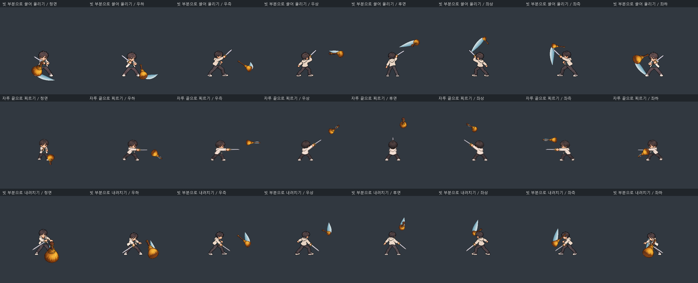
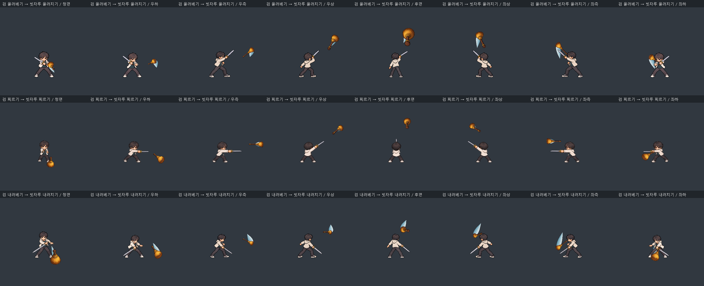
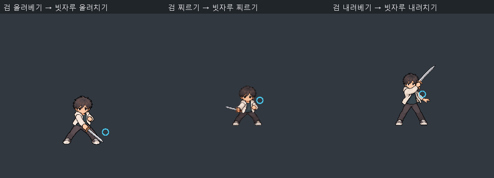
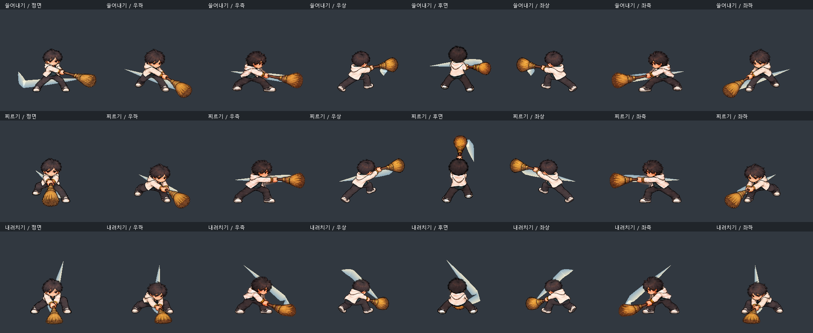
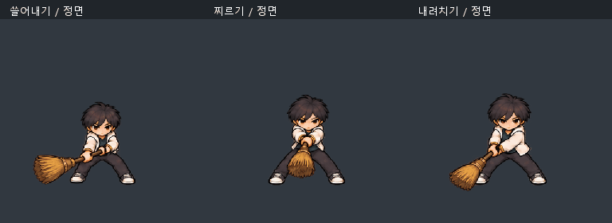
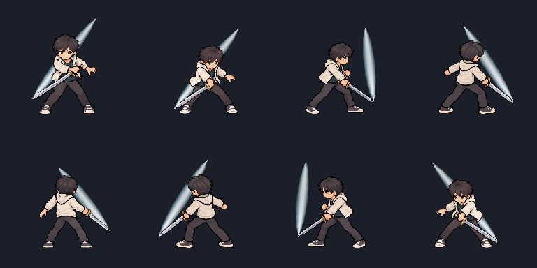
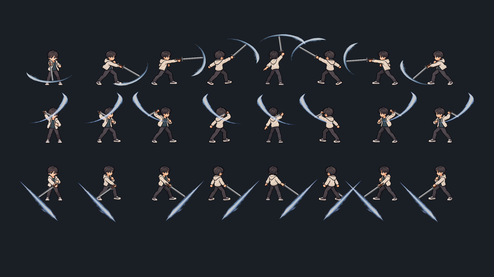

# 시스템 상세 부록

> 작성자: 송예찬 · 통합일: 2026-09-14 · 상태: 기존 상세 초안 통합 / 미검증

[종합 기획서](../00_프로젝트_개요/에르고스퀘어_종합_기획서_초안.md) · [부록 안내](./README.md)

이 부록은 기존 시스템 문서의 상세 표·예외·열린 질문을 한 파일로 모은 참고 자료입니다. **게임 규칙의 최종 기준은 종합 기획서**이며, 아래 과거 초안·수치·완료 체크는 확정 또는 구현 완료를 뜻하지 않습니다. 충돌은 종합 기획서의 결정 목록에서 해결한 뒤 이 부록을 함께 갱신합니다.

중앙 원점 예약은 튜토리얼 근접 계통에 적용합니다. 다른 계통에 일반화하지 않습니다. 코어 재전개는 자원을 초기화하지 않습니다. 편집 중 QWERASDF는 스킬 할당 입력이며 Q/E 회전 후보와의 충돌은 미확정입니다.

## 목차

- [전체 장기 플레이 루프](#long-loop)
- [플레이어](#player)
- [조작](#controls)
- [전투](#combat)
- [아이템](#items)
- [성장 및 보상](#growth)
- [실패 철수 사망](#failure)
- [적 AI](#enemy-ai)
- [UI UX](#ui)
- [코어 획득 및 능력치](#core-drop)
- [설계자 빌드](#deployment)
- [청사진 성장 및 공간 경제](#space-economy)

<a id="long-loop"></a>

## 전체 장기 플레이 루프

> [!IMPORTANT]
> 문서 상태: 초안

### 문서 역할과 읽기 순서

이 문서는 플레이어가 반복해서 경험할 전체 게임 흐름을 정의하는 상위 기준 문서입니다. 현재 인게임 전투 흐름은 튜토리얼에서 먼저 검증하며 세부 규칙은 아래 전용 문서에서 관리합니다.

1. 현재 문서: 전체 게임과 인게임 전투의 기본 흐름
2. [인게임 핵심 플레이 루프](01_핵심_플레이/README.md): 튜토리얼에서 먼저 구현할 조작과 진행의 기준
3. [장비·코어·스킬](01_핵심_플레이/장비_코어_스킬/README.md): 장비, 스킬 편성, 코어 자원과 재제작
4. [청사진 성장 및 공간 경제](#space-economy): 레벨별 격자, 직접·주머니 수납과 방어 공간
5. [실패·철수·사망](#failure): 익스트랙션, 월드 영구 사망과 협동 중상
6. [전투](#combat): 피격, 코어 방어와 MVP 검증 항목
7. [조작](#controls): 키보드·마우스 입력 기준

세부 문서와 내용이 충돌하면 각 세부 규칙은 해당 전용 문서를 우선하고, 플레이 단계의 연결은 이 문서를 우선합니다.

```text
게임 시작
  ↓
번호 지구 생성 또는 불러오기
  ↓
정해진 허브 시설 탐색·채집·업그레이드
  ↓
청사진에 코어·파츠 배치
  ↓
게이트 발견·이야기 분석
  ↓
평행 지구 진입·에르고스퀘어 전개
  ↓
퀘스트·전투·코어 방어·게이트 폐쇄 또는 철수
  ↓
반출한 장비·재료 저장과 지구 안정화
  ↓
허브 시설·청사진 성장 후 다음 게이트 추적
```

| 단계 | 플레이어 목표 | 주요 행동 | 사용 시스템 | 보상·위험 | 다음 조건 |
| --- | --- | --- | --- | --- | --- |
| 월드 | 자신의 지구에 기반 구축 | 탐색·채집·시설 강화 | 월드·저장·허브 | 자원·안전지대 / 침식 확산 | 게이트 발견 |
| 준비 | 게이트 조건에 맞는 빌드 구성 | 이야기 분석·프레임·파츠 선택 | 퀘스트·청사진 편성 | 공략 정보 / 약점 노출 | 편성 확정 |
| 진입 | 중첩된 평행 지구의 상황 파악 | 이동·탐색·대화 | 게이트·레벨·퀘스트 | 정보·분기 / 교전 위험 | 폐쇄 조건 확인 |
| 전개 | 전투 기반 구축 | 청사진 전개 | 에르고스퀘어 | 기능 활성화 / 코어 노출 | 파츠 활성화 |
| 해결 | 서사·전투 목표 달성과 코어 보호 | 공격·회피·협동·선택 | 전투·AI·퀘스트 | 좌표·전리품 / 파츠 파괴 | 폐쇄 조건 달성 |
| 철수·귀환 | 위험 전에 철수하거나 게이트를 닫고 성과 보존 | 철수 연결·보상 반출 | 익스트랙션·결과·저장 | 성장 자원 / 열린 게이트 폭주 진행 | 허브 복귀 |
| 성장 | 다음 공략과 최종 수렴점 준비 | 시설 강화·청사진 수정·연구 | 허브·성장·편성 | 더 넓은 선택 / 새 위협 | 다음 게이트 추적 |

### 튜토리얼에서 먼저 검증할 인게임 기본 흐름

아래 흐름은 전체 게임의 최종 사양이 아니라 [인게임 핵심 플레이 루프](01_핵심_플레이/README.md)에서 튜토리얼 우선으로 구현·검증할 축소 구조입니다.

```text
무기 획득
  ↓
무기에 부여된 액티브 스킬 확인
  ↓
스킬을 Q/W/E/R/A/S/D/F 중 원하는 슬롯에 편성
  ↓
이동·기본 공격과 편성한 기동·방어 스킬로 교전 시작
  ↓
전장에 코어 전개
  ↓
코어가 생성한 자원을 소비해 액티브 스킬 사용
  ↓
플레이어와 코어를 함께 보호하며 전투 목표 달성
  ↓
새 무기·스킬·코어 후보를 획득하고 빌드 갱신
```

#### 튜토리얼 현재 결정

- 무기에는 플레이어가 직접 사용할 액티브 스킬이 부여됩니다.
- 획득한 무기 스킬은 `QWERASDF` 8개 전투 슬롯 중 하나에 할당합니다.
- 액티브 스킬은 전개된 코어가 생성하는 전투 자원을 소비합니다.
- 이동과 기본 공격은 코어 자원이 없어도 사용할 수 있습니다. 기동·방어 행동은 편성한 스킬의 자원 규칙을 따릅니다.
- 코어는 전장에 존재하고 공격받을 수 있는 전략적 전개물입니다.
- 코어가 손상되면 자원 생성 효율이 낮아질 수 있으며, 파괴되면 축적 자원·장비 스킬·활성 능력과 신규 생성이 중단됩니다.

#### 이 흐름이 만드는 판단

- 어떤 무기 스킬을 제한된 슬롯에 편성할지 선택합니다.
- 코어를 안전한 곳에 둘지, 위험을 감수하고 전투에 유리한 곳에 둘지 결정합니다.
- 생성된 자원을 즉시 소비할지 강한 스킬을 위해 비축할지 판단합니다.
- 공격에 집중할지 코어 방어와 복구에 행동을 배분할지 결정합니다.

### 첫 전투 프로토타입 범위

- 녹슨 검 1종과 기본 공격
- 녹슨 검에 부여될 후보 스킬: 종베기, 횡베기, 찌르기
- `QWERASDF` 슬롯 편성과 스킬 발동
- 기본 코어 1종의 전개와 단일 전투 자원 생성
- 스킬의 자원 소비와 사용 불가 피드백
- 적의 코어 공격, 손상에 따른 생산 효율 저하와 파괴 시 활성 능력 중단

무기 스킬의 고정·무작위 부여 방식과 자원의 정식 명칭은 아직 확정하지 않습니다.

### 시스템 관점

1. 편성 데이터가 격자 좌표와 연결 정보를 저장합니다.
2. 호스트 세이브가 지구 번호, 허브 시설, 게이트와 진행 상태를 보존합니다.
3. 진입 시 게이트의 서사 규칙, 퀘스트와 전장 상태를 초기화합니다.
4. 전개 시 청사진 데이터를 월드 오브젝트로 변환합니다.
5. 전투 중 파츠·퀘스트 상태와 피해를 갱신·동기화합니다.
6. 철수 또는 귀환 시 반출에 성공한 장비·재료와 게이트 결과를 월드 상태에 반영합니다.

### 실패 가능성

- 코어 또는 핵심 파츠 파괴
- 플레이어 또는 팀 전멸
- 작전 목표 실패
- 게이트 침식도 초과 또는 폐쇄 조건 상실
- 네트워크 이탈과 상태 불일치

플레이어 또는 파티 전멸은 해당 번호 지구의 게임오버이며 새 지구 생성을 요구합니다. 코어 파괴는 즉시 사망이 아니지만 활성 장비 능력과 스킬을 잃고 허브 복구 전까지 회복되지 않습니다. 목표를 달성하지 못해도 전멸 전에 철수하면 반출 보상을 이용해 재정비하고 재도전할 수 있습니다. 세부 판정은 [실패·철수·사망](#failure)을 따릅니다.

### 협동 월드 원칙

- 초기 협동은 2~4명의 설계자가 하나의 번호 지구와 허브를 공유합니다.
- 개인 체력 0은 중상으로 처리하고 아군 구조 또는 파티 철수를 기다립니다.
- 모든 파티원이 동시에 중상이 되면 공동 월드가 게임오버됩니다.
- 다른 번호 지구에서 방문하는 플레이어와 반입·반출 규칙은 엔딩 이후 확장으로 보류합니다.

<a id="player"></a>

## 플레이어

> [!IMPORTANT]
> 문서 상태: 초안

### 역할

플레이어는 잠복 게이트 폭주에서 생환하며 에르고스퀘어가 발현한 특수 각성자입니다. 기관은 에르고스퀘어 운용자에게 `설계자(Architect)`라는 작전 코드네임과 분류를 부여합니다. 모든 설계자는 각성자이지만 모든 각성자가 설계자는 아닙니다.

솔로에서는 한 명의 생환자를, 협동에서는 같은 사건 또는 같은 작전에서 연결된 2~4명의 설계자 팀을 플레이합니다. 시나리오에서는 인원수에 따라 다시 쓰지 않아도 되는 `잠복 게이트 생환자`라는 표현을 우선 사용합니다.

### 핵심 능력

- 직접 이동·공격과 장비 스킬 기반 기동·방어
- 인벤토리 게이트 접근
- 에르고스퀘어 편성·전개·회수
- 팀원의 코어와 파츠 지원
- 다른 각성자·현현체의 능력 원리를 설계로 모사하고 융합

빌드와 전개 계통의 전체 규칙은 [설계자 빌드](#deployment)를 따릅니다.

### 기본 상태 후보

```text
공통: Idle → Move → Attack/Interact → Hit
싱글: 체력 0 → Dead → 월드 게임오버
협동: 체력 0 → Down(중상) → Revive 또는 파티 전멸
```

싱글에서는 사망 시 해당 번호 지구가 종료됩니다. 협동에서는 개인을 월드에서 사출하지 않고 중상 상태로 전환하며, 전원이 중상이 되었을 때만 공동 월드 게임오버로 판정합니다. 구조·철수·코어 파괴의 전체 규칙은 [실패·철수·사망](#failure)을 따릅니다. 근접·투사·영역은 고정 직업이 아니라 전개 위치를 결정하는 계통으로 사용합니다.

### 완료 조건

- [ ] 기본 이동과 카메라
- [ ] 공격·피격·사망
- [ ] 전개 상호작용
- [ ] 팀원 상태 표시
- [ ] 입력 장치별 조작 검증

<a id="controls"></a>

## 조작

> [!IMPORTANT]
> 문서 상태: 확정(키보드·마우스 기본 매핑). 정신 집중 수치, 카메라 세부 범위와 게임패드 매핑은 프로토타입 검증 후 확정합니다.

### 목적

아이소메트릭 실시간 전투, 소비 아이템 사용, 가방 관리와 에르고스퀘어 전개를 하나의 일관된 키보드·마우스 조작 체계로 정의합니다.

### 기본 원칙

- 마우스는 이동, 대상 지정, 기본 공격과 배치 위치를 다룹니다.
- `QWERASDF` 전체를 전투 스킬 슬롯으로 유지합니다.
- 가방 관리와 에르고스퀘어 전개를 `B`와 `Tab`으로 분리합니다.
- 상호작용은 스킬 키와 충돌하지 않도록 `G`를 사용합니다.
- 화면의 키 안내는 고정 문자열이 아니라 현재 바인딩 값을 표시할 수 있게 구성합니다.

### 일반 조작

| 입력 | 기능 |
| --- | --- |
| 우클릭 / 길게 누르기 | 지정 지점으로 이동 |
| 좌클릭 | 기본 공격 또는 선택한 위치 지정 아이템 사용 |
| `QWERASDF` | 8개 전투 스킬 슬롯 |
| `Space` 길게 누르기 | 정신 집중: 행동을 멈추고 비효율적으로 자원 회복 |
| `G` | 대화·조사·구조·장치 상호작용 |
| `1~4` | 소비 아이템 슬롯 |
| `B` | 가방·일반 아이템·획득품 목록 |
| `Tab` | 에르고스퀘어 전개 모드 진입·종료 |
| `Alt` | 바닥 아이템 정보 표시 |
| `Esc` | 메뉴 또는 현재 모드 취소 |

### 소비 아이템 조작

#### 즉시 사용형

회복제처럼 대상 지정이 필요 없는 아이템은 `1~4` 중 등록된 숫자 키를 누르면 즉시 사용합니다.

#### 위치 지정형

수류탄처럼 지점을 정해야 하는 아이템은 다음 순서로 사용합니다.

```text
숫자 키로 아이템 선택
→ 유효 거리·영향 범위 표시
→ 좌클릭으로 사용
→ 우클릭 또는 Esc로 취소
```

우클릭 취소가 기본 이동과 충돌하므로, 취소 시 이동 명령을 함께 발생시킬지는 조작 프로토타입에서 검증합니다.

### 상호작용

- `G` 짧게 누르기: 흔적 조사, 문·장치 작동, 대화
- `G` 길게 누르기: 민간인 구조, 장치 수리, 게이트 안정화
- 대상이 여럿이면 캐릭터와 가깝고 커서 방향에 있는 대상을 우선합니다.
- 상호작용 범위에서는 대상 위에 `G` 키와 행동 동사를 표시합니다.
- 일반 자원은 자동 획득하여 `G`를 의미 있는 행동에만 사용합니다.

### 에르고스퀘어 전개 조작

| 입력 | 전개 모드 기능 |
| --- | --- |
| 마우스 이동 | 배치할 격자·파츠 선택 |
| 좌클릭 | 배치 또는 확정 |
| 우클릭 | 이전 단계·배치 취소 |
| `Q` / `E` | 선택 파츠 회전 |
| `1~4` | 파츠 단축 선택 가안 |
| `Tab` | 전개 모드 종료 |
| `Space` | 전개 모드 중 정신 집중 입력 처리 `TBD` |

전개 모드에서는 일반 스킬 입력을 중단하고 `Q/E`를 파츠 회전에 사용합니다. 전개 중 시간 흐름은 실시간을 기본 가설으로 검증하되, 정지·감속과 비교한 뒤 확정합니다.

### 가방과 전개의 경계

- `B`: 장비·재료·소비품과 수납 상태를 확인하고 관리합니다.
- `Tab`: 미리 편성한 청사진을 현재 공간에 투영·전개합니다.
- 전투 중 `Tab`은 복잡한 인벤토리 편집이 아니라 준비된 설계의 빠른 현장 전개입니다.

### 입력 상태

| 상태 | 우선 입력 | 제한 |
| --- | --- | --- |
| 일반 | 이동·공격·스킬·상호작용 | 없음 |
| 정신 집중 | `Space` 유지 | 이동·기본 공격·스킬 사용 중단, 받는 피해 증가 |
| 위치 지정 아이템 | 좌클릭 사용, 취소 | 기본 공격 중단 |
| 에르고스퀘어 전개 | 격자·파츠 배치 | 일반 스킬 입력 중단 |
| 가방 | 아이템 확인·관리 | 온라인 전투 중 시간 정지 없음 |
| 길게 상호작용 | 진행 유지 | 피격·범위 이탈 시 취소 가안 |

### UI·피드백

- 스킬 슬롯은 키, 쿨다운, 사용 불가 이유를 표시합니다.
- 위치 지정 아이템은 커서, 캐릭터와 퀀슬롯에 같은 식별 효과를 표시합니다.
- 전개 가능·불가, 손상·파괴는 색상만으로 구분하지 않습니다.
- 입력 상태가 바뀌면 커서 형태와 HUD 표시를 함께 바꿉니다.
- 정신 집중 중에는 자원 증가량, 행동 제한과 받는 피해 증가 상태를 동시에 표시합니다.

### 정신 집중

- `Space`를 누르는 즉시 시작하고 놓으면 즉시 종료합니다.
- 누르는 동안 현재 장착한 코어와 호환되는 자원을 초당 `10` 회복합니다. `10`은 프로토타입 검증값입니다.
- 코어 전개 전후 모두 사용할 수 있으며, 전개 전에 모은 자원은 전개할 때 초기화되지 않습니다.
- 전개 후에도 사용할 수 있지만 코어가 자동으로 자원을 생성하므로 행동을 포기할 만큼 효율적이지 않은 보조 수단입니다.
- 집중 중에는 이동, 기본 공격과 스킬을 사용할 수 없고 받는 피해가 증가합니다. 피해 배율의 첫 검증값은 `1.5배`입니다.
- 코어 파괴 등 자원 계통 자체가 비활성화된 상태에서는 사용할 수 없습니다.
- 공통 회피 키는 두지 않습니다. 회피·방어·기동 행동은 장비가 제공하는 스킬로 `QWERASDF`에 편성합니다.

### 미확정 세부 항목

- 정신 집중 중 받는 피해 배율과 초당 회복량의 최종값
- 전개 모드에서 `Space` 정신 집중을 허용할지
- 위치 지정 아이템 취소 시 우클릭 이동 명령을 함께 발생시킬지
- 전개 중 시간 흐름과 피격 규칙
- 카메라 확대·축소 범위와 회전 지원 여부
- 게임패드 매핑과 키 리바인딩 세부 정책

### 완료 조건

- [ ] 일반, 아이템 지정, 전개와 가방 상태가 오입력 없이 전환됩니다.
- [ ] 필수 조작을 UI 설명 없이도 반복할 수 있습니다.
- [ ] 조작 키를 바꿔도 모든 프롬프트가 현재 바인딩을 표시합니다.
- [ ] 자주 사용하는 기능 사이의 입력 충돌이 플레이를 방해하지 않습니다.

### 남은 문제

- 스킬 잠금·교체·프리셋 규칙
- 상호작용 대상 변경 또는 순환 기능의 필요성
- 키보드·마우스와 게임패드 사이의 동일한 플레이 감각 재현 방식

<a id="combat"></a>

## 전투

> [!IMPORTANT]
> 문서 상태: 초안

### 목적

직접 액션과 코어 방어 판단을 동시에 요구해, 강한 빌드가 곧 지켜야 할 약점이 되도록 합니다.

### 기본 구조

- 플레이어 직접 공격과 장비 스킬 기반 기동·방어
- 파츠 기반 공격·방어·지원
- 플레이어·코어·파츠를 선택하는 적의 위협 판단
- 팀원 간 화력 집중과 방어 역할 분담

전개된 코어와 파츠는 충돌·피격 판정을 가진 월드 오브젝트입니다. 공격과 이동을 막아 플레이어의 방패가 될 수 있지만 동시에 적의 공격으로 파괴될 수 있습니다. 핵심 코어가 파괴되면 축적 자원, 장비 스킬과 활성 추가 능력이 중단되며 허브 복구 전까지 회복되지 않습니다.

장비 부여 스킬, `QWERASDF` 편성과 코어의 생성·손상·파괴 규칙은 [장비·코어·스킬](01_핵심_플레이/장비_코어_스킬/README.md)을 기준으로 합니다. 이동과 기본 공격은 코어 자원 없이도 유지하며, 공통 회피 대신 편성한 기동·방어 스킬을 사용합니다. `Space` 정신 집중은 코어 전개 전후 사용할 수 있는 느리고 위험한 수동 자원 회복입니다.

근접·투사·영역 계통의 차이는 무기 제한보다 전개 가능한 위치에서 발생합니다. 계통별 거리 규칙, 코어 보호 방식과 대표 융합 빌드는 [설계자 빌드](#deployment)를 기준으로 합니다.

### 훈련검 기본 공격 프로토타입

<a id="basic-combo-trail"></a>

#### 빗자루 3종 스킬 — 오브젝트 이미지/이펙트 분리 v3 (2026-10-03)

작성자: 송예찬. 상태: 프로토타입 적용, 튜토리얼 수동 검수 대상.

빗자루 프리팹 자체에 이미지와 `PrototypeBroomObjectVisual`을 연결합니다. 이 컴포넌트는 빗자루 루트의 이동·회전과 이미지 표시만 담당합니다. 출현/소멸 광륜과 공격 궤적은 `PrototypeBroomSkillEffects`의 별도 월드 오브젝트에서 처리합니다. 플레이어는 검 모션만 재생하며, 플레이어·빗자루·이펙트 사이에 부모/자식 연결은 두지 않습니다. 공유하는 것은 승인된 스킬 시간입니다.

| 스킬 | 빗자루 동작 | 타격 끝 / 궤적 기준 |
| --- | --- | --- |
| 올려치기 | 낮은 빗 끝으로 넓게 쓸고 마지막에 쓸어 올림 | 빗 부분 |
| 찌르기 | 빗 머리는 뒤에 두고 나무 자루 끝을 앞으로 찌름 | 자루 끝 |
| 내려치기 | 빗 머리를 위에서 아래로 내려찍음 | 빗 부분 |

빗자루 축의 최소 가독성 보정에도 각 스킬의 실제 타격 끝과 이펙트 위치를 맞춥니다. 찌르기 리본은 좁게, 빗 부분 리본은 넓게 표시합니다. 원화는 v2의 빗자루 단독/검 동작 이미지를 재사용하고, 기존 피해·비용·재사용·스킬 슬롯·이동 정지 규칙은 유지합니다. 바닥 획득용 빗자루의 충돌/상호작용은 변경하지 않습니다.




별도 Unity 검증 1,689개 검사 통과: 프리팹 이미지 연결, 이펙트 루트 분리, 이펙트만 꺼도 이미지 유지, 8방향 타격 끝/궤적 일치, 낮게 쓸기/자루가 앞서는 찌르기, 기존 피해·자원·정지·종료 복구를 확인했습니다. 실제 튜토리얼 카메라에서의 자연스러움과 겹침은 수동 검수 대상입니다.

#### 이전 기록 — 빗자루 검 동작과 독립 현현 v2 (2026-10-03)

작성자: 송예찬. 상태: 프로토타입 적용, 튜토리얼 수동 검수 대상.

**플레이어는 검으로 동작하고, 빗자루는 손과 분리된 허공에서 함께 공격합니다.** 플레이어가 빗자루를 직접 드는 아래 v1 방식은 이 경로에서 사용하지 않습니다. 검과 빗자루는 같은 스킬 타격 시간을 참조하지만 각각 별도 몸 원화와 월드 경로로 표현합니다.

| 기존 스킬 ID | 플레이어 | 허공 빗자루 | 실행/피해 시점 | 비용/재사용 |
| --- | --- | --- | --- | --- |
| KR_BROOM_SWEEP | 검 올려베기 | 아래에서 위로 올려치기 | 0.90/0.45초 | 60/1.8초 |
| KR_BROOM_THRUST | 검 찌르기 | 전방으로 직선 찌르기 | 0.55/0.209초 | 45/0.9초 |
| KR_BROOM_VERTICAL | 검 내려베기 | 위에서 아래로 내려치기 | 0.72/0.4032초 | 50/1.2초 |

- 빗자루 단독 5방향과 검 찌르기 5방향×6자세 투명 PNG를 새로 생성했습니다. 올려베기/내려베기는 기존 검 전용 원화를 재사용하며, 대응 방향 반전으로 8방향을 연결합니다.
- 현현 프리팹은 플레이어/손의 자식이 아닌 독립 오브젝트입니다. 출현 광륜 → 준비 → 베기/찌르기 이동과 짚 끝의 짧은 리본 → 소멸 순서로 표시합니다. 손 소켓에서 빙글 도는 표현이 아닙니다.
- 카메라 오른쪽 0.65 단위로 분리해 검과의 겹침을 줄입니다. 정면에서 축이 지나치게 짧아지는 경우 화면 투영 길이를 최소 0.55 단위로 보정하되 짚 끝과 리본 위치를 일치시킵니다. 이 값은 시각 가독성 보정이며 공격 범위가 아닙니다.
- 승인된 스킬은 이동을 멈추고 걷기보다 검 동작을 우선합니다. 검 기본 공격을 별도로 실행하지 않으므로 피해가 두 번 들어가지 않습니다. 기존 자원·재사용·경직·넉백·슬롯·월드 판정을 유지합니다.
- 종료/비활성화 시 현현체와 궤적을 숨기고 장착 검/대기 자세를 복원합니다. 출현/소멸 SFX는 이번 작업에 추가하지 않았습니다.





위 GIF는 실제 경과 시간을 30fps로 샘플링한 별도 Unity 검증 렌더입니다. 수동 확인: 파츠 배치/스킬 할당 → 자원 확보 → 이동 중 사용 → 검 동작과 독립 빗자루의 동시 타격/소멸 확인 → 종료 후 장비 검 복원을 확인합니다. 정면뿐 아니라 좌우·후면에서도 크기와 가림을 확인합니다.

별도 Unity 6000.3.7f1 프로젝트에서 현현 스킬 **1,228개 검사**를 통과했습니다. 독립 오브젝트, 8방향 원화/미러, 실제 화면 표시, 회수 중에도 짚 끝과 리본의 일치, 단일 피해·기존 비용·정지·복구를 확인했습니다. 기존 기본 공격 2,273개·걷기 75개·공격 무빙 53개 회귀 검사도 통과했습니다. 열린 사용자 씬은 변경하지 않았습니다.

현재는 훈련검 자세 기반 프로토타입이며 장착 무기별 전용 스킬 동작은 추후 확장합니다. 생성 원화의 손/체형 일관성, 좌우 반전의 손잡이 차이와 실제 튜토리얼에서의 자연스러움은 수동 검수 대상입니다. 코드와 검증 원본은 게임 프로젝트 `Tools/ArtReview/BroomSkills/README.md`의 v2 기록을 기준으로 합니다.

#### 이전 기록 — 빗자루 3종 스킬 몸·파츠·잔상 통합 v1 (현재 경로에서 미사용)

작성자: 송예찬. 상태: 프로토타입 적용, 튜토리얼 수동 검수 대상.

기본 공격과 같은 표현 원칙으로 빗자루도 몸·팔·빗자루가 함께 그려진 전용 자세를 사용합니다. 손에 붙인 프리팹만 회전하는 표현 대신, **쓸어내기·찌르기·내려치기 각각 6자세**를 준비→진행→접촉→복귀로 연결합니다. S/SE/E/NE/N 5개 원본과 좌우 반전으로 8방향을 표현합니다. 전용 자세 재생 중 장착 검과 별도 3D 빗자루는 중복 표시하지 않습니다.

| 스킬 | 기본 실행 길이 | 접촉/피해 시점 | 기존 에너지 비용 | 기존 재사용 |
| --- | --- | --- | --- | --- |
| 쓸어내기 | 0.90초 | 0.45초 | 60 | 1.8초 |
| 찌르기 | 0.55초 | 0.209초 | 45 | 0.9초 |
| 내려치기 | 0.72초 | 0.4032초 | 50 | 1.2초 |

승인된 스킬은 현재 이동 경로와 잔여 속도를 제거하고 제자리에서 시작합니다. 실행 중 이동 차단을 유지하고 스킬 자세가 걷기·대기보다 우선합니다. 종료 시 잔상을 숨기고 기존 장비 검/대기 자세를 복원합니다. 이전 목적지로 자동 복귀하지 않습니다. 공격 속도에 따라 실행 길이와 자세 시간을 함께 조정하며 피해량·경직·넉백·자원·재사용·슬롯 규칙은 변경하지 않습니다.

잔상은 손 소켓에 붙여 회전시키는 그림이 아니라 원화의 짚 부분이 지나간 경로를 나타내는 짧은 리본입니다. 도트 자세에 그려진 짚 위치와 잔상 머리를 맞추고 준비/최종 복귀에는 숨깁니다. 타격 후 최대 0.20초 안에 감쇠합니다. 잔상에는 피해 콜라이더가 없으며 기존 월드 공간 범위 판정은 유지합니다.





GIF는 세 스킬의 자세를 비교하기 위한 공통 프레임 시간이며 실제 실행 시간은 위 표를 따릅니다. 생성 원화의 손 위치·체형 차이·좌우 반전의 손잡이 차이와 시간 재생의 자연스러움은 인게임 수동 검수 대상입니다. 측면/후면 원화는 UV가 옆 자세를 잘못 가져오지 않도록 간격을 교정했습니다.

수동 확인: 빗자루 파츠를 배치하고 해당 스킬을 QWERASDF에 할당 → 자원 확보 → 이동 중 사용 → 정지·몸 자세·짚 잔상·피해 확인 → 종료 후 검 복원을 확인합니다. 세 스킬을 정면·측면·후면에서 각각 확인합니다.

별도 Unity 6000.3.7f1 검증: 빗자루 스킬 **1,084개 검사** 통과. 8방향 시간 자세·미러 좌표·Point 임포트·회색 배경 잔상 대비·기존 피해/비용/재사용·중복 무기 방지·종료/비활성화 복구를 확인했습니다. 원화 UV에 옆 개체가 섞이는 검사도 통과했습니다. 기존 기본 공격 2,273개·걷기 75개·공격 무빙 53개 회귀 검사도 통과했습니다.

#### 이동보다 기본 공격 우선 — 공격 무빙 (2026-10-03)

작성자: 송예찬.

- 이동 중 유효한 좌클릭 기본 공격을 입력하면 현재 위치에서 즉시 멈춥니다. 기존 목적지와 잔여 속도를 제거한 뒤 공격 방향을 고정하고, 같은 프레임에 걷기 대신 공격 자세를 표시합니다.
- 공격 전에 누르고 있던 우클릭의 커서 추적은 공격 중에만 억제합니다. 커서를 움직여도 유지 이동이 공격을 취소하지 않습니다. 우클릭을 계속 유지하면 공격 종료 후 현재 커서로 이동을 재개합니다.
- 우클릭을 새로 누르면 남은 공격·미적용 타격·다음 타수 예약을 취소하고 이동합니다. 이미 적용된 피해는 유지하며 공격 간격은 환불하지 않습니다. 같은 목적지를 다시 클릭해도 이동할 수 있습니다.
- 우클릭을 유지하지 않았다면 공격 종료 후 제자리에 남습니다. 이전 목적지로 자동 복귀하지 않습니다.
- 미장착·재사용 간격·집중·메뉴·입력 차단 등으로 거절된 공격은 이동 중단을 새로 발생시키지 않습니다. UI 위 클릭은 기본 공격으로 처리하지 않습니다. 기존 피해·에너지·3단 예약 규칙은 유지합니다.

수동 확인: 우클릭 이동 중 적을 좌클릭 → 정지·베기·피해 확인 → 새 우클릭으로 이동 → 다음 유효한 좌클릭으로 정지·공격을 반복합니다. 우클릭 유지 중 커서 변경, 같은 목적지 재클릭, 미장착·집중·메뉴 상태도 확인합니다.

Unity 6000.3.7f1 별도 검증 프로젝트에서 이동·공격 우선순위 53개 검사를 통과했습니다. 실제 마우스 입력과 NavMesh 이동 중 정지·공격·피해 적용, 유지 우클릭 억제, 새 우클릭 취소/동일 목적지 재개, 8방향 자세와 집중·메뉴·미장착 차단을 확인했습니다. 공격 무빙의 실제 손맛은 튜토리얼에서 추가 검수합니다.

#### 훈련검 8방향 전용 3단 공격 확장 (2026-10-03)

작성자: 송예찬. 현재는 아래의 정면 우선 구현을 8방향으로 확장했습니다.

S·SE·E·NE·N의 5개 기준 방향 원화를 연결하고, NW·W·SW는 대응하는 NE·E·SE의 몸·검과 칼끝 좌표를 함께 반전합니다. 각 방향은 3타×6개의 시간 자세를 사용합니다. 공격 중에는 별도 무기를 숨기므로 몸과 팔의 베기 동작에 검이 함께 움직이고, 궤적은 실제 칼끝이 지난 위치에 남습니다.

방향별 접촉 그림의 순서를 데이터로 분리했습니다. 1타 접촉은 정면·우하에서 3번, 측면·후면에서 2번 자세이며, 몸과 궤적이 같은 시간표를 참조합니다(0 기반). 기존 피해 시점 0.20/0.18/0.22초, 피해 15, 입력 예약·취소·자원 규칙은 유지합니다. 회색 바닥에서도 읽히는 짧은 청백색 잔상은 몸 바로 뒤에 정렬합니다.

후면 1타의 잘못된 검손 후보는 제외하고 후속 자세를 유지합니다. 후면 2타도 잘못된 손 후보 대신 준비 자세를 유지합니다. **144개는 8방향×3타×6시간 자세 슬롯 수이며 서로 다른 원화 144장이라는 뜻이 아닙니다.** 후면 준비/후속의 연결감과 타수 사이 전환은 실제 플레이에서 추가 검수합니다. 좌우 비대칭 복장이나 장비를 도입하면 왼쪽 전용 원화도 필요합니다.


위 행은 S/SE/E/NE, 아래 행은 N/NW/W/SW입니다.



Unity 6000.3.7f1 별도 검증 프로젝트에서 **2,273개 검사**를 통과했습니다. 144개 시간 자세의 재생·검 숨김·피벗·반전 칼끝 일치, 24개 방향/타수 조합의 실제 회색·어두운 배경 궤적 대비, 기존 예약·피해·취소를 확인했습니다. 실제 튜토리얼 체감과 자연스러움은 수동 검수 대상입니다. 아래 정면 한정·334개 검사 설명은 같은 날 확장 전 기록입니다.

기존 걷기 회귀 검사도 75개 통과했습니다. 실제 이동·정지·8방향과 새 전용 공격으로 전환되는 우선순위를 확인했습니다.

#### 이전 기록 — 훈련검 공격 모션 교정: 몸·팔·검 통합 프레임 (2026-10-03)

작성자: 송예찬. 정면 방향 우선 검증용 구현입니다. 8방향 최종 모션 완료로 보지 않습니다.

기존 구현은 손 위치에 검을 붙인 뒤 궤적에 맞춰 검을 회전·신축해, 손목에서 검만 빙글 도는 느낌이 발생했습니다. 이 보정은 모든 방향에서 폐기합니다. **몸의 공격 동작 → 손에 잡힌 검 → 지나간 검의 잔상** 순서로 표현합니다.

정면(S)은 1·2·3타 각각 6개의 전용 자세, 총 18자세를 사용합니다. 팔·어깨·몸통·무게중심과 검이 함께 그려진 프레임을 재생하고, 공격 중 별도 검 이미지는 숨깁니다. 3타는 오른팔을 가슴 앞으로 교차한 우상 준비 자세에서 좌하로 내려베며, 내려베기 접촉 자세는 기존 피해 시점 0.22초에 진입합니다.

궤적은 현재 손에 붙인 전체 PNG가 아니라 실제 원화의 칼끝 이동을 따라 남는 짧은 리본 메쉬입니다. 궤적 코드가 캐릭터 또는 검의 움직임을 역으로 결정하지 않습니다. 준비·복귀·취소 때는 궤적을 숨기고, 기존 입력 예약·피해·벽 차폐·중복 피해 방지는 유지합니다.

**같은 날 추가 교정:** 2타의 수평 이동→수직 상승으로 꺾이는 동작은 별도 사선 베기 6자세(v5)로 교체했습니다. 우하에서 가슴 앞을 가로질러 좌상으로 끝나며, 우상 재준비는 3타에만 둡니다. 2타의 교차 자세와 잔상을 0.11초부터 함께 표시하고 접촉 자세는 기존 피해 시점 0.18초에 맞춥니다.

1·3타 궤적이 납작하거나 옅어 잘 보이지 않던 문제는 칼끝 이동 중심선에 가독성 폭(최대 전체 폭 0.28 로컬 단위)과 밝은 흰 중심을 부여해 보완했습니다. 양끝을 가늘게 하고 타격 후 0.10초부터 감쇠해 0.21초 뒤 종료합니다. 마무리 자세에서는 즉시 숨깁니다. 몸 바로 뒤에 정렬하여 얼굴·팔·실제 검은 가리지 않습니다. 이 폭은 시각 잔상의 폭이며 피해 범위가 아닙니다.

나머지 7방향은 기존 핵심 자세를 유지합니다. 생성 후보의 방향·검 중복·타수 연결 오류로 자동 적용을 보류했으며, 이 방향에서는 잘못된 회전 보정과 PNG 궤적을 표시하지 않습니다. 화면 아래 방향의 실제 시간 재생을 먼저 확인한 뒤 전용 시트를 확장합니다.


2026-10-03 최종 추가 교정 검증 **334개 검사** 통과: 각 타수의 궤적 면적·유한 좌표, 회색/어두운 배경 실제 렌더링 대비, 2타 칼끝의 좌상 진행, 기존 입력·피해·취소를 포함합니다. 회색 배경 궤적 ON/OFF 대비 픽셀은 1타 917개·2타 563개·3타 1,307개입니다. 기존 걷기 회귀 **75개 검사**도 통과했습니다. 초기 교정의 172개 검사는 이전 기록이며, 실제 시간 재생의 자연스러움은 GIF 및 튜토리얼 수동 검수 대상입니다.

아래 2026-10-02의 PNG·경로 보정 설명과 347개 검사는 **이전 구현 기록**입니다. 기능·수학 검사가 모션의 자연스러움을 보장하지 않았다는 점을 반영해, 현재 검증에는 실제 시간 재생을 추가합니다.

#### 훈련검 3단 기본 공격·별도 궤적 (2026-10-02)

작성자: 송예찬. 구현 상태: 프로토타입 코드 연결 및 별도 Unity 자동 검사 완료, 실제 튜토리얼 체감은 수동 검수 대상입니다.

좌클릭 한 번으로 1타를 시작합니다. 공격 중 추가 클릭 한 번을 다음 타로 예약해 **좌→우 횡베기 → 우→좌상 올려베기 → 우상→좌하 내려베기 → 기본 자세 복귀**로 연결합니다. 좌우는 캐릭터 기준이며 각 타수의 시작에서 새 커서 방향을 적용합니다. 1·2타 종료 후 0.32초 안에 다시 클릭해도 이어집니다. 입력 예약은 한 개만 유지하고, 3타 중에는 다음 공격을 예약하지 않습니다. 단일 클릭·버튼 유지로 자동 3타가 나가지는 않습니다.

| 타수 | 피해 시점 | 모션 종료 | 궤적 표시 구간 |
| --- | --- | --- | --- |
| 횡베기 | 0.20초 | 0.48초 | 0.14~0.30초 |
| 올려베기 | 0.18초 | 0.48초 | 0.12~0.28초 |
| 직선 내려베기 | 0.22초 | 0.56초 | 0.16~0.32초 |

이 시간은 훈련검 검증 가안입니다. 예약 연속기는 직전 모션 종료에 시작하고, 새 1타는 장비의 기존 공격 간격을 따릅니다. 세 타 모두 기존 피해 15·수평 사거리 2m·전방 100도를 유지합니다. 코어 에너지를 소비하지 않으며 3타 보너스·경직·넉백은 확정하지 않았습니다.

이동 요청, Space 집중, Tab 메뉴, 입력 차단, 장착 해제와 비활성화는 남은 피해·연속기 예약·궤적을 취소합니다. 이미 발생한 피해나 공격 간격은 환불하지 않습니다. 타수마다 적을 한 번만 타격하고 벽 차폐·중복 콜라이더 방지를 유지합니다.

궤적은 캐릭터·검과 분리된 투명 PNG 3종입니다. 흰색 중심과 옅은 푸른 가장자리로 검의 경로만 짧게 보여 주며 준비·복귀에서는 숨깁니다. 1·2타는 곡선, 사용자의 추가 스케치를 반영한 3타는 우상→좌하의 가느다란 직선형 흔적입니다. 검과 이펙트는 같은 근사 경로·타격 시간을 참조합니다. 1타는 수평면, 2·3타는 좌우 방향에서 사라지지 않도록 카메라 평면으로 보정합니다. 이펙트에는 피해용 콜라이더가 없고 실제 피해는 기존 전방 범위 검사입니다.

몸은 기존 8방향 핵심 자세를 재사용·재배열한 프로토타입입니다. 검의 연결 회전은 있으나 2→3타의 팔·어깨·몸통 전용 프레임은 후속 제작 대상입니다. SFX·히트스톱도 이번 범위에 포함하지 않습니다.



위 검수판의 열은 S/SE/E/NE/N/NW/W/SW, 행은 1/2/3타입니다.

자동 검사: Unity 6000.3.7f1 별도 검증 프로젝트에서 `COMBO_TRAIL_SMOKE_SUCCESS` 347개 검사와 기존 걷기 회귀 검사 75개 통과. 8방향 타수·궤적, 검끝 투영 경로, 3타 직선 경로, 타격 시점, 예약 제한, 연결 유예, 중복 피해와 취소를 확인했습니다. 에디터 검색 인덱서 예외는 별도로 발생했으나 기능 시험은 성공 종료했습니다.

수동 확인: 대원 무기 장착 후 적 방향을 세 번 클릭 → 세 타 구분 → 우클릭·Space·Tab으로 중단 → 8방향에서 궤적이 과도하게 가리지 않는지 확인합니다. 실제 마우스 감각·모션 자연스러움·장애물 깊이는 자동 시험이 대신하지 않습니다.

### 기존 MVP 검증 항목

- 공격의 명중과 피격 피드백
- 코어가 공격받을 때의 우선순위 변화
- 파츠 파괴가 전투 방식에 미치는 영향
- 코어를 엄폐물로 사용할 때의 즉시 생존과 장기 자원 손실 사이의 판단
- 근접의 주변 전개, 투사의 `3×3` 최소 사거리와 영역의 원격 범위 위험이 만드는 체감 차이
- 1~4인이 상황을 이해할 수 있고 싱글에서도 정보가 과밀하지 않은 전달

무기 종류, 피해 공식, 경직과 상태 이상은 `TBD`입니다.

<a id="items"></a>

## 아이템

> [!IMPORTANT]
> 문서 상태: 용어 확정 및 시스템 초안

### 목적

획득 가능한 모든 물건을 `아이템`으로 부르되, 청사진에 배치하는 기능 부품은 `파츠`, 제작과 강화 등에 소비하는 물건은 `재료`로 구분합니다. 아키텍트는 파츠를 청사진에 구성해 하나의 `아키텍처`를 완성합니다.

장비, 부여 스킬과 자원 코어의 연결 규칙은 [장비·코어·스킬](01_핵심_플레이/장비_코어_스킬/README.md)을 기준으로 합니다. 전체 청사진 크기, 레벨 확장과 수납 공간 경쟁은 [청사진 성장 및 공간 경제](#space-economy)를 따릅니다. 이 문서는 아이템·파츠·재료의 명칭과 개별 파츠의 격자 규칙을 관리합니다.

### 용어 계층

```text
아키텍트
└─ 청사진에 파츠를 배치
   └─ 완성된 파츠 조합 = 아키텍처

아이템
├─ 파츠: 청사진에 배치되어 기능하는 아이템
└─ 재료: 제작·강화·복구·시설 확장에 소비하는 아이템
```

| 용어 | 정의 | 시스템 판정 |
| --- | --- | --- |
| 아키텍트 | 에르고스퀘어로 파츠를 설계·배치·전개하는 플레이어 | 플레이어의 공식 코드네임 |
| 청사진 | 파츠와 직접 수납 재료를 배치하는 격자 | 저장·편집·전개 대상 |
| 파츠 | 청사진에 배치되어 전투·자원·보호·수납 등의 기능을 수행하는 아이템 | 크기·내구도·배치 좌표·파괴 상태 보유 |
| 아키텍처 | 한 청사진에 구성된 파츠의 전체 조합과 그 빌드 | 개별 아이템이 아니라 완성된 구성 상태 |
| 재료 | 파츠 제작·강화·복구와 허브 시설 업그레이드에 소비하는 아이템 | 독립 기능과 전개 능력 없음 |

`잔재`, `파편`, `부산물`, `자재`는 별도 시스템 분류로 만들지 않습니다. 필요하면 `도깨비의 잔재`, `부서진 월도의 파편`처럼 개별 재료의 이름과 설명에만 사용합니다.

### 아이템 분류

| 분류 | 역할 |
| --- | --- |
| 장비형 파츠 | 무기·방어구의 기본 능력치와 편성 가능한 액티브 스킬 제공 |
| 코어형 파츠 | 액티브 스킬에 필요한 자원과 빌드 고유 메커니즘 생성 |
| 보조형 파츠 | 패시브 효과, 코어 강화, 스킬 변형, 수납 또는 방호 기능 제공 |
| 소비형 파츠 | 청사진의 소비 슬롯에 편성하며 사용 후 수량 또는 파츠 소모 |
| 재료 | 파츠 제작·강화·복구와 허브 시설 업그레이드에 소비 |

수납·방호·증폭·탐지는 독립된 상위 분류가 아니라 `보조형 파츠`의 역할 태그로 관리합니다. 예를 들어 소형 주머니는 `[수납]`, 방어 플레이트는 `[방호]`, 위상 증폭기는 `[코어 강화]` 태그를 가진 보조형 파츠입니다.

### 파츠와 재료의 경계

- 파츠는 청사진에 배치된 위치와 방향에 따라 기능하며 전개 후 공격받을 수 있습니다.
- 재료는 자체적으로 전투·자원·패시브 기능을 발휘하지 않습니다.
- 재료를 주머니 없이 반출하려면 재료 한 단위 또는 한 묶음이 청사진 한 칸을 직접 점유합니다. 묶음 기준은 `TBD`입니다.
- 수납형 보조 파츠는 여러 재료를 압축해 보관하지만 파괴되면 내부 재료를 반출할 수 없습니다.
- 파츠를 해체하면 재료를 얻을 수 있고, 재료를 사용해 새로운 파츠를 제작·강화할 수 있습니다.
- 설계 데이터와 퀘스트 전용 물품을 일반 재료에 포함할지는 콘텐츠별로 결정하되, 별도 기능이 없다면 신규 상위 분류를 만들지 않습니다.

### 공통 데이터 후보

공통: `ItemId`, `ItemKind`, `DisplayName`, `Description`, `Rarity`, `Tags`

파츠: `PartType`, `GridSize`, `ConnectRule`, `Durability`, `EffectId`, `GrantedSkillIds`

재료: `StackSize`, `CraftTags`, `RecipeIds`, `BaseValue`

아이템 희귀도와 드롭 테이블은 MVP 이후 결정합니다.

### 격자와 크기 규칙

원안 메인 기획서의 수치를 현재 대표 시스템 명세와 연결한 가안입니다.

- 격자 한 칸은 월드 기준 `1m × 1m`입니다.
- 파츠 크기는 `1×1`, `1×2`, `2×1`, `2×2`를 우선 사용합니다.
- 직사각형 파츠는 회전 배치를 지원하는 방향으로 검토합니다.
- 큰 파츠는 효과와 내구도가 높은 대신 배치 공간, 피격 면적과 설치 부담이 커집니다.
- 최종 크기와 회전 규칙은 편성 UI 프로토타입에서 검증합니다.

### MVP 파츠 후보

| 파츠 | 분류 | 크기 가안 | 역할 | 파괴 시 영향 |
| --- | --- | ---: | --- | --- |
| 기초 주 코어 | 코어형 | 1×1 | 전개 계통·활성 기초 능력치·핵심 자원 제공 | 자원·스킬·활성 기초 능력치 중단 |
| 대형·보조 코어 | 코어형 | 2×2 가안 | 후반 복수 자원 또는 확장 기능 `TBD` | 연결된 코어 기능 중단 |
| 공격 장비 | 장비형 | 1×2 | 기본 공격과 편성 가능한 액티브 스킬 제공 | 연결된 공격 기능 사용 불가 |
| 방어 플레이트 | 보조형 `[방호]` | 2×1 | 인접 파츠 피해 감소 | 피해 감소 효과 해제 |
| 소형 주머니 | 보조형 `[수납]` | 1×1 | 여러 재료의 압축 수납 가안 | 내용물 반출 불가 |
| 위상 증폭기 | 보조형 `[코어 강화]` | 1×1 | 인접 코어 생산량 증폭 | 생산 보너스 제거 |
| 코어 활성제 | 소비형 | 1×1 가안 | 현재 전개된 코어의 자원 즉시 충전 | 사용 시 수량 소모 |

튜토리얼 MVP는 1×1 기초 주 코어, 첫 장비형 파츠, 소형 주머니, 방어 플레이트와 소비형 파츠 2종을 우선 검증합니다. 2×2 대형 코어와 고급 연결·증폭 파츠는 확장 후보입니다.

### 설치 시간 가안

| 크기 | 기본 설치 시간 |
| --- | ---: |
| 1×1 | 1.5초 |
| 1×2 / 2×1 | 2초 |
| 2×2 | 3초 |

설치 중인 파츠는 홀로그램 상태이며 기능하지 않지만 공격과 파괴의 대상이 됩니다. 시간은 파츠 종류와 프레임 보정 전 기준이며 플레이테스트 전 가안입니다.

### 연결과 인접 효과 후보

- 코어형 파츠 + 증폭기: 자원 생산량 증가
- 코어형 파츠 + 방어 플레이트: 코어 피해 감소
- 장비형 파츠 + 탐지 파츠: 탐지 또는 약점 공격 효율 증가
- 주머니 + 방어 플레이트: 재료 반출 위험 감소
- 링크 노드 + 보조 노드: 원격 지원 기능 활성화

인접 효과는 강제 정답 배치를 만들지 않도록 효율, 노출 위험과 공간 비용을 함께 조정합니다.

### 공통 능력치(Stat) 및 태그(Tag) 규격 가안

파츠에 부여되는 옵션과 능력치의 표준 분류 및 태그 규칙입니다. 재료는 제작 조건에 사용하는 태그만 가지며 전투 능력치는 가지지 않습니다.

#### 1. 능력치 표현 방식
*   **고정 수치 (Flat):** 극초반 및 기본 수치에 적용 (예: 공격력 +5, 내구도 +10)
*   **비율 수치 (Percent):** 후반 성장 및 시너지 옵션에 적용 (예: 공격력 +5%, 이동속도 +3%)
*   **특수 매커니즘:** 주기적 발동 또는 특정 상태 조건부 발동 (예: 5초마다 체력 2 회복, 코어 인접 시 방어력 증가)

#### 2. 표준 능력치 분류 목록
| 분류 | 능력치 항목 | 비고 |
| --- | --- | --- |
| **기본/생존** | 공격력, 방어력, 내구도, 체력/치유력, 치유효과 증가 | 기본 전투 수치 |
| **속도/기동** | 공격속도, 이동속도, 이동속도 증가/감소 효과 | 전투 기동성 관련 |
| **전투 유틸** | 치명타 확률, 치명타 피해량, 회피율 | 확률성 공격/방어 수치 |
| **제어/저항** | 기절 확률, 기절 저항 | CC(상태이상) 제어 |
| **피해 분류** | 근접 피해 증가/감소, 원거리 피해 증가/감소 | 전개 계통별 맞춤 옵션 |
| **스킬/코어** | 스킬 효과 증가/감소, 코어 자원 생성 효율 | 에르고스퀘어 특화 수치 |

#### 3. 태그(Tag) 시스템
장비 및 스킬 간 시너지 계산을 위해 아이템에 키워드 태그를 부여합니다.
*   **계통 태그:** `[도깨비]`, `[무당]`, `[수호]` 등 (국가/문화별 힘의 근원)
*   **전투 계통 태그:** `[근접]`, `[투사]`, `[영역]` 등
*   **재질/형상 태그:** `[둔기]`, `[날검]`, `[의식도구]`, `[목재]` 등

---

<a id="growth"></a>

## 성장 및 보상

> [!IMPORTANT]
> 문서 상태: 아이디어

### 보상 계층

- 작전 중: 게이트에서 획득했지만 철수·귀환 전에는 확정되지 않은 장비와 재료
- 철수·폐쇄 결과: 반출에 성공해 허브에 저장된 장비·재료와 설계 데이터
- 장기 성장: 정해진 허브 시설, 장비, 코어와 청사진 선택지 확장

### 익스트랙션 성장 순환

```text
게이트 진입
→ 현재 등급의 몬스터에게 장비·재료 획득
→ 더 싸울지 철수할지 판단
→ 전리품 반출
→ 허브 시설에서 강화·제작·복구
→ 상위 몬스터와 게이트에 도전
```

- 같은 하위 몬스터를 반복해서 잡으면 같은 단계의 장비와 일반 재료를 얻습니다.
- 하위 재료는 수리, 소비 아이템과 기본 강화에 계속 사용합니다.
- 상위 강화와 등급 돌파에는 정예·보스 등 더 강한 몬스터가 주는 전용 장비 또는 촉매가 필요합니다.
- 하위 재료의 양만으로 상위 콘텐츠를 건너뛸 수 없게 합니다.
- 필요하지 않은 장비도 해체·재제작 진척으로 전환해 완전한 무가치 드롭을 줄입니다.
- 게이트는 철수 후에도 열려 있으며 시간이 지나면 폭주할 수 있으므로 무제한 연기는 불가능합니다.

### 관계 기반 각성 설계

NPC와 현현체는 단순 상점이 아니라 능력 계통의 원천입니다. 플레이어가 누구를 만나 어떤 방식으로 협력했는지가 실제 빌드 선택지로 남아야 합니다.

- 각성자의 가르침과 수행: 능력의 원리와 매개체 해금
- 현현체와의 신뢰·계약: 권능과 조건부 스킬 해금
- 신물·유물 연구: 장비 또는 파츠 형태의 힘 해금
- 서로 다른 계통 연결: 선별된 융합 설계 해금

원본 존재의 능력을 빼앗지 않으며, 관계를 통해 얻은 안정 설계와 불완전한 관측 모사를 구분합니다. 전개 계통과 조합 기준은 [설계자 빌드](#deployment)를 따릅니다.

### 설계 원칙

- 강해지는 이유가 청사진 선택의 다양성으로 이어져야 합니다.
- 철수는 다음 도전의 장비와 판단 근거를 남기지만, 사망과 파티 전멸은 해당 월드의 진행을 종료합니다.
- 영구 성장만으로 전투 난이도를 무력화하지 않습니다.

철수·중상 시 전리품 보존 범위와 경제 수치는 플레이테스트 후 확정합니다. 사망 규칙은 [실패·철수·사망](#failure)을 따릅니다.

### 결과 피드백 후보

- 가장 먼저 파괴된 파츠와 피격 방향
- 자원 생성량과 소비량
- 코어 유지 시간과 팀 지원량
- 다음 편성에서 바꿔 볼 파츠·위치 제안

피드백은 실패를 단순 손실이 아니라 다음 청사진을 수정할 정보로 바꾸는 것이 목적입니다.

### 제작·경제 확장 후보

원안에는 침식체 부산물, 파츠 제작·강화, 유저 거래와 청사진 라이선스가 포함되어 있었습니다. 현재 범위에서는 다음처럼 분리합니다.

| 단계 | 후보 기능 | 현재 판단 |
| --- | --- | --- |
| MVP | 작전 보상 지급, 2~3개 파츠 해금·제작 | 코어 루프 이후 검토 |
| 확장 | 내구도·설치 속도·자원 효율 중심 강화 | 선택 다양성을 해치지 않는 범위 |
| 장기 | 부산물·완성 파츠 거래 | 경제 설계와 운영 기반 필요 |
| 장기 | 청사진 열람·복제·개조 권한 | UGC·권리·악용 방지 검토 필요 |

실시간 거래소와 청사진 라이선스 시장은 MVP에서 제외합니다. 현재 프로젝트를 메타버스형 경제로 규정하지 않으며, 협동 전투와 청사진 설계가 검증된 뒤 독립적으로 재평가합니다.

<a id="failure"></a>

## 실패 철수 사망

> [!IMPORTANT]
> 문서 상태: 기준 초안. 월드 단위 영구 사망, 게이트 철수, 협동 중상과 파티 전멸 규칙을 정의합니다. 정확한 시간과 손실 수치는 플레이테스트 전 가안입니다.

### 목적

게이트에서 더 깊이 공략할지 확보한 전리품을 가지고 철수할지 끊임없이 판단하게 합니다. 플레이어의 죽음은 해당 번호 지구의 종말로 연결하되, 협동에서는 한 명의 실수로 장시간 플레이에서 배제되지 않도록 `중상`과 구조 단계를 둡니다.

### 결과 상태

| 상황 | 결과 |
| --- | --- |
| 게이트 목표 달성 후 귀환 | 폐쇄 보상과 반출 전리품을 허브에 저장 |
| 자발적 철수 성공 | 확보한 전리품을 반출하고 열린 게이트 상태는 계속 진행 |
| 코어 파괴 후 철수 | 생존과 반출은 가능하지만 코어를 허브에서 복구해야 함 |
| 싱글플레이 체력 0 | 사망, 해당 번호 지구 게임오버 |
| 협동 플레이어 체력 0 | 사망 대신 중상 상태 진입 |
| 협동 파티 전원 중상 | 파티 전멸, 해당 번호 지구 게임오버 |

게임오버가 된 월드는 더 이상 플레이할 수 없으며 새 번호와 시드의 지구를 생성해야 합니다. 종료된 지구의 연대기·결과 기록을 열람용으로 남길지는 `TBD`이며, 남기더라도 장비·자원·해금은 새 지구로 이전하지 않습니다.

### 게이트 철수

- 플레이어 또는 파티는 게이트 공략 중 언제든 철수를 시도할 수 있습니다.
- 철수는 즉시 완료되지 않고 짧은 연결 시간을 요구합니다.
- 연결 중 피격되거나 다른 행동을 하면 철수가 취소됩니다.
- 중상자가 있어도 의식이 있는 팀원이 철수를 완성하면 파티 전체가 복귀합니다.
- 철수해도 해당 게이트는 닫히지 않으며 시간과 폭주 단계가 계속 진행합니다.
- 이미 사용한 소비 아이템과 장비 내구도는 되돌리지 않습니다.
- 철수 시 반출 가능한 전리품의 정확한 확정 시점과 중상자 손실 범위는 `TBD`입니다.

철수 선언은 언제든 가능하지만 안전한 철수 상황을 만드는 것은 플레이어의 전투 판단에 속합니다.

### 싱글플레이 사망

```text
체력 0
→ 사망 판정
→ 해당 번호 지구의 게임오버 결과 표시
→ 진행 월드 종료
→ 새로운 번호 지구 생성
```

- 플레이어용 체크포인트 부활은 제공하지 않습니다.
- 개발·QA 빌드에서는 반복 검증을 위한 체크포인트와 상태 복구 명령을 별도로 허용할 수 있습니다.
- 월드 종료 처리는 오작동과 저장 손상을 막기 위해 결과 확인과 안전한 저장 절차를 거칩니다.

### 협동 중상과 구조

초기 협동은 같은 번호 지구에 속한 2~4명의 설계자가 하나의 공동 월드를 사용하는 방식으로 정의합니다. 다른 번호 지구에서 방문하는 규칙은 엔딩 이후 확장으로 보류합니다.

#### 중상 상태

- 체력이 0이 된 플레이어는 즉시 사망하지 않고 중상 상태가 됩니다.
- 느린 이동, 핑, 대화와 구조 요청은 유지합니다.
- 공격, 회피, 일반 스킬과 소비 아이템 사용은 제한합니다.
- 중상자의 코어와 전개물은 전장에 남아 계속 공격받을 수 있습니다.
- 초기 프로토타입은 출혈 사망 타이머 없이 구조와 파티 철수를 먼저 검증합니다.

#### 구조

- 의식이 있는 아군이 가까이에서 상호작용을 유지해 구조합니다.
- 구조 중 이동하거나 피격되면 진행이 취소됩니다.
- 구조된 플레이어는 낮은 체력으로 복귀합니다.
- 별도 부활 아이템을 추가하지 않고 체력 회복 아이템과 구조 상호작용의 연결을 검토합니다.
- 반복 중상 악용을 막기 위한 최대 체력 감소, 구조 시간 증가 등의 `중상 누적`은 후속 검증 항목입니다.

#### 파티 전멸

- 모든 파티원이 동시에 중상 상태가 되면 파티 전멸로 판정합니다.
- 파티 전멸은 싱글 사망과 동일하게 해당 공동 월드의 게임오버로 이어집니다.
- 한 명이라도 의식이 있으면 구조, 방어 또는 철수를 계속 시도할 수 있습니다.

### 코어 파괴

코어 파괴는 플레이어 사망과 별개의 강한 실패 상태입니다. 단전이 파괴된 것처럼 코어가 활성화하던 전투 능력을 잃습니다.

| 기능 | 코어 파괴 후 |
| --- | --- |
| 이동·기본 공격·상호작용 | 유지 |
| 무기 기본 공격 | 유지 |
| 방어구 기초 방어력 | 유지 |
| 축적된 코어 자원 | 소실 가안 |
| 신규 자원 생성 | 중단 |
| 장비 액티브 스킬 | 사용 불가 |
| 활성 추가 능력치·계통 효과 | 비활성화 |
| 체력 회복 아이템 | 사용 가능 |
| 코어 활성제 | 사용 불가 |

- 게이트 내부에서는 파괴된 코어를 완전히 복구할 수 없습니다.
- 플레이어는 기본 성능만으로 철수해야 합니다.
- 코어는 허브의 전용 복구 시설에서 수리합니다.
- 협동에서는 중상자의 코어가 파괴되어도 아군이 해당 플레이어를 구조할 수 있지만, 구조 후에도 코어 능력은 복구되지 않습니다.

### 실패 방지와 악용 방지

- 철수 연결 중 피격 취소로 위험한 순간의 즉시 탈출을 막습니다.
- 중상 플레이어를 무적 미끼로 이용하지 못하도록 적이 코어, 구조자 또는 주변 유효 표적으로 전환합니다.
- 구조 반복이 무제한 탱킹 수단이 되지 않도록 중상 누적을 검토합니다.
- 네트워크 이탈을 사망으로 오판하지 않도록 재접속 유예와 호스트 판정 규칙이 필요합니다.
- 저장 파일 삭제보다 `종료된 월드` 상태 기록을 우선 검토해 오작동으로 인한 데이터 손상을 방지합니다.

### UI·피드백

- 싱글 사망과 협동 중상을 서로 다른 화면·음향으로 구분합니다.
- 중상자의 위치, 구조 진행도, 코어 상태를 팀 HUD에 표시합니다.
- 마지막 생존자에게 구조·철수·코어 방어 선택을 명확히 알립니다.
- 철수 연결 시간과 피격 취소 사유를 표시합니다.
- 게임오버 화면에는 종료된 지구 번호와 최종 원인을 기록합니다.

### 완료 조건

- [ ] 싱글 체력 0이 월드 게임오버와 새 지구 생성으로 연결됩니다.
- [ ] 협동 체력 0은 개인 사출이 아니라 중상 상태로 전환됩니다.
- [ ] 아군이 중상자를 구조할 수 있습니다.
- [ ] 전원 중상일 때만 공동 월드 게임오버가 발생합니다.
- [ ] 중상자를 포함한 파티 철수가 가능합니다.
- [ ] 코어 파괴 후 기본 행동만으로 철수할 수 있습니다.
- [ ] 네트워크 이탈과 실제 전멸이 구분됩니다.

### 열린 질문

- 철수 연결 시간과 보스전 중 철수 허용 조건
- 중상 상태의 이동 속도와 허용 상호작용
- 구조 시 체력 회복 아이템을 필수로 소비할지
- 중상 누적의 단계와 허브 치료 비용
- 철수한 중상자가 잃는 미확정 전리품 범위
- 종료된 지구의 열람용 연대기 보존 범위
- 호스트 강제 종료·연결 끊김·세이브 손상 복구 정책

<a id="enemy-ai"></a>

## 적 AI

> [!IMPORTANT]
> 문서 상태: 초안

### 목적

침식체가 플레이어만 추격하지 않고 코어와 파츠를 압박해 에르고스퀘어 방어 판단을 만듭니다.

### MVP 상태 후보

`Idle → Detect → Chase → SelectTarget → Attack → Search/Return`

### 위협도 기반 표적 선택

각 적은 인식 가능한 플레이어·코어·파츠의 위협도를 비교해 표적을 선택합니다. 코어는 지속적인 고정 위협을 가지고 플레이어는 공격과 스킬로 일시적인 위협을 만들어 적의 시선을 빼앗습니다.

#### 초기 위협도 점수 모델 후보

아래 점수 모델은 확장 후보입니다. 2026-10-05 플레이용 프로토타입은 먼저 거리·접근 가능성·최근 피격에 따른 플레이어 우선 정책을 적용하며, 코어의 존재만으로 코어를 최우선 선택하지 않습니다.

| 사건 | 위협도 변화 | 적용 대상 |
| --- | ---: | --- |
| 코어 활성 상태 | `50` 고정 | 코어를 인식한 적 |
| 플레이어 스킬 사용 | `+30` | 효과를 감지한 주변 적 |
| 해당 몬스터 타격 | `+30` | 공격받은 적 |
| 시간 경과 | 초당 `-5` | 플레이어의 누적 위협도 |
| 위협도 상한 | `100` 가안 | 모든 동적 위협 |

점수 모델 후보에서는 스킬 사용과 타격이 이어지면 플레이어 위협도는 `60`이 되어 코어의 `50`을 넘습니다. 추가 행동이 없으면 2초 뒤 동점이 되지만, 근접 플레이어 우선·최근 피격 우선 조건을 먼저 적용합니다. 반복 공격으로 플레이어가 의도적으로 적을 붙잡을 수 있도록 검토합니다.

#### 평가식

```text
최종 위협도
= 대상 기본 위협도 × 적 유형별 대상 계수
+ 행동 위협도 × 적 유형별 반응 계수
+ 거리·경로·시야 보정
```

- 직접 타격 위협은 공격받은 적에게만 적용합니다.
- 스킬 사용 위협은 적의 인식 범위와 감지 조건을 만족할 때 적용합니다.
- 경로가 없거나 유효하지 않은 표적은 점수가 높아도 선택하지 않습니다.
- 평가 주기, 목표 유지 시간과 전환 임계값으로 매 프레임 표적이 흔들리는 현상을 막습니다.
- 동점만으로 코어에 강제 전환하지 않습니다. 가까운 플레이어와 최근 공격자를 보호하는 우선 조건 및 현재 표적 유지 조건을 먼저 적용합니다. 전조 시작 후에는 조준을 바꾸지 않습니다.

#### 2026-10-05 플레이용 표적 정책

- 접근 가능하고 보이는 플레이어가 5m 이내이면 플레이어 우선입니다. 플레이어를 이미 노리는 경우에는 5.75m까지 유지해 경계에서 표적이 흔들리지 않게 합니다.
- 해당 적을 타격한 플레이어를 3초 동안 우선합니다. 단, 플레이어가 보이지 않거나 경로가 없으면 가까운 유효 코어로 전환할 수 있습니다.
- 코어 공격이 허용된 일반 적은 플레이어가 멀거나 접근 불가능할 때, 6m 이내의 보이고 접근 가능한 전개 코어를 조건부로 선택합니다. 플레이어도 접근 가능하면 코어가 최소 1.5m 더 가까워야 합니다.
- 시야·플레이어 경로 평가는 0.25초 간격입니다. 회수·파괴된 코어는 즉시 후보에서 제외합니다.
- 보스는 일반 추격에서 플레이어를 노립니다. 2페이즈 이후 지정된 돌진 패턴에서만, 가까운 플레이어·최근 공격자가 우선되지 않고 유효한 코어가 가까울 때 코어를 조준할 수 있습니다.
- 조준 표적과 실제 피해 대상을 분리합니다. 플레이어 조준 공격이라도 동일 공격 범위에 노출된 코어·파츠는 피해를 받을 수 있습니다.
- 협동 위협도 누적과 적 유형별 점수 계수는 아직 이 프로토타입의 구현 완료 범위가 아닙니다.

### 역할별 침식체 후보

| 유형 | 전투 역할 | 우선 표적 후보 | 범위 |
| --- | --- | --- | --- |
| 일반 침식체 | 행동 위협에 반응하며 플레이어와 코어 사이를 전환 | 최고 위협 표적 | MVP |
| 파괴자 | 코어를 공격해 자원 생산 중단 유도 | 코어 계수 증가 | 확장 |
| 약탈자 | 빌드 효율 저하 | 자원·증폭 파츠 | 확장 |
| 방해자 | 일정 시간 기능 비활성화 | 활성 파츠 | 확장 |
| 절단자 | 원격 전개 연결 구조 붕괴 | 링크선·링크 노드 | 원격 연결 이후 |
| 균열 보스 | 광역 공격으로 청사진 전체 압박 | 밀집된 에르고스퀘어 | 정식 버전 후보 |

MVP에서는 일반 침식체 한 종에 위협도 규칙을 넣어 `플레이어 유도`와 `노출된 코어 압박`의 전환부터 검증합니다. 역할군은 별도 AI를 만들기 전에 대상·행동 반응 계수가 다른 프리셋으로 시험합니다.

### 적 유형별 반응 가안

| 유형 | 코어 반응 | 플레이어 행동 반응 |
| --- | ---: | ---: |
| 일반형 | 기본 `100%` | 기본 `100%` |
| 코어 파괴형 | 높음 `150%` 가안 | 낮음 `50%` 가안 |
| 호전형 | 낮음 `60%` 가안 | 피격 위협 `150%` 가안 |
| 경계형 | 기본 | 거리 보정을 크게 적용 |
| 지휘형 | 상황별 | 주변 적에게 목표를 강제 지정하는 후보 |

정량 계수는 모두 프로토타입 가안입니다. 적 유형은 새로운 예외 코드를 늘리기보다 같은 위협도 계산에 다른 계수를 넣어 표현합니다.

### 예외

- 경로 없음
- 표적 파괴 또는 사망
- 전개·회수 중 표적 소멸
- 네트워크 권한 변경
- 플레이어 중상으로 공격 불가 상태 진입
- 파티 철수 연결 시작 또는 완료

<a id="ui"></a>

## UI UX

> [!IMPORTANT]
> 문서 상태: 초안

### 주요 화면

- 작전 허브
- 청사진 편성
- 전투 HUD
- 전개 프리뷰
- 결과 분석

### 우선 정보

1. 코어와 핵심 파츠의 위험 상태
2. 전개 가능 여부와 실패 이유
3. 팀원의 위치와 역할
4. 작전 목표와 진행도
5. 획득 보상

색상만으로 상태를 구분하지 않으며 아이콘·텍스트·소리를 함께 사용합니다.

### 청사진 편성 화면

- 프레임별 격자와 전개 방향
- 사용 가능한 코어·파츠 목록
- 파츠 크기, 회전, 연결과 금지 구역
- 현재 편성의 유효성 및 실패 사유
- 월드 전개 범위 미리보기

### 전투 HUD

튜토리얼 HUD의 실제 배치, 기준 시안과 Unity 에셋 분리 원칙은 [인게임 HUD 구현 명세](01_핵심_플레이/인게임_HUD_구현_명세.md)를 따릅니다.

| 정보 | 표시 목적 |
| --- | --- |
| 코어·핵심 파츠 내구도 | 빌드 붕괴 위험 판단 |
| 프레임 자원 | 공격·스킬·파츠 운용 가능 여부 |
| 전개·회수 상태 | 진행 시간, 회수 제한과 재전개 대기 확인 |
| 작전 진행도 | 남은 목표·웨이브·시간 확인 |
| 팀 상태 | 위치, 프레임, 다운·위험 상태 확인 |

코어 위험은 화면 경고, 월드 핑과 사운드를 함께 사용합니다. 팀원이 멀리 있어도 어느 코어가 위험한지 식별할 수 있어야 합니다.

### 결과 분석 화면

| 항목 | 다음 판단과의 연결 |
| --- | --- |
| 생존·작전 시간 | 전투 구간별 버티기 성능 확인 |
| 파괴된 파츠 수 | 전체 유지력 확인 |
| 가장 먼저 파괴된 파츠 | 배치 약점 파악 |
| 자원 생성·소비량 | 생산과 직접 전투의 균형 확인 |
| 코어 피격 방향·빈도 | 전개 위치와 방어 방향 수정 |
| 지원량 | 수리·보호막·링크 기여 확인 |

AI 교관 피드백은 확장 후보입니다. MVP에서는 위 통계를 규칙 기반 문장으로 요약하며, 생성 AI 응답이 작전 결과 확인을 막지 않도록 합니다.

### 입력 원칙

키보드·마우스 기본 매핑과 입력 상태의 기준은 [조작](#controls)을 따릅니다. UI에는 고정 키 문자열이 아니라 현재 장치와 바인딩을 표시합니다. 게임패드 매핑은 조작 프로토타입 후 확정합니다.

<a id="core-drop"></a>

## 코어 획득 및 능력치

> [!IMPORTANT]
> 문서 상태: 튜토리얼 기준 초안. 코어의 획득, 전개 계통, 무작위 기초 능력치와 튜토리얼 보장 결과를 정의합니다. 확률과 수치는 플레이테스트 전까지 `TBD`입니다.

### 목적

코어를 단순한 자원 생성기가 아니라 현재 아키텍처의 전개 계통과 캐릭터 기초 능력치를 결정하는 핵심 파츠로 만듭니다. 플레이어는 고정 직업을 선택하지 않으며, 획득한 코어를 교체해 근접·투사·영역 빌드를 바꿉니다.

장비 스킬과 자원의 전체 호환 규칙은 [장비·코어·스킬 시스템](01_핵심_플레이/장비_코어_스킬/README.md), 공간 배치는 [청사진 성장 및 공간 경제](#space-economy)를 따릅니다.

### 사용자 흐름

```text
게이트·적의 코어 원형 드롭 목록 확인
→ 코어를 보유한 정예·보스 처치 또는 게이트 보상 획득
→ 전개 계통과 기초 능력치 결과 확인
→ 현재 아키텍처에 장착하거나 보관·해체
→ 코어의 자원 및 전개 계통과 호환되는 스킬 편성
→ 청사진에 코어를 배치하고 전개
→ 기존 자원을 유지하며 가동을 시작하고 코어 능력치 활성화
```

### 코어 한 개의 구성

| 구성 요소 | 결정 시점 | 역할 | 예시 |
| --- | --- | --- | --- |
| 코어 원형 | 드롭 원천에 고정 | 이름, 문화권, 기본 형태와 후보군 | 정기의 혼 코어 |
| 상태·품질 | 드롭 테이블 또는 제작 결과 | 이름 접두어, 수치 예산과 외형 상태 | 낡은 |
| 자원 계통 | 코어 원형에 고정 | 생성 자원과 장비 스킬 호환 | 정기 |
| 코어 메커니즘 | 코어 원형에 고정 | 생성 조건과 장기 성장 방식 | 혼 `TBD` |
| 전개 계통 | 드롭 시 결정 | 현재 직군과 배치 규칙 | 근접·투사·영역 |
| 격자 크기 | 코어 원형에 고정 | 청사진 공간 비용 | 1×1 |
| 기초 능력치 | 드롭 시 예산 안에서 결정 | 코어 가동 중 캐릭터 기본 성능 보정 | 최대 체력, 공격력 등 |
| 코어 성능 | 초기에는 원형별 고정 | 생성량, 최대 자원, 내구도와 전개 시간 | 수치 `TBD` |
| 특수 능력 | 고품질 확장 후보 | 조건부·규칙 변경 효과 | 튜토리얼 코어에는 없음 |

표시명 예시는 `낡은 정기의 혼 코어 [근접]`입니다. 실제 UI에서 전개 계통을 이름에 붙일지 별도 배지로 표시할지는 `TBD`입니다.

### 획득과 드롭 규칙

- 모든 일반 몬스터가 완성 코어를 떨어뜨리지는 않습니다.
- 코어를 보유한 정예·보스, 특정 사건과 게이트 완료 보상이 완성된 코어형 파츠의 주 획득처입니다.
- 일반 적은 코어 제작·수리에 필요한 재료를 제공할 수 있습니다.
- 게이트 정보에는 획득 가능한 `코어 원형`을 미리 공개하고, 전개 계통과 능력치 결과는 획득 후 확인하게 합니다.
- 같은 원천에서 나온 같은 코어 원형도 `근접`, `투사`, `영역` 중 다른 전개 계통으로 나올 수 있습니다.
- 원하는 결과가 아니어도 다른 아키텍처용으로 보관하거나 해체하여 재료로 바꿀 수 있습니다.
- 해체 재료를 이용해 특정 전개 계통을 목표로 제작하는 보정 수단을 둡니다. 필요 없는 드롭이 완전한 실패가 되지 않게 하기 위한 장치이며 비용과 해금 시점은 `TBD`입니다.
- 서로 다른 자원 계통은 자동 변환하지 않습니다. 장비를 현재 코어에 맞게 해체·재제작하거나 코어를 교체해야 합니다.

### 전개 계통이 현재 직군을 결정하는 규칙

- 캐릭터 생성과 레벨업에서 영구 직업을 선택하지 않습니다.
- 장착한 주 코어의 `전개 계통`이 현재 아키텍처의 직군을 결정합니다.
- 주 코어를 교체하면 같은 아키텍트가 근접·투사·영역 사이를 전환할 수 있습니다.
- 전개 계통은 코어 원형이나 문화권과 별개의 설계 축이지만, 실제 코어 인스턴스에는 하나의 결과값으로 부여됩니다.
- 장비형 파츠 자체를 영구 직군으로 잠그지 않고, 장비가 제공하는 각 스킬에 호환 전개 계통을 기록합니다.
- 스킬 사용 가능 여부는 `자원 계통 호환`과 `전개 계통 호환`을 모두 검사합니다.

#### 스킬 호환 예시

| 장비 | 부여 스킬 예시 | 자원 계통 | 호환 전개 계통 |
| --- | --- | --- | --- |
| 낡은 빗자루 | 횡쓸기 | 정기 | 근접 |
| 낡은 빗자루 | 먼지 돌풍 | 정기 | 투사 |
| 낡은 빗자루 | 쓸어낸 자리 | 정기 | 영역 |

스킬명과 실제 효과는 예시이며 한국 장비 명세에서 확정합니다.

### 무작위 기초 능력치

#### 능력치 후보

| 분류 | 능력치 후보 | 설계 의도 |
| --- | --- | --- |
| 생존 | 최대 체력, 방어력, 상태 이상 저항 | 코어를 지키며 버틸 수 있는 기반 제공 |
| 공격 | 공격력, 공격 속도, 치명타 확률, 치명타 피해 | 같은 원형에서도 공격 성향을 차별화 |
| 기동 | 이동 속도, 회피 성능 `TBD` | 배치와 위험 회피 방식 차별화 |

- 이 능력치는 코어가 정상 또는 손상 상태로 가동되는 동안 캐릭터에 적용되는 기초 보정입니다.
- 코어가 파괴되면 활성 기초 능력치는 중단되고, 플레이어 고유의 최소 기초 성능과 장비의 물리적 기본 행동만 남습니다.
- 정확한 스탯 목록은 플레이어 기본 능력치 체계가 정해질 때 축소할 수 있습니다.
- `피격 후 공격력 증가`, `특정 스킬 형태 변화` 같은 조건부 효과는 기초 능력치가 아니라 특수 능력입니다.

#### 능력치 예산

같은 상태·품질과 아이템 레벨의 코어는 동일한 총 능력치 예산을 사용하되, 어떤 능력치에 얼마나 분배되는지가 달라집니다.

```text
총 기초 능력치 예산
→ 부여 줄 수 결정
→ 전개 계통별 가중 후보군에서 능력치 선택
→ 각 능력치에 예산 분배
→ 허용 범위와 총합 검증
```

- 높은 수치 하나와 낮은 수치 여러 개 사이의 가치가 지나치게 벌어지지 않도록 능력치별 비용 계수를 둡니다.
- 같은 능력치의 중복 부여, 최소·최대 줄 수와 수치 구간은 `TBD`입니다.
- 전개 계통은 확률 가중치만 바꾸며 특정 능력치를 완전히 금지하지 않습니다. 비정형·혼합 빌드를 남기기 위함입니다.

| 전개 계통 | 높은 가중치 후보 | 의도 |
| --- | --- | --- |
| 근접 | 최대 체력, 공격력, 방어력, 공격 속도 | 플레이어와 코어가 함께 전선을 형성 |
| 투사 | 공격력, 치명타, 공격 속도, 이동 속도 | 사선과 거리 유지, 순간 화력 강화 |
| 영역 | 상태 이상 저항, 방어력, 최대 체력 `가안` | 설치·의식 유지 중 생존 안정성 강화 |

영역 계통의 자원 최대량이나 스킬 효과 증가는 캐릭터 기초 능력치가 아니라 코어 성능 또는 특수 능력으로 분리합니다.

### 코어 성능과 특수 능력의 분리

| 층 | 예시 | 초기 적용 방식 |
| --- | --- | --- |
| 캐릭터 기초 능력치 | 최대 체력, 공격력, 방어력, 공격 속도 | 드롭 시 무작위 |
| 코어 성능 | 자원 생성량, 최대 자원, 코어 내구도, 전개 시간 | 원형·품질별 고정 가안 |
| 특수 능력 | 피격 시 충전, 특정 스킬 변형, 조건부 부활 | 고품질 코어 확장 후보 |

초기 프로토타입에서는 세 층을 동시에 무작위화하지 않습니다. 먼저 기초 능력치 파밍이 읽히는지 검증한 뒤 코어 성능 변동과 특수 능력을 단계적으로 추가합니다.

### 상태

| 상태 | 자원 | 기초 능력치 | 스킬 |
| --- | --- | --- | --- |
| 미전개 | 생성 안 함 | 비활성 | 기본 행동만 가능 |
| 전개 중 | 생성 안 함 | 비활성 | 기본 행동만 가능 |
| 정상 가동 | 기존 자원 유지 후 생성 | 전부 활성 | 호환 스킬 사용 가능 |
| 손상 | 생성 효율 저하 | 적용 방식 `TBD` | 축적 자원 안에서 사용 가능 |
| 파괴 | 축적량 소실·생성 중단 | 전부 비활성 | 액티브 스킬 사용 불가 |
| 허브 복구 | 다음 출정 준비 | 복구 후 활성 가능 | 복구 후 사용 가능 |

코어 전개 자체는 자원을 추가 지급하지 않습니다. 전개 전에 `Space` 정신 집중으로 회복한 자원은 그대로 유지하며, 아무 준비도 하지 않았다면 `0`에서 시작합니다. 시작 자원은 무작위 능력치로 부여하지 않으며 정신 집중과 코어 활성제가 초반 시동 시간을 서로 다른 효율로 보완합니다.

### 튜토리얼 명세

| 항목 | 튜토리얼 고정값 |
| --- | --- |
| 표시명 | `낡은 정기의 혼 코어 [근접]` 가안 |
| 획득 | 튜토리얼 진행 중 보장 드롭 또는 보장 회수 |
| 자원 계통 | 정기 |
| 전개 계통 | 근접 |
| 크기 | 1×1 |
| 기초 능력치 | 고정 시드 결과, 수치 `TBD` |
| 코어 성능 | 튜토리얼 기준 고정 |
| 특수 능력 | 없음 |
| 초기 자원 | 0 |

- 튜토리얼은 파밍 운보다 학습 난이도를 일정하게 유지해야 하므로 첫 코어의 계통과 수치 결과를 고정합니다.
- 획득 UI에서는 이후 같은 원형이 다른 전개 계통과 능력치로 드롭될 수 있음을 짧게 예고합니다.
- 첫 코어를 어느 적·토벌팀 유해·게이트 보상에서 얻는지는 튜토리얼 레벨 디자인과 함께 확정합니다.
- 1레벨 `3×3` 청사진의 중앙 `설계자 원점`은 플레이어 위치이므로 파츠를 놓을 수 없습니다. 코어는 주변 8칸 중 한 칸을 사용하는 1×1 파츠입니다.

### 데이터 필드 후보

```text
CoreInstanceId
CoreArchetypeId
DisplayName
ConditionTier
ItemLevel
ResourceAffinity
CoreMechanicId
DeploymentLineage
GridSize
BaseStatBudget
RolledBaseStats
CorePerformanceStats
SpecialTraitIds
CurrentDurability
MaxDurability
DropSourceId
DismantleTableId
```

구현 클래스명이 아니라 저장·드롭 데이터가 구분해야 할 기획 필드입니다.

### 예외 처리

- 호환되지 않는 전개 계통의 스킬은 편성 화면에서 원인을 표시하고 활성화하지 않습니다.
- 자원 계통이 다른 스킬도 같은 방식으로 비활성화하며 자동 변환하지 않습니다.
- 유효한 능력치 예산을 넘긴 드롭 결과는 생성하지 않고 같은 시드로 재계산하거나 안전 기본값을 사용합니다.
- 청사진에 코어를 놓을 빈 칸이 없거나 `설계자 원점`과 겹치면 전개를 막고 충돌 칸을 표시합니다.
- 주 코어가 둘 이상 배치된 경우의 처리와 보조 코어 허용 여부는 `TBD`이며, 초기에는 주 코어 하나만 허용합니다.

### UI·피드백

- 코어 비교창에서 자원 계통, 전개 계통, 크기와 기초 능력치를 첫 화면에 표시합니다.
- 캐릭터 기초 능력치, 코어 성능과 특수 능력을 서로 다른 묶음으로 구분합니다.
- 현재 장착 장비의 스킬 중 호환·비호환 개수를 교체 전에 미리 보여줍니다.
- 전개 계통은 색상만으로 구분하지 않고 아이콘과 텍스트를 함께 사용합니다.
- 드롭 원천 정보에는 원형까지 공개하고 무작위 결과는 공개 범위를 별도로 표시합니다.

### 완료 조건

- [ ] 플레이어가 직업을 선택하지 않고 코어 교체로 전개 계통을 바꿀 수 있습니다.
- [ ] 같은 코어 원형이 서로 다른 전개 계통과 기초 능력치로 생성됩니다.
- [ ] 동일 품질 코어의 능력치 결과가 정해진 예산을 넘지 않습니다.
- [ ] 자원과 전개 계통을 모두 만족한 스킬만 활성화됩니다.
- [ ] 코어 파괴 시 자원, 스킬과 활성 기초 능력치가 중단됩니다.
- [ ] 필요 없는 코어를 보관·해체하고 목표 계통 제작에 사용할 수 있습니다.
- [ ] 튜토리얼 코어가 `1×1`, 근접, 고정 능력치 결과로 지급됩니다.
- [ ] 코어가 `설계자 원점`과 겹치면 배치할 수 없습니다.

### 열린 질문

- 튜토리얼 첫 코어의 정확한 획득 장면과 드롭 주체
- 근접·투사·영역의 기본 등장 확률과 목표 제작 비용
- 상태·품질 단계, 능력치 줄 수와 총 예산 공식
- 플레이어 기초 능력치의 최종 목록과 능력치별 비용 계수
- 손상 상태에서 캐릭터 기초 능력치도 감소시킬지 여부
- 코어 성능을 언제부터 무작위화할지
- 특수 능력을 어느 품질부터 허용할지
- 주 코어 외 보조 코어와 복수 자원 아키텍처를 허용할지

<a id="deployment"></a>

## 설계자 빌드

> [!IMPORTANT]
> 문서 상태: 기준 초안. 근접·투사·영역의 전개 규칙, 파괴 가능한 코어, 각성 능력의 모사·융합 원칙을 정의합니다. 수치와 개별 조합은 플레이테스트 전까지 가안입니다.

### 1. 핵심 정의

설계자는 고정 직업을 선택하는 대신, 다른 각성자와 현현체가 사용하는 힘의 원리와 매개체를 에르고스퀘어로 해석하여 파츠와 스킬 형태로 모사합니다. 서로 다른 파츠를 청사진에 구성하면 원본에는 없던 아키텍처와 융합 빌드를 만들 수 있습니다.

> 각성자는 하나의 힘을 깊게 다룬다. 설계자는 지나온 이야기의 힘을 연결해 자신의 직업을 설계한다.

설계자는 원본 존재의 고유 능력이나 인격을 빼앗지 않습니다. 안정적인 모사는 가르침, 계약, 신뢰, 유물 연구 또는 현상 분석을 통해 획득합니다. 동의 없는 추출과 불완전한 모사는 강력하지만 불안정한 금지 설계 후보로 남깁니다.

### 2. 빌드 조합 문법

| 요소 | 질문 | 예시 |
| --- | --- | --- |
| 권능의 원천 | 누구 또는 무엇의 힘인가? | 산군, 자연 발생 도깨비, 신령, 각성자, 신물 |
| 발현 방식 | 어떻게 불러내는가? | 강신, 소환, 계약, 봉인, 무기화 |
| 매개체 | 무엇을 통해 사용하는가? | 육체, 무기, 부적, 방울, 제단 |
| 운용 형태 | 전장에서 어떻게 작동하는가? | 근접, 투사체, 설치, 지속 의식, 지원 |
| 대가와 위험 | 무엇을 소비하거나 감수하는가? | 자원, 동조율, 준비 시간, 내구도, 코어 노출 |

일반적인 인접 조합은 속성·범위·발동 조건을 바꾸고, 의미와 규칙이 맞물리는 선별 조합은 고유 이름과 스킬을 가진 `융합 설계`로 진화합니다. 모든 가능한 조합을 개별 제작하지 않고 공통 태그 조합과 선별된 전용 조합을 병행합니다.

### 3. 세 전개 계통

근접·투사·영역은 고정 직업이 아니라, 청사진을 전장의 어디에 어떻게 전개하는지를 결정하는 공간 규칙입니다. 코어 계통, 무기 종류와 문화권을 제한하지 않습니다.

플레이어는 캐릭터 생성 시 직업을 고르지 않습니다. 장착한 주 코어에 부여된 전개 계통이 현재 직군을 결정하며, 코어를 교체하면 같은 아키텍트가 다른 계통의 아키텍처를 사용할 수 있습니다. 코어 원형과 전개 계통은 별도 설계 축이므로 같은 코어 원형도 서로 다른 계통으로 드롭될 수 있습니다. 획득과 능력치 규칙은 [코어 획득 및 능력치](#core-drop)를 따릅니다.

| 계통 | 전개 규칙 | 핵심 판단 |
| --- | --- | --- |
| 근접 | 플레이어 주변에만 전개 | 자신과 코어가 함께 전선을 형성한다. |
| 투사 | 플레이어 주변 `3×3`에는 공격 설계를 전개할 수 없고 그 바깥의 넓은 범위에 전개 | 최소 사거리, 사선, 플레이어와 코어 사이의 거리 관리 |
| 영역 | 원거리 지점에 현상과 지속 구조를 전개 | 범위 안의 플레이어와 아군 전개물도 영향을 받을 수 있어 위치와 발동 시점을 관리 |

`투사`는 전투원을 뜻하는 투사(鬪士)가 아니라 멀리 보내는 투사(投射)를 의미합니다. 정확한 최대 거리, 근접 전개 반경과 아군 피해 규칙은 프로토타입에서 검증합니다. 보조 파츠의 공용 범위와 계통 전환 조건은 `TBD`입니다.

### 4. 파괴 가능한 전개물과 코어

전개된 청사진은 UI 효과가 아니라 전장에 실체화된 구조물입니다.

- 플레이어와 적의 이동 또는 투사체를 막아 방패와 엄폐물 역할을 할 수 있습니다.
- 코어와 모든 파츠는 공격받고 내구도가 소진되면 파괴될 수 있습니다.
- 핵심 코어는 설계 운용 자원을 지속적으로 생성합니다.
- 코어가 파괴되면 축적 자원과 신규 생성이 사라지고 장비 스킬·활성 추가 능력치·계통 효과가 비활성화됩니다.
- 이동·기본 공격과 장비의 물리적 기초 성능은 유지되어 철수를 시도할 수 있습니다. 기동·방어 스킬은 자원 조건에 따라 비활성화될 수 있습니다.
- 게이트 내부에서는 코어를 완전히 복구할 수 없고 허브 복구 시설로 돌아가야 합니다.
- 주머니가 파괴되면 내부 재료 전체를 반출할 수 없고 해당 주머니에는 신규 재료를 수납할 수 없습니다. 빈 직접 수납 칸이나 다른 정상 주머니가 있으면 파밍을 계속할 수 있으며, 장착 장비·벨트 소비품·퀘스트 데이터는 별도 보호 규칙을 사용합니다.

코어를 숨기면 플레이어가 공격을 받아야 하고, 코어를 방패로 사용하면 이후 자원 운용 능력을 잃을 위험이 커집니다. 빌드는 공격 수치뿐 아니라 `코어를 어떻게 보호하는가`로 구분합니다.

### 5. 대표 빌드군

#### 근접

| 빌드 | 핵심 조합 | 코어 운용 |
| --- | --- | --- |
| 방패벽 | 방패·벽·근접 무기 | 코어 주변에 방어선을 만들고 구조물로 보호 |
| 강신 산군 | 산군의 발톱 + 박수무당의 강신술 + 육체 매개 | 플레이어가 적의 시선을 끌고 직접 코어를 보호 |

#### 투사

| 빌드 | 핵심 조합 | 코어 운용 |
| --- | --- | --- |
| 저격 설계 | 표식·사선·장거리 투사체 | 위협을 접근 전에 제거하고 최소 사거리 유지 |
| 첨탑 설계 | 외곽 첨탑·교차 사격·중계 | `3×3` 바깥에 방어 고리를 만들어 플레이어와 코어 보호 |

#### 영역

| 빌드 | 핵심 조합 | 코어 운용 |
| --- | --- | --- |
| 대제사 무당 | 도깨비 계약 + 방울·부적·제단 + 대제 의식 | 의식 구조를 지키며 소환·강화·영역 효과 유지 |
| 대폭발 설계 | 자원 축적 + 광역 발현 | 전개물과 코어까지 휘말릴 수 있는 고위험 일격 운용 |
| 저승사자 | 명부·사망 표식·저승문 | 죽음의 조건을 완성하고 회수한 혼으로 자원 순환 |

권능의 소재 자체는 한 계통에 고정하지 않습니다. 예를 들어 영역식 저승사자는 저승문과 명부를 사용하지만, 같은 소재를 근접 무기와 결합한 근접식 설계도 후속 제작할 수 있습니다.

### 6. 박수무당 계통 예시

박수무당 각성자 NPC는 그 자체로 하나의 살아 있는 스킬 계통입니다. 플레이어는 NPC의 사건을 해결하고 신뢰·계약·수행을 거쳐 무속 계통 설계를 획득합니다.

- 부적: 투사체, 속박, 봉인, 결계
- 방울: 영혼 감지, 범위 약화, 아군 강화
- 신칼: 근접 퇴마, 빙의체 절단, 의식 마무리
- 북·장단: 지속형 범위 효과와 의식 강화
- 제단: 설치형 방어와 현현의 기준점

같은 계통도 `부적 + 방울`은 원거리 제어, `신칼 + 부적`은 근접 퇴마, `제단 + 도깨비 계약`은 대제사 무당으로 발전합니다. NPC 관계의 결과는 대사와 엔딩뿐 아니라 실제 설계 선택지로 남아야 합니다.

### 7. 문화권 확장 원칙

다른 문화권의 신화·설화·신앙이 추가되면 기존 권능과 새로운 연결 가능성이 함께 열립니다. 문화권은 외형 스킨이 아니라 권능의 의미, 금기, 계약 조건과 작동 규칙을 제공합니다.

- 서로 다른 전승의 의미가 실제 전투 규칙으로 연결될 때만 전용 융합 설계를 만듭니다.
- 신·현현체의 권능은 일반 전리품이 아니라 시험, 관계, 계약과 신물을 통해 획득합니다.
- 한 문화의 존재를 선악·직업 하나로 고정하지 않습니다.
- 모든 조합을 수작업으로 만들지 않고 공통 태그와 선별 조합으로 제작 범위를 통제합니다.

### 8. 설계 검증 질문

1. 전개 거리 규칙만으로 세 계통의 조작 감각이 명확히 달라지는가?
2. 코어가 엄폐물이면서 공격 목표라는 양면성이 실제 판단을 만드는가?
3. 같은 권능을 다른 계통에 넣었을 때 플레이 방식이 달라지는가?
4. NPC 관계로 획득한 설계가 플레이어의 서사를 빌드에 남기는가?
5. 공통 조합 규칙과 전용 융합 설계의 제작 비용이 통제 가능한가?
6. 코어 계통의 정체성이 근접·투사·영역으로 표현되어도 유지되는가?

<a id="space-economy"></a>

## 청사진 성장 및 공간 경제

> [!IMPORTANT]
> 문서 상태: 기준 초안. 튜토리얼은 설계자 1레벨의 `3×3` 청사진만 구현합니다. 2레벨 이후 크기와 수치는 장기 확장 가안입니다.

### 1. 목적

설계자 레벨에 따라 청사진 격자를 확장하고, 한정된 공간을 전투 능력·코어 보호·전리품 수납에 배분하게 합니다. 레벨업은 공격력이나 체력을 직접 올리는 대신 더 복잡한 설계를 담을 공간을 제공합니다.

> 설계자 레벨은 전투 능력치를 직접 높이지 않고, 장비·코어·전리품·방어 구조를 배치할 청사진 공간을 확장한다.

개별 아이템과 파츠의 크기는 [아이템·파츠 시스템](#items), 장비·코어·스킬의 호환은 [장비·코어·스킬 시스템](01_핵심_플레이/장비_코어_스킬/README.md)을 기준으로 합니다.

### 2. 사용자 흐름

```text
설계자 레벨 상승
→ 청사진의 짧은 변 또는 긴 변이 한 줄 확장
→ 새 공간에 전투 파츠·패시브·주머니·재료·방어 구조 배치
→ 게이트에서 청사진 전개
→ 전투 기능과 전리품을 보호
→ 살아서 철수하거나 게이트를 폐쇄
→ 남아 있는 수납 구조의 전리품을 허브로 반출
```

### 3. 설계자 원점과 레벨별 청사진 크기

아래 원점·예약 칸 규칙과 표는 **근접 계통** 기준입니다. 투사·영역의 플레이어 위치 예약 규칙으로 일반화하지 않습니다.

- 1레벨 `3×3`에서는 중앙 한 칸이 설계자 원점입니다.
- 설계자 원점에는 코어·파츠·재료를 배치할 수 없습니다.
- 원점은 청사진과 월드 좌표를 연결하는 기준이며 코어 자체가 아닙니다.
- 청사진이 짝수 크기로 확장되어 기하학적 중앙이 사라져도 기존 원점 좌표를 유지합니다.
- 새 행·열을 어느 방향에 추가할지는 `TBD`이며, 확장으로 기존 파츠와 원점의 상대 좌표가 임의로 바뀌어서는 안 됩니다.

가로와 세로를 번갈아 한 줄씩 늘리고, 홀수 레벨마다 다시 정사각형을 완성합니다.

| 설계자 레벨 | 청사진 크기 | 전체 칸 | 이전 레벨 대비 | 원점 제외 사용 가능 칸 | 1×1 주 코어 배치 후 남는 칸 |
| ---: | ---: | ---: | ---: | ---: | ---: |
| 1 | 3×3 | 9 | 시작 | 8 | 7 |
| 2 | 3×4 | 12 | +3 | 11 | 10 |
| 3 | 4×4 | 16 | +4 | 15 | 14 |
| 4 | 4×5 | 20 | +4 | 19 | 18 |
| 5 | 5×5 | 25 | +5 | 24 | 23 |
| 6 | 5×6 | 30 | +5 | 29 | 28 |
| 7 | 6×6 | 36 | +6 | 35 | 34 |
| 8 | 6×7 | 42 | +6 | 41 | 40 |
| 9 | 7×7 | 49 | +7 | 48 | 47 |
| 10 | 7×8 | 56 | +7 | 55 | 54 |
| 11 | 8×8 | 64 | +8 | 63 | 62 |
| 12 | 8×9 | 72 | +8 | 71 | 70 |
| 13 | 9×9 | 81 | +9 | 80 | 79 |
| 14 | 9×10 | 90 | +9 | 89 | 88 |
| 15 | 10×10 | 100 | +10 | 99 | 98 |

크기 생성 가안은 다음과 같습니다.

```text
짧은 변 = floor((레벨 + 5) / 2)
긴 변   = floor((레벨 + 6) / 2)
```

15레벨과 `10×10`은 확정 상한이 아닙니다. 5레벨 이후의 조작 복잡도, 전장 크기와 성능 비용을 검증한 뒤 성장 중단, 구획 전개 또는 프레임 등급 제한을 결정합니다.

### 4. 청사진 공간을 사용하는 요소

| 요소 | 공간을 사용하는 이유 | 파괴·손실 위험 |
| --- | --- | --- |
| 코어 | 자원 생성과 계통 효과의 기준점 | 파괴 시 자원·스킬·활성 능력 중단 |
| 무기·방어구·스킬 파츠 | 기본 행동과 액티브 스킬 제공 | 연결 기능 또는 스킬 비활성화 |
| 패시브 아이템 | 조건부 효과와 빌드 규칙 제공 | 파괴 시 패시브 효과 중단 |
| 코어 강화 부품 | 생성량·최대량·내구도·영역 변경 | 파괴 시 강화 효과 중단 |
| 스킬 변형 부품 | 스킬 범위·형태·조건 변경 | 파괴 시 기본 스킬로 복귀 또는 비활성 `TBD` |
| 주머니 | 여러 재료를 적은 칸에 압축 수납 | 파괴 시 내용물 반출 불가 |
| 직접 수납 재료 | 주머니 없이 재료를 운반 | 재료 하나마다 한 칸 점유 |
| 방어 플레이트 | 코어·주머니·파츠와 이동 경로 보호 | 파괴 시 보호와 엄폐 상실 |
| 연결·지원 파츠 | 원격 전개·회복·탐지·시너지 제공 | 파괴 시 연결된 기능 정지 |

### 5. 8개 액티브 스킬과 청사진

`QWERASDF` 여덟 칸은 플레이어가 동시에 입력할 수 있는 액티브 스킬의 최대치입니다. 청사진 칸 수와는 별개의 제한입니다.

- 청사진이 커져도 액티브 입력은 최대 8개입니다.
- 장비와 파츠가 8개보다 많은 스킬 후보를 제공하면 플레이어가 편성할 8개를 선택합니다.
- 패시브, 코어 강화와 수납 파츠는 액티브 입력을 차지하지 않습니다.
- 하나의 장비가 여러 스킬 후보를 제공할 수 있습니다.
- 스킬을 제공하거나 연결하는 파츠가 파괴되면 해당 입력 슬롯이 비활성화될 수 있습니다.
- 정확한 장착 해제·파츠 파괴·대체 스킬 처리 순서는 `TBD`입니다.

이 제한은 후반 청사진의 공간이 커져도 조작 복잡도가 무한히 증가하는 것을 막습니다.

### 6. 재료 직접 수납

주머니는 재료 획득의 필수 조건이 아닙니다. 주머니가 없거나 사용하지 않을 때는 재료 하나가 청사진의 빈 칸 하나를 차지합니다.

```text
재료 1개 획득
→ 빈 청사진 칸 1개 점유
→ 철수·폐쇄까지 해당 칸을 전투 파츠에 사용할 수 없음
→ 반출 성공 시 허브 재고로 이전
```

- 직접 수납은 공간 효율이 낮습니다.
- 희귀 재료를 주머니 밖에 분리해 집중 손실을 피하는 선택을 제공합니다.
- 직접 수납 재료가 전장에 어떤 오브젝트로 표시되고 공격받을 수 있는지는 `TBD`입니다.
- 재료 스택을 허용할지는 현재 정하지 않으며 기본 가안은 `재료 1개 = 1칸`입니다.

### 7. 주머니 압축 수납

주머니는 여러 재료를 자신의 격자 크기 안에 압축해 보관하는 청사진 수납 파츠입니다. 주머니도 청사진의 일부로 전장에 실체화되고 공격받습니다.

```text
주머니를 청사진에 배치
→ 게이트에서 주머니 전개
→ 획득 재료를 주머니 용량 안에 수납
→ 주머니를 보호하며 철수 또는 폐쇄
→ 정상 상태인 주머니의 내용물만 허브로 반출
```

| 방식 | 공간 효율 | 손실 구조 |
| --- | --- | --- |
| 직접 수납 | 재료 하나당 한 칸 | 위험 분산, 정확한 파괴 판정 `TBD` |
| 주머니 수납 | 주머니 몇 칸에 여러 재료 | 주머니 파괴 시 내용물 전체 반출 불가 |

#### 주머니 상태

| 상태 | 기능 |
| --- | --- |
| 미전개 | 신규 재료를 수납할 수 없음 |
| 정상 | 재료 획득·보관·반출 가능 |
| 손상 | 경고 발생, 수납 기능 유지 가안 |
| 파괴 | 내부 재료 반출 불가, 신규 재료 수납 불가 |
| 철수·폐쇄 성공 | 파괴되지 않은 주머니의 내용물을 허브로 이전 |

- 주머니가 파괴되면 내용물은 허브에서 자동 복구되지 않습니다.
- 여러 주머니를 사용하면 손실 위험을 분산하지만 더 많은 청사진 공간과 방어가 필요합니다.
- 큰 주머니는 공간 효율이 높지만 피격 면적과 한 번의 손실 규모가 커집니다.
- 장착 중인 무기·방어구와 `1~2` 벨트 소비 아이템은 주머니 파괴와 무관하게 유지합니다.
- 미장착 장비를 주머니에 저장할지 별도 장비 보관 파츠를 사용할지는 `TBD`입니다.

### 8. 방어 플레이트와 보호 우선순위

방어 플레이트는 단순 방어력 증가가 아니라 청사진 배치 방향에 따라 보호 대상을 선택하는 구조물입니다.

- 코어 앞에 배치하면 전투 능력 유지에 유리합니다.
- 주머니 앞에 배치하면 전리품 반출에 유리합니다.
- 공격·패시브 파츠 앞에 배치하면 빌드 기능 유지에 유리합니다.
- 플레이어의 엄폐물과 적의 이동 경로 차단물로 사용할 수 있습니다.
- 보호 대상을 늘릴수록 공격·수납에 사용할 공간이 줄어듭니다.

### 9. 공간 경제가 만드는 빌드

| 빌드 방향 | 공간 배분 | 주요 위험 |
| --- | --- | --- |
| 공략형 | 공격·스킬·코어 강화 비중 증가 | 수납과 방어 부족 |
| 파밍형 | 큰 주머니와 직접 수납 공간 증가 | 화력·코어 보호 부족 |
| 안전형 | 방어 플레이트와 내구 파츠 증가 | 낮은 화력과 적은 반출량 |
| 분산형 | 작은 주머니 여러 개와 분산 배치 | 높은 공간 비용 |
| 고위험 압축형 | 큰 주머니 하나와 공격 파츠 집중 | 주머니 파괴 시 대량 손실 |

레벨이 오르면 모든 것을 넣을 수 있게 되는 것이 아니라 더 복잡한 조합을 선택할 수 있게 해야 합니다. 파츠 크기, 연결 조건과 피격 면적을 함께 키워 공간 부족과 보호 판단이 후반에도 유지되도록 합니다.

### 10. 튜토리얼 1레벨 범위

튜토리얼은 설계자 1레벨과 `3×3`을 사용합니다. 중앙 설계자 원점을 제외한 8칸이 실제 배치 공간입니다. 아래는 공간 경제를 한 번씩 보여주기 위한 최소 구성 예시이며 최종 배치는 튜토리얼 전투·드롭 명세와 함께 확정합니다.

| 구성 | 크기·사용 칸 가안 | 학습 목적 |
| --- | ---: | --- |
| 설계자 원점 | 중앙 1×1, 배치 불가 | 플레이어 위치와 전개 기준 이해 |
| `낡은 정기의 혼 코어 [근접]` | 1×1, 1칸 | 현재 직군·자원·활성 능력치와 보호 대상 이해 |
| 첫 공격·스킬 파츠 | 1×1, 1칸 | 기본 전투와 액티브 스킬 연결 |
| 작은 주머니 | 1×1, 1칸 | 압축 수납과 파괴 위험 이해 |
| 방어 플레이트 | 1×2, 2칸 | 보호 방향과 공간 비용 이해 |
| 직접 수납 재료 | 1×1, 1칸 | 주머니 없이도 운반 가능함을 이해 |
| 남은 배치 공간 | 2칸 | 소비형·추가 파츠 여부 `TBD` |
| 합계 | 원점 1칸 + 사용 6칸 + 빈 2칸 | `3×3`의 원점과 공간 경쟁 검증 |

튜토리얼에서는 8개 스킬을 모두 채우지 않습니다. 한정된 공간에서 코어·전투·수납·방어가 경쟁한다는 원리만 검증합니다.

### 11. 입력·출력과 데이터 후보

#### 입력

- 설계자 레벨
- 청사진 프레임 ID와 방향
- 배치 아이템 ID, 위치와 회전
- 주머니 ID와 내부 재료 목록
- 전개물 상태와 내구도

#### 출력

- 사용 가능 격자 범위
- 남은 칸과 배치 가능 여부
- 활성 스킬·패시브·코어 효과
- 직접 수납 및 주머니 수납량
- 현재 반출 가능 전리품과 위험 예상치

#### 데이터 필드 후보

```text
ArchitectLevel
BlueprintWidth
BlueprintHeight
BlueprintCellCount
ArchitectOriginPosition
PlacedItemId
GridPosition
Rotation
OccupiedCells
StorageMode
ContainerId
ContainedMaterialIds
ExtractableState
ProtectionLinks
```

### 12. 예외 처리

- 빈 칸이 없으면 직접 수납 재료를 획득하지 못하고 월드에 남깁니다.
- 정상 주머니의 빈 용량이 있으면 설정한 수납 우선순위에 따라 주머니로 보냅니다.
- 직접 수납과 주머니가 모두 가득 차면 획득 실패 이유를 표시합니다.
- 주머니 파괴 시 어떤 재료가 반출 불가가 되었는지 즉시 알립니다.
- 설계자 원점에는 어떤 파츠나 재료도 배치할 수 없습니다.
- 청사진 확장으로 생긴 새 줄의 방향과 기존 배치 이동 규칙은 `TBD`이지만 원점 기준 상대 위치를 보존합니다.
- 저장 데이터의 격자 크기와 현재 레벨이 맞지 않으면 배치를 임의 삭제하지 않고 편성 오류 상태로 엽니다.

### 13. UI·피드백

- 현재 크기, 전체 칸, 사용 칸과 남은 칸을 편성 화면에 표시합니다.
- 설계자 원점은 파츠 칸과 다른 모양으로 고정 표시하고 배치 불가 이유를 안내합니다.
- 다음 레벨에서 어느 방향으로 몇 칸이 늘어나는지 미리 보여줍니다.
- 직접 수납 재료와 주머니 내부 재료를 시각적으로 구분합니다.
- 주머니마다 현재 내용물, 반출 가치와 파괴 시 예상 손실을 표시합니다.
- 방어 플레이트를 선택하면 보호 방향과 가려지는 파츠를 미리 표시합니다.
- 전투 HUD에는 주머니 손상·파괴와 반출 가능 전리품 변화를 우선 경고합니다.

### 14. 완료 조건

- [ ] 1레벨에서 `3×3` 청사진만 사용할 수 있습니다.
- [ ] 중앙 설계자 원점이 전개 기준으로 유지되며 파츠를 배치할 수 없습니다.
- [ ] 레벨 상승에 따라 지정된 한 줄이 확장됩니다.
- [ ] `QWERASDF` 8스킬 제한과 청사진 칸 수가 별도로 동작합니다.
- [ ] 재료를 주머니 없이 한 칸씩 직접 수납할 수 있습니다.
- [ ] 주머니가 여러 재료를 압축 수납합니다.
- [ ] 주머니가 파괴되면 내용물을 반출할 수 없습니다.
- [ ] 방어 플레이트 배치가 코어·주머니의 피격 위험을 바꿉니다.
- [ ] 철수 결과에 실제 반출 가능한 재료만 저장됩니다.

### 15. 열린 질문

- 청사진 성장의 최종 레벨과 최대 격자 크기
- 5레벨 이후에도 매 레벨 한 줄씩 확장할지
- 짝수 레벨 확장 방향을 고정하거나 플레이어가 선택할지
- 짝수 크기에서도 설계자 원점을 UI상 어떻게 읽기 쉽게 표시할지
- 직접 수납 재료가 공격·파괴될 수 있는지
- 같은 재료의 스택을 허용할 시점과 최대 스택
- 미장착 장비의 수납과 반출 방식
- 주머니 손상 상태에서 수납 효율 또는 용량을 낮출지
- 대형 청사진을 전장에 전부 또는 구획별로 전개할지
- 협동에서 플레이어별 청사진 충돌과 보호 효과를 어떻게 처리할지
