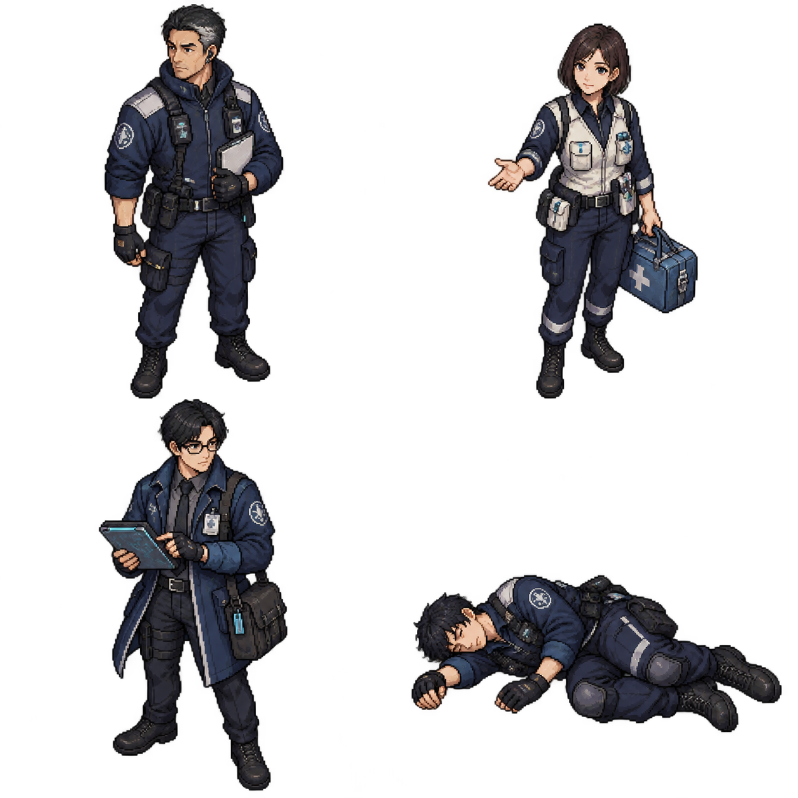
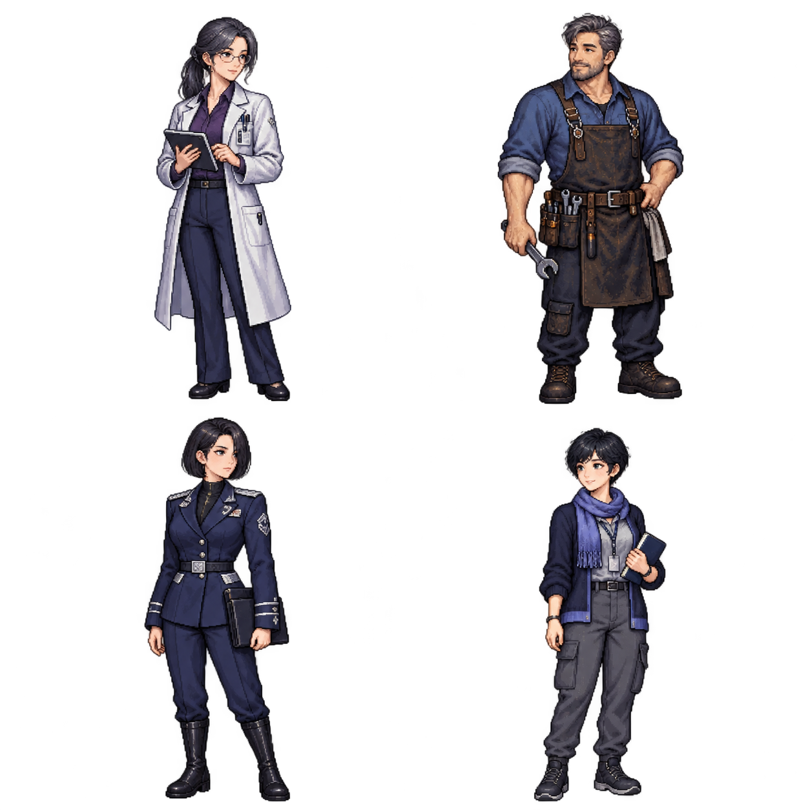
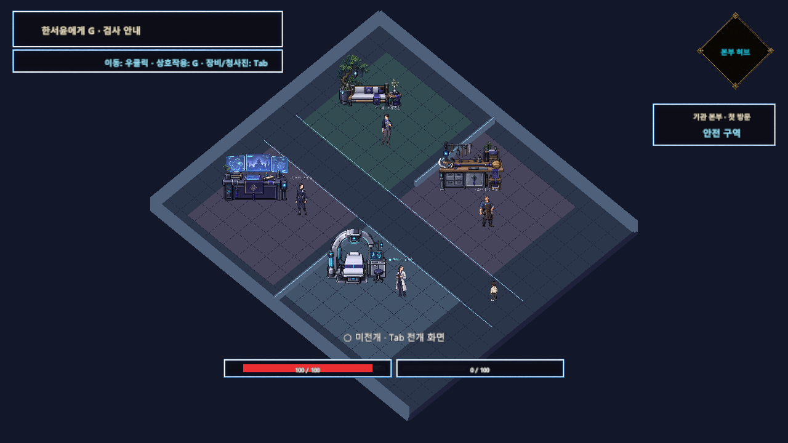
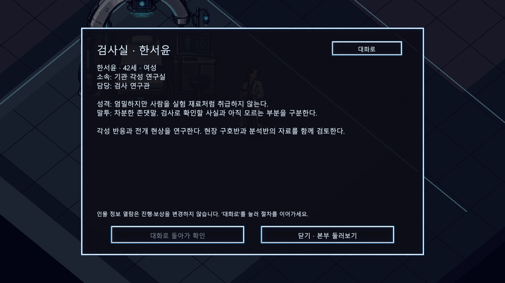

# 튜토리얼과 본부 NPC 기본 프로필 초안

> [!IMPORTANT]
> 문서 상태: 편집용 가안. 이름·나이·성별·이력·성격은 이번 제작에서 제안한 설정이며 최종 정본이 아닙니다. 실제 기능과 후속 서사 아이디어를 구분합니다.

## Quick Links

[캐릭터 설정](캐릭터_설정.md) · [튜토리얼 콘텐츠](../01_게임_기획/04_튜토리얼/콘텐츠/도깨비_게이트_콘텐츠_기획.md) · [종합 기획서](../00_프로젝트_개요/에르고스퀘어_종합_기획서_초안.md)

## 목적과 적용 범위

2026-10-12 대화 확장: [튜토리얼과 본부 대화 로그 초안](튜토리얼_본부_대화_로그_초안.md)에 플레이어의 질문·응답을 포함한 인게임 대사를 연결했습니다. 대화는 페이지별로 읽고 마지막 확인에서만 절차를 완료합니다. J로 실제 읽은 대화·기록을 다시 볼 수 있으며, 기존 프로필은 인물 정보 전환으로 열람합니다.

같은 외형의 안내 요원을 이름·역할·말투·소지품이 구분되는 인물로 만듭니다. 현장 귀환 구역 3명과 본부 4명은 기존 위치에서 G로 대화하고, 대화창의 ‘인물 정보’로 기본 프로필을 확인합니다. 동굴의 쓰러진 대원은 조사·기록·무기 획득 대상으로 유지합니다. 초가집의 두 기록 작성자는 기록에 이름만 연결하며 살아 있는 인물을 추가 배치하지 않습니다.

인간 영혼, 물건에 깃든 도깨비, 게이트의 병사 형상을 같은 종류의 NPC로 묶지 않습니다. 월도 보스는 기존 전투·영혼 해방·보상 흐름을 유지합니다. 인물 소개를 위해 사망·생환·각성 능력이나 개발진용 세계관 비밀을 새로 확정하지 않습니다.

## 배치 목록

| 맵·지점 | 인물 | 역할 | 상호작용 |
| --- | --- | --- | --- |
| 귀환 구역 · 통제선 | 강태윤 (38세) | 통제 담당 | G 대화 + 인물 정보 |
| 귀환 구역 · 임시 구호소 | 윤서하 (31세) | 구호 담당 | G 대화 + 인물 정보 |
| 귀환 구역 · 현장 조사실 | 백도현 (34세) | 현장 분석 담당 | G 대화 + 인물 정보 |
| 본부 · 검사실 | 한서윤 (42세) | 검사 연구관 | G 대화 + 인물 정보 |
| 본부 · 정비실 | 오준석 (46세) | 파츠 정비 기사 | G 대화 + 인물 정보 |
| 본부 · 작전실 | 정이현 (39세) | 작전 담당관 | G 대화 + 인물 정보 |
| 본부 · 휴게 공간 | 유나래 (27세) | 현현체 관계 지원 담당 | G 대화 + 인물 정보 |
| 튜토리얼 동굴 · 대원 조사 지점 | 이준호 (29세) | 정찰 대원 | G 기록 조사 + 명시적 무기 획득 |
| 초가집 대청 · 기록 작성자 | 서진우 (36세) | 유물 조사관 | 대청 기록의 작성자 이름 |
| 초가집 대청 · 철수 메모 작성자 | 차무진 (44세) | 토벌팀장 | 대청 기록의 작성자 이름 |

## 공통 상호작용 규칙

- 기존 위치·Collider·NavMesh와 진행 단계 번호는 유지하고, 프로필 ID와 새 외형을 연결합니다. 기존 씬을 재생성하지 않습니다.
- 머리 위 이름표와 G 안내, 목표 HUD, 대화 화자에 같은 이름을 사용합니다.
- 현장: 강태윤 → 윤서하 → 백도현 순서. 본부: 한서윤 → 오준석 → 정이현 순서. 유나래는 선택적으로 방문합니다.
- 인물 정보는 현재 대화창 안에서 전환합니다. 열람 중 진행 확인을 비활성화하고, ‘대화로’로 돌아온 뒤 확인할 수 있습니다.
- 프로필을 닫아도 단계·보상·유대·자원이 바뀌지 않습니다. 입력 차단은 해당 대화가 획득한 토큰만 해제합니다.
- 오준석의 정비 확인은 기존 청사진 편집을 엽니다. 새 수리·상점·재료 지급·친밀도 기능을 추가한 것은 아닙니다.
- 외형은 개별 정지 도트입니다. 8방향·걷기·표정 애니메이션과 AI 일과는 후속 제작입니다.

## 현장 귀환 인물

### 강태윤

- 데이터 ID: `FIELD_CONTROL`
- 기본 정보: 38세 · 남성 · 기관 현장 대응반
- 배치·담당: 귀환 구역 · 통제선 / 통제 담당
- 성격: 신중하고 책임감이 강하며, 확인되지 않은 약속을 하지 않는다.
- 말투: 짧은 존댓말과 확인 질문. 위험보다 지금 해야 할 일을 먼저 말한다.
- 외형: 짧은 검은 머리와 옅은 새치, 남색 전술복, 이어피스와 기록판.
- 배경: 여러 게이트의 통제선을 맡아온 요원. 생환자 확인과 구조팀 연결을 담당한다.
- 각성 여부·구체적 능력: 미정. 직책을 전투 능력으로 간주하지 않습니다.
- 후속 역할 후보: 구조 진행과 현장 통제 변화 안내. 구조 성공을 지금 대사만으로 확정하지 않음.

### 윤서하

- 데이터 ID: `FIELD_MEDIC`
- 기본 정보: 31세 · 여성 · 기관 현장 구호반
- 배치·담당: 귀환 구역 · 임시 구호소 / 구호 담당
- 성격: 차분하고 배려심이 깊다. 설명을 강요하지 않고 상대의 호흡을 기다린다.
- 말투: 부드러운 존댓말. 한 번에 질문 하나, 불확실한 진단은 단정하지 않는다.
- 외형: 갈색 단발, 밝은 구호 조끼와 민트빛 장식, 작은 구호 가방.
- 배경: 게이트 생환자의 초기 상태 확인을 맡는다. 본부 검사실로 필요한 정보를 전달한다.
- 각성 여부·구체적 능력: 미정. 직책을 전투 능력으로 간주하지 않습니다.
- 후속 역할 후보: 회복·구호 서비스와 생환 후 상태에 따른 대화. 현재 회복 기능 없음.

### 백도현

- 데이터 ID: `FIELD_ANALYST`
- 기본 정보: 34세 · 남성 · 기관 게이트 분석반
- 배치·담당: 귀환 구역 · 현장 조사실 / 현장 분석 담당
- 성격: 관찰력이 좋고 기록을 중시한다. 사실과 해석을 구분한다.
- 말투: 정중하고 구체적인 설명. 관측 사실을 말한 뒤 가능한 해석을 덧붙인다.
- 외형: 안경, 긴 남색 재킷, 측정 태블릿과 어깨 가방.
- 배경: 회수된 기록과 유물을 대조하는 분석 요원. 이면의 모든 원리를 아는 인물은 아니다.
- 각성 여부·구체적 능력: 미정. 직책을 전투 능력으로 간주하지 않습니다.
- 후속 역할 후보: 게이트 조사 결과를 누적하고 기록과 관측을 대조하는 분석 대화.

## 본부 인물

### 한서윤

- 데이터 ID: `HQ_EXAMINER`
- 기본 정보: 42세 · 여성 · 기관 각성 연구실
- 배치·담당: 본부 · 검사실 / 검사 연구관
- 성격: 엄밀하지만 사람을 실험 재료처럼 취급하지 않는다.
- 말투: 차분한 존댓말. 검사로 확인할 사실과 아직 모르는 부분을 구분한다.
- 외형: 낮게 묶은 검은 머리, 안경, 은백색 연구복과 보랏빛 안쪽 옷, 태블릿.
- 배경: 각성 반응과 전개 현상을 연구한다. 현장 구호반과 분석반의 자료를 함께 검토한다.
- 각성 여부·구체적 능력: 미정. 직책을 전투 능력으로 간주하지 않습니다.
- 후속 역할 후보: 정밀 검사와 공식 분류 등록 연출. 현재 검사 안내만 제공.

### 오준석

- 데이터 ID: `HQ_ENGINEER`
- 기본 정보: 46세 · 남성 · 기관 장비 정비반
- 배치·담당: 본부 · 정비실 / 파츠 정비 기사
- 성격: 실용적이고 털털하다. 물건과 함께한 시간을 가볍게 여기지 않는다.
- 말투: 친근한 존댓말과 짧은 작업 설명. 유대 보존을 먼저 강조한다.
- 외형: 새치 섞인 짧은 머리와 수염, 걷은 소매, 가죽 작업 앞치마와 공구.
- 배경: 기관 장비와 회수 파츠의 정비를 맡는다. 개체를 교체하기보다 기존 개체의 상태를 보존하는 방식을 선호한다.
- 각성 여부·구체적 능력: 미정. 직책을 전투 능력으로 간주하지 않습니다.
- 후속 역할 후보: 유대 보존형 정비와 수리, 월도 조각 진화 분기. 비용·규칙은 별도 설계.

### 정이현

- 데이터 ID: `HQ_OPERATIONS`
- 기본 정보: 39세 · 여성 · 기관 작전 지원실
- 배치·담당: 본부 · 작전실 / 작전 담당관
- 성격: 결단력 있고 계획적이다. 무리한 출격보다 정보와 철수 계획을 중시한다.
- 말투: 명확한 존댓말. 준비·출격·철수 조건을 순서대로 설명한다.
- 외형: 단정한 검은 단발, 남색 작전복과 은빛 견장, 얇은 임무 서류철.
- 배경: 게이트 조사 임무와 현장 지원을 조율한다. 플레이어의 첫 생환 보고를 바탕으로 다음 조사 계획을 준비한다.
- 각성 여부·구체적 능력: 미정. 직책을 전투 능력으로 간주하지 않습니다.
- 후속 역할 후보: 임무 선택·브리핑·출격과 철수 안내. 다음 게이트는 별도 제작.

### 유나래

- 데이터 ID: `HQ_LIAISON`
- 기본 정보: 27세 · 여성 · 기관 현현체 관계지원실
- 배치·담당: 본부 · 휴게 공간 / 현현체 관계 지원 담당
- 성격: 호기심이 많고 잘 들어준다. 도깨비의 작은 행동에도 주의를 기울인다.
- 말투: 편안한 존댓말과 열린 질문. 동료를 단순한 소모품처럼 부르지 않는다.
- 외형: 짧은 검은 머리, 남색 카디건과 푸른 보랏빛 머플러, 작은 수첩.
- 배경: 각성자와 현현체가 안전하게 적응하도록 돕는다. 관계와 행동을 기록하지만 특별한 각성 능력은 아직 정하지 않았다.
- 각성 여부·구체적 능력: 미정. 직책을 전투 능력으로 간주하지 않습니다.
- 후속 역할 후보: 도깨비와의 유대 사건과 관계 대화. 현재 열람만으로 유대가 증가하지 않음.

## 동굴과 초가집 기록 인물

### 이준호

- 데이터 ID: `CAVE_SCOUT`
- 기본 정보: 29세 · 남성 · 기관 선발 정찰조
- 배치·담당: 튜토리얼 동굴 · 대원 조사 지점 / 정찰 대원
- 성격: 꼼꼼하고 동료를 챙긴다. 관측 기록을 끝까지 남기려 한다.
- 말투: 짧은 1인칭 현장 기록. 관측과 판단을 구분한다.
- 외형: 남색 정찰복을 입고 옆으로 쓰러진 자세. 외상과 혈흔을 강조하지 않는다.
- 배경: 게이트 안쪽을 정찰하다 쓰러진 대원. 생사는 아직 확정하지 않는다. 남겨진 기록과 훈련검이 첫 전투 학습으로 이어진다.
- 각성 여부·구체적 능력: 미정. 직책을 전투 능력으로 간주하지 않습니다.
- 후속 역할 후보: 후속 구조 결과를 결정한 뒤 재등장 여부 논의. 현재 생사 미확정.

### 서진우

- 데이터 ID: `HOUSE_RESEARCHER`
- 기본 정보: 36세 · 남성 · 기관 현장 조사반
- 배치·담당: 초가집 대청 · 기록 작성자 / 유물 조사관
- 성격: 신중하고 자료를 중시한다. 유물 추정과 구전을 분리한다.
- 말투: 관측 중심의 기록체. 근거가 부족하면 미확정이라고 남긴다.
- 외형: 후속 제작. 현재는 대청 기록에서 이름만 확인한다.
- 배경: 월도의 전승과 이상 반응을 기록한 조사관. 현재 위치와 생사는 미확정이며 살아 있는 NPC를 새로 배치하지 않는다.
- 각성 여부·구체적 능력: 미정. 직책을 전투 능력으로 간주하지 않습니다.
- 후속 역할 후보: 회수된 조사 기록을 따라 후속 사건에 연결. 현재 대면·외형 없음.

### 차무진

- 데이터 ID: `HOUSE_LEADER`
- 기본 정보: 44세 · 남성 · 기관 게이트 토벌팀
- 배치·담당: 초가집 대청 · 철수 메모 작성자 / 토벌팀장
- 성격: 현장 판단이 빠르며 동료의 철수를 우선한다.
- 말투: 짧은 지시형 메모. 위험과 탈출 경로를 명확히 쓴다.
- 외형: 후속 제작. 현재는 철수 메모에서 이름만 확인한다.
- 배경: 결박을 끊고 살아남은 인원이 철수하도록 메모를 남긴 팀장. 최종 구조 결과나 생사는 이번 프로필에서 확정하지 않는다.
- 각성 여부·구체적 능력: 미정. 직책을 전투 능력으로 간주하지 않습니다.
- 후속 역할 후보: 철수 명령과 팀의 행적을 후속 기록으로 확장. 현재 대면·외형 없음.

## 도트 외형 기준

현장 시트: 좌상 강태윤, 우상 윤서하, 좌하 백도현, 우하 쓰러진 이준호입니다. 본부 시트: 좌상 한서윤, 우상 오준석, 좌하 정이현, 우하 유나래입니다.





남색·은빛을 기관 공통색으로 두고, 구호 담당의 밝은 조끼, 연구관의 은백색 연구복, 기사의 가죽 앞치마, 작전 담당의 단정한 제복, 관계지원 담당의 보랏빛 머플러로 역할을 구분합니다. NPC 그림에는 Collider를 추가하지 않고 기존 G 트리거를 유지합니다.

## 실제 적용 화면

아래는 생성 원화가 아니라 Unity 플레이에서 확인한 배치와 인물 정보 화면입니다.





NPC 검증에서 122개 조건을 통과했습니다. 개체별 외형·이름·프로필의 표시, 실제 G 조사·대화, 프로필 중 진행 차단, 닫기·대화 복원, 정비실 편집 연결을 검사했습니다. 기존 본부 이동·장비·파츠 인계 회귀 검사도 73개 조건을 통과했습니다. 두 검사는 일부 경로가 겹치므로 별도 기능 수로 합산하지 않습니다. 정지 도트의 모든 방향·애니메이션이나 전체 게임 QA 완료를 뜻하지 않습니다.

## 게임 데이터와 문서 편집

게임 적용 원본은 `C:/GitHubProjects/ERGOSQUARE-ARCHITECT/Assets/_ERGOSQUARE/Resources/NPC/Profiles_v1/NpcProfiles_v1.json`입니다. 문서만 고치면 인게임에 자동 반영되는 구조는 아닙니다. 이름·기본 프로필·공개 소개·대사는 JSON에서 수정하고 Unity 플레이를 다시 시작해야 반영됩니다. ID는 배치와 연결되는 키이므로 이름을 바꿀 때 ID까지 함께 바꾸지 않습니다.

공통 소개 데이터는 `NpcProfileCatalog`, 배치 인물의 ID는 `NpcIdentity`, 씬 연결은 `NpcSceneRoster`, 도트 표시는 `NpcProfileVisual`이 담당합니다. 퀘스트 진행·보상·편집 열림 상태는 기존 Flow와 각 시스템이 소유합니다. 프로필 파일에 퀘스트 진행을 저장하지 않습니다.

## 프로필 추가 양식

```text
이름 / 데이터 ID:
나이 / 성별 / 소속:
배치 맵 / 지점 / 역할:
성격 / 말투 / 소지품 / 실루엣:
공개 소개 / 첫 대사:
현재 상호작용과 진행 조건:
미정인 사실:
후속 역할 후보:
```

## Revision History

| 날짜 | 버전 | 변경 내용 | 작성자 |
| --- | --- | --- | --- |
| 2026-10-12 | v0.1 | 대화 요원 7명·쓰러진 대원 1명·기록 작성자 2명 가안, 프로필과 도트 적용 기준 작성 | 송예찬 |
