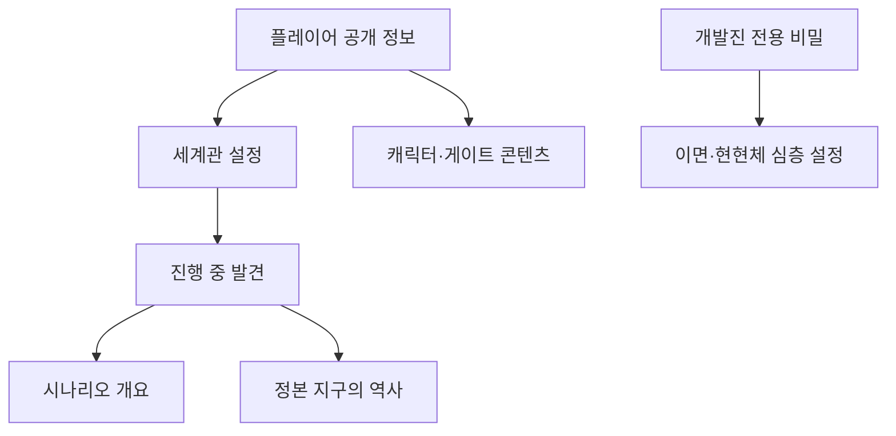

# 세계관 및 콘텐츠

> [!IMPORTANT]
> 문서 상태: 인덱스 운영. 세계관의 공개 정보, 숨겨진 진실과 실제 콘텐츠 후보를 구분해 관리합니다.

## Quick Links

[프로젝트 홈](../README.md) · [세계관 설정](./세계관_설정.md) · [시나리오 개요](./시나리오_개요.md) · [이면·현현체](./이면_및_현현체_심층_설정.md) · [게이트 조율](./게이트_신화_콘텐츠_조율서.md) · [튜토리얼](../01_게임_기획/04_튜토리얼/README.md)

## 정보 계층

## 문서 상태

| 문서 | 상태 | 공개 층위·역할 |
| --- | --- | --- |
| [세계관 설정](./세계관_설정.md) | 기준 초안 | 현재 세계와 게이트의 공통 사실 |
| [시나리오 개요](./시나리오_개요.md) | 기준 초안 | 메인 진행과 월드별 변주 |
| [정본 지구의 역사](./정본_지구의_역사.md) | 기준 초안 | 후반에 밝혀지는 숨겨진 역사 |
| [이면·현현체 심층 설정](./이면_및_현현체_심층_설정.md) | 개발진용 기준 초안 | 결말 이전 직접 설명 금지 정보 |
| [캐릭터 설정](./캐릭터_설정.md) | 아이디어 | 플레이어와 각성자 NPC 기준 |
| [게이트 신화 콘텐츠 조율서](./게이트_신화_콘텐츠_조율서.md) | 운영 초안 | 조사·문화 검토·채택 절차 |
| [콘텐츠 목록](./콘텐츠_목록.md) | 초안 | MVP 콘텐츠 후보와 수량 |

## 작성 원칙

- 신화·설화는 원문, 지역 전승과 현대 창작을 구분합니다.
- 실제 전승과 게임의 이면 해석을 같은 사실처럼 쓰지 않습니다.
- 개발진용 비밀이 튜토리얼 대사나 UI에서 조기에 노출되지 않도록 공개 층위를 확인합니다.

## Revision History

| 날짜 | 버전 | 변경 내용 | 작성자 |
| --- | --- | --- | --- |
| 2026-08-17 | v1.0 | 세계관 정보 계층, Quick Links와 상태 인덱스 작성 | Codex |
