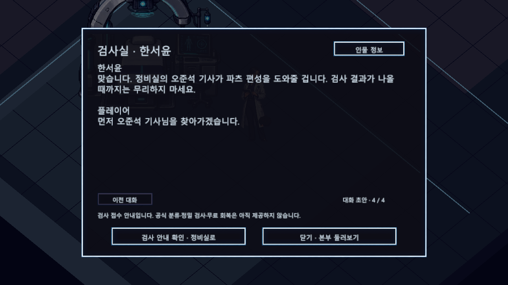
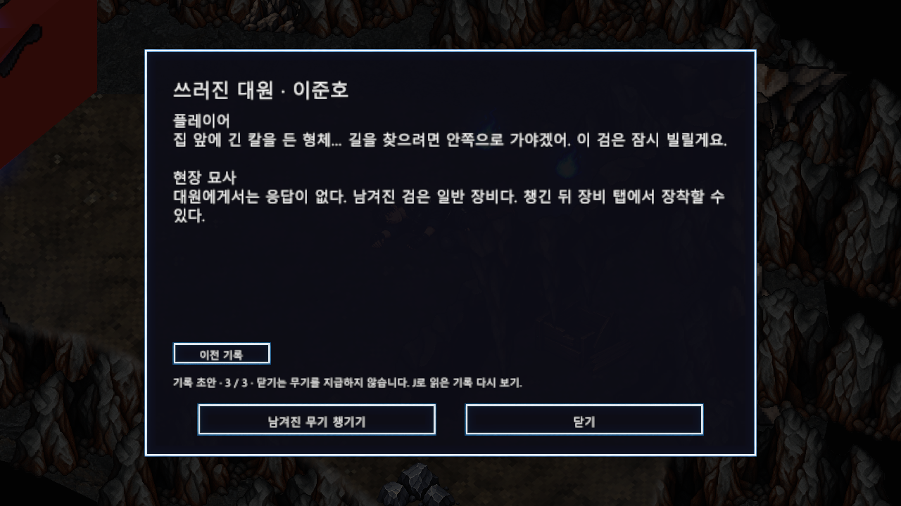
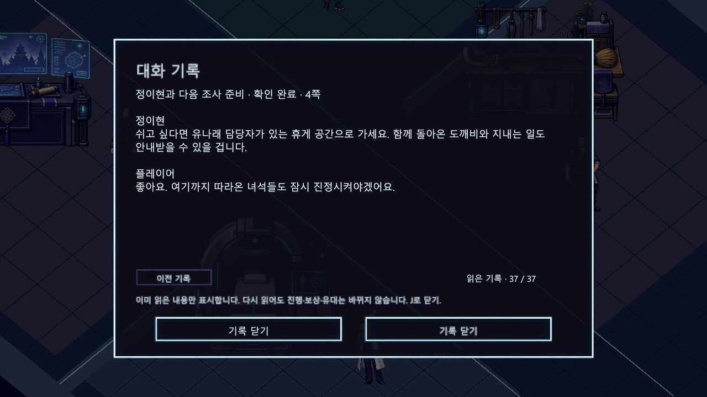

# 튜토리얼과 본부 대화 로그 초안

작성일: 2026-10-12 · 버전: v0.1 · 상태: 인게임 적용 및 플레이 검토용 초안

동굴의 정찰 기록부터 게이트 귀환, 기관 본부 첫 방문까지 플레이어의 질문과 NPC의 응답을 이어서 읽는 대사집입니다. 인간 영혼의 해방과 물건 도깨비의 회수를 구분하고, 사각 공간의 힘은 조사 대상으로 남깁니다. 실종자의 생사, 각성의 공식 분류와 다음 임무는 여기서 확정하지 않습니다.

[인물 프로필](NPC_기본_프로필_및_배치_초안.md) · [세계관 및 콘텐츠](README.md) · [튜토리얼 콘텐츠](../01_게임_기획/04_튜토리얼/콘텐츠/도깨비_게이트_콘텐츠_기획.md)

## 플레이 확인 방법

NPC와 기록을 G로 조사하고 ‘다음 대화’로 읽습니다. 마지막 페이지의 확인 버튼을 눌러야 기존 절차가 완료됩니다. 끝까지 읽고 닫기만 하면 다음 단계로 진행하지 않습니다. 인물 정보를 열었다 돌아오면 현재 대화 페이지를 유지합니다. 다시 조사하면 첫 페이지부터 재열람할 수 있습니다.

‘대화 기록 (J)’에서는 이번 플레이에서 실제 화면에 표시한 내용만 다시 볼 수 있습니다. 중간에 닫은 대화는 열람 중으로 남으며, 보지 않은 페이지나 앞으로 만날 인물의 대사는 노출되지 않습니다. 기록 탐색은 진행·보상·유대를 변경하지 않습니다. 씬 이동 동안은 유지되지만 영구 저장은 아니며 새 게임을 시작하면 비웁니다. 다른 메뉴나 대화, 정신집중, 스킬 실행 중에는 기록을 열지 않습니다. 전투 자체를 일시정지하는 기능은 아닙니다.

11개 기록·대화, 37페이지, 74개 화자 발언으로 구성합니다. 동굴의 이준호와 대청의 서진우·차무진은 기록 속 화자이며 플레이어와 실시간으로 대답하는 NPC가 아닙니다. 휴게 공간의 유나래는 선택 대화이므로 본부 필수 절차와 무관하게 만날 수 있습니다.

## 서사 연결 기준

| 구간 | 플레이어가 이해할 내용 | 다음 행동 |
| --- | --- | --- |
| 동굴 대원 조사 | 안쪽에 집과 긴 칼을 든 형체가 있다는 목격 기록 | 일반 검을 획득하고 장비 탭에서 장착 |
| 빗자루 전투와 코어 학습 | 물건 도깨비와 사각 공간의 사용 경험 | 기존 튜토리얼 목표를 따라 보스 구역으로 이동 |
| 보스 이후 대청 | 사람의 신호가 월도에 붙잡혔다는 관찰과 왜곡 가설 | 기록을 확인하고 집 옆 출구 조사 |
| 강태윤 | 생환 확인과 구조팀 인계, 실종자의 상태는 미확인 | 윤서하의 구호소 방문 |
| 윤서하 | 사각 공간 사용 경험과 소모·집중 경험 전달 | 백도현에게 기록과 월도 보고 |
| 백도현 | 정상 투영과 폭주의 차이, 인간 영혼과 물건 도깨비의 구분 | 북쪽 이동 지점에서 본부 귀환 확인 |
| 한서윤 | 능력을 단정하지 않는 검사 접수와 개체 보존 | 오준석의 정비실 방문 |
| 오준석 | 장비와 청사진의 구분, 유대를 유지하는 조합 점검 | 기존 청사진 편집 후 작전실 방문 |
| 정이현 | 게이트마다 징후·편성·귀환 경로를 따로 조사 | 현재 본부 첫 방문의 종점, 자유 이동 |
| 유나래 | 도깨비를 단순 소모품이 아닌 동행으로 대하는 관점 | 선택 대화 후 자유 이동 |

## 대화 초안

### 동굴의 정찰 기록

적용 메모: 이준호의 생사는 미확인. 플레이어의 말은 독백이며 대원이 답하지 않는다. 무기 획득과 장착은 별도.

#### 1페이지

**현장 묘사**

쓰러진 대원의 손 옆에 기록 장치와 훈련검이 놓여 있다. 신원은 정찰 대원 이준호. 생사는 확인되지 않았다.

**플레이어**

들리세요? …대답이 없다. 먼저 이 기록부터 확인하자.

#### 2페이지

**이준호**

내부는 동굴이었다. 그런데 더 안쪽에서 사람이 살던 집을 발견했다. 인기척은 없었다. 빗자루가 저절로 움직이기 전까지는.

**이준호**

우리는 단순한 잔류 현상으로 판단했다. 그 판단이 틀렸다. 마지막으로 확인한 것은 집 앞을 지키던, 긴 칼을 든 형체였다.

#### 3페이지

**플레이어**

집 앞에 긴 칼을 든 형체… 길을 찾으려면 안쪽으로 가야겠어. 이 검은 잠시 빌릴게요.

**현장 묘사**

대원에게서는 응답이 없다. 남겨진 검은 일반 장비다. 챙긴 뒤 장비 탭에서 장착할 수 있다.

### 대청에 남겨진 기록

적용 메모: 보스 격파와 영혼 해방 및 월도 회수 후 열람. 조사관의 관찰과 가설을 구분한다.

#### 1페이지

**플레이어**

동굴에서 본 기록에 있던 집이 여기였구나. 대청에도 기록이 남아 있어.

**서진우**

조선 시대에 제작된 것으로 추정되는 월도. 지역에서는 임진왜란 당시 한 병사가 사용한 무기라고 전한다. 이를 입증할 기록은 발견되지 않았다.

#### 2페이지

**서진우**

외부의 도깨비는 기억의 투영체였다. 하지만 이곳의 칼날에서는 시민과 대원들의 신호가 함께 검출됐다. 집 앞의 병사가 움직일 때마다 여러 사람의 목소리가 들린다.

**플레이어**

그 목소리들이 묶여 있던 사람들의 것이었나. 내가 풀어준 빛과 이 월도에 깃든 도깨비는… 다른 존재겠지?

#### 3페이지

**서진우**

아직 원인은 알 수 없다. 사람을 베었다는 이야기가, 사람을 붙잡는 무언가로 바뀐 것일까.

**차무진**

결박을 끊어 사람들을 풀어줘야 한다. 집 옆의 경계가 흔들리고 있다. 살아남았다면 그 틈으로 돌아가라.

#### 4페이지

**플레이어**

사람들은 풀어줬어. 이제 이 기록을 가지고 돌아가자. 이준호 대원과 여기 있던 팀의 일도 밖에 알려야 해.

**현장 묘사**

집 옆으로 돌아가는 길이 보인다. 기록 확인 후 출구를 G로 조사하면 귀환을 선택할 수 있다.

### 게이트 밖으로 귀환

적용 메모: 실제 씬 전환은 마지막 귀환 확인에서만 실행한다.

#### 1페이지

**플레이어**

처음엔 검 하나였는데… 이제 빗자루와 월도까지 따라오네. 이 사각 공간의 힘도 밖에서 알아볼 수 있을까.

**현장 묘사**

회수한 도깨비와 코어, 장비를 가지고 경계 밖 임시 통제 구역으로 돌아간다. 남겨진 사람들의 상태는 아직 확인되지 않았다.

### 강태윤과 생환 확인

적용 메모: 강태윤은 밖에서 관측한 사실만 말한다. 실종자의 생존을 확정하지 않는다.

#### 1페이지

**강태윤**

멈추세요. 통제 담당 강태윤입니다. 안쪽에서 나온 분 맞습니까? 다친 곳은요?

**플레이어**

아직 움직일 수 있어요. 안에서 쓰러진 대원과 기록을 봤습니다. 이준호라는 이름이었어요.

#### 2페이지

**강태윤**

선발 정찰조 대원입니다. 위치와 기록을 구조팀에 넘기겠습니다. 돌아오지 못한 사람들의 상태는 아직 확인 중입니다.

**플레이어**

집 앞의 병사에게 여러 사람이 묶여 있었어요. 쓰러뜨린 뒤 결박을 풀었는데… 그 사람들은 어떻게 됐나요?

#### 3페이지

**강태윤**

당신이 나오던 때, 경계에 붙잡혀 있던 신호들이 풀렸습니다. 그 뒤는 구조팀이 확인해야 합니다. 결과를 모르는 상태에서 괜찮다고 말할 순 없어요.

**플레이어**

알겠습니다. 이 기록과 같이 나온 물건들은 어디로 가져가면 될까요?

#### 4페이지

**강태윤**

우선 구호소의 윤서하에게 가세요. 여긴 본부가 아니라 게이트 밖 임시 통제 구역입니다. 무기와 도깨비는 그대로 보관하고, 몸부터 확인합시다.

**플레이어**

윤서하 담당자에게 가면 되는 거죠. 기록도 가지고 갈게요.

### 윤서하와 상태 확인

적용 메모: 대화 확인은 체력이나 정기를 회복시키지 않는다.

#### 1페이지

**윤서하**

윤서하입니다. 강태윤 씨에게 얘기 들었어요. 지금은 안전해요. 호흡부터 가다듬고, 안에서 무슨 일이 있었는지 천천히 말해 주세요.

**플레이어**

검으로 버티다가 빗자루 같은 물건의 힘을 썼어요. 바닥에 사각 공간이 펼쳐지고, 그 안에 물건을 놓을 수 있었고요.

#### 2페이지

**윤서하**

그 힘을 쓴 뒤 불편해진 곳은 없나요? 힘이 빠지거나 집중이 끊기는 느낌 같은 것요.

**플레이어**

계속 쓰다 보니 힘이 부족해졌어요. 집중하면 조금 돌아왔지만, 그동안 움직이기는 어려웠고요. 이런 것도 각성인가요?

#### 3페이지

**윤서하**

각성 반응일 가능성은 있어요. 다만 여기서 분류를 정하진 않겠습니다. 그 경험도 빠짐없이 검사 담당에게 전달할게요.

**플레이어**

대청 기록에는 사람들이 무기 안에 붙잡혔다고 적혀 있었어요. 같이 나온 도깨비도 그 사람들인가요?

#### 4페이지

**윤서하**

그건 현장 분석 담당 백도현이 설명해 줄 거예요. 기록과 월도를 가지고 조사실로 가세요. 그다음 본부에서 정밀 검사 안내를 받게 됩니다.

**플레이어**

백도현 담당자에게 먼저 보고하고, 본부로 가겠습니다.

### 백도현과 게이트 해석

적용 메모: 관측과 해석 가설을 분리. 역사 전승을 확정된 사실로 만들지 않는다.

#### 1페이지

**백도현**

백도현입니다. 가져온 기록부터 볼까요? 서진우 조사관과 차무진 팀장이 남긴 관측이군요. 당신이 본 일도 함께 대조하겠습니다.

**플레이어**

집 앞의 병사에게 사람들의 목소리가 섞여 있었어요. 결박을 풀자 빛들이 흩어졌고, 월도는 남았습니다.

#### 2페이지

**백도현**

정상적인 게이트는 인간의 기억을 이야기로 투영합니다. 이번에는 폭주하면서 이야기 속 상징을 현실의 인간으로 대체한 것으로 보입니다.

**플레이어**

이야기의 빈자리에 실제 사람들이 들어갔다는 건가요? 왜 하필 월도였죠?

#### 3페이지

**백도현**

‘많은 생명을 죽인 무기’가 ‘많은 생명을 담을 수 있는 그릇’으로 뒤틀렸다는 해석입니다. 시민과 토벌대의 신호가 월도 안에서 검출된 관측은 이를 뒷받침해요. 아직 원인 전체가 밝혀진 건 아닙니다.

**플레이어**

그렇다면 지금 가진 월도 도깨비 안에도 사람들이 남아 있는 건가요?

#### 4페이지

**백도현**

해방된 사람의 영혼과 물건에 깃든 월도 도깨비는 같은 존재가 아닙니다. 남은 도깨비를 풀려난 사람으로 취급해선 안 됩니다. 구조 결과는 따로 확인해야 하고요.

**플레이어**

알겠어요. 사람들의 구조와 도깨비의 조사는 구분하겠습니다. 제 사각 공간의 힘도 알아봐야겠네요.

#### 5페이지

**백도현**

보고를 본부로 전달하겠습니다. 북쪽 이동 지점으로 가면 됩니다. 도착하면 검사실의 한서윤 연구관을 먼저 찾아가세요.

**플레이어**

기록과 도깨비들을 가지고 가겠습니다. 구조 소식이 나오면 알려 주세요.

### 기관 본부로 이동

적용 메모: 확인 전까지 현장에 머무를 수 있다. 체력·정기·내구도는 현재 값 그대로 인계한다.

#### 1페이지

**플레이어**

현장 보고는 끝났어. 본부 검사실의 한서윤 연구관… 이 힘을 알아볼 실마리가 있을지도 몰라.

**현장 묘사**

현재 장비와 도깨비, 청사진 설정을 가지고 기관 본부로 이동한다. 아직 현장에 머물고 싶다면 닫기를 선택할 수 있다.

### 한서윤과 각성 조사 안내

적용 메모: 현재는 검사 접수 안내. 공식 능력 분류·정밀 검사·치료는 확정하지 않는다.

#### 1페이지

**한서윤**

한서윤입니다. 현장에서 전달한 보고는 읽었습니다. 사각 공간을 펼쳤다고 했죠. 당신이 겪은 순서대로 들려주세요.

**플레이어**

빗자루를 얻은 뒤 물건을 배치할 수 있었어요. 코어를 전개하자 그 공간과 물건의 힘을 더 뚜렷하게 쓸 수 있었고요.

#### 2페이지

**한서윤**

공간, 코어, 물건의 반응을 따로 기록한 뒤 서로 어떤 영향을 주는지 보겠습니다. 지금 정보만으로 당신의 능력을 단정하진 않겠습니다.

**플레이어**

조사하려면 도깨비를 맡겨야 하나요? 게이트에서 같이 싸웠는데, 다른 개체로 바뀌거나 없어지는 건 싫습니다.

#### 3페이지

**한서윤**

함께 돌아온 개체를 압수하거나 새 개체로 바꾸지 않습니다. 우선 지금 상태 그대로 접수하고 조사 절차를 준비할게요.

**플레이어**

그럼 제가 쓰던 청사진도 그대로 확인하면 되겠네요.

#### 4페이지

**한서윤**

맞습니다. 정비실의 오준석 기사가 파츠 편성을 도와줄 겁니다. 검사 결과가 나올 때까지는 무리하지 마세요.

**플레이어**

먼저 오준석 기사님을 찾아가겠습니다.

### 오준석과 파츠 편성

적용 메모: 마지막 확인에서 기존 청사진 편집 UI를 연다. 무료 수리·합성 재료 지급은 없다.

#### 1페이지

**오준석**

오준석이야. 게이트에서 데려온 빗자루랑 월도지? 겉모양만 보는 게 아니라, 네가 쓰던 배치랑 연결 상태부터 확인하자.

**플레이어**

빗자루끼리 조합하면 기술이 이어지던데요. 더 강화하면 지금 도깨비와 쌓은 유대도 사라지나요?

#### 2페이지

**오준석**

기준으로 삼은 개체는 그대로 두고 조합 상태를 바꾸는 거야. 같이 큰 도깨비를 새것으로 갈아치우는 게 아니지. 유대, 조합 상태, 남은 내구도를 먼저 확인해 봐.

**플레이어**

월도 같은 다른 물건과의 조합도 같은 방식으로 살펴보면 되겠네요.

#### 3페이지

**오준석**

그래. 다만 아무 조합이나 되는 건 아니야. 허용된 조합과 필요한 재료를 확인하고 결정해. 강화만 보고 오래 함께한 개체를 덜컥 분해하진 말고.

**플레이어**

먼저 배치와 스킬 할당부터 점검하겠습니다. 검은 도깨비 파츠가 아니라 장비 탭에서 확인하는 거죠?

#### 4페이지

**오준석**

맞아. 검은 장비 탭, 도깨비 편성은 청사진 탭이야. 편집 화면을 열어줄게. 확인이 끝나면 작전실의 정이현 담당관에게 가 봐.

**플레이어**

지금 가진 구성으로 정리한 뒤 작전실에 보고하겠습니다.

### 정이현과 다음 조사 준비

적용 메모: 본부 첫 방문의 현재 종점. 다음 임무 선택·게이트 출격은 아직 제공하지 않는다.

#### 1페이지

**정이현**

정이현입니다. 첫 게이트의 보고는 접수됐습니다. 안쪽에서 본 징후와 귀환 경로는 다음 조사에도 중요한 자료가 될 겁니다.

**플레이어**

처음엔 살아서 나오는 것만 생각했어요. 다음에는 들어가기 전에 뭘 알아둬야 할까요?

#### 2페이지

**정이현**

어떤 이야기에서 생긴 게이트인지, 관측이 그 이야기와 어디서 달라지는지 보세요. 필요한 파츠와 빠져나올 경로도 준비해야 합니다. 적을 쓰러뜨리는 것만으로 끝나지 않는다는 건 이번에 봤겠죠.

**플레이어**

결박을 풀고 기록을 확인해야 돌아갈 수 있었으니까요. 다른 게이트도 같은 절차인가요?

#### 3페이지

**정이현**

이번 게이트의 해결법을 모든 게이트에 그대로 적용할 순 없습니다. 다음 조사 구역이 정해지면 별도로 설명하겠습니다. 지금은 정비와 검사 준비를 마치세요.

**플레이어**

알겠습니다. 구조팀 소식과 다음 조사 안내를 기다리겠습니다.

#### 4페이지

**정이현**

쉬고 싶다면 유나래 담당자가 있는 휴게 공간으로 가세요. 함께 돌아온 도깨비와 지내는 일도 안내받을 수 있을 겁니다.

**플레이어**

좋아요. 여기까지 따라온 녀석들도 잠시 진정시켜야겠어요.

### 유나래와 도깨비 이야기

적용 메모: 선택 대화. 본부 진행 단계·유대·자원·보상을 변경하지 않는다.

#### 1페이지

**유나래**

유나래예요. 처음 왔으면 여기 앉아 쉬어도 돼요. 그 파란 불꽃, 계속 당신 곁에 있네요.

**플레이어**

처음엔 그냥 움직이는 빗자루인 줄 알았어요. 그런데 같이 싸우고 나오니까 두고 오기는 싫더라고요.

#### 2페이지

**유나래**

그런 마음이 드는 건 이상하지 않아요. 물건의 힘을 쓴다고 해서 그 관계까지 소모품이 되는 건 아니니까요.

**플레이어**

더 강하게 만들 때도 지금 함께한 도깨비는 계속 데리고 가고 싶어요.

#### 3페이지

**유나래**

그 마음은 정비 담당에게도 말해 주세요. 지금은 서두르지 않아도 돼요. 무엇을 할 수 있는지만큼, 누구와 함께하고 싶은지도 기억해 두세요.

**플레이어**

그럼 여기서는 잠깐 쉬겠습니다. 이 녀석도 낯선 곳에 적응할 시간이 필요하겠죠.

## 이야기 연결 검토 항목

### 인게임 검토 화면

### 플레이 검토 질문

- [ ] 시작 상황에서 플레이어가 동굴에 들어온 이유를 이해할 수 있는가. 이번 대화 작업은 기존 인트로·오프닝을 다시 제작하지 않는다.
- [ ] 대원 기록을 읽은 뒤 검을 챙겨야 하는 이유와 안쪽으로 가야 하는 이유가 자연스러운가.
- [ ] 빗자루 획득에서 청사진과 코어 사용으로 넘어가는 경험이 목표 안내만으로 충분한가. 이 구간에는 이번 작업에서 새 자동 독백이나 컷신을 붙이지 않았다.
- [ ] 첫 기록의 ‘긴 칼을 든 형체’와 초가집의 월도 병사를 같은 단서로 연결할 수 있는가.
- [ ] 보스 격파 → G 영혼 해방 → G 월도 회수 → 대청 기록 → 출구 확인을 각각 구분할 수 있는가.
- [ ] 백도현의 해석이 사람의 영혼과 물건 도깨비를 혼동하게 만들지 않는가. 역사 전승과 폭주 원인을 확정 사실처럼 읽지 않는가.
- [ ] 현장 구호소와 기관 본부 검사실이 같은 안내를 반복하는 것이 아니라 응급 상태 확인과 정밀 조사 접수로 구분되는가.
- [ ] 정비 안내에서 청사진을 열고 닫은 뒤 정이현을 찾아갈 수 있는가. 실제 편집을 수행했는지까지 판정하는 조건은 이번에 추가하지 않는다.
- [ ] 유나래를 먼저 만났을 때도 대사의 전제가 어긋나지 않는가.
- [ ] 작전실 이후 아직 새 임무가 없다는 점을 시스템 안내로 이해할 수 있는가.

실종자 구조 결과, 정밀 검사 결과, 다음 게이트의 선정과 출격은 이후 서사의 미완성 구간입니다. 현재 대사는 이들을 해결했다고 마무리하지 않고 후속 조사 대상으로 남깁니다.

## 데이터와 구현 경계

주 대사 원본은 게임 프로젝트의 `Assets/_ERGOSQUARE/Resources/NPC/Dialogue_v1/DialogueDraft_v1.json`입니다. 인물 신원·프로필은 기존 `NPC/Profiles_v1/NpcProfiles_v1.json`을 유지합니다. 프로필의 기존 `dialogue` 문구는 새 대사 로드 실패 시 사용하는 안내문이며, 정상 실행의 대사는 별도 대화 데이터에서 읽습니다.

각 대화는 ID, 제목, 배치 씬, 다음 대화 참조, 적용 메모, 페이지와 화자별 문장으로 구성합니다. `next`는 검토용 연결 정보이며 자동 이동이나 퀘스트를 실행하지 않습니다. 진행과 보상은 기존 보스·현장·본부 Flow가 소유합니다. 마지막 확인에서만 그 Flow의 확인 함수를 호출합니다.

`DialogueDraftCatalog`는 JSON과 화자·다음 참조를 검사합니다. `DialogueJournal`은 실제 표시한 페이지와 읽기 확인 여부를 플레이 세션에 보관합니다. `TutorialAftermathPresenter`와 `PrototypeEquipmentPresenter`가 페이지를 표시하고, `DialogueJournalPresenter`가 다시보기를 엽니다. 대사 수정은 JSON의 `pages[].lines[].text`에서 할 수 있으며, 이 대사집은 JSON을 수정한 뒤 별도로 동기화해야 합니다.

새 대화를 위해 기존 씬의 배치와 NavMesh를 재저장하지 않습니다. 음성, 립싱크, 선택지 분기, 호감도 이벤트와 영구 대화 저장은 이번 범위에 포함하지 않습니다.

## 적용 검증

2026-10-12 Unity 플레이 모드의 대화 검증 270개 조건을 통과했습니다. 페이지 순서·본문 영역, 프로필 전환, 중간 취소, 마지막 확인, 실제 J 입력, 중복 기록 방지와 동굴→보스 이후→귀환 구역→본부의 기록 유지 및 씬 이동을 확인했습니다. NPC 프로필 회귀 검증 122개 조건과 본부 기능 회귀 검증 73개 조건도 각각 통과했습니다.

자동 검증에서는 동굴 파츠와 보스 격파 조건을 테스트용으로 준비했습니다. 일반 전투 난이도나 사람이 플레이하며 느끼는 대사의 자연스러움까지 검증한 결과는 아닙니다. 네 개 씬의 파일 해시는 작업 전과 같습니다. 동굴 기록창은 1280×720, 대청 기록창은 1024×768, 본부 대화창은 두 해상도의 실제 렌더 화면을 확인했습니다. 위 플레이 검토 질문으로 서사의 이해도와 공백을 확인합니다.

## 수정 이력

| 날짜 | 버전 | 내용 | 작성자 |
| --- | --- | --- | --- |
| 2026-10-12 | v0.1 | 플레이어와 NPC의 교환 대사, 기록 속 독백, 페이지형 읽기와 실제 읽은 대화 기록 적용 | 송예찬 |
