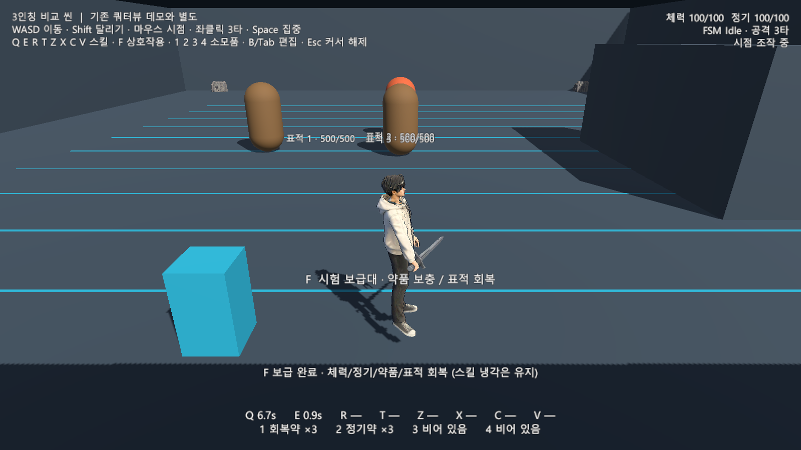
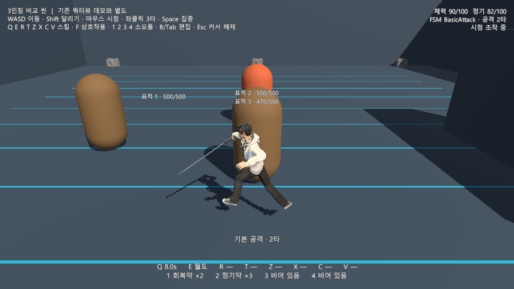
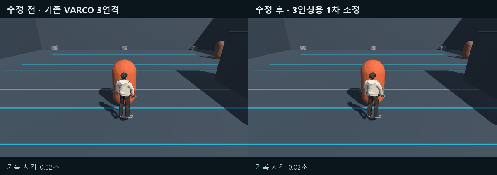
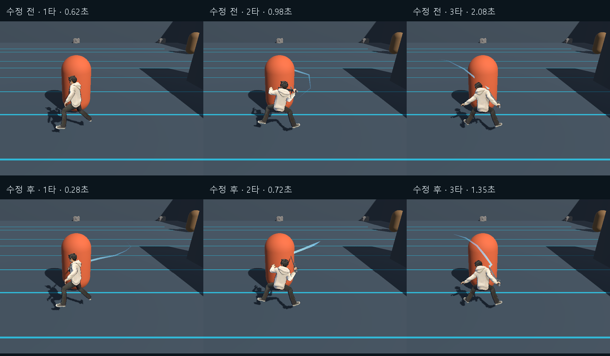
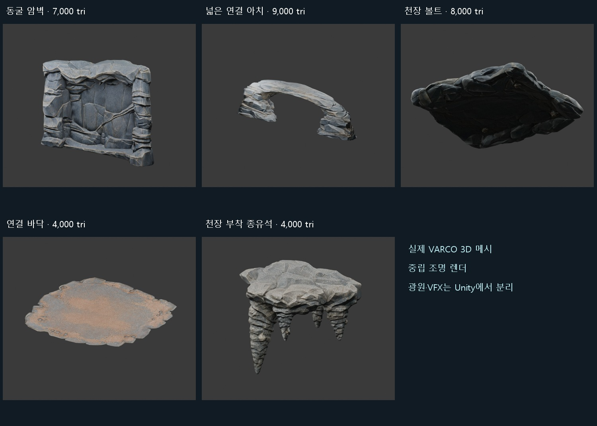
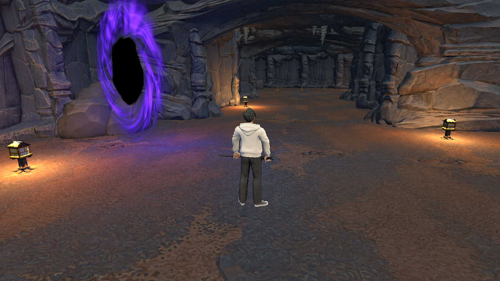

# 3인칭 비교 씬 조작과 검수 명세

문서 상태: 초안 · 비교용 프로토타입 / 작성자: 송예찬 / 기준일: 2026-10-20

20일 세션 마감 기준 일반공격은 VARCO 원본 ‘검 2단 베기’ 2타이며 마지막 찌르기는 제거했다. 두 타격 모두 공격 중 마우스 수평 에임을 따른다. 아래 초기 3타·파생 모션 검수는 비교 이력이며 현재 적용은 ‘원본 2타와 에임 추적’ 항목을 따른다. [마감 개발 일지](../../04_프로젝트_관리/개발_일지/2026-10-20_검_2단_베기와_공격_중_마우스_에임_추적.md)

## 목적

기존 쿼터뷰 데모의 씬·플레이어·입력 자산을 보존하면서 3인칭 카메라와 직접 이동의 조작감을 비교한다. 이 실험은 본편 조작 방식의 최종 변경이 아니다.

## 사용자 흐름

Unity 메뉴 `Tools → ERGOSQUARE → Comparison → Open Third Person Comparison`에서 씬을 열고 Play한다. 마우스로 시점을 바꾸며 WASD로 이동하고, 표적에 접근해 좌클릭 2타 공격과 Q/E 스킬을 시험한다. B/Tab으로 기존 새 인벤토리를 열어 장착·해제와 스킬 배정을 바꾼다. 시작점 옆 보급대에서 F로 체력·정기·약품·표적 체력을 회복한다.

## 동작 규칙

- 카메라 기준 WASD 이동이며 대각선 속도를 정규화한다. Shift는 비교용 달리기다. 기본 이동 속도 2.2, 달리기 4, 회전 속도 초당 720도는 가안이다.
- 이동 중 캐릭터는 이동 방향을 향한다. 기본 공격과 스킬은 요청 시 카메라의 수평 방향을 기준으로 실행한다. 기본 공격 중에는 현재·예약된 타격 방향을 마우스 수평 에임과 함께 갱신하고, 기존 공격·스킬의 이동 잠금과 타격 계약은 유지한다.
- 기존 `PlayerNavMotor`의 명시적 선택 기능으로 직접 이동을 사용한다. 기존 데모는 기본 클릭 이동 경로를 유지한다. 벽·표적의 이동 제약은 NavMesh와 표적 장애물로 처리한다.
- 카메라는 마우스 회전과 구체 캐스트를 사용해 벽 앞에서 거리를 줄인다. 거리 4.3, 수직 회전 8~65도, 감도 0.13은 가안이다. 기존 플레이어 루트의 Agent 높이 오프셋을 고려한 상체 기준점을 사용한다.
- 검 끝의 잔상은 실제 무기 메시를 따라가며, 스킬 방향 가이드는 실제 실행 상태를 따른다. 시각 효과는 피해를 발생시키지 않는다.
- 인벤토리에서는 커서를 해제하고 이동·공격·스킬·소모품 입력을 차단한다. 메뉴 밖 Esc는 커서만 해제하며 다시 좌클릭하면 조작을 재개한다.

## 입력과 출력

| 입력 | 비교 씬 기능 |
| --- | --- |
| WASD | 카메라 기준 이동 |
| 마우스 이동 | 카메라 회전 |
| 좌클릭 | VARCO 원본 검 2단 베기 1타 시작과 2타 입력 예약 |
| Q E R T Z X C V | 스킬 슬롯 0~7 |
| F | 기존 상호작용 컨트롤러를 통한 보급대 사용 |
| 1 2 3 4 | 소모품 슬롯 0~3 |
| Shift | 달리기 |
| Space | 기존 정신 집중·정기 회복 |
| B / Tab | 기존 새 장비·스퀘어 UI |
| Esc | 메뉴 닫기 또는 메뉴 밖 커서 해제 |

별도 Input Actions 자산에서 슬롯의 물리 키만 바꾼다. 슬롯 액션의 기존 이름은 내부 인덱스 계약으로 유지한다. 새 UI의 버튼·아이템 배지·키 배정 입력은 비교 씬의 QERTZXCV를 표시하고 사용한다.

## 상태

기존 FSM의 Idle·Moving·BasicAttack·Skill·Focus·Menu·Dead와 실제 Animator를 재사용한다. 새 이동기는 스킬·집중·메뉴·사망과 공격의 이동 억제를 지킨다. FSM·Animator는 씬의 플레이어 루트 `Demo Player Rig`에서 재생 전에도 확인한다.

## 데이터

- 비교 씬: `Assets/_ERGOSQUARE/01.Scenes/Comparison/ThirdPerson_Comparison.unity`
- 입력·재질·베이크된 내비게이션: `Assets/_ERGOSQUARE/08.Data/ThirdPersonComparison/`
- 플레이어: 기존 독립 `Player_Architect_Demo.prefab`의 씬 인스턴스에 비교용 컴포넌트를 추가한다. 원본 프리팹과 `Player_Test`는 변경하지 않는다.
- 시험 지급: 장착된 훈련검, Q 빗자루, E 월도, 각각의 독립 코어. 비교용 Lv.5에서 최초 3×3과 성장 선택으로 만든 두 번째 2×3을 미리 구성한다. 남은 스킬 6칸은 빈 상태이며 새 UI에서 재배정할 수 있다.
- 소모품 가안: 1번 체력 +30 회복약 3개, 2번 정기 +30 정기약 3개, 공통 재사용 대기 2초. 3·4번은 빈 예약 슬롯이다. 가득 찬 상태에서는 약품을 소모하지 않는다.
- 시험용 지급과 약품 상태는 이 씬의 메모리에서만 관리하며 기존 튜토리얼 세션 인계·영구 저장에 기록하지 않는다.

## 예외 처리

보급은 스킬의 기억된 냉각을 초기화하지 않는다. 빈 슬롯·자원 부족·냉각 중 사용·이미 가득 찬 소모품 사용은 HUD에서 상태를 확인한다. 커서를 해제한 메뉴 밖 상태에서는 게임플레이 입력을 비활성화한다. 초깃값과 표적은 비교용이며 기존 진행·보상을 건너뛰는 기능을 본편에 추가하지 않는다.

## UI와 피드백

상단에는 조작 안내와 체력·정기·FSM 상태, 하단에는 8개 스킬과 4개 소모품 슬롯을 표시한다. 표적 위에는 실제 체력을 표시한다. 장비·에르고 스퀘어는 기존 새 3열 UI를 사용하며, 키 표시 재정의는 비교 씬 인스턴스에만 적용한다. 정지 표적과 바닥 거리선·벽·카메라 장애물이 있는 별도 연습장을 사용한다.

## 완료 조건

재생 전 실제 FSM/Animator 연결, 물리 입력을 통한 8개 스킬 슬롯과 F 상호작용, 카메라 기준 이동·정지·속도 제한, 원본 2타의 정확히 2회 타격과 공격 중 에임 전환, 실제 스킬 피해·자원·냉각, 소모품 사용과 입력 차단, 카메라 장애물 대응을 별도 Unity에서 확인한다. 기존 자산의 해시와 클릭 이동·Animator 회귀를 확인한다. 초기 검수 근거는 `Tools/ArtReview/ThirdPerson_Comparison_20261019`, 현재 일반공격 검수는 `Tools/ArtReview/Varco_DoubleSlash_LiveAim_20261021`에 보관한다.

### 초기 3타 비교판 검수 결과

Unity 6000.3.7f1에서 편집 모드 연결·바인딩 11개와 비교 씬 실제 플레이 검사 45개를 통과했다. Input System 키보드·마우스 이벤트로 이동·공격·8개 슬롯·F·소모품을 실행했다. 3단 공격에서 타격 3회와 총 피해 45, 빗자루의 실제 피해, 월도 실행, 벽 앞 이동과 카메라 거리 축소를 확인했다. 원래 데모의 클릭 이동·Animator·전투 회귀 210개도 통과했다. 반복 프레임 검사를 포함한다.

기존 씬·조립 프리팹·테스트/데모 플레이어·모션/Animator·원래 입력·빌드 씬 목록 등 85개 기존 자산의 해시가 동일하다. 비교 씬은 기존 빌드 씬 목록에 추가하거나 기존 시작 씬을 대체하지 않는다. 공통 코드의 직접 이동과 UI 키 재정의는 비교 씬에서 명시적으로 사용하는 선택 기능이다.

이 결과는 별도 에디터에서 수행한 자동 기능 검사이며, 사용자의 메인 Unity에서 조작감을 수동 평가한 결과는 아니다. 화면은 해당 별도 플레이 검수에서 저장했다.

### 2026-10-20 일반 공격 1차 조정

열린 VARCO 플로우 `c86e923e-29ea-4e5b-95bf-175bde9c08d9`에서 기존 주인공 리그와 `combo_slash` 결과를 확인했다. 원본을 다시 생성하지 않고 Unity에서 파생 클립을 제작했다. 플로우의 Animate 미리보기는 원본이며, 수정본은 Unity와 아래 비교 캡처에서 확인한다.

| 항목 | 기존 쿼터뷰 데이터 | 3인칭 비교용 가안 |
| --- | --- | --- |
| 각 타격 모션 길이 | 0.74 / 0.72 / 0.80초 | 0.52 / 0.50 / 0.64초 |
| 각 타격 안의 피해 시각 | 0.616 / 0.259 / 0.616초 | 0.270 / 0.200 / 0.330초 |
| 3타 모션 길이 합계 | 2.26초 | 1.66초 |
| 피해·사거리 배율 | 1 / 1 | 1 / 1 |

준비·타격·회수 구간을 단조 시간 곡선으로 재매핑한다. 골반·머리·발·발끝·어깨·팔꿈치 위치 경로를 유지하고 전완은 보존된 VARCO 원본 회전을 사용한다. 손의 월드 회전에서 검 궤적을 연속화한 뒤 손목의 로컬 회전 곡선으로 베이크한다. 타격 부근의 방향과 연격 양 끝 방향을 고정하여 손목 보간 때문에 칼이 표적을 벗어나거나 다음 타수에서 방향이 뛰지 않도록 한다. 별도 IK나 런타임 본 강제 조작을 추가하지 않는다. 정수 그립과 기존 손가락 마스크를 유지한다.

새 데이터는 `Assets/_ERGOSQUARE/08.Data/ThirdPersonComparison/Attacks/`의 `Attack1~3.anim`, `ThirdPerson_AttackSequence.asset`, `ThirdPerson_AnimationSet.asset`, `Architect_ThirdPerson_Combat.controller`다. 비교 씬의 프리팹 인스턴스에 공격 데이터·Visual·Animator 참조 6개만 오버라이드한다. 기존 플레이어 프리팹과 쿼터뷰 씬·공격 자산은 변경하지 않는다. 씬을 다시 생성하는 에디터 빌더도 준비된 전용 프로필을 재사용한다.

재생 전 루트의 `Demo Player Rig`와 실제 모델 Animator에서 새 컨트롤러를 확인한다. Unity 메뉴 `Tools → ERGOSQUARE → Comparison → Open Third Person Attack Animator`로 공격 그래프를 연다. 상태 이름 `Attack1~3`, FSM, 공격 데이터, Animation Event와 기존 예약 입력을 그대로 연결한다.

별도 Unity에서 편집 연결 4개, 기본 공격 플레이 22개, 시간 재매핑·이벤트·연격 경계 검사 6개를 통과했다. 수정본의 세 타 모두 실제 피해 15씩, 총 45를 적용했으며 대기·이동 복귀, 취소 후 늦은 이벤트의 피해 차단, 장착 검 표시를 확인했다. 타격 구간에서 칼날 선분과 표적의 최소 거리는 각 0 / 0 / 약 0.042m였으며, 피해 시각 ±40ms에서는 0 / 0 / 약 0.097m였다. 이 근접 검사는 검 궤적의 시각 정합성 검사이며 기존 전방 범위 피해 판정을 대체하지 않는다.

검수 시 60Hz에서 손·검의 월드 회전 최대 프레임 변화는 기존 약 51.4도에서 수정본 약 24.7도로 줄었고, Animator와 피해 타이머의 최대 차이는 약 16.7ms였다. 120Hz 베이크 키에서 주요 몸·발 위치의 최대 차이는 약 0.0011mm, 다음 타수로 넘어가는 손의 월드 회전 경계 차이는 0도였다. 정지 표적과 고정된 공격 방향에서 측정한 결과다.

최종 수정본으로 기존 비교 씬의 이동·공격·스킬·장비/스퀘어 UI·소모품·카메라 검수 45개와 입력·연결 11개도 통과했다. 쿼터뷰·플레이어 원본과 공통 런타임 코드 등 89개 보호 파일의 해시가 동일하다. 파생 클립 3개의 텍스트 자산 합계는 약 11.1MB이며 상수 곡선을 축약했다. 런타임 메모리 실측값은 아니다. 근거는 Unity 저장소 `Tools/ArtReview/ThirdPerson_Attacks_20261020/`에 보관한다.

### 2026-10-20 동굴 에셋과 공간 프리뷰

3인칭 전환을 위한 동굴 구조 에셋 5종을 VARCO에서 신규 생성하고 별도 조립 씬에 배치했다. 이미지 모델은 기존 사용자 선택인 `gpt-image-2.5-flare`를 사용했다. 중립 원화 → 텍스처 포함 3D → 미터 단위·개구부·보행 표면 보정 → Unity 프리팹 순서다. 재생성 없이 로컬에서 아치의 비대칭 통과 공간을 중심에 맞추고 넓혔다. 플로우의 3D 출력은 보정 전 원본이며, Unity와 GLB 라이브러리는 보정본이다.

| 신규 모듈 | 삼각형 | 용도 |
| --- | --- | --- |
| CaveWall | 7,000 | 6m 높이 기준 암벽과 천장 뿌리 연결 |
| CaveArch | 9,000 | 방 사이 연결, 높이 0.4~3.5m에서 보수적 통과 폭 약 7.6m 확보 |
| CeilingVault | 8,000 | 천장 볼트, 하단 5.2m부터 배치 |
| GroundShelf | 4,000 | 평탄한 보행 표면과 겹쳐 잇는 바닥 |
| StalactiteRoot | 4,000 | 천장에 물리는 뿌리와 종유석, 끝 높이 4.5m 이상 |

5종의 메시 합계는 32,000삼각형이며 전체 장면의 삼각형 수와는 다르다. BaseColor·Normal은 2K이고 원본 PBR 데이터도 보관한다. 새 돌 재질은 발광을 사용하지 않는다. 랜턴·벽 밑 바위·빗자루 외형은 기존 자산을 재사용한다. 입장 차원문은 기존 회전 셰이더를 방사형 UV의 별도 이펙트 면에 재사용하여 검은 중심과 보라색 소용돌이를 표시한다. 광원과 VFX는 Unity 오브젝트로 분리한다.

새 씬은 `Assets/_ERGOSQUARE/01.Scenes/Comparison/Tutorial_Cave_ThirdPerson_Preview.unity`이며, 메뉴 `Tools → ERGOSQUARE → Comparison → Open Third Person Cave Preview`로 연다. 신규 모델·재질·텍스처는 `04.Graphics/Content/Tutorial_Dokkaebi/ThirdPerson_Cave_v1`, 구조 모듈과 맵 프리팹은 `03.Prefabs/Content/Tutorial_Dokkaebi/ThirdPerson_Cave_v1`, 연속 바닥·천장 캡·내비게이션은 `08.Data/ThirdPerson_Cave_v1`에 둔다. 경로는 Unity의 `Assets/_ERGOSQUARE/` 아래다. 맵 프리팹은 플레이어·전투 표적·UI와 분리한다.

입장 공터 → 연결 통로 → 첫 전투·코어 학습 공터 → 방향 전환 연결 → 다수전 공터 → 다음 구역 연결 준비 공간으로 구성했다. 구조 통로 폭 10m에서 암벽 충돌 두께를 제외한 내측 공간은 약 8m이며, 공터·높이·동선은 가안이다. 연속 충돌 바닥 362칸, 면적 1,448㎡를 기준으로 만들고 개별 돌 표면을 겹쳐 올려 빈틈을 막았다. 시야를 위해 카메라 기본 수직 각도만 이 씬에서 14도로 조정한다.

현재 씬은 기존 비교 씬의 Lv.5·Q/E 연습 지급 상태를 사용한다. 실제 튜토리얼의 최초 3×3 규칙은 바꾸지 않았고, 대원 대화·빗자루/코어 획득·드롭·진행 조건·다수전 스폰·보스 구역 이벤트는 이 씬으로 이전하지 않았다. 공간과 에셋을 확인하는 프리뷰와 실제 튜토리얼 진행 이관을 구분한다.

별도 Unity에서 편집 검사 32개와 실제 플레이 검사 15개를 통과했다. 바닥 362칸의 충돌, 6개 지점의 내비게이션·천장 높이, 지점 사이 완전 경로, FSM/Animator·UV·텍스처를 확인했다. 카메라는 6지점에서 16개 수평 방향과 4개 수직 각도, 총 384개 조합을 검사했다. 실제 WASD 이동, 수정된 3타 피해 45, Q 스킬, F 보급, 새 장비/에르고 스퀘어 UI 입력 차단도 확인했다. 이전 튜토리얼·공격·플레이어와 비교 씬 등 108개 보호 파일의 해시가 동일하다. 근거는 Unity 저장소 `Tools/ArtReview/ThirdPerson_Cave_20261020/`의 원화·모델 목록·원본 다운로드 기록·실제 플레이 화면·검수 결과에 있다.

### 원본 2타와 에임 추적

현재 데이터는 `Assets/_ERGOSQUARE/08.Data/ThirdPersonComparison/Attacks_VarcoOriginal_v4/`다. 원본 재생 1배에서 1타는 1.85초, 2타는 약 1.858초이며 판정 시점은 각 타격 시작 후 0.96초·0.28초다. 추가 입력은 2타까지만 예약한다. 내려베기 변형과 3타 찌르기는 보존 자료이며 현재 씬에 연결하지 않는다.

`ThirdPersonComparisonController`는 전투 Update 전에 `TrySetAttackDirection`으로 현재 타격·플레이어 루트·예약된 다음 타격을 함께 갱신한다. 공격 시간·식별자·피해 횟수는 유지한다. 커서 해제 시 갱신을 차단하고, 명시적 에임 갱신을 사용하지 않는 기존 공격은 방향 고정 보호 처리를 유지한다.

별도 Unity에서 실제 마우스·2타·취소·이동 복귀 검사 23개와 동굴 회귀 15개, 카메라 표본 384개를 통과했다. 방향 차이 최대 0°, 2회 타격·총 30 피해를 확인했다. 피해 15씩은 검수 설정이다. 주 에디터 수동 조작감 평가와 전체 튜토리얼 이벤트 이관은 후속이다.

## 남은 문제

마우스 감도·거리·카메라 전환과 각 키의 접근성은 실제 수동 플레이 평가가 필요하다. 현재는 키보드·마우스와 지면 이동 비교이며 패드·사용자 키 재설정 UI·점프·회피·록온·소모품 인벤토리 통합·최종 전투 밸런스는 포함하지 않는다. 별도 동굴 공간 프리뷰는 추가했으며, 실제 튜토리얼 진행과 보스 구역 이전·기존 빌드 씬 교체는 후속이다. 벽 반복과 바닥 모듈 경계의 추가 미술 보정, 혼전 중 시야와 모든 벽 근접 위치의 수동 평가, 실제 프레임레이트 측정도 남아 있다.

## Revision History

| 날짜 | 버전 | 변경 내용 | 작성자 |
| --- | --- | --- | --- |
| 2026-10-19 | v0.1 초안 | 기존 데모를 보존한 별도 3인칭 비교 씬, 입력·시험 지급·FSM 재사용과 검수 경계 기록 | 송예찬 |
| 2026-10-20 | v0.2 초안 | 3인칭 전용 일반 공격 시간·검 궤적 파생 자산, 실제 표적 근접·피해·연결·회귀 검수와 원본 보존 기록 | 송예찬 |
| 2026-10-20 | v0.3 초안 | VARCO 동굴 구조 5종과 별도 맵 프리뷰, 연속 바닥·내비게이션·카메라·전투/UI 검수와 진행 이벤트 미이전 범위 기록 | 송예찬 |
| 2026-10-21 | v0.4 초안 | 사용자 지정 20일 마감의 원본 2타·찌르기 제거·공격 중 에임 추적으로 현재 동작을 정리하고 초기 3타 검수와 구분 | 송예찬 |
