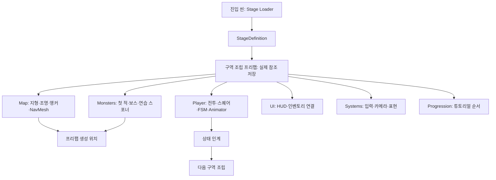

# 튜토리얼 구역 조립과 프리팹 분리 명세

문서 상태: 초안 · 별도 Unity 검수 / 작성자: 송예찬 / 기준일: 2026-10-19

## 목적

맵·플레이어·몬스터·UI·진행을 개별 프리팹으로 편집하고 구역 조립 프리팹에 실제 연결을 저장한다. 기존 장비·전투·에르고 스퀘어·튜토리얼 순서를 유지하며, 진행기에서 지형·조명·적·보상까지 생성하던 책임을 분리한다.

## 사용자 흐름

기존 동굴·보스·귀환 씬을 열면 `Stage Loader` 아래 편집용 미리보기가 조립된다. 인스펙터의 `구역 조립 프리팹 열기`로 저장 가능한 구성을 편집하고 `플레이어 FSM / Animator 확인`으로 실제 연결을 확인한다. 미리보기는 씬 저장과 빌드에서 제외되므로 변경은 조립 프리팹에서 저장한다.

Play 전에 미리보기를 제거하고 실행 시 `StageContentLoader`가 해당 구역을 한 번 생성한다. 기존 비동기 씬 전환과 `TutorialSessionTransfer`가 보스·귀환 구역으로 파츠 개체·스퀘어·키 배정·성장·코어 상태를 인계한다.

## 동작 규칙

- `StageDefinition`은 구역 ID와 불러올 조립 프리팹을 선택한다. 모듈 목록은 구성 확인용이며 실제 교체와 연결은 조립 프리팹에서 편집한다.
- 조립 프리팹은 Map, Player, Monsters, UI, Systems, Progression 중첩 프리팹과 상호 참조를 소유한다. 모듈 단독 프리팹의 외부 참조는 조립 프리팹의 오버라이드로 연결한다.
- 플레이어에 FSM·모델 Animator·Controller·공격 데이터를 저장한다. 현재 VARCO 원본 보존형 모션을 유지한다.
- 현행 Player 모듈은 세 튜토리얼 구역과 본부가 공유하는 `Gameplay/Player/Player_Architect_Demo.prefab`이다. VARCO 모델을 기반으로 독립 생성하고 기존 이동·전투·자원·인벤토리·스퀘어 컴포넌트와 설정을 옮긴다. `Player_Test.prefab`과 상속·종속 관계가 없고 테스트 원본을 수정하지 않는다. 루트의 `Demo Player Rig`에서 모든 연결을 확인한다.
- 동굴의 `TutorialMapContext`는 좌표·코어/연습 적/출구 앵커·베이크 NavMesh를 소유한다. 진행기가 런타임 지형 확장이나 NavMesh 재생성을 하지 않는다.
- `TutorialPracticeDefinition`은 연습 적·개별 드롭·코어 픽업·출구·대원 프리팹과 적 배치 오프셋을 소유한다. `TutorialPracticeSpawner`는 앵커에 생성하고 플레이어·입력·코어 참조를 전달한다.
- 진행기는 등장 시점과 처치·획득·스킬 사용 이벤트를 연결한다. 세 연습 적과 보상은 구역 진입 때 준비하며 재도전은 기존 개체를 재사용한다.
- 초기 3×3, 추가 1×1, 레벨업당 한 줄 확장 또는 생성, 파츠 면적·강화·소환·쿨타임 규칙을 유지한다.

## 입력과 출력

| 소유자 | 입력 | 출력 |
| --- | --- | --- |
| StageContentLoader | 현재 구역 설정 | 조립 프리팹 인스턴스 한 개 |
| StageComposition | 저장된 모듈과 참조 | 실제 Player·Map·Monsters·UI·Systems·Progression |
| TutorialMapContext | 지형·앵커·베이크 데이터 | 생성 위치와 이동 지면 |
| TutorialPracticeSpawner | 조우 설정·플레이어·입력·코어 | 적·보상·상호작용 개체 |
| TutorialStageOne/TwoController | 장비·조우·파츠·스킬 결과 | 학습 단계와 목표 안내 |
| TutorialSessionTransfer | 출발 시 플레이어 상태 | 도착 시 같은 개체와 포트폴리오 |

## 상태

편집 미리보기 → Play 전 미리보기 제거 → 구역 생성 → 튜토리얼 → 상태 인계 → 다음 씬 로드 및 이전 구역 파괴 → 다음 구역 조립·복원 순서다. `Load()` 재호출은 같은 인스턴스를 반환한다. 플레이어·UI를 `DontDestroyOnLoad`로 중복 보존하지 않는다.

## 데이터

게임 저장소 기준 주요 경로는 다음과 같다.

- `Assets/_ERGOSQUARE/03.Prefabs/Composition/Tutorial/`: 구역별 조립·맵·플레이어·적·UI·시스템·진행 및 연습 개체 프리팹.
- `Assets/_ERGOSQUARE/08.Data/Tutorial_Dokkaebi/Stages/`: 세 구역 설정·연습 조우·동굴 NavMesh.
- `Assets/_ERGOSQUARE/02.Scripts/Core/Runtime/SceneFlow/StageDefinition.cs`, `StageComposition.cs`, `StageContentLoader.cs`: 콘텐츠 타입을 모르는 공통 계약.
- `Assets/_ERGOSQUARE/02.Scripts/Content/Tutorial_Dokkaebi/Runtime/TutorialMapContext.cs`, `TutorialPracticeDefinition.cs`, `TutorialPracticeSpawner.cs`: 도깨비 맵·조우 구현.
- `Assets/_ERGOSQUARE/02.Scripts/Editor/VarcoAcd/StageCompositionEditor.cs`: 편집 미리보기와 인스펙터.

씬 이름과 빌드 목록은 유지한다. 세 진입 씬은 렌더 설정과 로더만 저장한다. 이전 씬·수정 전 코드는 검수 폴더의 `Before`에 보존한다.

## 예외 처리

구역 정의가 유효하지 않으면 로더가 오류를 표시하고 생성하지 않는다. 연습 맵 앵커·베이크 데이터·조우 프리팹이 없으면 스포너가 명시적으로 실패한다. 나머지 기존 시스템의 검색 경로를 이 개편에서 모두 제거하지는 않는다.

맵 활성화 전에 적을 켜지 않도록 최초 진행 갱신은 장비 연결 후 `Start`에서 수행한다. 편집 연결기와 미리보기는 열린 씬을 자동 저장하지 않는다. 메인 에디터에 이전 미저장 씬이 남아 있다면 변경분을 별도 씬으로 보존하고 새 진입 씬이나 조립 프리팹을 연다. 이전 내용을 원래 경로에 저장하여 새 진입 씬을 덮어쓰지 않도록 한다.

## UI와 피드백

신규 3열 UI·드래그 장착·가방 면적·스퀘어 성장·키 배정의 기존 소유자를 유지한다. 로더 인스펙터에서 구성 프리팹과 FSM·Animator를 확인하고 플레이어 인스펙터에서 실제 상태·공격 단계·클립을 확인한다.

## 완료 조건

별도 Unity 6000.3.7f1에서 세 구역의 이전·직렬화 참조 보존·저장/재열기·미리보기 제외·FSM/Animator 연결 52개 검사를 통과했다. 최종 재열기에서 플레이어 단독 프리팹의 연결·전용 인스펙터·누락 스크립트·미리보기 멱등성/저장 제외 등 33개도 통과했다. 실제 Play Mode에서 첫 전투·빗자루/코어 조합·지면 전개·세 적과 개별 드롭·성장·Q/W·비동기 보스/귀환 이동·파츠 인계·귀환 보고·중복 로드 방지 66개 검사를 통과했다. 이동과 피해는 검수 코드로 입력한 초기 조건이며 수동 완주를 의미하지 않는다.

추가 회귀는 신규 UI의 드래그 장착·무기 표시·잘못된 드롭·취소 17개, 다중 스퀘어 성장·강화·소환·과부하·쿨타임·실물 전개·본부 인계 78개, 실제 Animator·원본 3타·검날 접촉·피해 중복 방지·취소·이동·집중·사망 210개를 통과했다. Animator 검수에는 프레임별 반복 검사가 포함된다. 실행 근거는 `Tools/ArtReview/Modular_Tutorial_20261018`의 보고서·캡처·전달 파일 해시에 보존한다. 메인 에디터의 미저장 씬이나 수동 플레이를 검수한 결과는 아니다.

2026-10-19의 데모 플레이어 분리 검수는 `Tools/ArtReview/Demo_Player_VARCO_20261018`에 추가했다. 새 공통 데모 프리팹의 생성·참조 이관 27개, 최종 편집·빌드 의존성 25개, 실제 튜토리얼 진행 72개, 드래그 장착 17개, Animator·전투 210개, 스퀘어/소환/본부 인계 80개를 통과했다. 활성 빌드 씬 7개에서 테스트 프리팹 의존성이 없고 테스트 원본·기존 모션 파일은 유지한다. 본부도 같은 데모 프리팹을 저장한다.

## 루시드 다이버와의 차이

비교 근거는 로컬 `UnityProject_LucidDiver/Assets/02_Scripts`의 `Manager/LoadManager.cs`, `Manager/GameManager.cs`, `Manager/GameSystem/SpawnManager.cs`, `Utils/AddressableLoader.cs`다.

| 항목 | 루시드 다이버의 코드 | 이번 에르고스퀘어 구현 |
| --- | --- | --- |
| 구역 로드 | 대상 씬과 선택적 추가 씬을 Additive 로드 | 기존 비동기 Single 전환과 진입 씬의 프리팹 로더 |
| 플레이어 | SpawnManager가 태그로 스폰 풀 재수집 후 생성 | 조립 프리팹의 플레이어 생성, 편집 중 실제 연결 확인 |
| 적 | SpawnManager가 존·포인트를 모아 생성 | 첫 적·보스 중첩 프리팹, 연습 적은 명시적 맵 앵커와 조우 정의 |
| 상태 | GameManager가 캐릭터·아이템 저장소와 저장 상태로 초기화 | 기존 메모리 인계로 같은 파츠 개체·다중 스퀘어·코어 상태 복원 |
| UI | UIManager에서 Gameplay 루트 열기 | 구역 UI 프리팹과 기존 신규 Workbench 연결 |
| 에셋 | AddressableLoader 유틸리티 존재 | 씬·프리팹 직접 참조, Addressables 미도입 |

맵과 엔티티를 나누는 원칙은 같고, 에르고스퀘어는 현재 튜토리얼의 UI·장비·스퀘어 참조 보존을 조립 프리팹에서 해결한다. 새 전역 SpawnManager나 광역 이벤트 버스를 추가하지 않는다.

## 남은 문제

현재 구역은 조립 단위로 함께 로드하며 카메라 주변 청크 스트리밍은 하지 않는다. FPS·메모리 감소율은 별도 빌드 프로파일링 대상이다. 몬스터 Animator 추가나 그래픽 변경도 이번 구조 개편 범위 밖이다.

큰 월드에서 Additive 청크나 Addressables를 적용할 때는 조명·NavMesh·에셋 해제·실패 복구 정책을 함께 검증한다. 현재 세 마리 연습 조우는 재도전 시 재사용하며 범용 풀 매니저를 추가하지 않는다.

## Revision History

| 날짜 | 버전 | 변경 내용 | 작성자 |
| --- | --- | --- | --- |
| 2026-10-18 | v0.1 | 구역 프리팹·편집 미리보기·맵/조우 책임 분리와 루시드 다이버 비교 | 송예찬 |
| 2026-10-19 | v0.2 | 테스트 프리팹과 VARCO 데모 프리팹 분리, 튜토리얼·본부 공통 플레이어와 연결 참조 이관 | 송예찬 |
