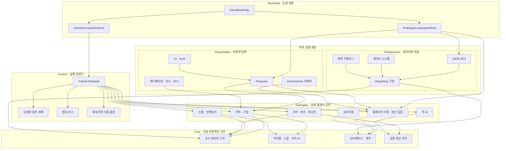
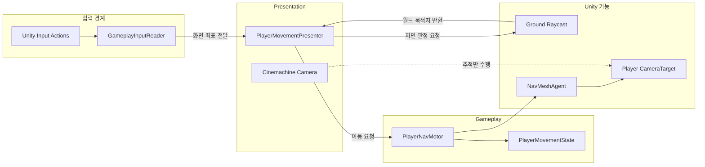
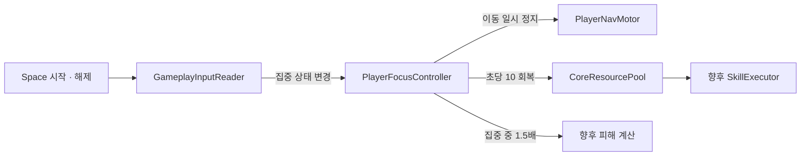

# 프로젝트 아키텍처

> [!IMPORTANT]
> 문서 상태: 기준 초안. 루시드 다이버에서 검증한 계층 분리 원칙은 유지하되 전역 싱글턴·서비스 로케이터·광역 이벤트 버스의 확산은 피합니다.

## Quick Links

[기술 문서](README.md) · [데이터 구조](데이터_구조.md) · [씬 구조](씬_구조.md) · [대표 시스템 명세](시스템별_구현_명세/에르고스퀘어_대표_시스템_명세.md) · [튜토리얼 개발 순서](../01_게임_기획/04_튜토리얼/제작/개발_순서_및_완료_조건.md)

## 현재 튜토리얼 조립

실제 조립 진입점은 `StageContentLoader` → `StageDefinition` → `StageComposition` 프리팹이다. 맵·플레이어·적·UI·입력/카메라·진행을 중첩 프리팹으로 나누고 실제 참조를 조립 프리팹에 저장한다. `TutorialMapContext`·`TutorialPracticeDefinition`·`TutorialPracticeSpawner`가 맵 위치·설정·개체 생성을 맡는다. [구역 조립 명세](시스템별_구현_명세/튜토리얼_구역_조립과_프리팹_분리_명세.md)에서 실제 경로와 비교를 확인한다. 아래 전체 계층 그림의 Bootstrap 타입명은 초기 목표 구조이며 실제 구현 타입명과 구분한다.

## 1. 목표

- 하위의 안정적인 규칙이 상위의 화면·콘텐츠를 참조하지 않게 합니다.
- 입력, 실제 동작, 화면 표현과 데이터 저장을 서로 교체할 수 있게 분리합니다.
- 모든 기능을 미리 추상화하지 않고 첫 버티컬 슬라이스에서 필요한 경계부터 만듭니다.
- 여러 시스템을 소유하는 전역 `Manager`보다 책임이 드러나는 작은 Controller·Presenter·Repository를 사용합니다.
- 실제 조립은 Bootstrap 계층 한 곳에서 수행합니다.

## 2. 전체 계층과 참조 방향

아래 화살표는 앞쪽 계층이 뒤쪽 계층을 참조한다는 뜻입니다. `Core`로 갈수록 안정적이며 위쪽 화면이나 콘텐츠를 알지 못합니다.

## 3. 계층별 책임

| 계층 | 책임 | 참조 가능 | 참조 금지 |
| --- | --- | --- | --- |
| Core | 공통 데이터, ID, 인터페이스, 순수 계산 | 공용 표준 라이브러리 | Gameplay, UI, 콘텐츠 |
| Gameplay | 이동·전투·상호작용·코어·파츠 규칙 | Core, 최소 공용 기반 | Presentation, 구체 UI |
| Presentation | 입력 연결, Presenter, UI, 카메라, 연출 | Core, Gameplay | Infrastructure 구현 상세 |
| Infrastructure | JSON, 저장, Repository, 에셋 카탈로그 | Core의 데이터·인터페이스 | Presentation |
| Content | 도깨비 튜토리얼과 개별 콘텐츠 조합 | Core, Gameplay | 다른 콘텐츠의 내부 구현 |
| Bootstrap | 실제 구현체 생성·참조 연결·시작 순서 | 필요한 모든 계층 | 게임 규칙 직접 구현 |

`UnityGameFoundation`은 프로젝트 바깥의 공용 기반 패키지로 두며 입력 차단, 상호작용 계약과 씬 참조처럼 둘 이상의 프로젝트에서 재사용이 확인된 기능만 포함합니다.

## 4. 첫 이동 기능의 실제 연결

첫 구현은 우클릭 지점 이동과 아이소메트릭 카메라 추적입니다. 입력, 중재, 실제 이동과 카메라를 다음처럼 분리합니다.

### 역할 경계

- `GameplayInputReader`는 Unity Input System을 게임플레이 요청으로 변환합니다.
- `PlayerMovementPresenter`는 화면 좌표를 유효한 월드 목적지로 바꾸고 이동을 요청합니다.
- `PlayerNavMotor`는 목적지를 받아 `NavMeshAgent`를 구동하며 마우스와 UI를 모릅니다.
- Cinemachine Camera는 `CameraTarget`을 추적할 뿐 이동 입력이나 NavMesh를 직접 제어하지 않습니다.
- `PrototypeCompositionRoot`가 테스트 씬의 입력·Presenter·Motor·카메라 참조를 연결하고 누락을 검증합니다.

### 정신 집중의 실제 연결

- `GameplayInputReader`는 Space의 시작과 해제를 집중 상태로 변환합니다.
- `PlayerFocusController`는 집중 중 이동을 막고 프레임 시간에 따라 자원을 회복합니다.
- `CoreResourcePool`은 전개 전후가 공유하는 같은 자원 풀입니다. 전개 시 새로 만들거나 초기화하지 않습니다.
- 현재 피해 시스템은 미구현이므로 `CurrentIncomingDamageMultiplier`를 공개해 후속 피해 계산이 `1.5배` 검증값을 적용하도록 준비합니다.

## 5. 현재 Unity 어셈블리

| 어셈블리 | 현재 상태 | 다음 조치 |
| --- | --- | --- |
| `Ergosquare.Core` | 생성됨 | 순수 데이터·계약부터 추가 |
| `Ergosquare.Gameplay` | 생성됨 | 이동 Motor와 상태 구현 |
| `Ergosquare.Presentation` | 생성됨 | 이동 Presenter와 카메라 연결 |
| `Ergosquare.Content.TutorialDokkaebi` | 생성됨 | 이동 기반 이후 콘텐츠 추가 |
| `Ergosquare.Editor` | 생성됨 | 데이터 검증·제작 도구에 사용 |
| `Ergosquare.Infrastructure` | 예정 | ExcelToJson·Repository 작업 때 추가 |
| `Ergosquare.Bootstrap` | 예정 | 첫 이동 버티컬 슬라이스 조립 전에 추가 |

## 6. 금지할 의존 방식

- 모든 기능을 `GameManager.Instance`에 모으지 않습니다.
- 전체 프로젝트가 공유하는 무제한 `GlobalEventBus`를 만들지 않습니다.
- 의존 대상을 숨기는 서비스 로케이터를 기본 연결 방식으로 사용하지 않습니다.
- 입력·이동·애니메이션·소리·충돌을 하나의 플레이어 클래스에 넣지 않습니다.
- Gameplay가 구체적인 UI, JSON 파일 경로나 튜토리얼 콘텐츠를 직접 참조하지 않습니다.

이 규칙은 싱글턴과 이벤트를 절대 사용하지 않는다는 뜻이 아니라 소유자·수명·구독 해제가 명확한 좁은 범위에서만 사용한다는 뜻입니다.

## 7. 최초 스크립트 구현 순서

기반은 시스템 이름을 먼저 늘리는 방식이 아니라, 플레이 가능한 기능 하나를 세로로 완성하는 방식으로 쌓습니다. 첫 번째 세로 조각은 **빈 테스트 맵에서 우클릭한 지점까지 이동하는 것**입니다.

### 7.1 1차: 우클릭 이동

> 구현 상태: 2026-08-17 기준 `TestMap`에서 Input System → 지면 투영 → NavMesh 이동 → Cinemachine 추적까지 연결 및 Play Mode 검증 완료.

| 순서 | 스크립트 | 계층 | 책임 | 완료 조건 |
| --- | --- | --- | --- | --- |
| 1 | `GameplayInputReader` | Gameplay/Input | 포인터·우클릭 유지 이동·정신 집중·상호작용 요청을 이벤트로 변환 | 우클릭 유지와 Space 시작·해제 상태가 각각 전달됨 |
| 2 | `GroundPointerProjector` | Presentation/Camera | 화면 좌표를 `Ground` 레이어의 월드 좌표로 변환 | 지면 밖 클릭은 거부하고 지면 클릭은 좌표 반환 |
| 3 | `PlayerMovementState` | Gameplay/Player | `Idle`, `Moving`, `Stopped` 상태 표현 | 이동기가 외부에 상태를 노출 |
| 4 | `PlayerNavMotor` | Gameplay/Player | 목적지를 받아 `NavMeshAgent` 구동 | 장애물을 우회해 목적지에서 정지 |
| 5 | `PlayerMovementPresenter` | Presentation/Player | 입력, 지면 투영, 이동기를 연결 | 입력 계층과 이동기가 서로 직접 참조하지 않음 |

씬에서는 `GameplayInputReader → PlayerMovementPresenter → GroundPointerProjector/PlayerNavMotor` 참조만 연결합니다. Cinemachine은 플레이어 하위의 `CameraTarget`을 추적하며 이동 코드를 참조하지 않습니다.

### 7.1.1 현재 테스트 씬 구성

- `Player_Test`: `NavMeshAgent`, `PlayerNavMotor`, `CoreResourcePool`, 하위 `CameraTarget`
- `GameplaySystems`: `GameplayInputReader`, `PlayerMovementPresenter`, `PlayerFocusController`
- `Main Camera`: `CinemachineBrain`, `GroundPointerProjector`
- `CM_IsometricCamera`: `CinemachineCamera`, `CinemachineFollow`, `IsometricCameraController`
- `TestMap`: `Ground` 레이어, `NavMeshSurface`, 저장된 `NavMesh-TestMap.asset`
- `PrototypeObstacle_A~C`: `Obstacle` 레이어와 Carving `NavMeshObstacle`

구성이 손상되었거나 테스트 씬을 다시 만들 때 Unity 메뉴의 `Tools > ERGOSQUARE > Prototype > Build Movement Test Scene`을 실행합니다. 설치 도구는 기존 이름의 오브젝트를 재사용하고 누락된 컴포넌트와 참조만 보강합니다.

### 7.2 2차 이후

| 단계 | 추가할 주요 스크립트 | 먼저 확인할 플레이 경험 |
| --- | --- | --- |
| 아이소메트릭 카메라 | `IsometricCameraRig`, `CameraOcclusionController` | 이동 방향과 클릭 지점이 읽기 쉬운가 |
| 정신 집중 | `CoreResourcePool`, `PlayerFocusController` | Space 유지 중 이동 정지와 초당 10 회복이 명확한가 |
| 상호작용 | `PlayerInteractor`, `InteractionPresenter` | 가까운 조사물을 `G`로 안정적으로 선택하는가 |
| 기본 공격 | `PlayerBasicAttackController`, `AttackTargetResolver` | 좌클릭 공격과 우클릭 이동이 충돌하지 않는가 |
| 에르고스퀘어 | `BlueprintGrid`, `PartPlacementRule`, `CoreRuntime` | 3×3 전개와 중심 칸 제한이 이해되는가 |
| 자원·스킬 | `SkillSlotLoadout`, `SkillExecutor`, `CoreRuntime` | 정신 집중 자원이 전개 후 유지되고 자동 생성으로 이어지는가 |

각 단계는 이전 단계의 스크립트를 비대하게 만드는 대신 새 책임으로 분리합니다. 실제로 둘 이상의 구현이 필요해지기 전에는 인터페이스나 범용 Manager를 미리 만들지 않습니다.

## Revision History

| 날짜 | 버전 | 변경 내용 | 작성자 |
| --- | --- | --- | --- |
| 2026-07-31 | v0.1 | 계층과 핵심 모듈 후보 작성 | 송예찬 |
| 2026-08-17 | v0.2 | 계층 의존성과 첫 이동 기능 연결을 Mermaid 다이어그램으로 구체화 | 송예찬 |
| 2026-08-17 | v0.3 | 최초 이동 스크립트와 이후 기반 구현 순서 명세 추가 | 송예찬 |
| 2026-08-17 | v0.4 | TestMap 우클릭 이동·Cinemachine·NavMesh 구현 및 검증 결과 반영 | 송예찬 |
| 2026-08-17 | v0.5 | Space 정신 집중, CoreResourcePool과 이동 잠금 구현 구조 반영 | 송예찬 |
| 2026-10-18 | v0.6 | 실제 구역 조립 타입과 맵·플레이어·몬스터 프리팹 책임 분리 명세 연결 | 송예찬 |
