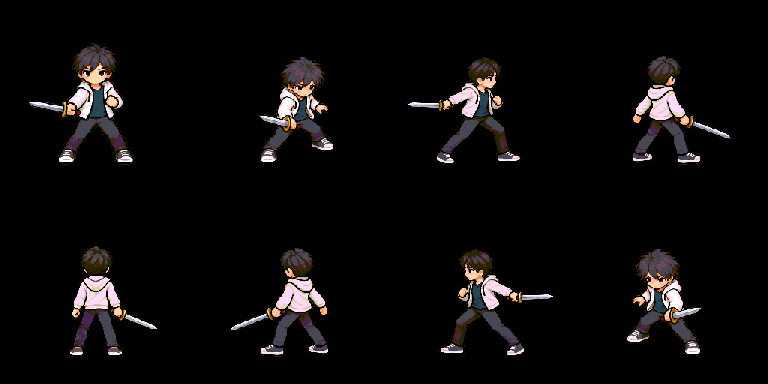
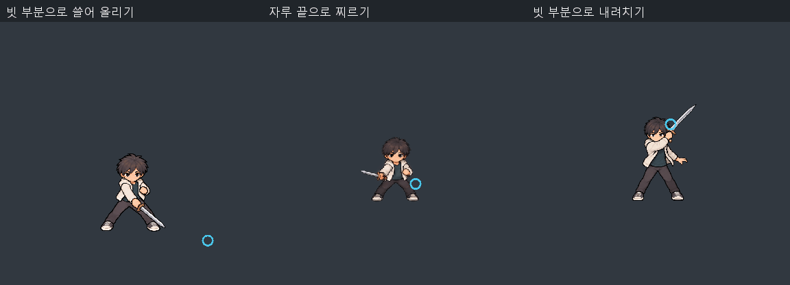
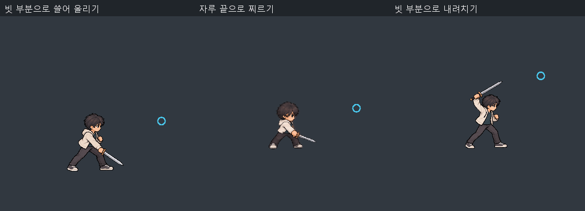
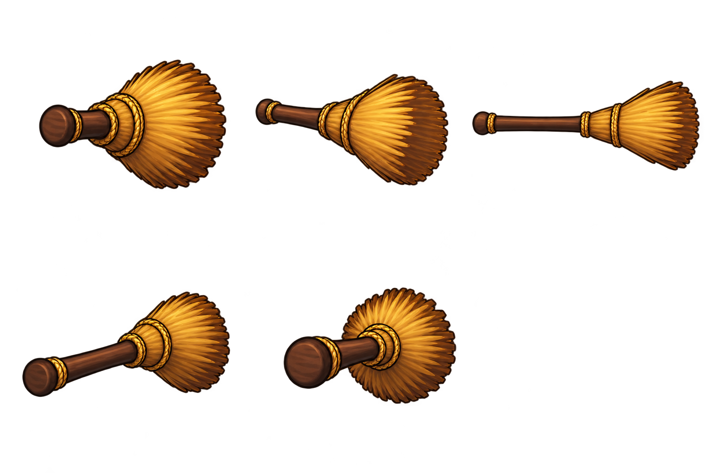
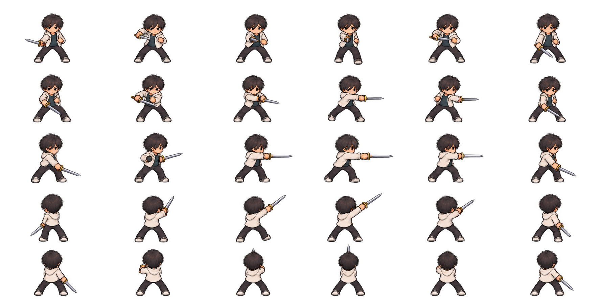
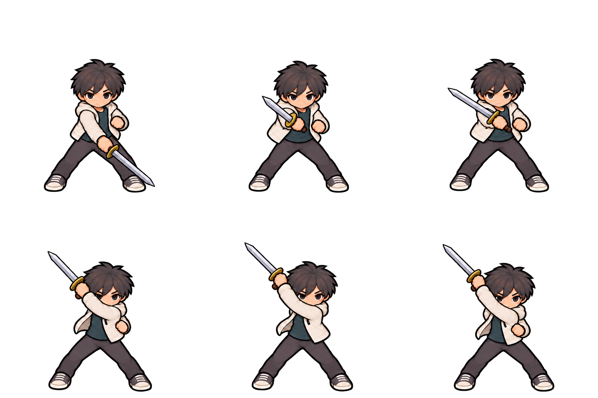

# 2026-10-02 개발 일지 — 3단 기본공격과 빗자루 독립 연출 구현

## 기본 정보

- 작성자: 송예찬
- 작업일: 2026-10-02 (한국 시간)
- 기록 작성일: 2026-10-03. 자정 이후 작업·검증을 포함하며 사용자 요청에 따라 10월 2일 작업분으로 기록합니다. 첨부 파일의 `2026-10-03` 폴더명은 실제 자료 생성일로 유지합니다.
- 프로젝트: ERGOSQUARE: ARCHITECT
- 단계: 튜토리얼 프로토타입
- [노션 데일리로그](https://app.notion.com/p/3ed36532580e81beb208f09b4bd2448b) · [개발 일지 인덱스](README.md) · [시스템 상세 부록](../../01_게임_기획/시스템_상세_부록.md)

> [!IMPORTANT]
> 당일 작업 기록 마감입니다. 튜토리얼 전체 완성·모션의 시각 품질 최종 승인·커밋 및 푸시 완료를 뜻하지 않습니다. 아래 재생 자료는 별도 Unity 검증 프로젝트의 렌더이며 실제 튜토리얼 플레이 녹화와 구분합니다.

## 오늘의 목표

10월 2일에 만든 훈련검 3단 공격 기반을 다듬고, 몸·검·궤적이 함께 읽히도록 8방향으로 확장합니다. 걷기보다 기본공격을 우선 처리하고, 빗자루를 플레이어에게 붙이지 않는 독립 오브젝트로 구현합니다.

## 적용 결과 미리보기

### 8방향 3단 기본공격

위: S/SE/E/NE, 아래: N/NW/W/SW. 실제 경과 시간에 따라 재생한 검증 자료입니다.

방향별 접촉 자세와 칼끝·궤적을 확인하는 정지 비교판입니다.

### 빗자루 독립 오브젝트와 세 스킬

플레이어는 검 동작을 수행하고, 빗자루 프리팹은 별도로 나타나 움직입니다. 찌르기는 나무 자루 끝, 올려쓸기·내려치기는 빗 부분이 타격 끝입니다.

정면·측면 GIF는 실제 경과 시간을 30fps로 샘플링했습니다. 스킬별 실행 길이가 서로 다르며, 공통 시간으로 늘려 맞춘 영상이 아닙니다.

## 작업 내용

### 1. 3단 공격의 몸·검 동작 교정

| 타수 | 동작 | 교정 기준 |
| --- | --- | --- |
| 1타 | 좌→우 횡베기 | 팔·몸·검이 함께 움직이며 넓은 베기가 읽힘 |
| 2타 | 우→좌상 사선 올려베기 | 우측 이동 후 수직 상승이 아닌 연속적인 대각선 베기 |
| 3타 | 우상→좌하 직선적인 내려베기 | 교차 준비에서 내려베고 대기 자세로 복귀 |

- 손 소켓의 검만 회전·신축하는 표현을 폐기하고 몸·팔·검이 통합된 자세를 사용했습니다.
- 타수별 6개 시간 자세를 연결했습니다. 공격 중 별도 장비 검을 숨겨 검이 두 자루 보이지 않도록 했습니다.
- 정면 2타를 교정한 원화로 교체하고, 실제 베기 자세가 피해 전에 준비 동작으로 재생되지 않도록 시간표를 맞췄습니다.
- S/SE/E/NE/N 5개 원본 방향과 SW/W/NW 반전으로 8방향을 구성했습니다. 몸과 칼끝 좌표를 함께 반전합니다.
- 방향별 접촉·궤적 시작 프레임을 데이터로 읽어 몸과 궤적이 같은 시간표를 사용합니다.
- 검손이 바뀌는 N 방향 후보는 제외하고 앞뒤 승인 자세를 유지했습니다. **144개는 8방향×3타×6시간 자세 슬롯이며 서로 다른 원화 144장을 뜻하지 않습니다.**

### 2. 모든 타수에서 읽히는 궤적

- 궤적은 실제 원화의 칼끝 이전 위치를 따라가는 짧은 리본 메쉬입니다. 현재 손에 붙어서 회전하는 PNG가 아닙니다.
- 납작해져 보이지 않던 1·3타의 면을 경로 수직 방향으로 확보하고, 양끝을 가늘게 하여 칼끝으로 수렴시켰습니다.
- 청백색 경계와 밝은 흰 중심선을 사용하고 몸 통합 스프라이트 뒤에 표시합니다.
- 준비·최종 복귀·취소에는 숨기고, 타격 후 짧게 감쇠합니다. 다음 타수에 이전 잔상이 남지 않습니다.
- 궤적은 시각 효과이며 새 피해 콜라이더가 아닙니다. 기존 사거리·벽 차폐·중복 타격 방지 규칙을 유지했습니다.

### 3. 이동 중 기본공격 우선

| 입력 상황 | 결과 |
| --- | --- |
| 걷는 중 유효한 좌클릭 공격 승인 | 목적지·잔여 속도를 제거하고 즉시 제자리 공격 |
| 공격 전에 누른 우클릭을 계속 유지 | 공격 중 이동 갱신 억제; 공격을 취소하지 않음 |
| 공격 중 새 우클릭 명령 | 남은 타격·예약 취소 후 이동 재개; 같은 목적지도 재입력 가능 |
| 공격 종료 시 우클릭 유지 | 현재 커서를 따라 이동 재개 |
| 공격 종료 시 유지 입력 없음 | 제자리에 남음; 버린 목적지로 자동 이동하지 않음 |
| 미장착·간격·집중·메뉴·UI 등으로 공격 거절 | 이동을 새로 정지시키지 않음 |

입력 처리를 외형 갱신보다 먼저 수행하여 같은 프레임에 걷기에서 공격 자세로 전환합니다. 취소해도 공격 간격을 환불하지 않으며 기존 피해·자원·연속기 규칙은 유지합니다.

### 4. 빗자루 프리팹 이미지와 이펙트 분리

플레이어는 검으로 올려베기·찌르기·내려베기를 합니다. 빗자루는 플레이어 손의 자식이 아닌 허공의 독립 오브젝트로 나타납니다. 몸과 빗자루를 함께 그린 v1은 현재 적용 경로에서 사용하지 않습니다.

| 역할 | 구현 | 관계 |
| --- | --- | --- |
| 플레이어 검 자세 | `PrototypeManifestSkillAnimation` / 플레이어 Presenter | 기존 스킬 타격 시간과 동기화 |
| 빗자루 이미지·이동 | `PrototypeBroomObjectVisual` | 현현 프리팹 자체의 `Broom_Image` 사용 |
| 출현·소멸·궤적 | `PrototypeBroomSkillEffects` | `VFX_BroomSkill_Independent` 별도 월드 루트 |
| 시작·종료 조정 | `PrototypeManifestBroomVisual` | 이미지와 이펙트를 따로 제어 |

빗자루 루트 `SkillPart_BroomManifested` 자체가 이동·회전합니다. 프리팹 내부에는 이펙트용 LineRenderer/MeshRenderer를 두지 않습니다. 이펙트를 꺼도 빗자루 이미지와 움직임은 유지됩니다.

| 스킬 | 빗자루 동작 | 궤적 기준 |
| --- | --- | --- |
| `KR_BROOM_SWEEP` | 빗 끝을 낮게 대고 좌→우 곡선으로 쓴 뒤 끝에서 올림 | 빗 부분 |
| `KR_BROOM_THRUST` | 자루 끝이 앞서고 빗 부분은 뒤에 남음 | 나무 자루 끝 |
| `KR_BROOM_VERTICAL` | 빗 머리를 위에서 아래로 내려찍음 | 빗 부분 |

- 찌르기는 좁은 궤적, 나머지는 넓은 빗 궤적으로 구분합니다. 이 차이는 시각 연출이며 판정 범위를 바꾸지 않습니다.
- 카메라 오른쪽으로 분리해 출현시키고 손 소켓을 따라 움직이지 않습니다. 축이 화면에서 지나치게 짧아지지 않도록 최소 투영 길이를 보정했습니다.
- 승인된 스킬은 이동을 정지시킵니다. 종료·비활성화 때 두 루트를 숨기고 장비 검·대기를 복원합니다.
- 스킬 자세만 공유하며 검 기본공격을 추가 실행하지 않습니다. 따라서 스킬 피해가 두 번 발생하지 않습니다.
- 바닥 획득용 `TestWeapon.prefab`의 충돌·상호작용은 변경하지 않았습니다.
- 현재 구조는 v3이지만 생성 원화와 `BroomManifest_v2` 폴더·프리팹 이름은 재사용했습니다.

### 5. 유지한 수치와 작업 범위

기본공격 피해 15와 타격 시점 0.20/0.18/0.22초, 클릭 예약·취소 규칙을 유지했습니다.

| 빗자루 스킬 | 실행 길이 | 타격 시점 | 자원 비용 | 재사용 |
| --- | --- | --- | --- | --- |
| 쓸기 | 0.90초 | 0.45초 | 60 | 1.8초 |
| 찌르기 | 0.55초 | 0.209초 | 45 | 0.9초 |
| 내려치기 | 0.72초 | 0.4032초 | 50 | 1.2초 |

피해·자원·재사용·경직·슬롯·복수 콜라이더 중복 방지는 기존 규칙을 유지했습니다. SFX·히트스톱·새 무기 콜라이더 판정은 추가하지 않았습니다. 관련 구현에 한글 주석을 추가했습니다.

## 문제 → 원인 → 해결

| 발견한 문제 | 원인 | 해결 |
| --- | --- | --- |
| 검이 손에 붙어 빙글빙글 도는 느낌 | 몸 자세와 별개로 손 소켓의 검을 회전·신축 | 몸·팔·검 통합 자세와 별도 칼끝 리본으로 교체 |
| 2타가 오른쪽 이동 후 수직으로 상승 | 원화 중간 자세와 베기 시간표가 원하는 사선과 불일치 | 사선 올려베기 원화·시간표 동시 교정 |
| 궤적이 2타에서만 잘 보임 | 1·3타 리본이 투영상 납작하고 대비가 약함 | 경로 수직 폭·흰 중심선·배경 대비 검사 추가 |
| 걷는 중 기본공격이 즉시 나오지 않음 | 이동 경로·속도·표시 우선순위가 남아 있음 | 승인된 좌클릭에서 정지하고 입력을 외형보다 먼저 처리 |
| 빗자루가 플레이어에 붙은 표현 | 몸·빗자루 통합 v1이 독립 오브젝트 의도와 다름 | 단독 빗자루 원화·프리팹 사용, 이미지·이펙트 월드 루트 분리 |
| 세 빗자루 동작의 타격 끝 구분이 약함 | 동일한 끝점·유사 경로 사용 | 올려쓸기 곡선, 자루 끝 찌르기, 빗 끝 내려치기로 구분 |

## 생성 원화 첨부

임포트에 사용한 투명 PNG 원본입니다. 위 Unity 검증 렌더와 구분합니다. 현재 사용하지 않는 초기 시안은 게임 저장소에 보존하되 최종 적용 예시로 제시하지 않습니다.

### 빗자루 단독 5방향

### 검 찌르기 5방향·각 6자세

### 정면 2타 사선 올려베기 교정

## 검증

Unity 6000.3.7f1 별도 배치 검증 프로젝트에서 실행했습니다. 열린 사용자 Unity 씬은 변경하지 않았으며 실제 튜토리얼 수동 플레이는 미검수입니다.

| 최종 검사 | 통과 항목 | 주요 범위 |
| --- | --- | --- |
| `ManifestBroomSmokeTest` | 1,689 | 프리팹 이미지·이펙트 분리, 8방향 타격 끝·궤적, 단일 피해·비용·종료 복구 |
| `ComboBodySmokeTest` | 2,273 | 144 시간 슬롯, 몸·검·궤적, 방향 반전, 렌더 대비, 피해·예약·취소 |
| `WalkEightKeyposeSmokeTest` | 75 | 기존 걷기·정지·8방향·표시 우선순위 회귀 |
| `MovementAttackPrioritySmokeTest` | 53 | 실제 입력 이벤트·NavMesh 정지, 유지/새 우클릭, 거절된 공격의 이동 유지 |

모두 종료 코드 0입니다. 원화 알파·UV 분리, 발 피벗, Point 임포트, 타격 끝과 잔상 머리 일치를 확인했습니다. 최종 v3 검증 기록을 기준으로 하며 중간 v1/v2 검사 수를 합산하지 않습니다.

에디터 SearchDatabase 초기화의 기존 `ArgumentOutOfRangeException`은 별도 경고로 남았습니다. 기능 시험 성공과 구분합니다. 자동 검사는 **모션 자연스러움·손맛·실제 튜토리얼 장애물 가림**의 합격 판정이 아닙니다.

## 구현 산출물과 검증 근거

아래는 게임 저장소 `C:/GitHubProjects/ERGOSQUARE-ARCHITECT` 기준입니다.

- `Assets/_ERGOSQUARE/02.Scripts/Presentation/Runtime/VFX/PrototypeComboSpriteAnimation.cs`
- `Assets/_ERGOSQUARE/02.Scripts/Presentation/Runtime/VFX/PrototypeSwordTrailVisual.cs`
- `Assets/_ERGOSQUARE/02.Scripts/Presentation/Runtime/VFX/PrototypePlayerSpritePresenter.cs`
- `Assets/_ERGOSQUARE/02.Scripts/Presentation/Runtime/VFX/PrototypeBroomObjectVisual.cs`
- `Assets/_ERGOSQUARE/02.Scripts/Presentation/Runtime/VFX/PrototypeBroomSkillEffects.cs`
- `Assets/_ERGOSQUARE/02.Scripts/Presentation/Runtime/VFX/PrototypeManifestBroomVisual.cs`
- `Assets/_ERGOSQUARE/02.Scripts/Presentation/Runtime/VFX/PrototypeManifestSkillAnimation.cs`
- `Assets/_ERGOSQUARE/Resources/Characters/ComboBodyAlignment.json` 및 방향별 공격 원화
- `Assets/_ERGOSQUARE/Resources/VFX/BroomManifest_v2/` 단독 빗자루·검 찌르기 원화, 정렬 데이터·현현 프리팹
- 입력·이동 연계: `PlayerNavMotor`, `PlayerMovementPresenter`, `PrototypeBasicAttack`, `PrototypeEquipmentPresenter`
- 제작 기록: `Tools/ArtReview/ComboBody/generation-prompts.json`, `Tools/ArtReview/BroomSkills/manifest-generation-prompts.json`
- 최종 근거: `Tools/ArtReview/BroomSkills/object-separated-verification-v3.txt`
- 회귀 근거: `Tools/Verification/ComboBodySmokeTest_result.txt`, `WalkEightKeyposeSmokeTest_result.txt`, `MovementAttackPrioritySmokeTest_result.txt`
- 최종 로그: `tmp/broom-object-separated-v3.log`, `tmp/broom-v3-combo-regression.log`, `tmp/broom-v3-walk-regression.log`, `tmp/broom-v3-movement-regression.log`

## 다음 작업

- [ ] 실제 튜토리얼에서 8방향 3단 공격·2→3타 연결·대기 복귀 확인
- [ ] 이동 중 좌클릭 정지·공격, 새 우클릭 취소, 유지 우클릭 재개 확인
- [ ] 빗자루 세 스킬의 빗 끝/자루 끝과 크기·바닥 깊이·장애물 가림 확인
- [ ] 후면 프레임 유지 구간과 좌우 반전으로 주 사용 손이 바뀌는 표현 검토
- [ ] 모션 승인 후 중간 자세·장착 무기별 스킬 자세 확장
- [ ] SFX 제작·연결은 별도 과제로 진행

### 다음 세션 확인 순서

1. Unity 재컴파일 후 Play 모드를 다시 시작합니다.
2. 대원의 무기를 장착하고 마우스 방향을 바꾸며 3회 클릭하여 8방향을 확인합니다.
3. 우클릭 이동 중 좌클릭 공격·새 우클릭 취소·유지 우클릭 종료 재개를 비교합니다.
4. 빗자루 세 스킬을 슬롯에 할당하고 충분한 에너지를 준비합니다.
5. 올려쓸기의 빗 부분, 찌르기의 자루 끝, 내려치기의 빗 부분과 잔상을 비교합니다.
6. 종료·취소·비활성화 후 잔상·현현체가 사라지고 장비 검·대기가 복구되는지 확인합니다.
7. 실제 카메라의 후면·대각선 손 위치, 지형 깊이와 장애물 겹침을 검토합니다.

## 관련 기록

- [10월 2일 노션 데일리로그](https://app.notion.com/p/3ed36532580e81beb208f09b4bd2448b)
- [이전 10월 1일 개발 일지](2026-10-01_걷기_핵심자세와_8방향_반전_적용.md)
- [문서 저장소](https://github.com/SongYeChan1024/Document_ERGOSQUARE-ARCHITECT)

## Revision History

| 날짜 | 버전 | 변경 내용 | 작성자 |
| --- | --- | --- | --- |
| 2026-10-03 | v1.0 | 3단 공격 교정·8방향 확장·이동 중 공격 우선·빗자루 독립 연출과 원화/재생 자료 8개 기록 | 송예찬 |
| 2026-10-03 | v1.1 | 사용자 요청에 따라 작업일·제목·파일명·연결을 10월 2일 작업분으로 정정; 실제 기록·자료 생성일 유지 | 송예찬 |
