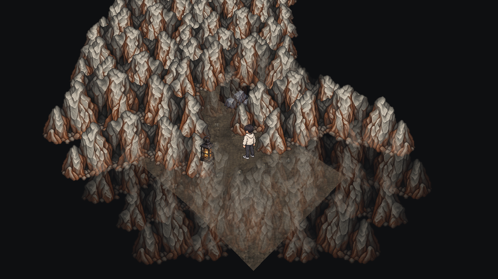
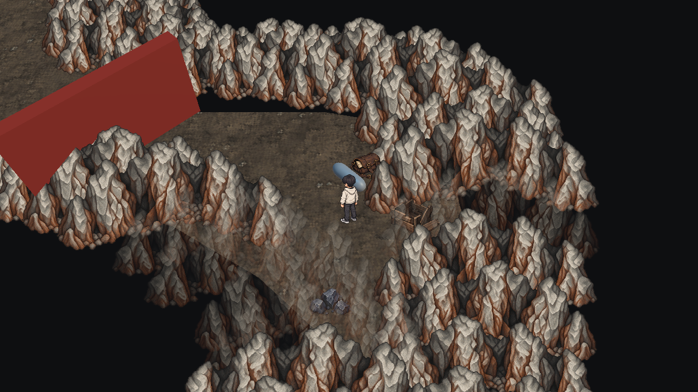
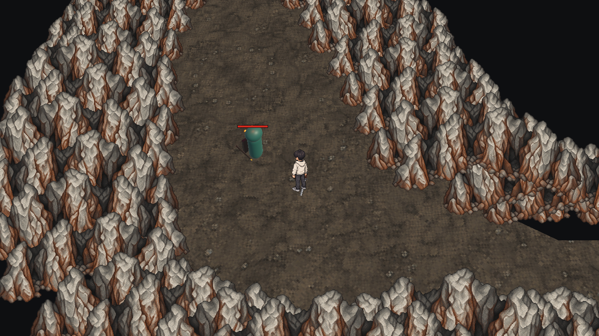
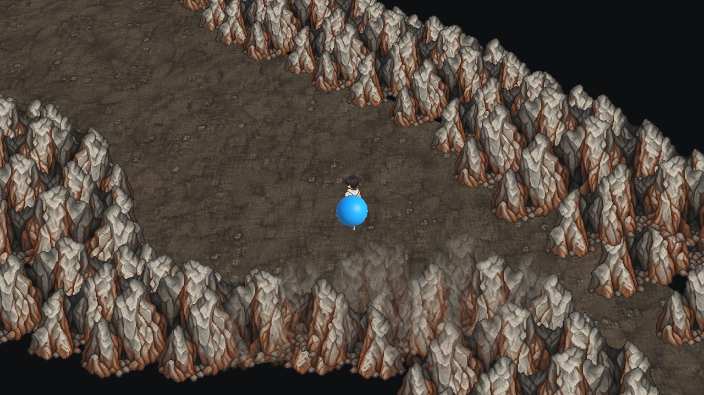
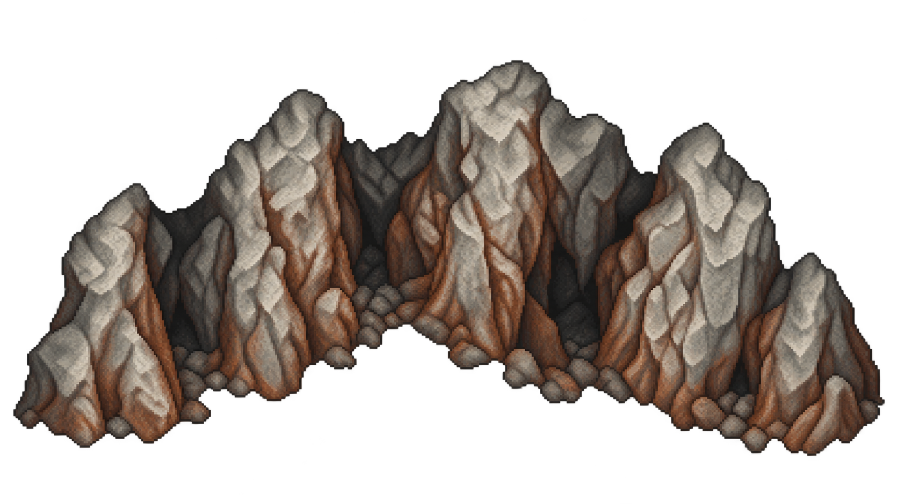
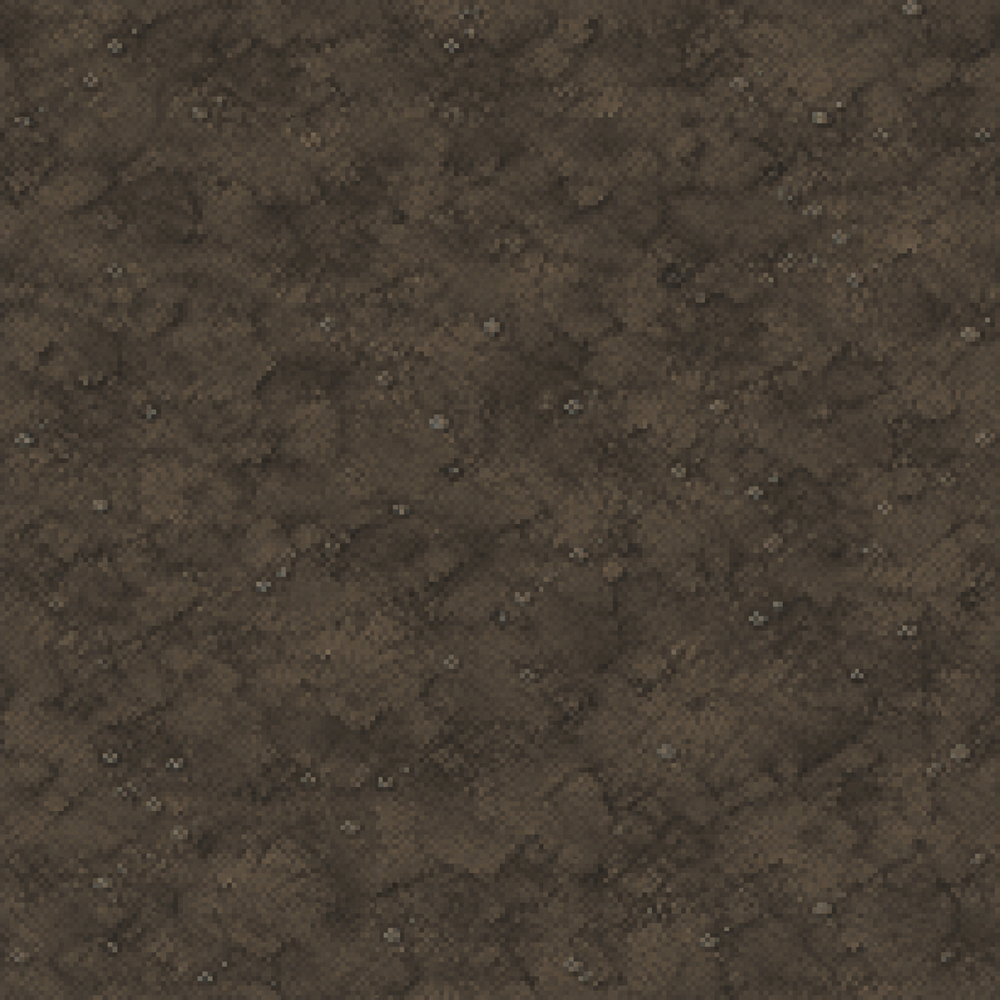
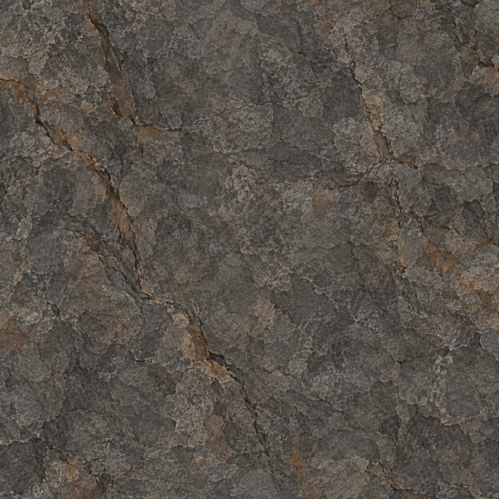

# 2026-10-03 개발 일지 튜토리얼 동굴 리소스와 굴곡 레벨 적용

## 기본 정보

- 작성자: 송예찬
- 작업일: 2026-10-03 (한국 시간)
- 기록 작성일: 2026-10-04. 자정 이후 후속 수정·검증을 포함하며 사용자 요청에 따라 10월 3일 작업분으로 기록합니다. 기술 문서의 수정일과 첨부 원본의 생성일은 그대로 유지합니다.
- 프로젝트: ERGOSQUARE: ARCHITECT
- 단계: 튜토리얼 프로토타입
- [노션 데일리로그](https://app.notion.com/p/3ee36532580e81f3bbe1e566496d5121) · [개발 일지 인덱스](README.md) · [레벨 및 전투 설계](../../01_게임_기획/04_튜토리얼/플레이/레벨_및_전투_설계.md)

> [!IMPORTANT]
> 오늘의 구현과 기록을 마감한 상태입니다. 튜토리얼 전체 완성·환경 아트 최종 승인·수동 플레이 완주·독립 빌드·커밋 및 푸시 완료를 뜻하지 않습니다.

## 오늘의 목표

튜토리얼 동굴에 환경 이미지를 입히고, 사각 블록아웃을 자연스러운 굴곡 통로와 비대칭 공동으로 바꿉니다. 사용자 맵의 1.5배 배율을 유지하면서 시각 경계·실제 충돌·이동 경로·상호작용 위치를 일치시키는 것이 핵심입니다.

## 적용 결과

별도 Unity 검증 프로젝트에서 본 프로젝트와 동일한 저장 씬을 실행한 카메라 캡처입니다. Screen Space Overlay HUD는 포함하지 않습니다. 대원·적·코어와 붉은 장비 학습 장벽 일부는 아직 프로토타입 외형입니다.

### 굽은 입구

좁은 시작 통로에서 오른쪽으로 두 번 굽습니다. 대원 위치로 향하는 직선 시야는 실제 암벽으로 막힙니다.

### 대원 발견 공간

대원 기록을 읽고 검을 획득·장착하는 공간입니다. 가방·상자는 장식이며 대원 기록·장비 획득 상호작용은 기존 객체에서 처리합니다.

### 비대칭 첫 전투 공동

대원 구간보다 넓어지고 왼쪽으로 벌어지는 공동입니다. 첫 전투와 최소 3×3 청사진 배치용 평탄 바닥을 확보했습니다.

### 코어 공동

첫 전투 후 푸른 표식을 지나 좁은 통로와 코어 획득 공간으로 이어집니다. 기존 코어 전개 연습과 두 번째 전투로 가는 길도 유지합니다.

## 작업 내용

### 환경 리소스 생성과 적용

초기 v1 바닥·암벽·등불·돌무더기·가방·상자 이미지를 생성하고 Unity 재질/스프라이트로 적용했습니다. 원본 PNG는 보존하고, 바닥과 암벽의 렌더링을 기존 충돌·상호작용과 분리했습니다.

사용자가 제시한 참고 이미지와 초기 적용 화면을 비교한 결과, 바닥에 돌 패턴이 빽빽하게 반복되어 빈 이동 공간과 암벽의 구분이 약했습니다. v2에서는 저대비의 어두운 흙바닥, 큰 암반용 텍스처, 투명 도트 암벽을 따로 생성했습니다.

- 바닥은 Point 필터와 12m 기준 반복 UV를 사용합니다. 반복 경계의 최종 수작업 보정까지 완료한 것은 아닙니다.
- 도트 암벽은 경계 바깥에 겹쳐 배치하며 높낮이와 좌우 반전을 달리합니다. 플레이어를 가리는 부분은 옅게 표시합니다.
- 장식에는 Collider와 NavMeshObstacle을 만들지 않아 기존 바닥 클릭·이동을 막지 않습니다.
- 맵 밖 배경을 어둡게 하고 외형 컴포넌트 해제 시 관련 렌더링 상태를 복원합니다.
- v1 PNG와 재질은 비교·복구용으로 보존했습니다.

### 1.5배 맵 배치 보정

사용자가 바닥과 진행 오브젝트를 `Tutorial_Blockout_Stage01` 아래로 모으고 1.5배로 확대한 상태를 유지했습니다. 고정 월드 좌표 대신 `MapCoordinateFrame`과 `Tutorial_LayoutAnchors`를 사용합니다.

스폰·대원·첫 적·빗자루 보상·코어·소품이 같은 좌표 변환을 따릅니다. 캐릭터 신체 크기와 NavMeshAgent 높이는 맵 배율에서 분리해 이중 확대를 피했습니다. 기존 배치 보정 도구는 앵커 위치를 유지하므로 개별 앵커를 이동해 편집할 수 있습니다.

### 굴곡 지형과 실제 이동 영역

`Tutorial_Ground`에 `TutorialCaveLayout`을 추가하고 21개 단면의 좌우 경계를 각각 지정했습니다. 입구 → 오른쪽 대원 포켓 → 왼쪽 전투 공동 → 좁은 코어 통로 → 코어 공동 순서로 폭과 방향이 달라집니다.

바닥은 42개 정점의 실제 Mesh이며 MeshFilter와 MeshCollider가 같은 에셋을 사용합니다. 경계는 닫힌 암벽 MeshCollider로 구성하고 NavMesh를 새로 베이크했습니다. 옛 직사각 영역의 빈 공간에는 바닥과 이동 경로가 남지 않습니다. 도트 암벽과 시각 바닥도 동일한 경계 데이터를 사용합니다.

옛 벽·바위는 삭제하지 않고 비활성화했습니다. 기존 두 번째 학습 구간이 바닥을 직사각형으로 확장하던 코드는 굴곡 지형에서는 실행하지 않도록 분기했습니다. 기존 연습 전투 자체는 유지했습니다.

### 진행 연결과 다음 맵 방향

현재 연결한 흐름은 `대원 기록 → 검 획득·장착 → 첫 빗자루 도깨비 처치 → 빗자루 획득·편성 → 푸른 표식 → 코어 획득`입니다. 이후 기존 코어 전개 연습·두 번째 훈련 적·끝 표식도 접근할 수 있습니다.

향후에는 **진입 튜토리얼존을 코어 획득까지**, **초가집 앞 언월도 보스존을 별도 맵으로** 구성합니다. 이번 작업에서 보스맵이나 씬 전환을 새로 구현하지 않았습니다. 도깨비불이 둥둥 떠다니는 조명은 연출 방향으로 논의했으며 현재 등불·조명 전체를 교체한 상태는 아닙니다.

## 발생한 문제와 원인

| 문제 | 원인 | 해결 |
| --- | --- | --- |
| 맵 확대 후 스폰·상호작용 위치가 어긋남 | 맵 계층의 배율·위치와 고정 월드 좌표가 혼재 | 공통 좌표 프레임과 앵커로 배치 통일 |
| 화면이 돌 패턴으로 가득 찬 공간처럼 보임 | 바닥과 벽 모두 강한 반복 돌무늬를 사용 | 흙바닥·암반·경계 스프라이트를 분리한 v2 리소스 적용 |
| 내부가 사각형처럼 보임 | 직사각 바닥과 긴 평행 벽의 실제 윤곽 유지 | 바닥·충돌벽·NavMesh 자체를 굴곡 경계로 교체 |
| 새 지형이 런타임에 다시 사각형으로 늘어남 | 이후 학습 코드가 기존 Plane 스케일을 변경 | 굴곡 지형에서는 구형 연장 코드를 건너뜀 |
| 초기 굴곡에서도 대원에게 직선 시야가 열림 | 통로 방향만 바꾸고 대원까지의 시야선을 충분히 가리지 못함 | 단면을 좁히고 실제 암벽 시야 차단 검사를 통과시킴 |

## 구현 파일과 복구

게임 저장소는 `C:/GitHubProjects/ERGOSQUARE-ARCHITECT`입니다.

| 파일 | 역할 |
| --- | --- |
| `Core/Runtime/Common/MapCoordinateFrame.cs` | 맵 좌표·회전·배율 변환 |
| `Gameplay/Runtime/Tutorial/TutorialCaveLayout.cs` | 동굴 단면, 바닥·경계 Mesh 생성 |
| `Presentation/Runtime/Environment/TutorialCaveEnvironmentPresenter.cs` | 흙바닥·도트 암벽·소품·가림 처리 |
| `Editor/TutorialCaveTextureImporter.cs` | 환경 이미지 임포트 설정 |
| `Editor/TutorialLayoutRepairTools.cs` | 사용자 맵 기준 배치 보정 |
| `Editor/TutorialOrganicCaveTools.cs` | 씬 백업 후 굴곡 지형·앵커·NavMesh 적용 |
| `Content/Tutorial_Dokkaebi/Runtime/TutorialStageOneController.cs` | 공통 맵 배치와 첫 학습 흐름 연결 |
| `Content/Tutorial_Dokkaebi/Runtime/TutorialStageTwoController.cs` | 코어·연습 구간 앵커 연결과 지형 확장 분기 |

위 스크립트 경로의 기준은 `Assets/_ERGOSQUARE/02.Scripts/`입니다.

- 저장 씬: `Assets/_ERGOSQUARE/01.Scenes/Tutorial_Dokkaebi/Tutorial_Stage01_Awakening.unity`.
- 생성 지형 에셋: 같은 씬 폴더의 `OrganicCave/`에 Mesh·재질·NavMesh를 보존했습니다.
- 수정 전 저장 씬 백업: `Assets/_ERGOSQUARE/01.Scenes/Tutorial_Dokkaebi/LayoutBackups/BeforeOrganicCave_20261004_SavedUserMap.unity`.
- 편집 메뉴: `Tools → ERGOSQUARE → Tutorial → 굴곡 동굴 레벨 적용`. 재실행은 현재 씬을 백업한 뒤 프리셋 지형과 앵커를 다시 적용합니다. 임의 배치를 수정한 뒤에는 주의합니다.
- 확인: Play 종료 → Asset Refresh → `Tutorial_Stage01_Awakening` 다시 열기 → Play. 외부 수정된 씬을 다시 열기 전에 오래된 편집 상태를 저장해 덮어쓰지 않도록 주의합니다.

## 생성 리소스 첨부

실제 적용 화면과 구분되는 v2 PNG 원본입니다. 작업일은 10월 3일로 기록하지만 아래 첨부 경로의 `2026-10-04`는 자료 생성·마감 시점으로 유지합니다. 별도 픽셀 재작성 없이 원본 파일을 복사했습니다.

### 투명 도트 암벽

### 흙바닥 텍스처

### 암반 텍스처

## 검증

별도 `tmp/SlashVerification` Unity 6000.3.7f1 프로젝트에서 단계별 검사를 수행했습니다. 서로 다른 지형 버전과 검증 단계의 수이므로 최종 맵의 단일 통합 검사 수로 합산하지 않습니다.

| 단계 | 도구 | 결과 |
| --- | --- | --- |
| 초기 이미지 외형 | `TutorialCaveEnvironmentSmokeTest` | 48개 통과 |
| 1.5배 배치·좌표 보정 | `TutorialLayoutScaleSmokeTest` | 35개 통과 |
| 외형 v2 | `TutorialCaveV2SmokeTest` | 75개 통과 |
| 최종 저장 굴곡 씬 | `TutorialOrganicCaveSmokeTest.RunSaved` | 54개 통과 |

최종 검사에서는 사용자 배율 유지, 실제 바닥/경계 연결, 옛 직사각 공간의 바닥/이동 경로 제거, 시작점과 대원 사이 시야 차단, 각 구간 NavMesh 완전 경로, 첫 공동의 3×3 바닥을 확인했습니다. 장비 장착 해금·처치 보상·빗자루 편성/Q 할당·코어 해금/획득/편성과 기존 연습 구간 접근도 검사했습니다.

본 프로젝트 저장 씬과 검증 씬의 내용 일치 및 생성 Mesh·재질·NavMesh 5개 파일의 해시 일치를 확인했습니다. 최종 카메라 캡처 4장을 이 일지와 노션에 첨부했습니다.

**검증 한계:** 장비·획득·피해는 테스트 API로 진행했습니다. 실제 G 상호작용과 기록 창 읽기·입력을 포함한 수동 완주, 모든 해상도, 독립 플레이어 빌드는 미검증입니다. 기존 `UnityEditor.Search.SearchDatabase` 검색 인덱스 예외는 게임 진행 검사와 구분해 기록했습니다. 벽 스프라이트의 반복감과 통로 폭·전투 여유는 추가 플레이테스트가 필요합니다.

## 다음 작업

- [ ] 입구에서 대원까지 직접 플레이하며 굴곡과 발견 시점 확인.
- [ ] 좁은 통로의 클릭 이동·카메라 가림·상호작용 가독성 조정.
- [ ] 첫 공동의 우클릭 이동·기본공격·빗자루 스킬과 3×3 전개 공간 확인.
- [ ] 대원·적·코어 자리 표시자와 붉은 장비 학습 장벽 외형 개선.
- [ ] 도깨비불 조명과 별도 보스존/씬 전환을 다음 구현 범위로 구체화.

## 기록 상태

데일리로그는 노션의 기존 `Logs For Develope` 데이터베이스에, 상세 일일 개발일지는 안티그래비티에서 사용하는 이 문서 저장소에 작성했습니다. 문서 인덱스와 이미지 7개를 함께 보존했습니다. 이번 요청에는 커밋·푸시·공개 위키 배포를 포함하지 않습니다.

## Revision History

| 날짜 | 버전 | 변경 내용 | 작성자 |
| --- | --- | --- | --- |
| 2026-10-04 | v1.0 | 사용자 지정 10월 3일 작업분으로 동굴 리소스·1.5배 배치·굴곡 지형·단계별 검증과 이미지 7개 기록 | 송예찬 |
