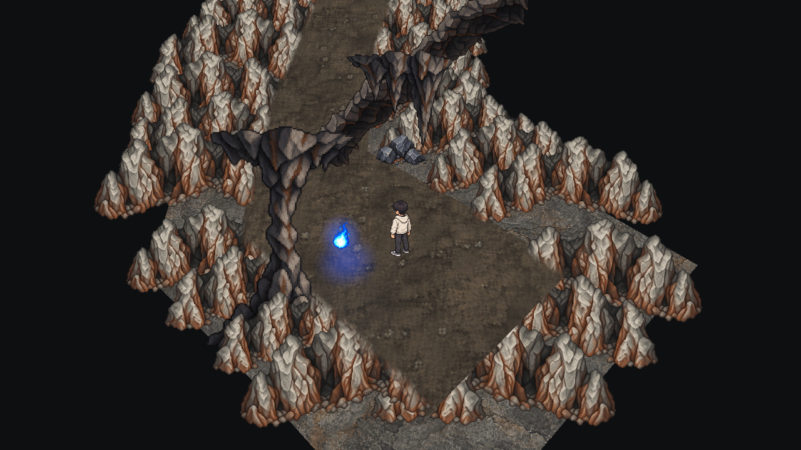
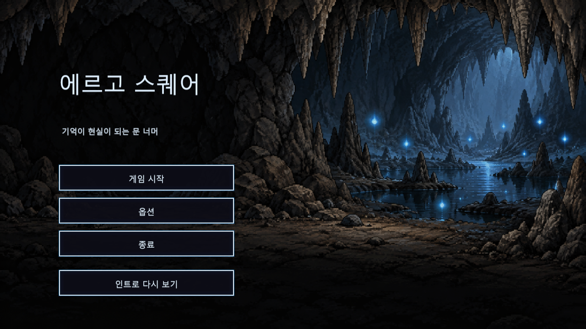
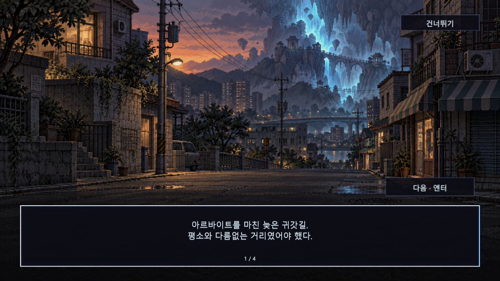
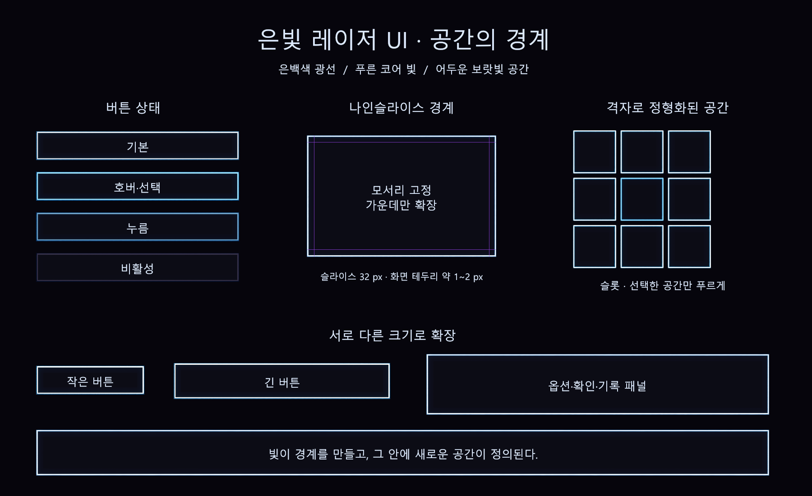
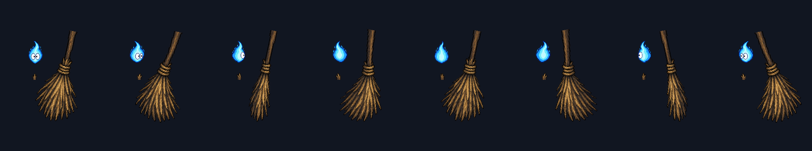
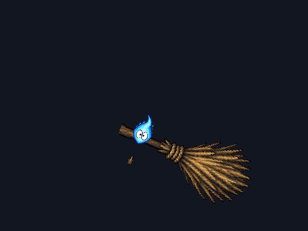
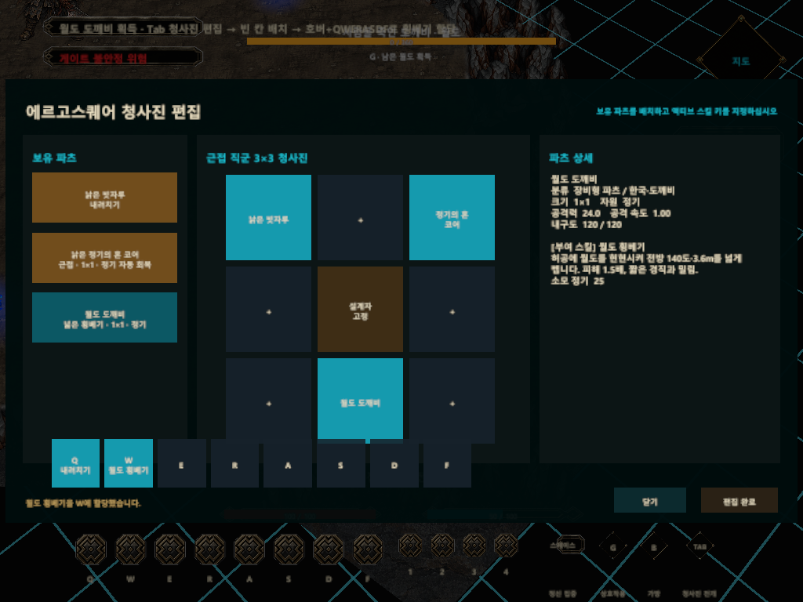
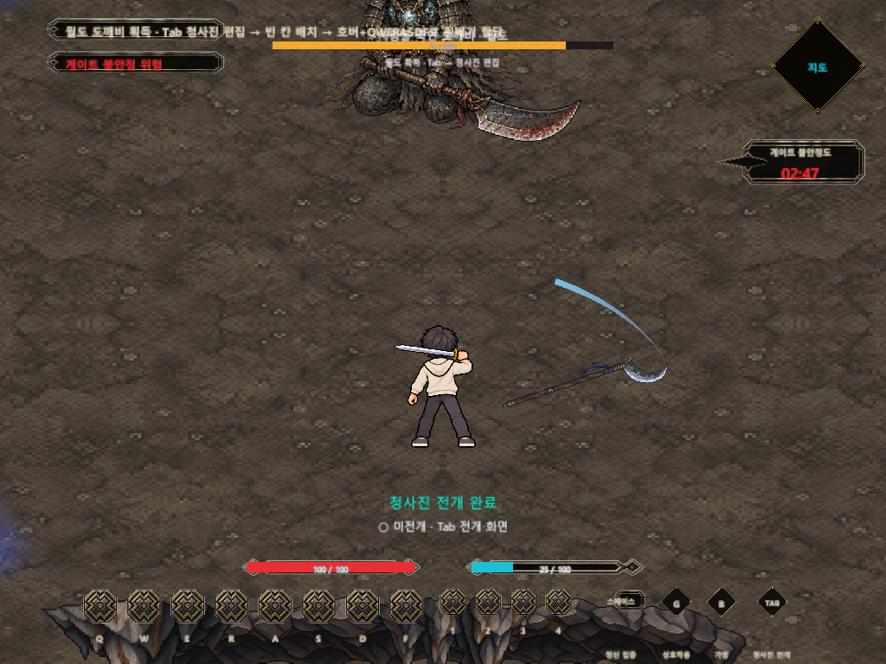

# 2026-10-05 개발 일지

작성자: 송예찬 · 프로젝트: ERGOSQUARE: ARCHITECT

[개발 일지 인덱스](README.md) · [노션 데일리로그](https://app.notion.com/p/3f036532580e8160a633e72eb34d9af2) · [이전 10월 4일 기록](2026-10-04_동굴_통로와_보스_AI_피격_역전개_구현.md)

## 기록 정보

- 프로젝트: ERGOSQUARE: ARCHITECT
- 작업일: 2026-10-05 · 사용자 지정 마감일
- 기록 작성일: 2026-10-06 · 자정 이후 월도 보상과 G 오류 수정까지 이번 마감에 포함
- 상태: 당일 작업 마감. 전체 튜토리얼과 최종 아트의 완성을 뜻하지 않습니다.
- 실제 에셋 생성일·검증 로그의 날짜는 변경하지 않습니다.

## 오늘의 목표

동굴의 공간감을 보강하고 시작부터 튜토리얼까지 진입 흐름을 만듭니다. 빗자루 도깨비의 도트 표현과 피격 반응을 정리하고, 보스 처치 뒤 영혼 해방과 월도 파츠 획득을 청사진 시스템으로 연결합니다.

## 작업 내용

- 동굴 외벽은 투명화에서 제외하고 실제 시야를 가리는 내부 장애물·전경만 흐려지도록 분리했습니다.
- 석주·종유석·석순·천장 암반과 연결부를 추가하고 옆 암벽과 천장의 색감을 종유석 계열로 맞췄습니다.
- 인트로 → 로비 → 게이트 진입 오프닝 → 첫 튜토리얼의 씬 흐름을 구성했습니다. 로비의 시작·옵션·종료와 클릭 진입 안내를 연결했습니다.
- 첫 감상 시 인트로 영상과 자막이 재생되며, 완료·명시적 건너뛰기 이후에는 자동 재생을 생략합니다. 다시 보기와 영상 준비 실패 시 원화 연출 대체도 마련했습니다.
- 씬 전환에 비동기 로딩 화면과 오류 복귀를 연결했습니다.
- 은빛 레이저 테두리·푸른 광채·어두운 보라색의 UI 이미지와 버튼·패널·슬롯 나인슬라이스를 적용했습니다.
- 빗자루 도깨비를 기존 도트 방식으로 유지하고 8방향 외형·스킬별 흔들림과 휘어짐을 구현했습니다. 독립 빗자루 오브젝트의 이미지와 궤적 이펙트를 분리했습니다.
- 일반 적에 기본 피격 경직, 쓸기의 밀림, 찌르기의 밀림, 내려치기의 넘어짐·기상을 연결했습니다.
- 보스의 일반 상태 반응은 일반 적의 20%로 제한하고 전조·타격·후딜 중에는 피해만 받으며 경직·밀림·넘어짐·스킬 취소는 막았습니다.
- 가까운 플레이어와 자신을 공격한 플레이어를 우선하고 코어는 거리·시야·접근 가능 조건에 따라 공격하도록 변경했습니다.
- 보스 처치 → G로 묶인 영혼 해방 → 월도 드롭 표시 → 다시 G로 월도 도깨비 획득을 구현했습니다.
- 월도를 1×1 청사진 파츠로 추가했습니다. Tab 편집에서 클릭·드래그 배치와 호버 중 QWERASDF 스킬 배정, 별도 횡베기 연출을 연결했습니다.

## 발생한 문제와 원인 및 해결

보스 처치 후 G로 영혼을 풀 수 없다는 플레이 피드백이 있었습니다. 보스 씬에는 G 입력을 월드 대상으로 전달하는 PlayerInteractionController와 오브젝트 위 안내 UI가 빠져 있었습니다. 첫 맵의 자동 설치가 빗자루 획득 오브젝트에 의존했는데, 보스 맵에는 그 오브젝트가 없었습니다.

보스 진행 컴포넌트에서 같은 씬의 입력과 플레이어를 연결하고, HUD에서 월드 G 안내를 설치하도록 수정했습니다. 기존 씬 파일을 재생성하거나 사용자 미저장 맵 편집을 덮어쓰지 않았습니다.

이전 보상 검증은 TryInteract 함수를 직접 호출했기 때문에 입력 연결 누락을 놓쳤습니다. 이번에는 가상 키보드 G → 실제 InputAction → 입력 이벤트 → 물리 탐색 → 영혼 해방 → 드롭 → 획득 경로를 검사했습니다.

## 결정한 규칙

- 월도는 검 장비칸을 교체하는 보상이 아니라 독립 청사진 파츠입니다. 보유 빗자루와 유대 데이터를 소비하지 않습니다.
- 영혼 해방 시 즉시 자동 획득하지 않습니다. 드롭을 확인한 뒤 다시 G로 획득하며 편집 창도 자동으로 열지 않습니다.
- 첫 월도 보상은 공격력 24·내구도 120의 고정 파츠, 첫 스킬은 횡베기입니다. 에너지 25·재사용 2.4초·전방 140도·반경 3.6m, 피해 배율 1.5의 프로토타입 값입니다.
- 일반 회수·재설치는 수리가 아니며 파츠 인스턴스·스킬 배정·남은 내구도를 유지합니다.
- 부러진 월도 칼날과 빗자루 합성은 후속 아이디어입니다. 이번에 합성 시스템까지 구현한 것은 아닙니다.

## 검증 결과

- 동굴 전경 85개, 통로 회귀 67개, 외벽과 장애물 투명화 회귀 52개 항목 통과.
- 프런트엔드 41개, 로딩 36개, 레이저 UI 나인슬라이스 25개 항목 통과.
- 피격 반응 최종 73개, 일반 AI 56개, 코어 피드백 36개, 당시 보스 회귀 67개, 빗자루 도트 최종 62개 항목 통과.
- 월도 기능 43개, 월도 추가 후 보스 회귀 69개, 기존 빗자루 연출 1689개 항목 통과.
- G 입력 통합 17개와 수정 후 월도 회귀 43개 항목 통과.

검증은 사용자 씬과 분리된 Unity 6000.3.7f1 복제 프로젝트에서 수행했습니다. 검사 수는 모듈·재실행별 항목이며 중복을 포함합니다. 수동 전체 완주나 독립 빌드 QA 완료로 해석하지 않습니다. 기존 UnityEditor 검색 인덱스 예외는 별도 기록했습니다.

## 구현 화면

별도 Unity 검증에서 저장한 대표 화면 8장입니다. 작업 중간 캡처와 최종 후속 검증 수치를 구분합니다. 월도 화면의 실제 생성일은 10월 6일이며 사용자 요청대로 10월 5일 마감 기록에 포함했습니다.

### 동굴 전경

석주·종유석·천장 연결부를 추가한 입구 화면입니다.

### 로비

은빛 레이저 UI를 적용한 로비 화면입니다.

### 게이트 진입 오프닝

튜토리얼 전 원화와 이야기 안내 화면입니다.

### 나인슬라이스 시트

버튼·패널·슬롯의 테두리를 유지하는 분할 시트입니다.

### 빗자루 도깨비 8방향

도트 외형과 방향별 표현 검토 시트입니다.

### 빗자루 피격

내려치기 피격 후 넘어짐을 확인한 검증 화면입니다.

### 월도 청사진 편집

보유 파츠에서 월도를 배치하고 스킬을 배정하는 화면입니다.

### 월도 횡베기

독립 월도 이미지와 별도 궤적을 확인한 검증 화면입니다.

## 다음 작업

- [ ] 실제 입력으로 인트로·로비·오프닝 → 첫 맵 → 보스 처치 → 영혼 해방·월도 획득을 수동 완주하기.
- [ ] 획득한 월도를 Tab에서 클릭·드래그 배치하고 QWERASDF를 배정한 뒤 전개·회수·재설치 확인하기.
- [ ] 초가집을 대청이 있는 구조로 바꾸고 기록 열람·보스 후속 이야기를 연결하기.
- [ ] 게이트 종료·복귀 시나리오, 병사 루팅의 최종 구성과 합성·강화·수리 시스템은 별도로 설계하기.
- [ ] 영상·효과음·최종 아트, 모든 해상도와 장시간 반복·독립 빌드 검증 보강하기.

## 관련 기록

이전 기록: [10월 4일 노션 데일리로그](https://app.notion.com/p/3f036532580e814c89d7f9563859321c)

상세 일일개발일지는 안티그래비티에서 사용하는 Git 문서 저장소의 04_프로젝트_관리/개발_일지/2026-10-05_동굴_전경과_시작_흐름_피격_월도_보상.md에 보존합니다. 이번 요청은 기록 작성이며 커밋·푸시·공개 배포는 수행하지 않습니다.

## 구현 세부와 한계

### 동굴과 전경

외벽의 전체 알파는 유지하고, 별도 전경의 실제 불투명 PNG 픽셀이 카메라와 플레이어 사이에 있을 때만 흐려집니다. 투명 여백·석주 사이의 빈 공간·플레이어 뒤쪽은 가림으로 보지 않습니다. 전경 장식에는 Collider와 NavMeshObstacle을 만들지 않고 Ignore Raycast 레이어를 사용합니다. 굴곡 맵의 좌표·배율·이동 경계는 유지했습니다.

### 시작 흐름과 UI

인트로 영상은 원화 기반 연출과 자막을 연결한 프로토타입입니다. 최초 감상 여부는 완료 또는 명시적 건너뛰기 때 저장하며, 씬에 들어왔다는 이유만으로 감상 완료를 기록하지 않습니다. 영상 준비 실패 시 원화 연출로 대체합니다. 로비에는 클릭 진입 안내와 시작·옵션·종료·인트로 다시 보기가 있고, 오프닝 뒤 첫 튜토리얼로 이동합니다.

버튼·패널·슬롯의 Sprite border는 네 변 32px 기준이며 네이티브 Image.Type.Sliced로 검증했습니다. 1280×720과 1024×768 검토 화면이 있습니다. 전체 인게임 HUD의 최종 스킨·접근성·모든 해상도 검수까지 끝났다고 보지는 않습니다. 신규 효과음 최종 제작은 이번 완료 범위에 포함하지 않습니다.

### 피격 반응과 코어 우선순위

일반 적의 프로토타입 반응값은 기본 경직 0.10초, 쓸기 경직 0.40초·측면 밀림 1.4m, 찌르기 경직 0.25초·전방 밀림 0.75m, 내려치기 경직 0.65초·넘어짐 0.75초·밀림 0.35m입니다. 내려치기 뒤 기상 0.30초와 회복 0.15초를 분리합니다. 해당 공격은 일반 적의 전조·타격을 중단할 수 있습니다.

보스는 일반 상태에서 반응 시간·거리가 20%이고 넘어지거나 공격이 취소되지 않습니다. 전조·타격뿐 아니라 Recovery 상태도 슈퍼아머 범위에 포함되어 경직·밀림·넘어짐은 0이지만 피해량은 그대로입니다. 억제한 밀림을 스킬 종료 뒤에 뒤늦게 적용하지 않습니다.

플레이어가 보이고 접근 가능한 가까운 범위에 있거나 최근 공격자일 때 플레이어 우선권을 줍니다. 코어는 가까우면서 시야·경로 조건을 만족하고 플레이어 우선 조건이 해제된 경우에만 선택합니다. 보스의 코어 표적은 2단계 이후 돌진 패턴으로 제한하며 전조가 시작된 뒤 방향을 다시 바꾸지 않습니다.

### 월도 보상과 청사진

월도의 월드 드롭은 획득 대상을 보여주는 연출이며 물리 이동을 막지 않습니다. 현재 두 번의 G 상호작용은 쓰러진 보스의 기존 상호작용 트리거를 공유하고 안내 문구만 영혼 해방에서 월도 획득으로 갱신합니다. 월도 드롭만 따로 자유롭게 이동·루팅하는 범용 드롭 시스템이 완성된 것은 아닙니다.

월도 1×1 파츠는 코어+빗자루+월도 편성 또는 코어+월도 편성을 지원합니다. 근접 청사진 중앙칸 잠금은 유지합니다. 별도 월도 이미지가 현현하고 궤적은 LineRenderer로 처리하며 시각물의 Collider로 중복 피해를 만들지 않습니다. 전개 실물의 내구도는 적의 피해와 회수·재설치를 통해 같은 인스턴스에 유지됩니다. 씬 인계는 메모리 스냅샷이며 디스크 영구 저장은 아닙니다.

대청이 있는 초가집으로의 외형 개편과 기록 열람, 보스 후 게이트 종료·복귀는 아직 미구현입니다. 병사 루팅의 최종 서사·품목, 부러진 월도 칼날 합성·유대 유지 강화·수리도 후속 논의로 남깁니다.

## 구현 파일과 검증 자료

게임 프로젝트: `C:/GitHubProjects/ERGOSQUARE-ARCHITECT`. 아래 소스 경로는 `Assets/_ERGOSQUARE/02.Scripts/` 기준입니다.

| 소스 및 자료 | 역할 |
| --- | --- |
| `Presentation/Runtime/Environment/TutorialCaveForegroundPresenter.cs` · `TutorialCavePalette.cs` | 시야 가림 전경·암벽과 천장 색감 |
| `Presentation/Runtime/UI/FrontEndSceneController.cs` · `FrontEndStoryData.cs` · `SceneLoadingView.cs` | 인트로·로비·오프닝·영상·로딩 |
| `Presentation/Runtime/UI/ErgosquareUiSkin.cs` | 레이저 UI 이미지와 나인슬라이스 |
| `Gameplay/Runtime/Combat/PrototypeDamageReceiver.cs` · `PrototypeHitData.cs` | 피해와 피격 반응 분리 |
| `Gameplay/Runtime/AI/PrototypeMeleeEnemy.cs` · `PrototypeWoldoBoss.cs` | 피격 중단·보스 슈퍼아머·표적 우선권 |
| `Gameplay/Runtime/Tutorial/PrototypeBossEncounter.cs` · `TutorialBindingCoreInteractable.cs` | 영혼 해방·월도 획득과 보스 씬 G 연결 |
| `Gameplay/Runtime/Interaction/PlayerInteractionController.cs` · `Presentation/Runtime/UI/WorldInteractionPromptPresenter.cs` | G 대상 탐색·입력 전달·월드 안내 |
| `Presentation/Runtime/UI/PrototypeBossHudPresenter.cs` | 월도 드롭 표시·획득 후 정리·G 안내 설치 |
| `Gameplay/Runtime/Items/PrototypePartInventory.cs` · `Gameplay/Runtime/Tutorial/TutorialSessionTransfer.cs` | 월도 소유와 씬 간 인계 |
| `Presentation/Runtime/UI/PrototypeBlueprintEditorPresenter.cs` · `PrototypeBlueprintPartDragSource.cs` | 월도 선택·클릭·드래그·스킬 배정 |
| `Presentation/Runtime/VFX/WoldoDokkaebiObjectVisual.cs` · `WoldoDokkaebiSkillPresenter.cs` | 월도 이미지와 별도 횡베기 연출 |
| `Tools/Verification/EnemyHitReaction_v1.result.json` | 피격 정책과 10월 5일 최종 모듈 검사 |
| `Tools/Verification/WoldoReward_v1.result.json` | 월도 검사와 10월 6일 G 수정 후 검증 |
| `Tools/Verification/BossGInteractionSmokeTest.cs` | G 입력 → 물리 탐색 → 보상 획득 통합 검사 |

- 월도 에셋: `Assets/_ERGOSQUARE/Resources/Items/Woldo_v1/`.
- 인트로 영상: `Assets/StreamingAssets/FrontEnd/Ergosquare_Intro_v1.mp4`.
- 나인슬라이스 검사: `Tools/ArtReview/LaserUi/slice-settings.json`.
- G 입력 로그: `tmp/boss-g-interaction-v4.log`.
- 수정 후 월도 회귀 로그: `tmp/woldo-reward-gfix-regression.log`.
- 키보드 검사는 별도 에디터의 가상 키보드와 복제된 런타임 입력 설정을 사용합니다. 실제 InputAction부터 처리하지만 사용자의 포커스·입력 설정 파일을 바꾸지 않으며 직접 수동 완주와 동일한 검증은 아닙니다.
- 이번 기록에는 앞선 작업의 저장된 검증 결과와 화면을 재사용했습니다. 모든 과거 모듈을 마감 시점에 재실행한 것은 아닙니다.

## Revision History

| 날짜 | 버전 | 변경 내용 | 작성자 |
| --- | --- | --- | --- |
| 2026-10-06 | v1.0 | 사용자 지정 10월 5일 마감분 기록. 동굴·시작 흐름·UI·빗자루·피격·월도 보상·G 오류 수정과 대표 이미지 8장 포함 | 송예찬 |

