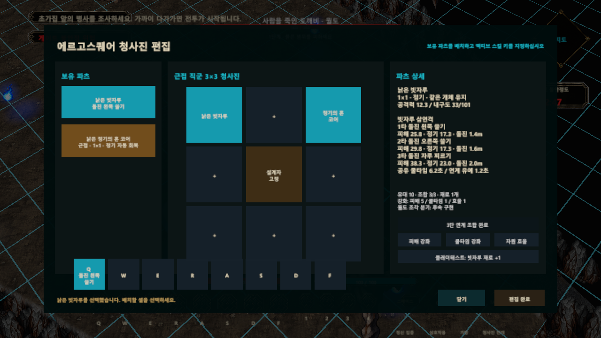

# 2026-10-07 개발 일지

> [!IMPORTANT]
> 문서 상태: 작업 마감 기록. 구현 완료 항목과 후속 계획을 구분하며, 수치는 플레이테스트용 임시값입니다.

## 기록 정보

- 프로젝트: 에르고 스퀘어 — 튜토리얼 프로토타입
- 작성자: 송예찬
- 작업일: **2026-10-07** — 사용자가 지정한 마감일
- 실제 작성·최종 검증일: 2026-10-08 (Asia/Seoul)
- 엑셀·이미지 폴더, 검증 보고서와 `balanceVersion=2026-10-08-v1`은 실제 생성일을 유지합니다.
- [개발 일지 목록](README.md) · [노션 데일리로그](https://app.notion.com/p/3f236532580e813d845ec293fec42fe3) · [이전 작업](2026-10-06_대청_기록과_첫_귀환_구역_구현.md)

## 오늘의 목표

빗자루를 파밍·조합하면 한 번의 돌진 쓸기에서 2·3회 연계 스킬로 확장되도록 만들고, 함께 성장한 도깨비의 정체성과 유대를 유지합니다. 데미지·쿨타임·이동거리·소모 자원을 엑셀에서 수정한 뒤 JSON으로 게임에 반영하는 작업 흐름을 구축합니다.

## 작업 내용

### 1. 개체와 재료를 분리한 조합 성장

| 단계 | 해금 연계 | 조합 규칙 |
| --- | --- | --- |
| 1자루 | 짧게 돌진하며 왼쪽 쓸기 | 처음 획득한 빗자루 도깨비 사용 |
| 2자루 | 왼쪽 쓸기 → 오른쪽 쓸기 | 추가 빗자루 재료 1개 소비 |
| 3자루 | 왼쪽 쓸기 → 오른쪽 쓸기 → 자루 찌르기 | 추가 빗자루 재료 1개 소비 |

- QQQ는 입력 예시입니다. 실제로는 청사진에서 할당한 동일 스킬 키를 반복 입력합니다.
- 중복 빗자루 획득은 미유대 `BROOM_COPY` 재료 수량으로 적립하며, 기존 개체 교체나 자동 조합을 하지 않습니다.
- 조합 후에도 개체 ID, 유대, 무작위 능력치, 내구도, 청사진 배치 및 스킬 할당을 유지합니다. 능력치 재추첨이나 무료 내구도 회복은 하지 않습니다.
- 3단계 이후에는 피해·쿨타임·자원 효율을 별도의 강화 축으로 관리합니다. 각 축 최대 5단계, 강화마다 재료 1개 소비입니다.
- 유대가 있거나 이미 조합한 개체는 직접 재료로 소비하는 API에서 차단합니다. 정식 분해 경고창을 구현했다는 의미는 아닙니다.

### 2. 연계 전투와 독립 빗자루 연출

- 첫 번째 승인 입력에서 개체 공유 쿨타임을 시작합니다. 스킬 슬롯을 재할당해도 우회할 수 없습니다.
- 자원은 각 타격 승인 시 소모합니다. 자원 부족·파손·코어 사용 불가·메뉴 상태 등에서 승인되지 않은 공격은 추가 비용을 쓰지 않습니다.
- 연계 유예와 마지막 구간 선입력 1회를 적용합니다. 너무 이른 입력을 무한히 쌓지 않고, 연계 시간이 끝나면 단계만 초기화합니다.
- 돌진은 지면 방향 이동이며 NavMesh와 장애물 경계에서 멈춥니다. 벽 너머로 Warp하지 않습니다.
- 동일 대상이 여러 콜라이더를 가져도 타격당 한 번만 피해를 받습니다. 실제 명중한 타격당 유대를 한 번 증가시킵니다.
- 보스의 일반 상태 피격 저항과 스킬 중 슈퍼아머는 기존 피해 수신 정책을 재사용합니다.
- 기존 8방향 플레이어 이미지와 독립 빗자루 프리팹을 재사용해 좌·우 쓸기와 자루 끝 찌르기를 연결했습니다. 새 캐릭터 원화를 생성한 작업은 아닙니다.
- 귀환 상태 인계에 성장 상태와 재료를 포함했습니다. 현재는 메모리 인계이며 디스크 저장은 별도입니다.

### 3. 청사진 편집 UI

`Tab → 청사진 편집 → 빗자루 선택`에서 현재 단계·연계 수·데미지·비용·돌진거리·쿨타임을 확인합니다. 하단에는 단계·유대·재료 요약, 2회 클릭 확인 조합과 3개 강화 버튼을 표시합니다.

테스트 재료 지급 버튼은 Editor / Development Build에서만 노출합니다. 일반 몬스터의 반복 파밍 경제나 정식 조합 시설 UI는 아직 완성하지 않았습니다.

*실제 Unity 검증 화면, 생성일 2026-10-08. 작업 기록은 사용자 요청에 따라 10월 7일자로 관리합니다.*

### 4. 엑셀 → JSON 데이터 흐름

- [엑셀 원본](../../01_게임_기획/05_밸런스/outputs/2026-10-08_도깨비_조합/도깨비_스킬_밸런스.xlsx): 사용안내, Stages, Actions, Recipes, Enhancements, Branches의 6시트.
- 필드명·한글 설명·단위는 1~3행, 실제 편집 수치는 4행 이후에 배치합니다. 입력 셀은 노란 배경과 파란 글씨로 구분합니다.
- 데미지와 공격력 계수, 쿨타임, 이동거리, 소모 정기, 판정 범위, 모션 시간, 경직·밀림·넘어짐을 데이터화했습니다.
- Python 표준 라이브러리 변환기, PowerShell 실행기 및 Unity Editor 재생성 메뉴를 추가했습니다.
- 필수 시트·헤더·값·타입·참조·ID 중복·수치 범위·강화 상한을 검증합니다. 수식·숫자 문자열·NaN 등 잘못된 입력은 거부합니다.
- 성공한 출력만 원자적으로 교체합니다. 잘못된 엑셀을 저장해도 기존 JSON을 훼손하지 않습니다.
- JSON에는 원본 SHA256, schemaVersion과 balanceVersion을 기록하고 Runtime에서 읽습니다.
- 수정 순서: **엑셀 저장 → Unity Play 종료 → JSON 재생성 → import 완료 → Play 재시작**. 실행 중 데이터에 실시간 반영하지 않습니다.
- 최초 엑셀 생성 도구는 사용자가 수정한 엑셀에 다시 실행하면 덮어쓰므로, 일반 밸런스 작업에는 exporter만 사용합니다.

### 5. 플레이테스트용 임시 밸런스

| 항목 | 1타 | 2타 | 3타 |
| --- | --- | --- | --- |
| 고정 피해 + 공격력 계수 | 8 + 공격력 × 0.85 | 9 + 공격력 × 1.00 | 12 + 공격력 × 1.25 |
| 소모 정기 | 18 | 18 | 24 |
| 돌진거리 | 1.4 | 1.6 | 2.0 |
| 기본 모션 시간(초) | 0.45 | 0.48 | 0.55 |

- 단계별 쿨타임은 1단계 4.5초 / 2단계 5.5초 / 3단계 6.5초입니다. 타격마다 새 쿨타임이 생기는 구조가 아닙니다.
- 연계 유예 1.2초, 선입력 0.18초, 3타 완주 기본 비용 60입니다.
- 강화 1단계당 해당 축에 피해 +8%, 쿨타임 -4%, 비용 -4%를 가산 적용합니다. 각각 5단계에서 +40% / -20% / -20%입니다.
- 실제 모션·돌진 시간에는 공격속도가 반영됩니다. 최종 수치는 플레이 후 엑셀에서 수정합니다.

### 6. 기획 문서 보완

[도깨비 조합 성장 명세](../../01_게임_기획/01_핵심_플레이/장비_코어_스킬/도깨비_조합_성장_명세.md)에 성장 흐름, 개체 보존, 입력·소모·쿨타임, UI, 데이터 계약, 예외와 검수 조건을 정리했습니다. [종합 기획서](../../00_프로젝트_개요/에르고스퀘어_종합_기획서_초안.md) 및 [밸런스 색인](../../01_게임_기획/05_밸런스/README.md)을 연결했습니다.

월도 조각 분기는 `WOLDO_BROOM` 비활성 후보 데이터로만 남겼습니다. 낮도깨비·밤도깨비는 논의 소재이며 이번 구현에 분류나 행동 규칙을 추가하지 않았습니다.

## 발생한 문제

1. 중복 아이템 조합이 기존 도깨비의 성장 정보와 섞이면 유대·능력치를 잃거나 재추첨할 위험이 있었습니다.
2. 스킬 슬롯별 쿨타임만 사용하면 키 재할당으로 재사용 제한을 우회할 수 있었습니다.
3. 같은 적의 여러 콜라이더에 중복 피해가 들어가거나, 잘못 입력한 엑셀이 런타임 데이터를 덮어쓸 수 있었습니다.
4. 검증 시 캐릭터 높이 오프셋 때문에 실제로는 맞는 돌진거리 검사가 실패했고, 엑셀의 긴 필드명이 화면에서 잘렸습니다.

## 원인

성장 개체·소비 재료·슬롯 상태의 소유 경계가 달랐으며, 충돌 검사와 엑셀 입력 검증이 이를 별도로 보장해야 했습니다. 이동 검증에는 3차원 높이가 섞였고, 표의 열 너비는 긴 ID와 한글 설명을 수용하지 못했습니다.

## 해결

- 별도 성장 상태와 재료 수량, 개체 ID 기반 쿨타임으로 소유 경계를 분리했습니다.
- 대상별 중복 피격을 제거하고 엑셀 검증 성공 후에만 출력하게 했습니다.
- 돌진 거리와 이동량을 지면 기준으로 검증하고 열 너비·행 높이를 조정했습니다.
- 원본 씬과 미저장 편집을 덮어쓰지 않도록 임시 Unity 복제본에서 네이티브 플레이 검증과 화면 캡처를 진행했습니다.

## 검증

| 검증 | 결과 | 범위 |
| --- | --- | --- |
| Python 엑셀 변환 단위시험 | 13개 통과 | 잘못된 입력·참조·수식·출력 보존 등, 마감 시 재실행 |
| 원본 Excel ↔ 생성 JSON 확인 | 통과 | 3단계·3액션·2레시피·3강화·1분기 데이터 일치 |
| Unity 성장 네이티브 Play | 57항목 통과 | 단계·연계·선입력·쿨타임·돌진·재료·상한·개체 보존·실패 조건·UI |
| 기존 독립 빗자루 연출 회귀 | 1,689회 검사 통과 | 반복 프레임 검사 포함, 고유 기능 1,689개를 뜻하지 않음 |
| 기존 월도 보상 회귀 | 43항목 통과 | 기존 영혼 해방·보상 흐름 회귀 |

게임 저장소의 `Tools/Verification/DokkaebiGrowth_v1.result.json`과 검증 소스를 보존합니다. 임시 복제본의 원시 로그는 작업 공간에 남기되 커밋 범위에서 제외합니다.

복제본 Unity Editor Search 인덱스 초기화 예외는 관찰됐으나 게임 코드 컴파일 오류 없이 시험은 완료했습니다. **실제 사용자 플레이 밸런스와 독립 실행 빌드는 아직 검증하지 않았습니다.**

## 다음 작업

- [ ] 1·2·3단계의 실제 조작감, 각도별 돌진·벽 접근·자원 부족을 확인한 뒤 엑셀 수치 조정.
- [ ] 일반 몹의 반복 파밍 경제와 정식 조합 시설 UI.
- [ ] 월도 조각 드롭·분기 스킬·새 외형. 기존 월도 보상을 임의로 조합 재료로 소비하지 않음.
- [ ] 유대 레벨 보상과 장정형 성장, 유대 개체 분해 경고창.
- [ ] 디스크 세이브와 씬 간 쿨타임 보존.
- [ ] 좌·우 전용 플레이어 원화와 연계 가능 시간 HUD 피드백.

## 저장 범위

- 문서 저장소: 명세·종합 기획서·밸런스 색인·엑셀 원본·UI 화면·이번 일지 및 목록.
- 게임 저장소: 성장/전투/UI/귀환 코드·JSON·변환 도구·검증 소스와 요약 결과.
- 임시 검증 복제본, 중첩 저장소, 기존 LayoutBackups, 엑셀 미리보기·inspect 출력과 Python 캐시는 커밋하지 않습니다.

## Revision History

| 작업일 | 버전 | 변경 내용 | 작성자 |
| --- | --- | --- | --- |
| 2026-10-07 | v1.0 | 빗자루 조합 성장·Excel→JSON·실제 UI·검증과 후속 과제를 7일 마감분으로 기록 (작성 10월 8일) | 송예찬 |
