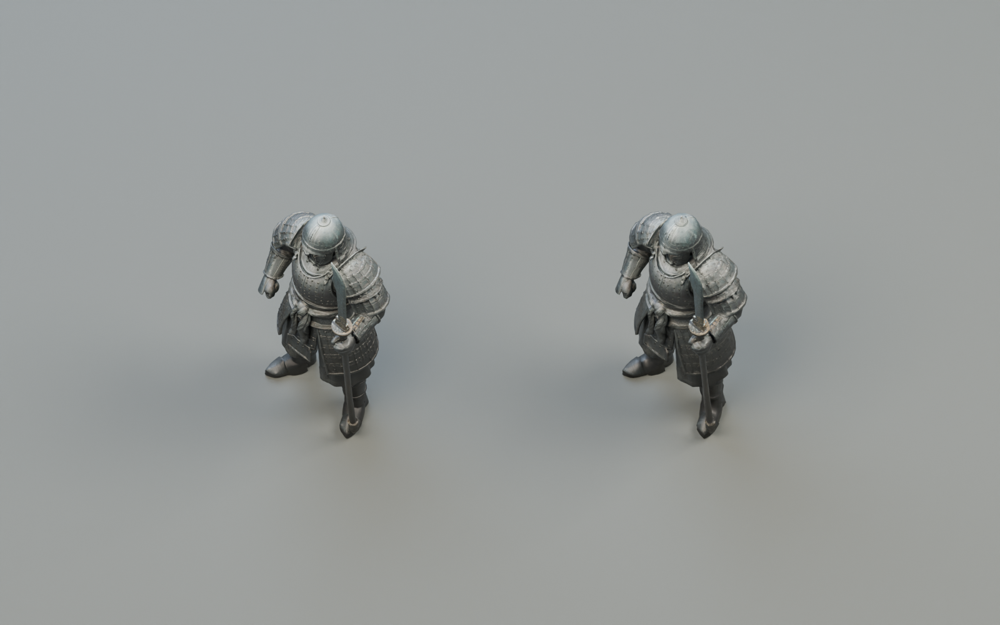
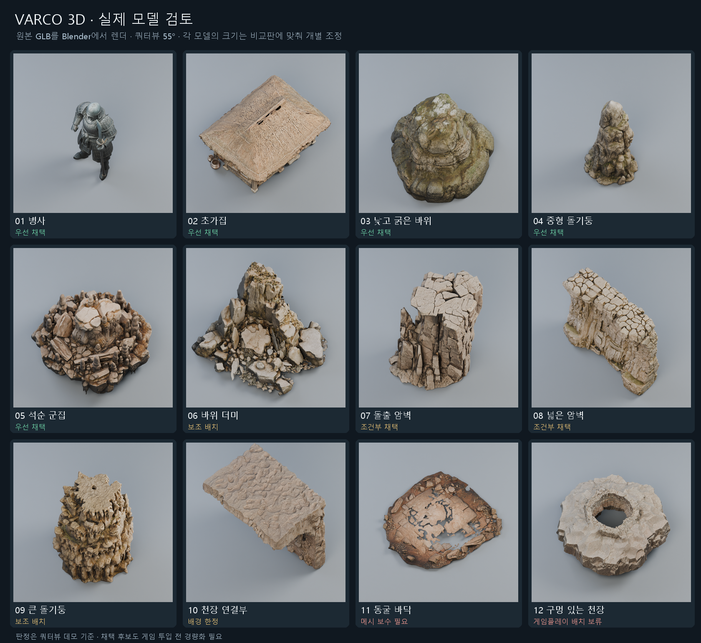
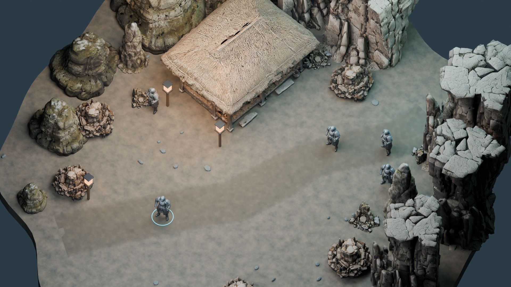

# 2026-10-15 개발 일지

> [!IMPORTANT]
> 문서 상태: 3D 에셋 실습·경량화·Blender 시각 검토 기록.

## 기록 정보

- 프로젝트: 에르고스퀘어: 설계자 — 튜토리얼 프로토타입
- 작성자: 송예찬
- 작업일: 2026-10-15
- 작성일: 2026-10-16 (Asia/Seoul · 누락 기록 보완)
- [개발 일지 목록](README.md) · [노션 데일리로그](https://app.notion.com/p/3fa36532580e81e782d9c092d7b5bce3)

## 오늘의 목표

아카데미에서 제작한 병사·초가집·동굴 에셋이 쿼터뷰 데모에 적합한지 검토하고, 경량화한 에셋으로 튜토리얼 공간의 분위기와 가독성을 확인합니다.

## 작업 내용

### 1. 아카데미 실습과 VARCO 3D 연결

3D·애니메이션 제작 파이프라인 수업 내용을 별도 NCAI 메모에 기록하고, VARCO 플로우에서 만든 동굴·초가집·병사를 검토했습니다. 공식 MCP 가이드를 따라 설정하고 사용자가 직접 OAuth 승인을 완료했습니다.

Codex app-server 경로에서 도구 16개와 `list_flow_sessions` 응답을 확인하고, “과제용 동굴 안의 초가집, 병사” 플로우의 결과물을 읽었습니다. 현재 대화의 기본 도구 목록 노출 문제와 서버 응답 성공은 구분해서 확인했습니다.

### 2. 병사 FBX 점검과 경량화

원본 병사는 500,000삼각형의 정적 메시였습니다. UV와 내장 베이스 컬러·노멀 텍스처가 존재하며, 원래 색도 회녹색·검정 중심이었습니다. 이 파일에서 색이 적게 보이는 현상을 텍스처 누락으로 단정하지 않았습니다. 사용자 화면의 Blender 표시 모드는 별도 확인 대상입니다.

용접 후 단순화해 20,000삼각형으로 줄이고 약 1.8m 높이로 맞췄습니다. 베이스 컬러 2K·노멀 1K를 내장한 FBX와 GLB를 내보냈습니다. FBX는 약 66.55MB에서 8.95MB로 줄었으며 삼각형 감소율은 96%입니다. 정적 병사 12개를 연결 복제한 쿼터뷰 비교 장면도 만들었습니다.

### 3. 플로우 결과물 선별

기본 GLB 12개와 리깅·걷기 결과 2개를 비교했습니다. 병사·초가집·낮은 바위·중간 바위·바위 군집을 우선 후보로 선정했습니다. 벽면은 반복 형태와 인공적인 상단이 드러나는 각도를 피하는 조건으로 검토했습니다.

바닥 에셋은 표면 틈 때문에 이동 지면으로 바로 쓰기 어렵고, 천장은 쿼터뷰 시야를 가릴 수 있었습니다. 걷기 결과에서는 무기 자루가 다리 움직임에 따라 휘어 무기 분리와 손 본 연결이 후속 과제로 남았습니다.

### 4. Blender 동굴 튜토리얼 조립

초가집·바위·벽 돌출부 등 환경 에셋 6종을 6,000~39,994삼각형으로 정리하고, 앞서 경량화한 병사를 함께 사용했습니다. 연속된 임시 지면, 차가운 동굴 조명과 따뜻한 집 주변 조명, 이동 동선을 조합했습니다.

정적 병사 5개를 포함한 사용자 에셋 인스턴스는 34개이고, 사용자 에셋은 520,722삼각형, 지면·소품을 포함한 렌더 장면은 525,898삼각형입니다. 카메라는 경사 55도·방위 45도, Unity Orthographic Size 7에 대응하는 쿼터뷰로 비교했습니다.

`Cave_Tutorial_Assembly.blend`와 전경·게임플레이 시점 이미지를 저장하고, 텍스처를 내장한 상태로 씬을 다시 열어 확인했습니다. 이번 결과는 Blender 시각 검토이며 Unity 튜토리얼 씬 적용은 후속 작업입니다.

### 5. 원래 제작 의도와 후속 개선안

공유한 제작 대화에서 자연 동굴 속 초가집, 천장 틈의 낮빛, 월도를 세운 단독 수호자와 낮은 시점 연출 의도를 확인했습니다.

후속 구성안은 수호자 1명, 뒤쪽 초가집과 열린 중앙 전투 공간, 짧은 낮은 시점 소개 후 쿼터뷰 전환입니다. 천장과 빛줄기는 소개 연출에 맞춰 별도로 다루고, 사람의 영혼 해방과 사물에서 태어난 도깨비를 구분하는 기존 설정을 유지합니다. 이 재구성과 카메라 전환은 아직 구현하지 않은 제안입니다.

## 발생한 문제

생성 원본의 밀도와 파일 크기가 높고, 색 표현·바닥 틈·무기 스키닝 등 실제 사용 전에 확인해야 할 요소가 있었습니다. 첫 조립 장면도 원래 의도한 단독 수호자 장면과 차이가 있었습니다.

## 원인

생성 결과를 게임용 메시·재질·충돌·애니메이션 기준으로 정리하는 단계가 필요했습니다. 쿼터뷰의 시야와 낮은 시점 연출은 서로 다른 공간 조건을 요구합니다.

## 해결

원본을 보존하면서 데모용 메시와 텍스처를 줄이고 동일한 쿼터뷰에서 비교했습니다. 불안정한 바닥은 연속 지면으로 대체한 Blender 시안을 만들고, 원래 제작 의도는 다음 구성 개선안으로 정리했습니다.

## 검증

- 병사 `export_verification.json`: FBX·GLB 재불러오기, 20,000삼각형, UV 1개와 내장 텍스처 확인. FBX 정점 9,910개, GLB는 내보내기 시 분리되어 26,241개입니다.
- `assembly_verification.json`: 씬 재열기, 환경 에셋 6종 메시 검증, 2K 베이스 컬러·1K 노멀 패킹, 최종 GLB 재내보내기 확인.
- 렌더 결과로 배치·실루엣·분위기를 검토했습니다. Unity 재질 변환·충돌·NavMesh·실제 FPS는 후속 검증입니다.
- MCP 서버의 플로우 조회는 성공했습니다. 기본 대화 도구 목록의 노출 문제는 연결 여부와 별도로 남았습니다.

## 다음 작업

- [ ] 수호자 1명과 넓은 중앙 전투 공간으로 구도 수정하기
- [ ] 걷기 모델의 무기를 분리하고 손 본 연결 및 애니메이션 확인하기
- [ ] Unity 시험 씬에서 URP 재질·스케일·충돌·이동·성능 확인하기
- [ ] 검토가 끝난 환경부터 기존 튜토리얼 한 구간에 시범 적용하기

## 근거와 관련 기록

- [VARCO 작업 플로우](https://3d.varco.ai/flow/1f481ea0-6b30-4bc8-8f8c-7770ff7c62ec)
- [제작에 사용한 대화](https://chatgpt.com/share/6ad0e1ef-5af8-83ee-b6ae-ca22a7a45579)
- [VARCO 공식 MCP 설정 가이드](https://3d.varco.ai/mcp/setup.md)
- 결과 폴더: `Soldier_QuarterView_Demo/`, `Varco_Asset_Review/`, `Cave_Tutorial_Preview/`
- 수치·검증: `export_verification.json`, `asset-inspection.json`, `ground-walk-details.json`, `assembly_report.json`, `assembly_verification.json`

## 결과 화면

## 원본 결과 위치

`C:/Users/Administrator/.codex/visualizations/2026/10/15/01a13fce-f85e-7450-850e-800d156a6fcd/`

- `Soldier_QuarterView_Demo/Soldier_Demo_20K.fbx`
- `Soldier_QuarterView_Demo/Soldier_Demo_20K.glb`
- `Soldier_QuarterView_Demo/Soldier_QuarterView_Demo.blend`
- `Cave_Tutorial_Preview/Cave_Tutorial_Assembly.blend`
- `Cave_Tutorial_Preview/Optimized_Assets/`

15일 수업 메모 [261015 NCAI](https://app.notion.com/p/3fa36532580e80789b23eef7a10dcdbf)는 별도 수업 기록으로 유지합니다.

## Revision History

| 날짜 | 버전 | 변경 내용 | 작성자 |
| --- | --- | --- | --- |
| 2026-10-16 | v1.0 | 10월 15일 VARCO 3D 에셋 검토와 동굴 튜토리얼 Blender 조립 기록 보완 | 송예찬 |
