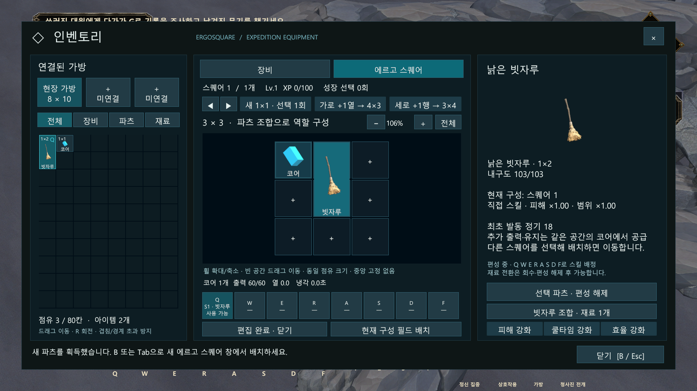
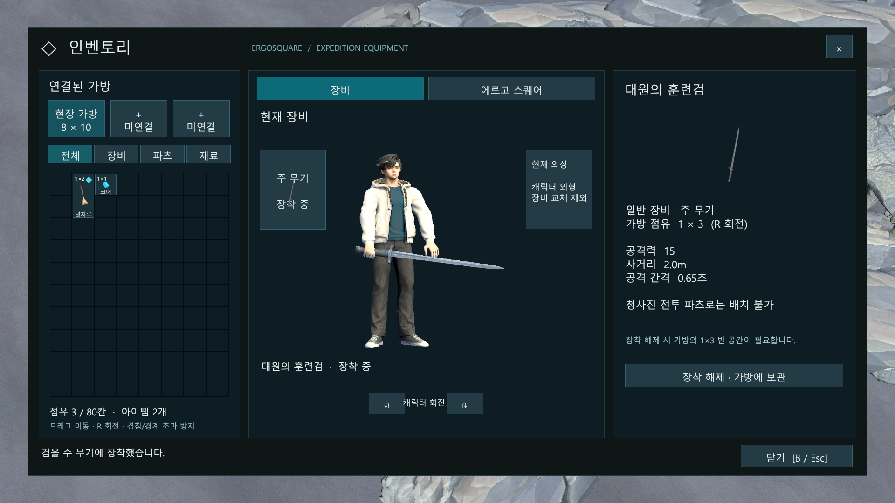

# 2026-10-18 개발 일지

> 문서 상태: 초안 · 세션 마감 기록. 구현 결과와 후속 설계를 구분합니다.

## 기록 정보

- 프로젝트: 에르고스퀘어: 설계자 — 튜토리얼 프로토타입
- 작성자: 송예찬
- 작업일: 2026-10-18 — 사용자 지정
- 작성일: 2026-10-19 (Asia/Seoul)
- 기록 범위: 이번 세션의 최종 상태. 날짜가 넘어 이어진 검수와 커스터마이징 설계 정리도 18일 마감분에 포함합니다. 기존 기술 문서의 실제 수정일은 유지합니다.
- [개발 일지 목록](README.md) · [데일리 로그](../데일리_로그/2026-10-18.md) · [노션 데일리로그](https://app.notion.com/p/3fd36532580e818fb82ecb420b766973)

## 오늘의 목표

새 UI에서 에르고 스퀘어의 성장과 자유 조합을 편집하고, VARCO 3D 플레이어의 실제 장비·전투 상태와 애니메이션을 연결합니다. 테스트 캐릭터를 보존하면서 독립 데모 플레이어를 만들고 맵·엔티티·진행 책임을 분리합니다.

## 작업 내용

### 1. 에르고 스퀘어 성장과 자유 조합

최초 지급은 3×3, 이후 추가 생성만 1×1로 정정했습니다. 레벨업마다 기존 어느 스퀘어에든 한 행 또는 열을 추가하거나 새 공간을 생성하는 선택을 한 번 사용합니다. 칸당 비용·무료 성장 선택·중앙 플레이어 예약 칸과 역할 강제 구분을 제거했습니다.

첫 튜토리얼은 빗자루와 코어를 같은 3×3에 넣고 Q를 사용합니다. 이후 같은 무기를 다른 공간으로 옮겨 코어와 보조 파츠로 피해를 강화하거나 소환으로 변형합니다. 최초 발동 비용과 로컬 출력·열 부하·냉각을 연결하고, 무기 개체와 키·코어 상태를 이동·구역 전환에서 보존했습니다. 소환은 원본 파츠의 임시 월드 외형을 사용하며 최종 아트와 수치는 후속입니다.

### 2. 새 장비·스퀘어 UI와 드래그 장착

왼쪽 연결 가방, 가운데 장비·에르고 스퀘어 탭, 오른쪽 선택 아이템 설명으로 구성한 새 UI를 사용합니다. 성장 선택·스퀘어 전환·편성·키 배정·조합과 필드 배치 진입을 같은 UI에 연결했습니다. 격자 확대·축소와 화면 이동, 아이템마다 다른 점유 크기·회전·겹침 방지를 적용했습니다.

검을 가방에서 주무기 칸으로 드래그하면 바로 장착되도록 하고, 실제 손의 검과 인벤토리 미리보기에 장비 상태와 정수 그립을 반영했습니다. 일반 검의 주무기 장착과 청사진 전투 파츠 배치는 별도 규칙을 유지합니다.

두 이미지는 별도 Unity 자동 검수 중 저장한 실제 화면입니다.

### 3. FSM·Animator 연결과 원래 모션 보존

실제 이동·기본 공격 3타·스킬·집중·사망 상태를 Animator와 연결했습니다. FSM이 요청 가능 여부와 상태 우선순위를 소유하고, NavMesh가 이동을 담당하며 Animator는 그 결과를 표현합니다. 이동 방향·보행 반복 구간과 걷기/달리기 블렌드를 정리했습니다.

베기를 통째로 다시 만든 접근은 최종 기본 공격에서 제외했습니다. 보존된 VARCO 원래 3타와 타격 시점을 복원하고 오른쪽 전완·손목 회전만 보정했습니다. 다른 몸 곡선·손 위치와 기존 피해 계약은 유지합니다. 월드 동작은 실제 Animator가 재생하며 인벤토리 복제 모델은 독립 미리보기 경로를 사용합니다.

### 4. 테스트 플레이어와 독립 데모 프리팹 분리

`Player_Test.prefab`과 메타 파일은 그대로 보존했습니다. VARCO 모델에서 독립 일반 프리팹 `Player_Architect_Demo.prefab`을 생성하고 이동·물리·전투·체력·자원·장비·인벤토리·에르고 스퀘어·FSM 컴포넌트와 설정을 새 루트에 이관했습니다. 테스트용 캡슐 표면은 제외하고 물리 Collider는 유지했습니다.

루트의 `Demo Player Rig`를 Transform 다음에 배치하여 FSM·Animator와 관련 컴포넌트를 바로 확인할 수 있게 했습니다. 모델의 실제 Animator는 `Visual/ArchitectModel`에 유지합니다. `Tools → ERGOSQUARE → Player → Open Demo Player Prefab`에서 열고 루트 인스펙터의 그래프 버튼으로 재생 전에도 확인합니다. 재생 전에는 아직 재생하지 않은 상태임을 표시하고, 재생 중 실제 FSM 상태와 클립을 표시합니다.

### 5. 구역 조립과 로딩 책임 분리

맵·플레이어·몬스터·UI·시스템·진행기를 별도 프리팹으로 나누고 구역 조립 프리팹에 실제 참조를 저장합니다. 로더는 설정을 읽어 조립체를 한 번 생성합니다. 편집 미리보기는 저장·빌드에서 제외합니다. 진행기는 학습 순서와 이벤트, 맵은 배치·앵커와 베이크된 NavMesh를 담당합니다.

동굴·보스·귀환과 본부에서 같은 데모 플레이어를 사용합니다. 루시드 다이버에서 참고한 책임 분리를 적용하되 현재는 기존 비동기 Single 씬 전환과 메모리 세션 인계를 유지합니다. Additive 스트리밍·Addressables와 성능 개선율 측정은 이번 구현 범위가 아닙니다.

### 6. 커스터마이징 후속 계약

현재 외형을 최종 고정 캐릭터로 취급하지 않습니다. 향후 의상이 없는 기본 신체·머리카락·상의·하의·신발 등을 공통 골격에 연결하고, 외형 데이터와 능력치·장비 소유 데이터를 분리합니다. 의상 교체 시 게임플레이 루트·FSM·Animator와 전투·스퀘어 상태를 유지해야 합니다.

현재 캐릭터 스킨은 `ArchitectBody`의 SkinnedMeshRenderer 하나입니다. 기본 신체·교체 의상·외형 교체 UI·저장 기능은 아직 없습니다. 별도 기본 신체와 호환 의상 제작, 신체 관통 처리, 외형 변경에 따른 월드·미리보기 갱신을 후속 수용 기준으로 기획서와 기술 명세에 기록했습니다.

## 발생한 문제

- 첫 데모 구성이 테스트 플레이어에 외형만 연결된 형태여서 사용자가 의도한 독립 데모 자산과 달랐습니다.
- 재생 전 FSM·Animator 연결을 찾기 어려웠고 장착 여부와 검 표시가 일치하지 않았습니다.
- 검술 모션을 통째로 재구성하면서 사용자가 유지하려던 원래 동작이 달라졌습니다.
- 맵·적·UI·진행 책임이 한 흐름에 누적되어 재사용과 편집 확인이 어려웠습니다.

## 원인

테스트 자산과 실제 데모의 역할, 게임플레이 상태와 표현의 책임, 원래 모션 보존 범위가 충분히 구분되지 않았습니다. 런타임에서만 연결을 찾는 부분과 특정 테스트 오브젝트 이름에 기대는 환경 연결도 편집 확인과 교체를 어렵게 했습니다.

## 해결

독립 데모 프리팹과 직렬화된 FSM·Animator 참조를 기준으로 튜토리얼과 본부 연결을 이관했습니다. 환경은 실제 구역 플레이어 참조를 사용하고, 장비와 애니메이션은 게임플레이 데이터를 읽어 표현하도록 연결했습니다. 원래 VARCO 몸 동작을 복원하고 검 궤적 보정 범위를 제한했습니다. 구역 로딩·조립과 각 모듈의 책임을 나누었습니다.

## 검증

아래는 최종 독립 데모 플레이어 기준의 별도 Unity 6000.3.7f1 검수입니다. 앞선 중간 검수 횟수와 합산하지 않습니다.

| 영역 | 최종 결과 | 근거 파일 |
| --- | --- | --- |
| 독립 프리팹·참조 이관 | 27개 통과 | `verification.json` |
| 루트 인스펙터 | Transform 다음 첫 컴포넌트 확인 | `authoring-verification.json` |
| 본부 편집 연결 | 참조 19필드 이관, 테스트 의존성 없음 | `headquarters-edit-verification.json` |
| 최종 편집·빌드 의존성 | 25개 통과, 활성 빌드 씬 7개에 테스트 의존성 없음 | `final-edit-verification.json` |
| 동굴→보스→귀환 진행 | 72개 통과 | `Tutorial/runtime-verification.json` |
| 드래그 장착·UI | 17개 통과 | `DragEquipment/verification.json` |
| Animator·FSM·공격 | 210개 통과, 69프레임 기록 | `Animator/verification.json` |
| 성장·조합·소환·본부 | 80개 통과 | `Ergosquare/verification.json` |
| 전달·원본 보존 | 전달 파일 22개 일치, 테스트 프리팹·메타 및 모션·Controller·데이터 31개 보존 | `delivered-files.json`, `preserved-assets.json` |
| C# 진단 | 검사 대상 최종 로그 오류 0건 | `compiler-diagnostics.json` |

근거 파일의 기준 폴더는 Unity 저장소 `Tools/ArtReview/Demo_Player_VARCO_20261018`입니다. 반복 프레임 검사와 시험용 파츠·경험치·적을 준비한 자동 기능 검사입니다. 메인 Unity에서 실제 입력으로 전체 튜토리얼을 수동 완주한 결과는 아닙니다. 메인 에디터의 미저장 씬을 자동 저장하거나 폐기하지 않았으며, 별도 프로젝트 검수가 메인 에디터의 최신 임포트 상태까지 증명하지는 않습니다.

## 다음 작업

- [ ] 메인 Unity에서 편집 모드 FSM·Animator 연결과 실제 입력 기반 전체 튜토리얼·장비·성장·본부 인계를 확인합니다.
- [ ] 쿼터뷰 정지·출발·이동·공격에서 검 궤적·손 그립·가독성을 검수합니다.
- [ ] 기본 신체와 교체 의상 한 벌로 골격·웨이트·신체 관통·미리보기 갱신을 먼저 검증합니다.
- [ ] 소환 전용 아트·모션, 최종 밸런스, 가방 스퀘어 용량 연결과 영구 저장을 후속 개발합니다.
- [ ] 성능 병목을 측정한 뒤 스트리밍·로드 정책의 추가 개편 여부를 판단합니다.

## 관련 문서

- [종합 기획서](../../00_프로젝트_개요/에르고스퀘어_종합_기획서_초안.md)
- [플레이어 FSM과 Animator 연동](../../03_기술_문서/시스템별_구현_명세/플레이어_FSM과_Animator_연동_명세.md)
- [튜토리얼 구역 조립과 프리팹 분리](../../03_기술_문서/시스템별_구현_명세/튜토리얼_구역_조립과_프리팹_분리_명세.md)
- [성장 선택·파츠 조합·새 UI 초기 검증](../../05_QA/2026-10-18_성장선택_파츠조합_새UI_검증.md)
- [레벨업 선택과 자유 파츠 조합 결정](../의사결정_기록/2026-10-18_레벨업_선택과_자유_파츠_조합.md)
- [구역과 엔티티 조립 분리 결정](../의사결정_기록/2026-10-18_튜토리얼_구역과_엔티티_조립_분리.md)

## Revision History

| 날짜 | 버전 | 변경 내용 | 작성자 |
| --- | --- | --- | --- |
| 2026-10-19 | v1.0 초안 | 사용자 지정 18일 마감분의 성장·새 UI·Animator·독립 데모 플레이어·구역 분리와 검수, 커스터마이징 후속 계약 기록 | 송예찬 |
