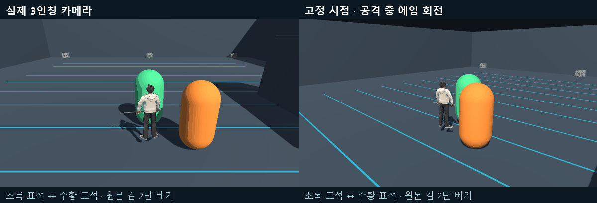

# 2026-10-20 개발 일지

> 문서 상태: 초안 · 3인칭 일반공격 수정과 별도 Unity 자동 검수 기록.

## 기록 정보

- 프로젝트: 에르고스퀘어: 설계자 — 3인칭 비교 프로토타입
- 작성자: 송예찬
- 작업일: 2026-10-20 — 사용자가 지정한 세션 마감 기준
- 작성일: 2026-10-21 (Asia/Seoul)
- [개발 일지 목록](README.md) · [데일리 로그](../데일리_로그/2026-10-20.md) · [노션 데일리로그](https://app.notion.com/p/3ff36532580e81eabcacc073415e92f6)

## 오늘의 목표

3인칭에서 검으로 베는 동작이 자연스럽게 보이도록 일반공격을 정리합니다. VARCO의 ‘검 2단 베기’를 기준으로 모션을 비교하고, 공격 도중 마우스 에임을 돌렸을 때 캐릭터와 실제 타격 방향도 함께 따라가도록 만듭니다.

## 작업 내용

### 1. 모션 비교와 최종 선택

[VARCO 작업 플로우](https://3d.varco.ai/flow/c86e923e-29ea-4e5b-95bf-175bde9c08d9)의 ‘검 2단 베기’ 원본을 확인했습니다. 내려베기 변형과 마지막 찌르기를 차례로 비교했으며, 마감 시점에는 사용자의 최종 요청에 따라 원본 2타를 사용하고 찌르기를 제거했습니다.

| 비교 단계 | 검토 내용 | 마감 시점 적용 |
| --- | --- | --- |
| 내려베기 변형 | 원본 동작의 진행 방향을 바꾼 1·2타 비교 | 시험 자료로 보존 |
| 원본 검 2단 베기 | 원본 순서와 재생 속도로 1·2타 연결 | 최종 사용 |
| 마지막 찌르기 | 참고 영상의 찌르기를 3타로 연결해 비교 | 연결 제거, 시험 자료 보존 |

일반공격은 좌클릭으로 1타를 시작하고 추가 입력으로 2타를 예약합니다. 2타가 끝나면 대기로 돌아가며 3타는 예약되지 않습니다. 이전 시안 폴더가 남아 있어도 현재 적용 데이터는 `Attacks_VarcoOriginal_v4`입니다.

### 2. 원본 모션과 공격 데이터 연결

원본의 연속 동작을 1타와 2타로 나누고, 공격 데이터·Animator·표시가 실제 연계 수를 따르도록 정리했습니다. `BasicAttackSequenceDefinition`의 유효성 검사와 단계 접근, `PrototypeBasicAttack.ComboStageCount`, `TutorialPlayer3DVisual`의 클립 연결에서 3타 고정 전제를 제거했습니다. 재생 전에도 데모 플레이어의 FSM과 연결된 Animator를 확인할 수 있는 구성을 유지했습니다.

| 타격 | 원본 구간 | 재생 길이 | 해당 타격 시작 후 판정 시점 |
| --- | --- | --- | --- |
| 1타 | 0.000000~1.850000초 | 1.850000초 | 0.960000초 |
| 2타 | 1.850000~3.708333초 | 1.858333초 | 0.280000초 |

재생 배속은 1배입니다. 원본 비교 자료의 122개 표본에서 로컬 회전 오차는 최대 0°, 위치 오차는 약 0.00000003m였습니다. 일정한 바닥 높이 보정과 기존 손가락 그립 보정을 제외하고 원본 동작을 유지했습니다. 마지막 에임 수정에서는 애니메이션 클립을 다시 편집하지 않았습니다.

### 3. 공격 중 마우스 에임 추적

마우스의 수평 회전에 맞춰 플레이어 루트 방향, 현재 타격 방향, 예약된 2타의 방향을 함께 갱신했습니다. 1타 도중 2타를 먼저 예약한 후 시점을 돌려도 2타가 최신 방향으로 시작합니다.

`ThirdPersonComparisonController`가 전투 갱신보다 먼저 에임을 읽고 `PrototypeBasicAttack.TrySetAttackDirection`에 수평 방향을 전달합니다. 공격 시간과 타격 식별자를 유지하므로 방향을 돌리는 것만으로 모션이 다시 시작되거나 피해가 추가되지 않습니다. 커서가 풀린 상태에서는 에임을 갱신하지 않으며, 취소된 공격의 늦은 애니메이션 이벤트도 피해를 만들지 않습니다.

이 API를 호출하지 않는 기존 방향 고정 공격은 외부 회전 감지에 따른 취소 처리를 유지합니다. 회전으로 내비게이션 루트의 위치가 이동하지 않도록 했습니다.

### 4. 적용 씬과 자료 보존

다음 두 씬에 원본 2타와 공격 중 에임 추적을 반영했습니다.

- 비교 연습장: `Assets/_ERGOSQUARE/01.Scenes/Comparison/ThirdPerson_Comparison.unity`
- 동굴 미리보기: `Assets/_ERGOSQUARE/01.Scenes/Comparison/Tutorial_Cave_ThirdPerson_Preview.unity`

현재 공격 데이터와 Animator는 `Assets/_ERGOSQUARE/08.Data/ThirdPersonComparison/Attacks_VarcoOriginal_v4/`의 `VARCO_Original_AttackSequence.asset`, `VARCO_Original_AnimationSet.asset`, `Architect_VARCO_Original_Combat.controller`, `Attack1.anim`, `Attack2.anim`입니다.

기존 데모 프리팹·쿼터뷰 자산과 이전 모션 시안을 보존했습니다. 오늘의 모션 비교는 내려받은 원본을 Unity용으로 연결·변환한 작업이며, VARCO의 원본 프리셋을 수정하거나 새 생성 작업을 실행한 것은 아닙니다.

## 발생한 문제

직접 변형한 베기와 찌르기가 사용자가 원한 원본 검 2단 베기와 달라졌습니다. 또한 공격 중 시점만 회전하고 캐릭터와 타격 방향이 따라가지 않아, 마우스로 바라보는 방향과 실제 공격 방향이 어긋날 수 있었습니다.

## 원인

공격 시작 시 방향을 고정하고 공격 도중 회전 입력을 제한하는 흐름이 남아 있었습니다. 예약된 다음 타격도 예약 당시 방향을 보관했습니다. 이 상태에서 캐릭터 방향만 바꾸면 기존 보호 로직이 외부 회전으로 판단해 공격을 취소할 수 있었습니다. 연계를 3타로 가정하던 코드도 원본 2타 적용에 맞춰 정리할 필요가 있었습니다.

## 해결

모션은 원본 2타로 확정하고 3타 연결을 제거했습니다. 공격 데이터에 설정된 실제 단계 수를 사용하도록 연결을 정리했으며, 현재 공격과 예약된 다음 타격에 명시적으로 새 방향을 전달하도록 수정했습니다. 기존 공격 시간·타격 횟수·취소 처리를 유지한 상태에서 에임만 갱신합니다.

## 검증

별도 Unity 6000.3.7f1 검수 프로젝트에서 실제 입력을 발생시켜 확인했습니다. 아래 수치는 최종 에임 수정에 대한 결과이며, 이전 모션 시안의 검사 횟수를 더하지 않았습니다.

| 범위 | 결과 |
| --- | --- |
| 실제 마우스·공격 입력 | 23개 통과: 1타 시작, 2타 예약, 타격 도중 방향 전환, 타격 수, 취소, 커서 해제, 이동 복귀 등 |
| 동굴 회귀 | 15개 통과: FSM·Animator, 이동, 원본 2타 피해, Q 빗자루, F 상호작용, 새 인벤토리·에르고 스퀘어 UI 입력 차단 등 |
| 동굴 카메라 | 6개 지점에서 각각 64개, 총 384개 시점 표본 통과 |
| 방향 일치 | 시험 구간의 시각 방향과 타격 방향 최대 차이 0° |
| 검과 표적 접촉 | 두 판정 부근의 검과 표적 사이 거리 0m |
| 실제 피해 | 각 타격 15, 합계 30. 2회만 적용되며 방향을 바꿔도 추가 타격 없음 |
| 기존 자료 보존·전달 | 최종 수정 묶음의 보호 대상 250개 파일 해시 동일, 전달 파일 7개 확인 |

피해량 15와 합계 30은 검수용 설정입니다. 주 작업 Unity 에디터에서 직접 조작하는 감각 평가는 다음 세션에 진행합니다. 동굴은 에셋·배치·전투·UI 미리보기이며, 전체 튜토리얼 진행 이벤트는 아직 이식하지 않았습니다.

### 재생 자료

추적 카메라와 고정 시점으로 같은 동작을 비교한 검수 GIF입니다. 초록색 북쪽 표적과 주황색 동쪽 표적을 두고, 1타 도중 동쪽으로 돌린 뒤 2타 도중 북쪽으로 돌아오는 입력에서 방향과 타격을 확인했습니다.

### 근거 파일

프로젝트의 `Tools/ArtReview/Varco_DoubleSlash_LiveAim_20261021/`에 `review.html`, `verification-summary.json`, `checks.txt`, `metrics.txt`, `aim-timeline.csv`, `delivered-files.json`, `protected.json`과 `CaveRegression/`을 보존했습니다. 원본 구간·자세 비교는 `Tools/ArtReview/Varco_DoubleSlash_Original_20261021/source-checks.txt`에 있습니다.

## 다음 작업

1. Unity에서 비교 씬을 열고 재생 전 데모 플레이어의 FSM·Animator와 Attack1·Attack2 연결을 확인합니다.
2. 두 베기 도중 좌우로 크게 또는 빠르게 시점을 돌려 검 방향·실제 피해 방향·예약한 2타가 자연스럽게 이어지는지 직접 플레이합니다.
3. 공격 종료 후 WASD 이동, Q 스킬, F 상호작용, 장비·에르고 스퀘어 UI를 함께 확인합니다.
4. 조작감 확인 후 원본 공격 속도·연계 입력 여유·카메라 감도를 조정합니다. 동굴의 전체 튜토리얼 진행 연결은 별도 후속 작업으로 이어갑니다.

## Revision History

| 날짜 | 버전 | 변경 내용 | 작성자 |
| --- | --- | --- | --- |
| 2026-10-21 | v1.0 초안 | 모션 비교와 원본 2타 확정, 찌르기 제거, 공격 중 에임 추적, 최종 검수·GIF·다음 시작점 기록 | 송예찬 |
| 2026-10-21 | v1.1 초안 | 사용자 지정에 따라 작업일·파일명·연결을 10월 20일 기준으로 정정. 작성일과 검수 자료 생성일은 21일로 유지 | 송예찬 |
