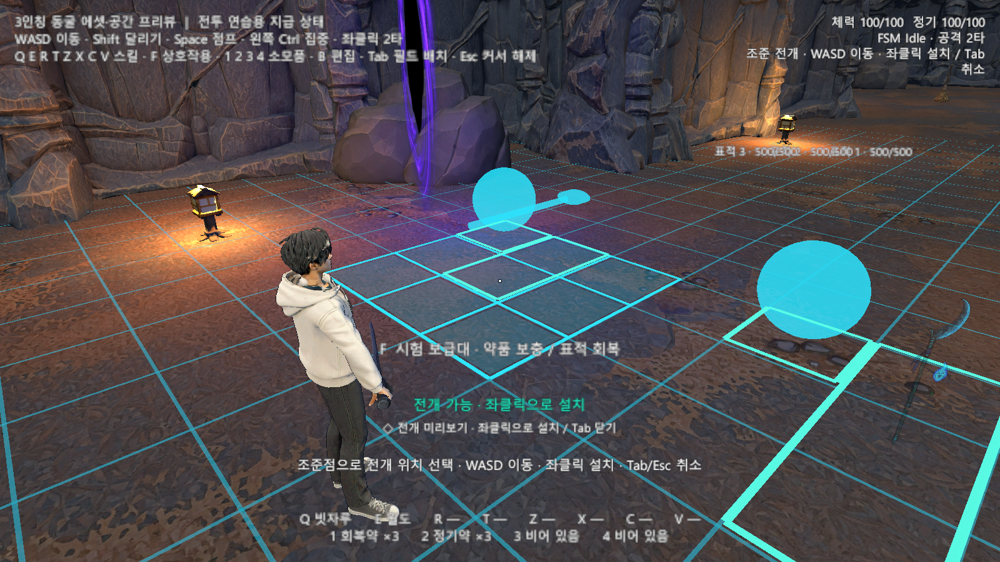
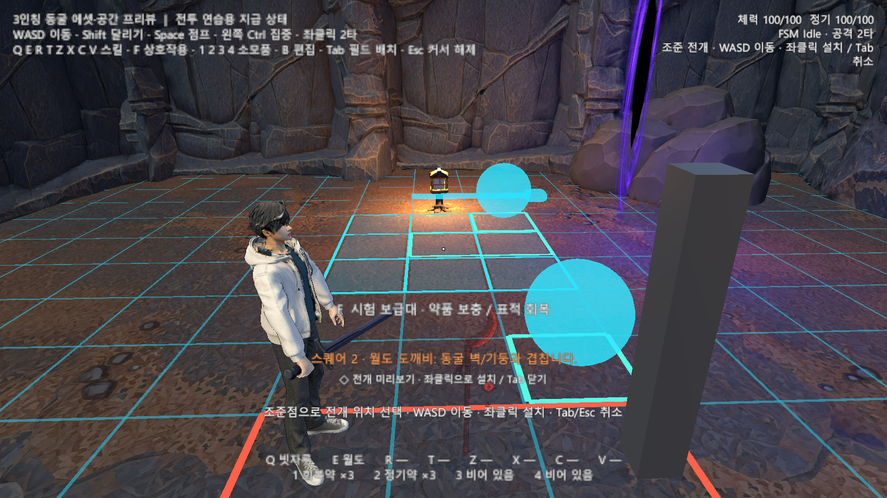

# 2026-10-21 개발 일지

> 문서 상태: 초안 · 3인칭 조작·전투·필드 전개 개선과 다른 PC 전달 기록.

## 기록 정보

- 작성자: 송예찬
- 작업일·작성일: 2026-10-21 (Asia/Seoul)
- 프로젝트: 에르고스퀘어: 설계자 — 기존 데모와 분리된 3인칭 비교 프로토타입
- [노션 데일리로그](https://app.notion.com/p/40036532580e81c18f80e71b5ace9e55) · [개발 일지 목록](README.md) · [3인칭 구현 명세](../../03_기술_문서/시스템별_구현_명세/3인칭_비교씬_조작과_검수_명세.md)

## 오늘의 목표

실제 조작에서 발견한 단타 복귀·공격 속도·스킬 냉각·전개 문제를 수정합니다. 3인칭 숄더뷰에 맞는 점프와 조준점을 연결하고, 플레이어가 움직이며 전개 위치를 선택할 수 있게 만듭니다. 레벨업으로 스퀘어가 커져도 감당할 수 있는 필드 칸 크기를 비교하고 다른 PC에서도 같은 상태로 개발을 이어갈 수 있게 정리합니다.

## 작업 내용

### 전투 속도·복귀와 스킬 냉각

원본 검 2단 베기 클립의 곡선은 유지하고 재생 속도를 1.7배로 조정했습니다. 1타 이후 추가 입력이 없으면 0.28초 동안 Idle/Move로 돌아가도록 Animator와 외형 보간을 연결했습니다. 최종 1타 길이는 약 1.088초, 2타는 약 1.093초이며 마지막 찌르기는 사용하지 않습니다.

Q와 E를 사용했을 때 기본 쿨타임·과부하 추가 대기가 함께 시작되지 않도록 무기 개체별 상태로 분리했습니다. 같은 코어를 공유할 때의 열·출력은 별도 코어 상태입니다. UI 키 재배정이나 편성 복원으로 남은 냉각을 초기화하지 않습니다. 비교 씬에는 각각의 무기에 독립 코어를 지급하여 동작을 비교합니다.

### 실제 점프와 오른쪽 숄더뷰

Space를 점프로, 정신 집중을 왼쪽 Ctrl로 분리했습니다. 실제 루트와 충돌체가 상승·하강하고 Jumping/Falling/Landing FSM과 Animator가 함께 움직입니다. 공중 재점프·공중 공격·공중 전개를 막고 천장·벽 조건을 확인했습니다. 점프 중 수평 이동은 기존 NavMesh 경계를 유지하므로 틈 건너기는 후속입니다.

카메라는 오른쪽 어깨 너머에서 캐릭터를 왼쪽에 두는 구도로 바꿨습니다. 현재 가안은 거리 2.6m, 오른쪽 오프셋 0.85m, 루트 기준 피벗 높이 0.55m입니다. 화면 중앙에는 작은 점을 표시하고 공격 중 색을 바꿉니다. 원거리용 십자선 형식은 분리했으며 무기 종류에 따른 실제 자동 전환은 아직 연결하지 않았습니다.

### 멈추지 않는 조준 전개와 바닥 높이

Tab을 누르면 이동·시점을 차단하던 전개 분기를 제거했습니다. B에서는 새 장비·스퀘어 편집 UI를 열고, Tab에서는 시점·WASD 이동을 유지하며 중앙 점으로 바닥을 고릅니다. 좌클릭은 설치, Tab/Esc는 취소입니다. 이미 전개한 상태에서는 Tab → 좌클릭으로 회수한 뒤 새 위치를 조준합니다.

격자·파츠 미리보기·실물은 공통 전개 원점을 사용합니다. 설치한 뒤에는 플레이어를 따라오지 않고 선택한 월드 위치에 남으며, 자동 회수 거리도 선택 위치를 기준으로 판단합니다. 전개 중심까지 10m, 자동 회수 12m는 현재 비교용 가안입니다.

시각용 GroundShelf와 연속 충돌 바닥의 높이가 달라 격자가 묻히는 문제도 수정했습니다. 전체 점유 영역을 검사하여 가장 높은 받침 위에 놓고 렌더러 하단에 약 0.05m 여백을 둡니다. 장식 바닥만 있고 구조적 받침이 없는 영역은 설치를 허용하지 않습니다.

### 간헐적인 옆 공격과 전개 실패 사유

숄더 카메라의 광선이 몸 가까운 표면에 닿으면 옆 오프셋에 비해 전방 깊이가 너무 짧아 공격 방향이 거의 옆으로 꺾일 수 있었습니다. 가까운 경우 같은 광선을 전방 1.25m 깊이 평면까지 연장하여 방향을 계산합니다. 실제 조준 충돌점은 유지하고 자기 몸·장착물의 자식 콜라이더는 제외합니다. 클릭 요청은 그 프레임의 카메라 회전 뒤 소비합니다.

전개는 선택한 스퀘어뿐 아니라 전체 편성의 파츠를 함께 설치합니다. 선택 격자 아래 바닥이 있어도 다른 스퀘어의 파츠가 벽·등불·바위 등에 겹치면 실패할 수 있었습니다. 실패한 스퀘어·파츠·장애물 종류 또는 받침 부족을 안내하고, 다른 스퀘어를 포함한 파츠 점유 테두리를 표시했습니다. 막힌 파츠만 빨간색으로 구분합니다. 높이 보정된 전체 영역에서 검사하여 개별 셀의 더 낮은 표면에서 중복 충돌을 검사하던 경로도 제거했습니다.

### 1m 격자 적용

| 필드 1칸 | 최초 3×3의 길이 | 확장 6×6의 길이 | 입구 방 30개 조준 위치 중 전체 설치 가능 |
| --- | --- | --- | --- |
| 2m | 6m | 12m | 3곳 |
| 1.25m | 3.75m | 7.5m | 12곳 |
| 1m | 3m | 6m | 19곳 |

같은 현재 판정 코드에서 크기만 바꾼 비교입니다. 전체 맵 성공률이나 최종 밸런스로 일반화하지 않습니다. 확장 면적과 파츠 가독성을 고려해 우선 1m를 적용했습니다. 논리 칸 수·파츠 점유 칸은 유지하고, 미리보기·실물은 비율을 보존하여 점유 영역 안으로 맞췄습니다. 월도 물건 표현은 수직 표시와 비율에 맞는 도깨비불 오프셋을 사용하며, 카메라가 회전했을 때의 최대 수평 폭도 고려합니다.

두 번째 화면의 회색 기둥은 충돌 검사용 오브젝트이며 원래 씬에 저장하지 않았습니다.

## 검증 결과

아래 검사는 별도 Unity 6000.3.7f1에서 실제 Input System 이벤트와 FSM·Animator·피해 경로로 실행했습니다. 사용자의 제보를 반영한 자동 검수이며 주 에디터에서 최종 조작감을 수동 평가한 결과와 구분합니다.

| 검사 | 결과와 근거 |
| --- | --- |
| 최종 공격 방향·전개·1m 크기 | 25개 통과. 같은 프레임 입력, 2회 타격, 127프레임 방향 추적, 480개 동굴 시점, 실패 사유·받침·실제 설치·월도 24방향 |
| 1m 조준 전개 회귀 | 56개 통과. Tab/LMB/WASD/시점, 거리·벽·바닥, 높이 보정, 설치 위치 고정·자원 생성·수동/거리 회수 |
| 숄더뷰 회귀 | 55개와 카메라 표본 1,152개 통과. 실제 표적 2타 합계 30 피해, 이동·점프·메뉴·조준·벽/바닥/천장 |
| 점프 구현 단계 | 83개 통과. 실제 높이·충돌체·FSM/Animator·천장·벽·공중 입력 제한. 최종 검사 횟수와 합산하지 않음 |

근거리 조준 보정 뒤 480개 시점에서 카메라 정면 대비 수평 방향 차이는 최대 약 34.23도였습니다. 이는 방향 보정 범위이며 타격 오차율이 아닙니다. 타격 15와 합계 30은 검수용 장비 수치입니다. 단타 복귀·쿨타임·바닥·카메라 구도의 이전 단계 검사와 최종 검사를 무작정 합산하지 않습니다.

게임 저장소의 `Tools/ArtReview/Combat_Deployment_Polish_20261021/`에 최종 결과·비교 화면·30곳 측정표·소스 해시를 보존했습니다. `DeploymentRegression/`과 `ShoulderRegression/`에 회귀 결과가 있습니다. 점프는 `ThirdPerson_Jump_20261021/`, 단타·냉각은 `Combat_Usability_20261021/`에서 확인합니다.

## 다른 PC 전달

게임 브랜치는 `codex/tutorial-foundation`, 문서 브랜치는 `codex/reorganize-game-design-docs`입니다. UnityGameFoundation은 게임의 `Packages/com.kasil.game-foundation`에 포함되어 별도 형제 폴더 없이 받습니다. 원본 기준은 `5691fef`이며 Runtime·Editor·Tests와 GUID를 함께 보존합니다.

기존 캐시 없이 복제했던 이전 NCAI 전달 검수와 이번 마감의 Git 인덱스 무결성 점검은 구분합니다. 이번 변경의 코드·점프 클립·Animator·입력·동굴 프리팹·검수 결과와 관련 `.meta`를 함께 커밋합니다. `Library`, `Temp`, 로그·임시 검수 프로젝트와 로그인 정보는 개발 파일 전달 범위에 포함하지 않습니다. 실행 방법은 [다른 PC 안내](../../03_기술_문서/다른_PC에서_프로젝트_열기.md)와 게임의 `GETTING_STARTED.md`를 따릅니다.

게임 마감 커밋은 [`55802da`](https://github.com/SongYeChan1024/ERGOSQUARE-ARCHITECT/commit/55802da0bc0bb3bc1411651ba7170427b34ff292)입니다. `codex/tutorial-foundation` 푸시 후 원격 브랜치 SHA와 로컬 HEAD의 일치, ahead/behind 0/0, 미커밋 변경 없음까지 확인했습니다.

커밋 대상 점검에서 에셋 751개의 `.meta` 누락 0개, embedded 공통 패키지 33개 파일, 외부 로컬 경로 의존성 없음, 두 씬의 1m 설정 저장을 확인했습니다. 검수 HTML 9개의 로컬 참조도 모두 Git에 포함되어 있습니다. 결과는 게임의 `Tools/Verification/EndOfDay_20261021/staged-index-audit.json`에 보존합니다. 문서 Git 커밋·푸시 결과는 연결된 노션 데일리로그의 Git 전달 상태에서 확인합니다.

## 다음 시작점

1. 다른 PC에서 두 작업 브랜치를 가져온 뒤 Unity 6000.3.7f1로 동굴 비교 씬을 엽니다.
2. 재생 전 DemoPlayerRig에서 FSM·Animator를 확인하고 단타 복귀·공격 중 시점 회전·Q/E 독립 냉각을 직접 조작합니다.
3. 숄더뷰 이동·점프·장비 장착과 1m 격자의 설치·확장·회수, 막힌 파츠의 표시를 확인합니다.
4. 밀집 배치의 시야·파츠 가독성·내구도 HUD를 조정합니다. 동굴 전체 튜토리얼 진행 이벤트 이관·공중 전투·원거리 조준점 자동 전환은 후속입니다.

## Revision History

| 날짜 | 버전 | 변경 내용 | 작성자 |
| --- | --- | --- | --- |
| 2026-10-21 | v1.0 초안 | 단타·냉각·점프·숄더뷰·조준 전개·1m 격자, 최종 검수와 다른 PC 전달 기록 | 송예찬 |
