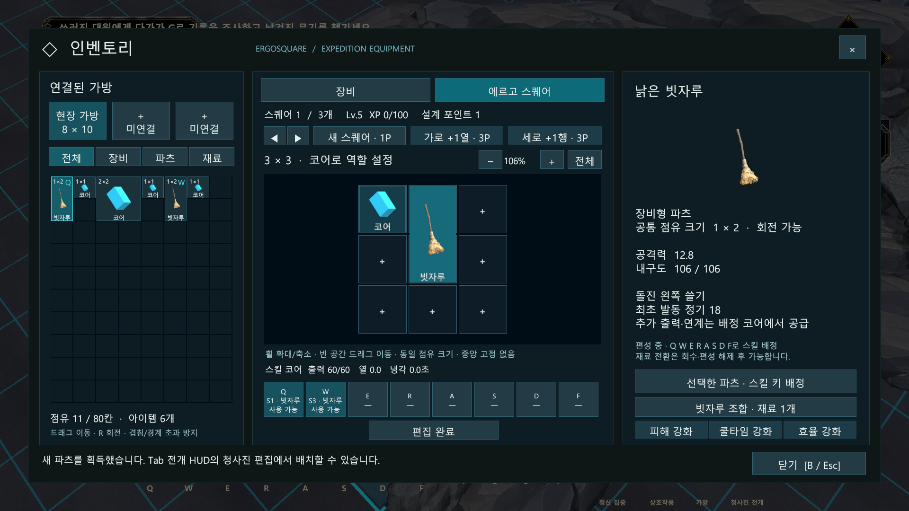
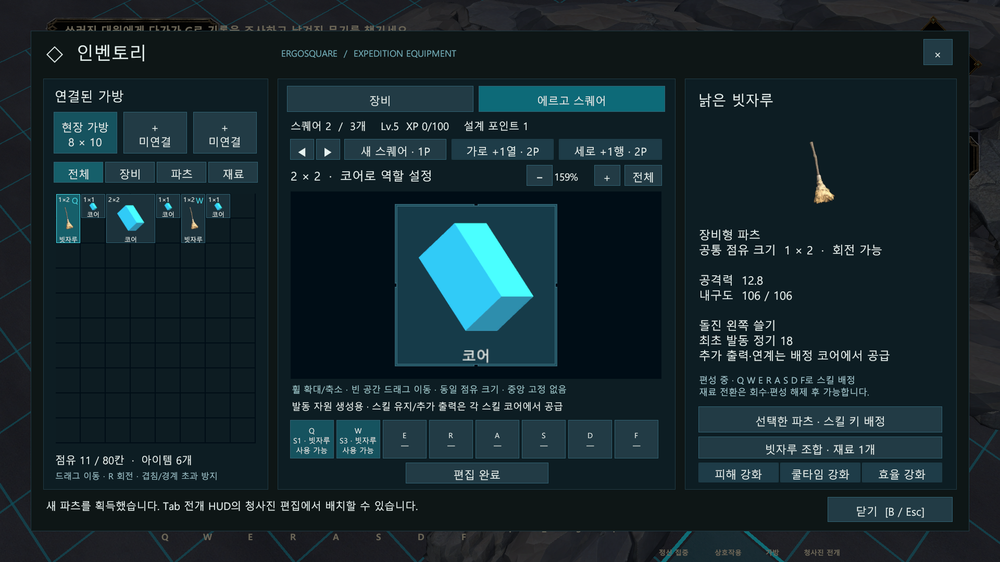
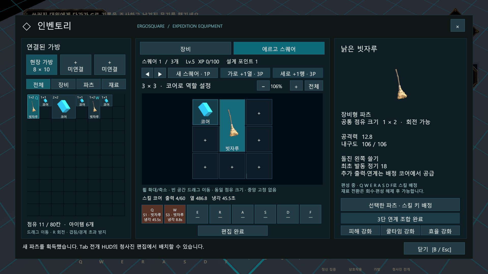

# 다중 에르고 스퀘어 검증

> 이후 규칙 변경과 새 UI 검증은 [성장 선택·파츠 조합·새 UI 검증](2026-10-18_성장선택_파츠조합_새UI_검증.md)을 참조합니다. 아래는 v4 당시 검증 이력입니다.

- 날짜: 2026-10-18
- 작성자: 송예찬
- 판정: 별도 Unity 플레이 세션의 90개 자동 검사 통과, 관련 5개 어셈블리 컴파일 통과.
- 대상: 다중 스퀘어·선택 성장·스킬 코어·과부하·냉각·메모리 씬 인계.
- 환경: Unity 6000.3.7f1, Windows, URP, 1920×1080.

## 초기 크기 정정 후 재검증

사용자 정정에 따라 **최초 지급 스퀘어 3×3, 그 이후 추가 생성만 1×1**로 분리했습니다. 중앙 예약 칸은 없으며 최초 9칸을 모두 사용할 수 있습니다. 초기 3×3은 확장 없이 사용하므로 첫 스퀘어 확장용 2P를 빼고 튜토리얼 지원을 4P 가안으로 조정했습니다.

정정 후 별도 Unity에서 90개 검사를 다시 통과했습니다. 최초 3×3·중앙 배치 가능·추가 1×1 생성·추가 격자 확장 시 최초 크기/배치 보존·씬 인계 후 최초 크기 보존을 확인했습니다. 아래 캡처도 정정한 빌드로 교체했습니다.

## 검증 방법

본 작업용 에디터 창을 조작하지 않고 `tmp/InventoryUiVerification` 복제 프로젝트에서 저장된 Tutorial_Stage01_Awakening 씬을 플레이했습니다. 파츠·XP를 준비한 뒤 실제 UI 버튼과 게임플레이/전개/씬 인계 API를 호출했습니다. 열 부족·유지 부하 시험에는 의도적으로 큰 부하를 주었습니다. 이는 실제 입력으로 전체 튜토리얼을 처음부터 끝까지 완주한 결과가 아닙니다.

## 확인 결과

| 영역 | 확인한 내용 |
| --- | --- |
| 시작·성장 | 최초 3×3, 이후 별도 1×1 생성, 독립 크기, 포인트 소비·보관·부족 시 무차감 |
| 튜토리얼 예산 | 최초 4P 지원 + 첫 적/연습 3마리의 XP로 추가 1×3 스킬 스퀘어 예산 확보 |
| 보유·점유 | 빗자루 1×2·생성기 2×2·스킬 코어 1×1, 개체 ID 독립, 겹침·잘림 금지 |
| 배정·UI | Q/W 별도 스퀘어·코어, 한 스퀘어 한 키, 실제 생성/확장/선택 버튼과 줌 |
| 실제 연계 | 1·2·3타 순서, 실제 시작/적중 이벤트 각 3회, 후속 타격 공용 자원 무소비 |
| 독립 코어 | Q 과부하가 W 냉각에 영향 없음, Q 냉각 중 W 실제 사용 가능 |
| 생성기/파괴 | 공용 공급 상실 시 새 W 발동 거절, 기존 Q 연계 유지, 특정 코어 파괴 영향 분리 |
| 부하·냉각 | 로컬 출력 소비·부족분 과부하·유지 부하·긴 냉각, 키 변경/분리로 초기화되지 않음 |
| 씬 인계 | 전 스퀘어 ID·배정·성장·여분 코어·출력·열·남은 냉각 보존, 한 번만 복원 |
| 필드 실물 | 넓은 시험 바닥에서 전 파츠 전개·별도 코어 피격 대상, 바닥 없으면 전개 거절 |
| 편집/실물 일치 | 선택만으로 회수되지 않음, 크기 변경은 기존 실물 회수, 재전개 가능 |
| XP | 실제 근접 적 처치 보상, 동일 적 체크포인트 재시도 중복 지급 방지 |
| 전투 HUD | 편집창 밖 기존 Q 프레임에 실제 코어 냉각 표시 |

필드 양성 시험은 복제 씬 안의 넓은 임시 바닥에서 진행했습니다. 동굴의 모든 위치·크기 조합을 검증한 것으로 해석하지 않습니다. 최종 플레이 밸런스·실제 드래그/키 입력 완주·가방 스퀘어의 용량 연결·영구 저장·협동 동기화는 남아 있습니다.

## 실제 Unity 캡처

### 최초 지급 Q 스퀘어 3×3과 전역 키 배정

### 별도 발동 생성기 2×2

### 의도적 고부하 후 독립 냉각

아래는 부족 출력과 유지 부하를 크게 준 시험 상태입니다. 일반 사용의 최종 밸런스 수치가 아닙니다.

## 증빙과 알려진 경계

Unity 저장소 `Tools/ArtReview/MultiErgo_v4_1_Initial3x3_20261018`의 checks.txt·verification.json·code-verification.json·Renders를 참조합니다. 시험 중 UnityEditor.Search.SearchDatabase 시작 인덱서의 ArgumentOutOfRangeException이 별도로 기록됐습니다. 게임플레이 검증 90건은 성공 종료했으며 이 에디터 인덱서 문제를 본 기능에서 수정한 것으로 간주하지 않습니다. 원시 에디터 로그는 배포 증빙에 포함하지 않습니다.

기능 계약은 [대표 시스템 명세](../03_기술_문서/시스템별_구현_명세/에르고스퀘어_대표_시스템_명세.md), 방향 결정은 [ADR](../04_프로젝트_관리/의사결정_기록/2026-10-18_다중_에르고스퀘어와_코어_과부하.md)를 참조합니다.

## Revision History

| 날짜 | 버전 | 변경 내용 | 작성자 |
| --- | --- | --- | --- |
| 2026-10-18 | v0.1 | 90개 자동 검사·컴파일·실제 캡처와 미검증 범위 기록 | 송예찬 |

| 2026-10-18 | v0.2 | 최초 지급 3×3·추가 생성 1×1 정정 후 재검증 및 캡처 교체 | 송예찬 |
