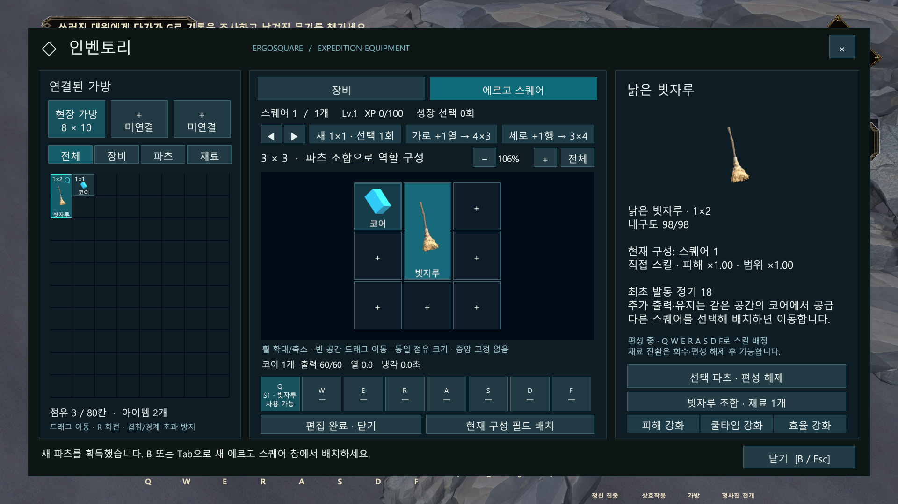
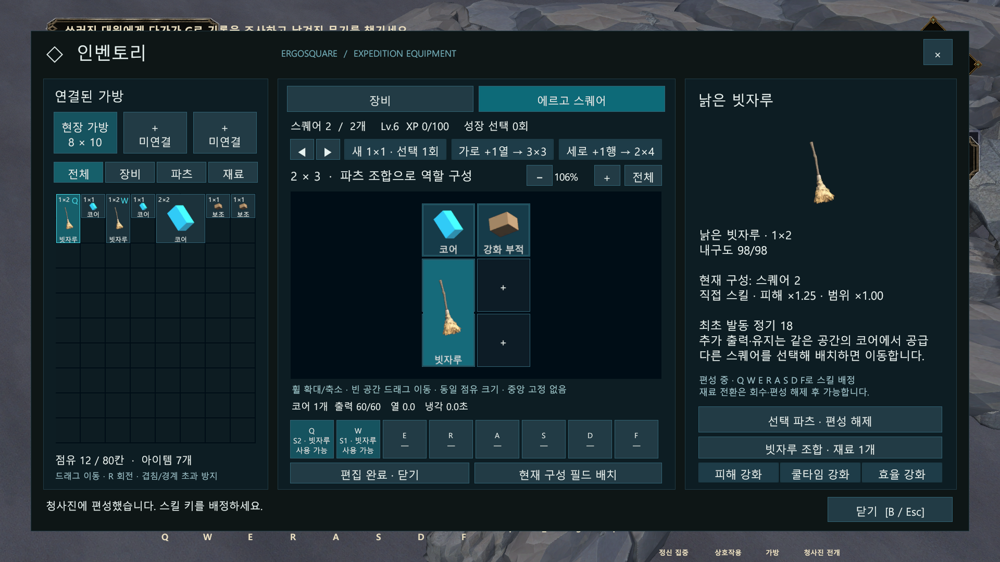
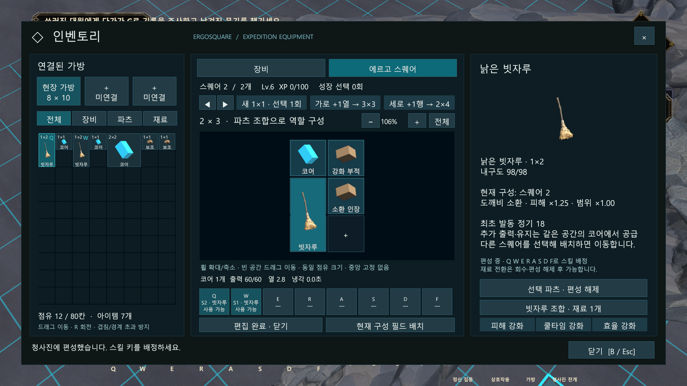
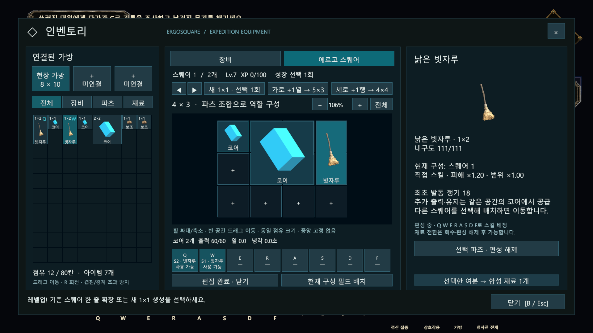
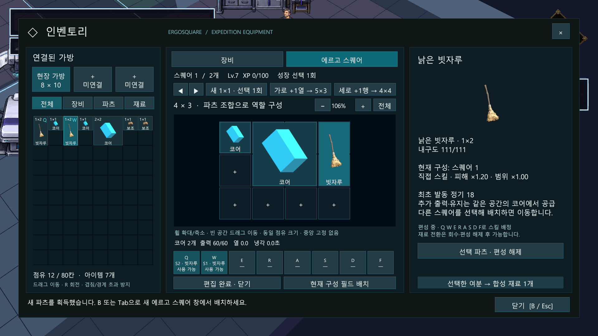

# 성장 선택·파츠 조합·새 UI 검증

- 작성자: 송예찬
- 날짜: 2026-10-18
- 결과: 별도 Unity 6000.3.7f1의 실제 플레이 기능 검사 **78개 통과**, 관련 어셈블리 **5개 컴파일 통과**.
- 대상 씬: Tutorial_Stage01_Awakening → 실제 Headquarters_Hub_v1 이동.
- 상태: 기능 프로토타입 검증. 최종 수치·아트·전체 튜토리얼 수동 완주 판정은 별도.

## 검증 방법

본 작업용 열린 Unity 창을 조작하지 않고 별도 복제 프로젝트에서 실행했습니다. 실제 저장된 씬, 새 UI 버튼과 편성 API, 직접 피해 판정, 소환 AI, 월드 전개와 실제 씬 인계를 사용했습니다. 파츠·경험치를 준비하고 시험용 적·넓은 바닥을 추가한 자동 검증입니다. 실제 마우스/키보드로 전체 튜토리얼을 처음부터 끝까지 완주한 결과가 아닙니다.

## 확인 결과

| 영역 | 통과 내용 |
| --- | --- |
| 최초 지급 | 3×3, 예약 칸 없음, 무료 성장 선택 없음 |
| 레벨업 | 한 레벨에서 3×3→4×3 또는 3×4, 각각 한 선택만 소비 |
| 추가 공간 | 다음 레벨에서 새 1×1 선택, 이후 1×2·1×3·2×3 개별 확장 |
| 튜토리얼 | 빗자루와 함께 받은 코어를 첫 3×3에 배치하고 Q 사용 |
| 공간 역할 | 같은 공간에 복수 코어·무기·다른 키 허용 |
| 이동 | 실제 무기 ID·키를 유지해 다른 공간으로 이동, 실패 시 원위치 유지 |
| 강화 | 호환 코어·부적 보정 합산, 다른 공간에는 미적용, 실제 피해에 배율 한 번 반영 |
| 소환 변형 | 실제 소유 소환 인장을 배치하면 같은 Q가 직접 공격 대신 소환 시전 |
| 소환 동작 | 원본 파츠의 임시 월드 외형으로 실제 동료 생성, 탐색·NavMesh 이동·적 피해·수명 종료 |
| 소환 유지 | 공용 최초 비용 한 번, 이후 로컬 출력·열 부하, 중복 소환 방지 |
| 조합 해제 | 부적 제거 시 기존 소환의 보정도 해제, 인장 제거 시 직접 스킬로 복귀 |
| 편집 중 전투 | 소환도 편집 입력 차단을 지켜 멈추며 메뉴 중 일방 공격 방지 |
| 과부하 | 열·로컬 출력 소비, 소환 종료·키 변경 시 남은 냉각 유지 |
| 필드 | 혼합 구성의 전 파츠 실물 생성, 일부 코어 파괴 후 다른 코어 유지, 바닥 없으면 거절 |
| 씬 인계 | 무기·보조 파츠·키·성장 선택·코어 열/출력 보존 |
| 새 UI | 독립 Canvas, B/Tab·시설·레벨업·필드 배치 진입, 옛 편집/탐색 UI 숨김 |
| 실제 본부 | 실제 씬 로드 뒤 원본 개체·성장·키 보존 및 시설에서 같은 새 UI 편집 |

## 실제 Unity 화면

### 처음 받은 3×3에서 코어와 빗자루 함께 사용

### 추가 스퀘어로 옮겨 강화 구성

### 파츠 조합으로 같은 키를 소환으로 변형

### 레벨업 성장 선택 화면

### 실제 본부 씬에서도 같은 새 UI

## 증빙과 경계

Unity 저장소 Tools/ArtReview/Ergo_Composition_v5_20261018의 checks.txt·verification.json·code-verification.json·Renders를 참조합니다. 원시 에디터 로그는 배포하지 않습니다. UnityEditor.Search.SearchDatabase 시작 인덱서 예외가 별도로 발생했으며 최종 게임플레이 검증은 성공 종료했습니다.

성장 XP·보상 지급·피해 보정·소환 수명/공격/유지 계수는 가안입니다. 보조 파츠는 기존 임시 아이콘을 쓰고 소환은 원본 파츠의 월드 프리팹(임시 외형 포함)을 재사용합니다. 소환 전용 원화·모션·내구/어그로·다른 무기 실행기·최종 밸런스·가방 스퀘어 용량 연결·영구 저장·협동과 전체 수동 UX 검수는 후속입니다. 동굴의 모든 크기/위치 조합에서 설치 가능함을 검증한 것은 아닙니다.

[기준 기획서](../00_프로젝트_개요/에르고스퀘어_종합_기획서_초안.md) · [기술 계약](../03_기술_문서/시스템별_구현_명세/에르고스퀘어_대표_시스템_명세.md) · [결정 기록](../04_프로젝트_관리/의사결정_기록/2026-10-18_레벨업_선택과_자유_파츠_조합.md)

## Revision History

| 날짜 | 버전 | 변경 내용 | 작성자 |
| --- | --- | --- | --- |
| 2026-10-18 | v0.1 | 성장 선택·조합·새 UI 78개 검사와 실제 씬 이동 결과 기록 | 송예찬 |
