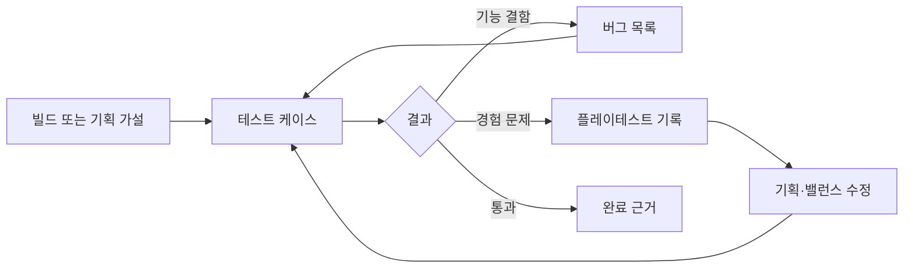

# QA

> [!IMPORTANT]
> 문서 상태: 인덱스 운영. 구현 여부와 재미 가설을 서로 다른 검증 자료로 관리합니다.

## Quick Links

[프로젝트 홈](../README.md) · [테스트 계획](테스트_계획.md) · [테스트 케이스](테스트_케이스.md) · [버그 목록](버그_목록.md) · [플레이테스트 기록](플레이테스트_기록.md) · [튜토리얼 체크리스트](../01_게임_기획/04_튜토리얼/제작/테스트_체크리스트.md)

## 문서 상태

| 문서 | 상태 | 검증 대상 |
| --- | --- | --- |
| [테스트 계획](테스트_계획.md) | 초안 | 범위·환경·통과 기준 |
| [테스트 케이스](테스트_케이스.md) | 초안 | 재현 가능한 기능 검증 |
| [버그 목록](버그_목록.md) | 운영 | 결함 상태와 재현 정보 |
| [플레이테스트 기록](플레이테스트_기록.md) | 운영 | 재미·가독성·난이도 가설 |
| [2026-10-18 다중 스퀘어 검증](2026-10-18_다중_에르고스퀘어_검증.md) | 별도 플레이 자동 검사 90건 통과 | 전체 수동 완주·밸런스는 별도 |
| [성장 선택·파츠 조합·새 UI](2026-10-18_성장선택_파츠조합_새UI_검증.md) | 실제 플레이 API 78건 통과 | 새 UI·강화/소환·본부 씬 인계 |

## 판정 흐름

## Revision History

| 날짜 | 버전 | 변경 내용 | 작성자 |
| --- | --- | --- | --- |
| 2026-08-17 | v1.0 | QA Quick Links, 상태 인덱스와 판정 흐름 작성 | 송예찬 |

| 2026-10-18 | v1.1 | 다중 스퀘어 자동 검증 기록 연결 | 송예찬 |

| 2026-10-18 | v1.2 | 새 성장 선택·조합·UI 검증 기록 연결 | 송예찬 |
