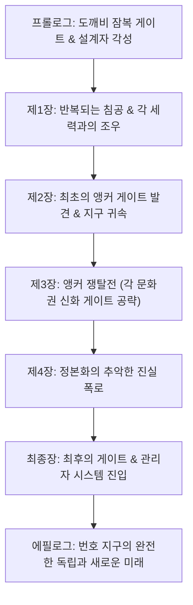

# 2026-09-14 기획서 통합 이전 원문

> 보존 전용. 현재 사양이 아닙니다. 원문은 Markdown 코드 블록으로 보존하며 링크도 당시 표기를 유지합니다. 현재 기준은 종합 기획서입니다.

## 01_게임_기획/01_핵심_플레이/전체_장기_플레이_루프.md

SHA256: `b25d0c93732629b46a9d16c79bd320f0b12d2d38f32f3807fcc7ecaa1952b79c`

````````markdown
# 핵심 플레이 루프

> [!IMPORTANT]
> 문서 상태: 초안

## 문서 역할과 읽기 순서

이 문서는 플레이어가 반복해서 경험할 전체 게임 흐름을 정의하는 상위 기준 문서입니다. 현재 인게임 전투 흐름은 튜토리얼에서 먼저 검증하며 세부 규칙은 아래 전용 문서에서 관리합니다.

1. 현재 문서: 전체 게임과 인게임 전투의 기본 흐름
2. [인게임 핵심 플레이 루프](./README.md): 튜토리얼에서 먼저 구현할 조작과 진행의 기준
3. [장비·코어·스킬](./장비_코어_스킬/README.md): 장비, 스킬 편성, 코어 자원과 재제작
4. [청사진 성장 및 공간 경제](../02_에르고스퀘어/청사진_성장_및_공간_경제.md): 레벨별 격자, 직접·주머니 수납과 방어 공간
5. [실패·철수·사망](./실패_철수_사망.md): 익스트랙션, 월드 영구 사망과 협동 중상
6. [전투](./전투.md): 피격, 코어 방어와 MVP 검증 항목
7. [조작](./조작.md): 키보드·마우스 입력 기준

세부 문서와 내용이 충돌하면 각 세부 규칙은 해당 전용 문서를 우선하고, 플레이 단계의 연결은 이 문서를 우선합니다.

```text
게임 시작
  ↓
번호 지구 생성 또는 불러오기
  ↓
정해진 허브 시설 탐색·채집·업그레이드
  ↓
청사진에 코어·파츠 배치
  ↓
게이트 발견·이야기 분석
  ↓
평행 지구 진입·에르고스퀘어 전개
  ↓
퀘스트·전투·코어 방어·게이트 폐쇄 또는 철수
  ↓
반출한 장비·재료 저장과 지구 안정화
  ↓
허브 시설·청사진 성장 후 다음 게이트 추적
```

| 단계 | 플레이어 목표 | 주요 행동 | 사용 시스템 | 보상·위험 | 다음 조건 |
| --- | --- | --- | --- | --- | --- |
| 월드 | 자신의 지구에 기반 구축 | 탐색·채집·시설 강화 | 월드·저장·허브 | 자원·안전지대 / 침식 확산 | 게이트 발견 |
| 준비 | 게이트 조건에 맞는 빌드 구성 | 이야기 분석·프레임·파츠 선택 | 퀘스트·청사진 편성 | 공략 정보 / 약점 노출 | 편성 확정 |
| 진입 | 중첩된 평행 지구의 상황 파악 | 이동·탐색·대화 | 게이트·레벨·퀘스트 | 정보·분기 / 교전 위험 | 폐쇄 조건 확인 |
| 전개 | 전투 기반 구축 | 청사진 전개 | 에르고스퀘어 | 기능 활성화 / 코어 노출 | 파츠 활성화 |
| 해결 | 서사·전투 목표 달성과 코어 보호 | 공격·회피·협동·선택 | 전투·AI·퀘스트 | 좌표·전리품 / 파츠 파괴 | 폐쇄 조건 달성 |
| 철수·귀환 | 위험 전에 철수하거나 게이트를 닫고 성과 보존 | 철수 연결·보상 반출 | 익스트랙션·결과·저장 | 성장 자원 / 열린 게이트 폭주 진행 | 허브 복귀 |
| 성장 | 다음 공략과 최종 수렴점 준비 | 시설 강화·청사진 수정·연구 | 허브·성장·편성 | 더 넓은 선택 / 새 위협 | 다음 게이트 추적 |

## 튜토리얼에서 먼저 검증할 인게임 기본 흐름

아래 흐름은 전체 게임의 최종 사양이 아니라 [인게임 핵심 플레이 루프](./README.md)에서 튜토리얼 우선으로 구현·검증할 축소 구조입니다.

```text
무기 획득
  ↓
무기에 부여된 액티브 스킬 확인
  ↓
스킬을 Q/W/E/R/A/S/D/F 중 원하는 슬롯에 편성
  ↓
이동·기본 공격과 편성한 기동·방어 스킬로 교전 시작
  ↓
전장에 코어 전개
  ↓
코어가 생성한 자원을 소비해 액티브 스킬 사용
  ↓
플레이어와 코어를 함께 보호하며 전투 목표 달성
  ↓
새 무기·스킬·코어 후보를 획득하고 빌드 갱신
```

### 튜토리얼 현재 결정

- 무기에는 플레이어가 직접 사용할 액티브 스킬이 부여됩니다.
- 획득한 무기 스킬은 `QWERASDF` 8개 전투 슬롯 중 하나에 할당합니다.
- 액티브 스킬은 전개된 코어가 생성하는 전투 자원을 소비합니다.
- 이동과 기본 공격은 코어 자원이 없어도 사용할 수 있습니다. 기동·방어 행동은 편성한 스킬의 자원 규칙을 따릅니다.
- 코어는 전장에 존재하고 공격받을 수 있는 전략적 전개물입니다.
- 코어가 손상되면 자원 생성 효율이 낮아질 수 있으며, 파괴되면 축적 자원·장비 스킬·활성 능력과 신규 생성이 중단됩니다.

### 이 흐름이 만드는 판단

- 어떤 무기 스킬을 제한된 슬롯에 편성할지 선택합니다.
- 코어를 안전한 곳에 둘지, 위험을 감수하고 전투에 유리한 곳에 둘지 결정합니다.
- 생성된 자원을 즉시 소비할지 강한 스킬을 위해 비축할지 판단합니다.
- 공격에 집중할지 코어 방어와 복구에 행동을 배분할지 결정합니다.

## 첫 전투 프로토타입 범위

- 녹슨 검 1종과 기본 공격
- 녹슨 검에 부여될 후보 스킬: 종베기, 횡베기, 찌르기
- `QWERASDF` 슬롯 편성과 스킬 발동
- 기본 코어 1종의 전개와 단일 전투 자원 생성
- 스킬의 자원 소비와 사용 불가 피드백
- 적의 코어 공격, 손상에 따른 생산 효율 저하와 파괴 시 활성 능력 중단

무기 스킬의 고정·무작위 부여 방식과 자원의 정식 명칭은 아직 확정하지 않습니다.

## 시스템 관점

1. 편성 데이터가 격자 좌표와 연결 정보를 저장합니다.
2. 호스트 세이브가 지구 번호, 허브 시설, 게이트와 진행 상태를 보존합니다.
3. 진입 시 게이트의 서사 규칙, 퀘스트와 전장 상태를 초기화합니다.
4. 전개 시 청사진 데이터를 월드 오브젝트로 변환합니다.
5. 전투 중 파츠·퀘스트 상태와 피해를 갱신·동기화합니다.
6. 철수 또는 귀환 시 반출에 성공한 장비·재료와 게이트 결과를 월드 상태에 반영합니다.

## 실패 가능성

- 코어 또는 핵심 파츠 파괴
- 플레이어 또는 팀 전멸
- 작전 목표 실패
- 게이트 침식도 초과 또는 폐쇄 조건 상실
- 네트워크 이탈과 상태 불일치

플레이어 또는 파티 전멸은 해당 번호 지구의 게임오버이며 새 지구 생성을 요구합니다. 코어 파괴는 즉시 사망이 아니지만 활성 장비 능력과 스킬을 잃고 허브 복구 전까지 회복되지 않습니다. 목표를 달성하지 못해도 전멸 전에 철수하면 반출 보상을 이용해 재정비하고 재도전할 수 있습니다. 세부 판정은 [실패·철수·사망](./실패_철수_사망.md)을 따릅니다.

## 협동 월드 원칙

- 초기 협동은 2~4명의 설계자가 하나의 번호 지구와 허브를 공유합니다.
- 개인 체력 0은 중상으로 처리하고 아군 구조 또는 파티 철수를 기다립니다.
- 모든 파티원이 동시에 중상이 되면 공동 월드가 게임오버됩니다.
- 다른 번호 지구에서 방문하는 플레이어와 반입·반출 규칙은 엔딩 이후 확장으로 보류합니다.

## Revision History

| 날짜 | 버전 | 변경 내용 | 작성자 |
| --- | --- | --- | --- |
| 2026-07-31 | v0.1 | 플레이어·시스템 관점의 전체 루프 작성 | 송예찬 |
| 2026-08-02 | v0.2 | 장기 월드·기지·퀘스트형 게이트와 세계 안정화 루프로 확장 | 송예찬 |
| 2026-08-15 | v0.3 | 무기 스킬 편성, 코어 자원 생성과 전투 순간 흐름 연결 | 송예찬 |
| 2026-08-15 | v0.4 | 고정 허브, 익스트랙션, 월드 영구 사망과 협동 중상 루프 반영 | 송예찬 |

````````

## 01_게임_기획/01_핵심_플레이/플레이어.md

SHA256: `67dc25bd6deb2fc0f954a3aab26e3dbe1bd70ed54b9e8c40da463cb838ca75ba`

````````markdown
# 플레이어 기획

> [!IMPORTANT]
> 문서 상태: 초안

## 역할

플레이어는 잠복 게이트 폭주에서 생환하며 에르고스퀘어가 발현한 특수 각성자입니다. 기관은 에르고스퀘어 운용자에게 `설계자(Architect)`라는 작전 코드네임과 분류를 부여합니다. 모든 설계자는 각성자이지만 모든 각성자가 설계자는 아닙니다.

솔로에서는 한 명의 생환자를, 협동에서는 같은 사건 또는 같은 작전에서 연결된 2~4명의 설계자 팀을 플레이합니다. 시나리오에서는 인원수에 따라 다시 쓰지 않아도 되는 `잠복 게이트 생환자`라는 표현을 우선 사용합니다.

## 핵심 능력

- 직접 이동·공격과 장비 스킬 기반 기동·방어
- 인벤토리 게이트 접근
- 에르고스퀘어 편성·전개·회수
- 팀원의 코어와 파츠 지원
- 다른 각성자·현현체의 능력 원리를 설계로 모사하고 융합

빌드와 전개 계통의 전체 규칙은 [설계자 빌드](../02_에르고스퀘어/설계자_빌드.md)를 따릅니다.

## 기본 상태 후보

```text
공통: Idle → Move → Attack/Interact → Hit
싱글: 체력 0 → Dead → 월드 게임오버
협동: 체력 0 → Down(중상) → Revive 또는 파티 전멸
```

싱글에서는 사망 시 해당 번호 지구가 종료됩니다. 협동에서는 개인을 월드에서 사출하지 않고 중상 상태로 전환하며, 전원이 중상이 되었을 때만 공동 월드 게임오버로 판정합니다. 구조·철수·코어 파괴의 전체 규칙은 [실패·철수·사망](./실패_철수_사망.md)을 따릅니다. 근접·투사·영역은 고정 직업이 아니라 전개 위치를 결정하는 계통으로 사용합니다.

## 완료 조건

- [ ] 기본 이동과 카메라
- [ ] 공격·피격·사망
- [ ] 전개 상호작용
- [ ] 팀원 상태 표시
- [ ] 입력 장치별 조작 검증

## Revision History

| 날짜 | 버전 | 변경 내용 | 작성자 |
| --- | --- | --- | --- |
| 2026-07-31 | v0.1 | 설계자의 역할과 기본 상태 후보 작성 | 송예찬 |
| 2026-08-06 | v0.2 | 설계자 코드네임, 잠복 게이트 생환자와 능력 모사 역할 반영 | 송예찬 |
| 2026-08-15 | v0.3 | 싱글 월드 사망과 협동 중상·파티 전멸 상태 반영 | 송예찬 |

````````

## 01_게임_기획/01_핵심_플레이/조작.md

SHA256: `c99498ce698e9091fdfe0d6f6e79f44ae0f7456dd9f9c15f1e962620fb4a5edc`

````````markdown
# 조작 시스템

> [!IMPORTANT]
> 문서 상태: 확정(키보드·마우스 기본 매핑). 정신 집중 수치, 카메라 세부 범위와 게임패드 매핑은 프로토타입 검증 후 확정합니다.

## 목적

아이소메트릭 실시간 전투, 소비 아이템 사용, 가방 관리와 에르고스퀘어 전개를 하나의 일관된 키보드·마우스 조작 체계로 정의합니다.

## 기본 원칙

- 마우스는 이동, 대상 지정, 기본 공격과 배치 위치를 다룹니다.
- `QWERASDF` 전체를 전투 스킬 슬롯으로 유지합니다.
- 가방 관리와 에르고스퀘어 전개를 `B`와 `Tab`으로 분리합니다.
- 상호작용은 스킬 키와 충돌하지 않도록 `G`를 사용합니다.
- 화면의 키 안내는 고정 문자열이 아니라 현재 바인딩 값을 표시할 수 있게 구성합니다.

## 일반 조작

| 입력 | 기능 |
| --- | --- |
| 우클릭 / 길게 누르기 | 지정 지점으로 이동 |
| 좌클릭 | 기본 공격 또는 선택한 위치 지정 아이템 사용 |
| `QWERASDF` | 8개 전투 스킬 슬롯 |
| `Space` 길게 누르기 | 정신 집중: 행동을 멈추고 비효율적으로 자원 회복 |
| `G` | 대화·조사·구조·장치 상호작용 |
| `1~4` | 소비 아이템 슬롯 |
| `B` | 가방·일반 아이템·획득품 목록 |
| `Tab` | 에르고스퀘어 전개 모드 진입·종료 |
| `Alt` | 바닥 아이템 정보 표시 |
| `Esc` | 메뉴 또는 현재 모드 취소 |

## 소비 아이템 조작

### 즉시 사용형

회복제처럼 대상 지정이 필요 없는 아이템은 `1~4` 중 등록된 숫자 키를 누르면 즉시 사용합니다.

### 위치 지정형

수류탄처럼 지점을 정해야 하는 아이템은 다음 순서로 사용합니다.

```text
숫자 키로 아이템 선택
→ 유효 거리·영향 범위 표시
→ 좌클릭으로 사용
→ 우클릭 또는 Esc로 취소
```

우클릭 취소가 기본 이동과 충돌하므로, 취소 시 이동 명령을 함께 발생시킬지는 조작 프로토타입에서 검증합니다.

## 상호작용

- `G` 짧게 누르기: 흔적 조사, 문·장치 작동, 대화
- `G` 길게 누르기: 민간인 구조, 장치 수리, 게이트 안정화
- 대상이 여럿이면 캐릭터와 가깝고 커서 방향에 있는 대상을 우선합니다.
- 상호작용 범위에서는 대상 위에 `G` 키와 행동 동사를 표시합니다.
- 일반 자원은 자동 획득하여 `G`를 의미 있는 행동에만 사용합니다.

## 에르고스퀘어 전개 조작

| 입력 | 전개 모드 기능 |
| --- | --- |
| 마우스 이동 | 배치할 격자·파츠 선택 |
| 좌클릭 | 배치 또는 확정 |
| 우클릭 | 이전 단계·배치 취소 |
| `Q` / `E` | 선택 파츠 회전 |
| `1~4` | 파츠 단축 선택 가안 |
| `Tab` | 전개 모드 종료 |
| `Space` | 전개 모드 중 정신 집중 입력 처리 `TBD` |

전개 모드에서는 일반 스킬 입력을 중단하고 `Q/E`를 파츠 회전에 사용합니다. 전개 중 시간 흐름은 실시간을 기본 가설으로 검증하되, 정지·감속과 비교한 뒤 확정합니다.

## 가방과 전개의 경계

- `B`: 장비·재료·소비품과 수납 상태를 확인하고 관리합니다.
- `Tab`: 미리 편성한 청사진을 현재 공간에 투영·전개합니다.
- 전투 중 `Tab`은 복잡한 인벤토리 편집이 아니라 준비된 설계의 빠른 현장 전개입니다.

## 입력 상태

| 상태 | 우선 입력 | 제한 |
| --- | --- | --- |
| 일반 | 이동·공격·스킬·상호작용 | 없음 |
| 정신 집중 | `Space` 유지 | 이동·기본 공격·스킬 사용 중단, 받는 피해 증가 |
| 위치 지정 아이템 | 좌클릭 사용, 취소 | 기본 공격 중단 |
| 에르고스퀘어 전개 | 격자·파츠 배치 | 일반 스킬 입력 중단 |
| 가방 | 아이템 확인·관리 | 온라인 전투 중 시간 정지 없음 |
| 길게 상호작용 | 진행 유지 | 피격·범위 이탈 시 취소 가안 |

## UI·피드백

- 스킬 슬롯은 키, 쿨다운, 사용 불가 이유를 표시합니다.
- 위치 지정 아이템은 커서, 캐릭터와 퀀슬롯에 같은 식별 효과를 표시합니다.
- 전개 가능·불가, 손상·파괴는 색상만으로 구분하지 않습니다.
- 입력 상태가 바뀌면 커서 형태와 HUD 표시를 함께 바꿉니다.
- 정신 집중 중에는 자원 증가량, 행동 제한과 받는 피해 증가 상태를 동시에 표시합니다.

## 정신 집중

- `Space`를 누르는 즉시 시작하고 놓으면 즉시 종료합니다.
- 누르는 동안 현재 장착한 코어와 호환되는 자원을 초당 `10` 회복합니다. `10`은 프로토타입 검증값입니다.
- 코어 전개 전후 모두 사용할 수 있으며, 전개 전에 모은 자원은 전개할 때 초기화되지 않습니다.
- 전개 후에도 사용할 수 있지만 코어가 자동으로 자원을 생성하므로 행동을 포기할 만큼 효율적이지 않은 보조 수단입니다.
- 집중 중에는 이동, 기본 공격과 스킬을 사용할 수 없고 받는 피해가 증가합니다. 피해 배율의 첫 검증값은 `1.5배`입니다.
- 코어 파괴 등 자원 계통 자체가 비활성화된 상태에서는 사용할 수 없습니다.
- 공통 회피 키는 두지 않습니다. 회피·방어·기동 행동은 장비가 제공하는 스킬로 `QWERASDF`에 편성합니다.

## 미확정 세부 항목

- 정신 집중 중 받는 피해 배율과 초당 회복량의 최종값
- 전개 모드에서 `Space` 정신 집중을 허용할지
- 위치 지정 아이템 취소 시 우클릭 이동 명령을 함께 발생시킬지
- 전개 중 시간 흐름과 피격 규칙
- 카메라 확대·축소 범위와 회전 지원 여부
- 게임패드 매핑과 키 리바인딩 세부 정책

## 완료 조건

- [ ] 일반, 아이템 지정, 전개와 가방 상태가 오입력 없이 전환됩니다.
- [ ] 필수 조작을 UI 설명 없이도 반복할 수 있습니다.
- [ ] 조작 키를 바꿔도 모든 프롬프트가 현재 바인딩을 표시합니다.
- [ ] 자주 사용하는 기능 사이의 입력 충돌이 플레이를 방해하지 않습니다.

## 남은 문제

- 스킬 잠금·교체·프리셋 규칙
- 상호작용 대상 변경 또는 순환 기능의 필요성
- 키보드·마우스와 게임패드 사이의 동일한 플레이 감각 재현 방식

## Revision History

| 날짜 | 버전 | 변경 내용 | 작성자 |
| --- | --- | --- | --- |
| 2026-08-06 | v1.0 | 기본 키보드·마우스 매핑과 입력 상태를 전체 게임 기준으로 정립 | 송예찬 |
| 2026-08-17 | v1.1 | Space 정신 집중, 초당 10 수동 회복과 장비 스킬 기반 회피 방향 반영 | 송예찬 |

````````

## 01_게임_기획/01_핵심_플레이/전투.md

SHA256: `8bf0c097abd500a829726abc801704f91813ed2b9b06963cd167ea9446ff0dba`

````````markdown
# 전투 시스템

> [!IMPORTANT]
> 문서 상태: 초안

## 목적

직접 액션과 코어 방어 판단을 동시에 요구해, 강한 빌드가 곧 지켜야 할 약점이 되도록 합니다.

## 기본 구조

- 플레이어 직접 공격과 장비 스킬 기반 기동·방어
- 파츠 기반 공격·방어·지원
- 플레이어·코어·파츠를 선택하는 적의 위협 판단
- 팀원 간 화력 집중과 방어 역할 분담

전개된 코어와 파츠는 충돌·피격 판정을 가진 월드 오브젝트입니다. 공격과 이동을 막아 플레이어의 방패가 될 수 있지만 동시에 적의 공격으로 파괴될 수 있습니다. 핵심 코어가 파괴되면 축적 자원, 장비 스킬과 활성 추가 능력이 중단되며 허브 복구 전까지 회복되지 않습니다.

장비 부여 스킬, `QWERASDF` 편성과 코어의 생성·손상·파괴 규칙은 [장비·코어·스킬](./장비_코어_스킬/README.md)을 기준으로 합니다. 이동과 기본 공격은 코어 자원 없이도 유지하며, 공통 회피 대신 편성한 기동·방어 스킬을 사용합니다. `Space` 정신 집중은 코어 전개 전후 사용할 수 있는 느리고 위험한 수동 자원 회복입니다.

근접·투사·영역 계통의 차이는 무기 제한보다 전개 가능한 위치에서 발생합니다. 계통별 거리 규칙, 코어 보호 방식과 대표 융합 빌드는 [설계자 빌드](../02_에르고스퀘어/설계자_빌드.md)를 기준으로 합니다.

## MVP 검증 항목

- 공격의 명중과 피격 피드백
- 코어가 공격받을 때의 우선순위 변화
- 파츠 파괴가 전투 방식에 미치는 영향
- 코어를 엄폐물로 사용할 때의 즉시 생존과 장기 자원 손실 사이의 판단
- 근접의 주변 전개, 투사의 `3×3` 최소 사거리와 영역의 원격 범위 위험이 만드는 체감 차이
- 1~4인이 상황을 이해할 수 있고 싱글에서도 정보가 과밀하지 않은 전달

무기 종류, 피해 공식, 경직과 상태 이상은 `TBD`입니다.

## Revision History

| 날짜 | 버전 | 변경 내용 | 작성자 |
| --- | --- | --- | --- |
| 2026-07-31 | v0.1 | 전투 구조와 MVP 검증 항목 작성 | 송예찬 |
| 2026-08-06 | v0.2 | 전개물의 방패·피격 양면성과 세 전개 계통 검증 항목 반영 | 송예찬 |
| 2026-08-15 | v0.3 | 무기 부여 스킬과 코어 자원 전용 문서 연결 | 송예찬 |

````````

## 01_게임_기획/01_핵심_플레이/아이템.md

SHA256: `5745d6ebf3a5463fbf85a630a997eb3a5a4d8fd92e223ca1dfb7085fe48ae458`

````````markdown
# 아이템·파츠 시스템

> [!IMPORTANT]
> 문서 상태: 용어 확정 및 시스템 초안

## 목적

획득 가능한 모든 물건을 `아이템`으로 부르되, 청사진에 배치하는 기능 부품은 `파츠`, 제작과 강화 등에 소비하는 물건은 `재료`로 구분합니다. 아키텍트는 파츠를 청사진에 구성해 하나의 `아키텍처`를 완성합니다.

장비, 부여 스킬과 자원 코어의 연결 규칙은 [장비·코어·스킬](./장비_코어_스킬/README.md)을 기준으로 합니다. 전체 청사진 크기, 레벨 확장과 수납 공간 경쟁은 [청사진 성장 및 공간 경제](../02_에르고스퀘어/청사진_성장_및_공간_경제.md)를 따릅니다. 이 문서는 아이템·파츠·재료의 명칭과 개별 파츠의 격자 규칙을 관리합니다.

## 용어 계층

```text
아키텍트
└─ 청사진에 파츠를 배치
   └─ 완성된 파츠 조합 = 아키텍처

아이템
├─ 파츠: 청사진에 배치되어 기능하는 아이템
└─ 재료: 제작·강화·복구·시설 확장에 소비하는 아이템
```

| 용어 | 정의 | 시스템 판정 |
| --- | --- | --- |
| 아키텍트 | 에르고스퀘어로 파츠를 설계·배치·전개하는 플레이어 | 플레이어의 공식 코드네임 |
| 청사진 | 파츠와 직접 수납 재료를 배치하는 격자 | 저장·편집·전개 대상 |
| 파츠 | 청사진에 배치되어 전투·자원·보호·수납 등의 기능을 수행하는 아이템 | 크기·내구도·배치 좌표·파괴 상태 보유 |
| 아키텍처 | 한 청사진에 구성된 파츠의 전체 조합과 그 빌드 | 개별 아이템이 아니라 완성된 구성 상태 |
| 재료 | 파츠 제작·강화·복구와 허브 시설 업그레이드에 소비하는 아이템 | 독립 기능과 전개 능력 없음 |

`잔재`, `파편`, `부산물`, `자재`는 별도 시스템 분류로 만들지 않습니다. 필요하면 `도깨비의 잔재`, `부서진 월도의 파편`처럼 개별 재료의 이름과 설명에만 사용합니다.

## 아이템 분류

| 분류 | 역할 |
| --- | --- |
| 장비형 파츠 | 무기·방어구의 기본 능력치와 편성 가능한 액티브 스킬 제공 |
| 코어형 파츠 | 액티브 스킬에 필요한 자원과 빌드 고유 메커니즘 생성 |
| 보조형 파츠 | 패시브 효과, 코어 강화, 스킬 변형, 수납 또는 방호 기능 제공 |
| 소비형 파츠 | 청사진의 소비 슬롯에 편성하며 사용 후 수량 또는 파츠 소모 |
| 재료 | 파츠 제작·강화·복구와 허브 시설 업그레이드에 소비 |

수납·방호·증폭·탐지는 독립된 상위 분류가 아니라 `보조형 파츠`의 역할 태그로 관리합니다. 예를 들어 소형 주머니는 `[수납]`, 방어 플레이트는 `[방호]`, 위상 증폭기는 `[코어 강화]` 태그를 가진 보조형 파츠입니다.

## 파츠와 재료의 경계

- 파츠는 청사진에 배치된 위치와 방향에 따라 기능하며 전개 후 공격받을 수 있습니다.
- 재료는 자체적으로 전투·자원·패시브 기능을 발휘하지 않습니다.
- 재료를 주머니 없이 반출하려면 재료 한 단위 또는 한 묶음이 청사진 한 칸을 직접 점유합니다. 묶음 기준은 `TBD`입니다.
- 수납형 보조 파츠는 여러 재료를 압축해 보관하지만 파괴되면 내부 재료를 반출할 수 없습니다.
- 파츠를 해체하면 재료를 얻을 수 있고, 재료를 사용해 새로운 파츠를 제작·강화할 수 있습니다.
- 설계 데이터와 퀘스트 전용 물품을 일반 재료에 포함할지는 콘텐츠별로 결정하되, 별도 기능이 없다면 신규 상위 분류를 만들지 않습니다.

## 공통 데이터 후보

공통: `ItemId`, `ItemKind`, `DisplayName`, `Description`, `Rarity`, `Tags`

파츠: `PartType`, `GridSize`, `ConnectRule`, `Durability`, `EffectId`, `GrantedSkillIds`

재료: `StackSize`, `CraftTags`, `RecipeIds`, `BaseValue`

아이템 희귀도와 드롭 테이블은 MVP 이후 결정합니다.

## 격자와 크기 규칙

원안 메인 기획서의 수치를 현재 대표 시스템 명세와 연결한 가안입니다.

- 격자 한 칸은 월드 기준 `1m × 1m`입니다.
- 파츠 크기는 `1×1`, `1×2`, `2×1`, `2×2`를 우선 사용합니다.
- 직사각형 파츠는 회전 배치를 지원하는 방향으로 검토합니다.
- 큰 파츠는 효과와 내구도가 높은 대신 배치 공간, 피격 면적과 설치 부담이 커집니다.
- 최종 크기와 회전 규칙은 편성 UI 프로토타입에서 검증합니다.

## MVP 파츠 후보

| 파츠 | 분류 | 크기 가안 | 역할 | 파괴 시 영향 |
| --- | --- | ---: | --- | --- |
| 기초 주 코어 | 코어형 | 1×1 | 전개 계통·활성 기초 능력치·핵심 자원 제공 | 자원·스킬·활성 기초 능력치 중단 |
| 대형·보조 코어 | 코어형 | 2×2 가안 | 후반 복수 자원 또는 확장 기능 `TBD` | 연결된 코어 기능 중단 |
| 공격 장비 | 장비형 | 1×2 | 기본 공격과 편성 가능한 액티브 스킬 제공 | 연결된 공격 기능 사용 불가 |
| 방어 플레이트 | 보조형 `[방호]` | 2×1 | 인접 파츠 피해 감소 | 피해 감소 효과 해제 |
| 소형 주머니 | 보조형 `[수납]` | 1×1 | 여러 재료의 압축 수납 가안 | 내용물 반출 불가 |
| 위상 증폭기 | 보조형 `[코어 강화]` | 1×1 | 인접 코어 생산량 증폭 | 생산 보너스 제거 |
| 코어 활성제 | 소비형 | 1×1 가안 | 현재 전개된 코어의 자원 즉시 충전 | 사용 시 수량 소모 |

튜토리얼 MVP는 1×1 기초 주 코어, 첫 장비형 파츠, 소형 주머니, 방어 플레이트와 소비형 파츠 2종을 우선 검증합니다. 2×2 대형 코어와 고급 연결·증폭 파츠는 확장 후보입니다.

## 설치 시간 가안

| 크기 | 기본 설치 시간 |
| --- | ---: |
| 1×1 | 1.5초 |
| 1×2 / 2×1 | 2초 |
| 2×2 | 3초 |

설치 중인 파츠는 홀로그램 상태이며 기능하지 않지만 공격과 파괴의 대상이 됩니다. 시간은 파츠 종류와 프레임 보정 전 기준이며 플레이테스트 전 가안입니다.

## 연결과 인접 효과 후보

- 코어형 파츠 + 증폭기: 자원 생산량 증가
- 코어형 파츠 + 방어 플레이트: 코어 피해 감소
- 장비형 파츠 + 탐지 파츠: 탐지 또는 약점 공격 효율 증가
- 주머니 + 방어 플레이트: 재료 반출 위험 감소
- 링크 노드 + 보조 노드: 원격 지원 기능 활성화

인접 효과는 강제 정답 배치를 만들지 않도록 효율, 노출 위험과 공간 비용을 함께 조정합니다.

## 공통 능력치(Stat) 및 태그(Tag) 규격 가안

파츠에 부여되는 옵션과 능력치의 표준 분류 및 태그 규칙입니다. 재료는 제작 조건에 사용하는 태그만 가지며 전투 능력치는 가지지 않습니다.

### 1. 능력치 표현 방식
*   **고정 수치 (Flat):** 극초반 및 기본 수치에 적용 (예: 공격력 +5, 내구도 +10)
*   **비율 수치 (Percent):** 후반 성장 및 시너지 옵션에 적용 (예: 공격력 +5%, 이동속도 +3%)
*   **특수 매커니즘:** 주기적 발동 또는 특정 상태 조건부 발동 (예: 5초마다 체력 2 회복, 코어 인접 시 방어력 증가)

### 2. 표준 능력치 분류 목록
| 분류 | 능력치 항목 | 비고 |
| --- | --- | --- |
| **기본/생존** | 공격력, 방어력, 내구도, 체력/치유력, 치유효과 증가 | 기본 전투 수치 |
| **속도/기동** | 공격속도, 이동속도, 이동속도 증가/감소 효과 | 전투 기동성 관련 |
| **전투 유틸** | 치명타 확률, 치명타 피해량, 회피율 | 확률성 공격/방어 수치 |
| **제어/저항** | 기절 확률, 기절 저항 | CC(상태이상) 제어 |
| **피해 분류** | 근접 피해 증가/감소, 원거리 피해 증가/감소 | 전개 계통별 맞춤 옵션 |
| **스킬/코어** | 스킬 효과 증가/감소, 코어 자원 생성 효율 | 에르고스퀘어 특화 수치 |

### 3. 태그(Tag) 시스템
장비 및 스킬 간 시너지 계산을 위해 아이템에 키워드 태그를 부여합니다.
*   **계통 태그:** `[도깨비]`, `[무당]`, `[수호]` 등 (국가/문화별 힘의 근원)
*   **전투 계통 태그:** `[근접]`, `[투사]`, `[영역]` 등
*   **재질/형상 태그:** `[둔기]`, `[날검]`, `[의식도구]`, `[목재]` 등

---

## Revision History

| 날짜 | 버전 | 변경 내용 | 작성자 |
| --- | --- | --- | --- |
| 2026-07-31 | v0.1 | 아이템 분류와 공통 데이터 후보 작성 | 송예찬 |
| 2026-08-02 | v0.2 | 원안 메인 기획서에서 격자·파츠·설치·연결 가안 복원 | 송예찬 |
| 2026-08-06 | v0.3 | 코어 파괴 효과와 구 링커 전용 표현을 현재 전개 규칙에 맞게 수정 | 송예찬 |
| 2026-08-15 | v0.4 | 무기와 자원 전용 기획 문서 링크 추가 | 송예찬 |
| 2026-08-15 | v0.5 | 장비 스킬 편성과 해체·재구성 공통 원칙 추가 | 송예찬 |
| 2026-08-15 | v0.6 | 장비·코어·스킬 상세를 통합 문서로 이전하고 파츠 규칙에 집중 | 송예찬 |
| 2026-08-15 | v0.7 | 공통 능력치(Stat) 표현 및 태그(Tag) 정의 규격 추가 | 송예찬 |
| 2026-08-16 | v0.8 | 청사진 공간 경제 문서 분리, 주머니·직접 수납과 최신 MVP 파츠 반영 | 송예찬 |
| 2026-08-16 | v0.9 | 아키텍트·파츠·아키텍처·재료 용어와 파츠 4종 분류 확정 | 송예찬 |
| 2026-08-16 | v0.10 | 튜토리얼 주 코어를 1×1로 변경하고 2×2 코어를 확장 후보로 분리 | 송예찬 |

````````

## 01_게임_기획/01_핵심_플레이/성장_및_보상.md

SHA256: `3858535adb18527504d86adc87a1b8fff9c59bab1b4ecc586fdcfab0f58175dc`

````````markdown
# 성장 및 보상

> [!IMPORTANT]
> 문서 상태: 아이디어

## 보상 계층

- 작전 중: 게이트에서 획득했지만 철수·귀환 전에는 확정되지 않은 장비와 재료
- 철수·폐쇄 결과: 반출에 성공해 허브에 저장된 장비·재료와 설계 데이터
- 장기 성장: 정해진 허브 시설, 장비, 코어와 청사진 선택지 확장

## 익스트랙션 성장 순환

```text
게이트 진입
→ 현재 등급의 몬스터에게 장비·재료 획득
→ 더 싸울지 철수할지 판단
→ 전리품 반출
→ 허브 시설에서 강화·제작·복구
→ 상위 몬스터와 게이트에 도전
```

- 같은 하위 몬스터를 반복해서 잡으면 같은 단계의 장비와 일반 재료를 얻습니다.
- 하위 재료는 수리, 소비 아이템과 기본 강화에 계속 사용합니다.
- 상위 강화와 등급 돌파에는 정예·보스 등 더 강한 몬스터가 주는 전용 장비 또는 촉매가 필요합니다.
- 하위 재료의 양만으로 상위 콘텐츠를 건너뛸 수 없게 합니다.
- 필요하지 않은 장비도 해체·재제작 진척으로 전환해 완전한 무가치 드롭을 줄입니다.
- 게이트는 철수 후에도 열려 있으며 시간이 지나면 폭주할 수 있으므로 무제한 연기는 불가능합니다.

## 관계 기반 각성 설계

NPC와 현현체는 단순 상점이 아니라 능력 계통의 원천입니다. 플레이어가 누구를 만나 어떤 방식으로 협력했는지가 실제 빌드 선택지로 남아야 합니다.

- 각성자의 가르침과 수행: 능력의 원리와 매개체 해금
- 현현체와의 신뢰·계약: 권능과 조건부 스킬 해금
- 신물·유물 연구: 장비 또는 파츠 형태의 힘 해금
- 서로 다른 계통 연결: 선별된 융합 설계 해금

원본 존재의 능력을 빼앗지 않으며, 관계를 통해 얻은 안정 설계와 불완전한 관측 모사를 구분합니다. 전개 계통과 조합 기준은 [설계자 빌드](../02_에르고스퀘어/설계자_빌드.md)를 따릅니다.

## 설계 원칙

- 강해지는 이유가 청사진 선택의 다양성으로 이어져야 합니다.
- 철수는 다음 도전의 장비와 판단 근거를 남기지만, 사망과 파티 전멸은 해당 월드의 진행을 종료합니다.
- 영구 성장만으로 전투 난이도를 무력화하지 않습니다.

철수·중상 시 전리품 보존 범위와 경제 수치는 플레이테스트 후 확정합니다. 사망 규칙은 [실패·철수·사망](./실패_철수_사망.md)을 따릅니다.

## 결과 피드백 후보

- 가장 먼저 파괴된 파츠와 피격 방향
- 자원 생성량과 소비량
- 코어 유지 시간과 팀 지원량
- 다음 편성에서 바꿔 볼 파츠·위치 제안

피드백은 실패를 단순 손실이 아니라 다음 청사진을 수정할 정보로 바꾸는 것이 목적입니다.

## 제작·경제 확장 후보

원안에는 침식체 부산물, 파츠 제작·강화, 유저 거래와 청사진 라이선스가 포함되어 있었습니다. 현재 범위에서는 다음처럼 분리합니다.

| 단계 | 후보 기능 | 현재 판단 |
| --- | --- | --- |
| MVP | 작전 보상 지급, 2~3개 파츠 해금·제작 | 코어 루프 이후 검토 |
| 확장 | 내구도·설치 속도·자원 효율 중심 강화 | 선택 다양성을 해치지 않는 범위 |
| 장기 | 부산물·완성 파츠 거래 | 경제 설계와 운영 기반 필요 |
| 장기 | 청사진 열람·복제·개조 권한 | UGC·권리·악용 방지 검토 필요 |

실시간 거래소와 청사진 라이선스 시장은 MVP에서 제외합니다. 현재 프로젝트를 메타버스형 경제로 규정하지 않으며, 협동 전투와 청사진 설계가 검증된 뒤 독립적으로 재평가합니다.

## Revision History

| 날짜 | 버전 | 변경 내용 | 작성자 |
| --- | --- | --- | --- |
| 2026-07-31 | v0.1 | 보상 계층과 성장 설계 원칙 작성 | 송예찬 |
| 2026-08-02 | v0.2 | 원안의 결과 피드백과 제작·거래 후보를 단계별 범위로 재분류 | 송예찬 |
| 2026-08-06 | v0.3 | NPC·현현체 관계 기반 각성 설계와 융합 성장 원칙 추가 | 송예찬 |
| 2026-08-15 | v0.4 | 익스트랙션 반출, 보상 단계와 상위 촉매 성장 구조 추가 | 송예찬 |

````````

## 01_게임_기획/01_핵심_플레이/실패_철수_사망.md

SHA256: `7f858fc768af70094be5cbb2e78915d0e93ebdf323414bf7d1fc646c4e23b033`

````````markdown
# 실패·철수·사망 시스템

> [!IMPORTANT]
> 문서 상태: 기준 초안. 월드 단위 영구 사망, 게이트 철수, 협동 중상과 파티 전멸 규칙을 정의합니다. 정확한 시간과 손실 수치는 플레이테스트 전 가안입니다.

## 목적

게이트에서 더 깊이 공략할지 확보한 전리품을 가지고 철수할지 끊임없이 판단하게 합니다. 플레이어의 죽음은 해당 번호 지구의 종말로 연결하되, 협동에서는 한 명의 실수로 장시간 플레이에서 배제되지 않도록 `중상`과 구조 단계를 둡니다.

## 결과 상태

| 상황 | 결과 |
| --- | --- |
| 게이트 목표 달성 후 귀환 | 폐쇄 보상과 반출 전리품을 허브에 저장 |
| 자발적 철수 성공 | 확보한 전리품을 반출하고 열린 게이트 상태는 계속 진행 |
| 코어 파괴 후 철수 | 생존과 반출은 가능하지만 코어를 허브에서 복구해야 함 |
| 싱글플레이 체력 0 | 사망, 해당 번호 지구 게임오버 |
| 협동 플레이어 체력 0 | 사망 대신 중상 상태 진입 |
| 협동 파티 전원 중상 | 파티 전멸, 해당 번호 지구 게임오버 |

게임오버가 된 월드는 더 이상 플레이할 수 없으며 새 번호와 시드의 지구를 생성해야 합니다. 종료된 지구의 연대기·결과 기록을 열람용으로 남길지는 `TBD`이며, 남기더라도 장비·자원·해금은 새 지구로 이전하지 않습니다.

## 게이트 철수

- 플레이어 또는 파티는 게이트 공략 중 언제든 철수를 시도할 수 있습니다.
- 철수는 즉시 완료되지 않고 짧은 연결 시간을 요구합니다.
- 연결 중 피격되거나 다른 행동을 하면 철수가 취소됩니다.
- 중상자가 있어도 의식이 있는 팀원이 철수를 완성하면 파티 전체가 복귀합니다.
- 철수해도 해당 게이트는 닫히지 않으며 시간과 폭주 단계가 계속 진행합니다.
- 이미 사용한 소비 아이템과 장비 내구도는 되돌리지 않습니다.
- 철수 시 반출 가능한 전리품의 정확한 확정 시점과 중상자 손실 범위는 `TBD`입니다.

철수 선언은 언제든 가능하지만 안전한 철수 상황을 만드는 것은 플레이어의 전투 판단에 속합니다.

## 싱글플레이 사망

```text
체력 0
→ 사망 판정
→ 해당 번호 지구의 게임오버 결과 표시
→ 진행 월드 종료
→ 새로운 번호 지구 생성
```

- 플레이어용 체크포인트 부활은 제공하지 않습니다.
- 개발·QA 빌드에서는 반복 검증을 위한 체크포인트와 상태 복구 명령을 별도로 허용할 수 있습니다.
- 월드 종료 처리는 오작동과 저장 손상을 막기 위해 결과 확인과 안전한 저장 절차를 거칩니다.

## 협동 중상과 구조

초기 협동은 같은 번호 지구에 속한 2~4명의 설계자가 하나의 공동 월드를 사용하는 방식으로 정의합니다. 다른 번호 지구에서 방문하는 규칙은 엔딩 이후 확장으로 보류합니다.

### 중상 상태

- 체력이 0이 된 플레이어는 즉시 사망하지 않고 중상 상태가 됩니다.
- 느린 이동, 핑, 대화와 구조 요청은 유지합니다.
- 공격, 회피, 일반 스킬과 소비 아이템 사용은 제한합니다.
- 중상자의 코어와 전개물은 전장에 남아 계속 공격받을 수 있습니다.
- 초기 프로토타입은 출혈 사망 타이머 없이 구조와 파티 철수를 먼저 검증합니다.

### 구조

- 의식이 있는 아군이 가까이에서 상호작용을 유지해 구조합니다.
- 구조 중 이동하거나 피격되면 진행이 취소됩니다.
- 구조된 플레이어는 낮은 체력으로 복귀합니다.
- 별도 부활 아이템을 추가하지 않고 체력 회복 아이템과 구조 상호작용의 연결을 검토합니다.
- 반복 중상 악용을 막기 위한 최대 체력 감소, 구조 시간 증가 등의 `중상 누적`은 후속 검증 항목입니다.

### 파티 전멸

- 모든 파티원이 동시에 중상 상태가 되면 파티 전멸로 판정합니다.
- 파티 전멸은 싱글 사망과 동일하게 해당 공동 월드의 게임오버로 이어집니다.
- 한 명이라도 의식이 있으면 구조, 방어 또는 철수를 계속 시도할 수 있습니다.

## 코어 파괴

코어 파괴는 플레이어 사망과 별개의 강한 실패 상태입니다. 단전이 파괴된 것처럼 코어가 활성화하던 전투 능력을 잃습니다.

| 기능 | 코어 파괴 후 |
| --- | --- |
| 이동·기본 공격·상호작용 | 유지 |
| 무기 기본 공격 | 유지 |
| 방어구 기초 방어력 | 유지 |
| 축적된 코어 자원 | 소실 가안 |
| 신규 자원 생성 | 중단 |
| 장비 액티브 스킬 | 사용 불가 |
| 활성 추가 능력치·계통 효과 | 비활성화 |
| 체력 회복 아이템 | 사용 가능 |
| 코어 활성제 | 사용 불가 |

- 게이트 내부에서는 파괴된 코어를 완전히 복구할 수 없습니다.
- 플레이어는 기본 성능만으로 철수해야 합니다.
- 코어는 허브의 전용 복구 시설에서 수리합니다.
- 협동에서는 중상자의 코어가 파괴되어도 아군이 해당 플레이어를 구조할 수 있지만, 구조 후에도 코어 능력은 복구되지 않습니다.

## 실패 방지와 악용 방지

- 철수 연결 중 피격 취소로 위험한 순간의 즉시 탈출을 막습니다.
- 중상 플레이어를 무적 미끼로 이용하지 못하도록 적이 코어, 구조자 또는 주변 유효 표적으로 전환합니다.
- 구조 반복이 무제한 탱킹 수단이 되지 않도록 중상 누적을 검토합니다.
- 네트워크 이탈을 사망으로 오판하지 않도록 재접속 유예와 호스트 판정 규칙이 필요합니다.
- 저장 파일 삭제보다 `종료된 월드` 상태 기록을 우선 검토해 오작동으로 인한 데이터 손상을 방지합니다.

## UI·피드백

- 싱글 사망과 협동 중상을 서로 다른 화면·음향으로 구분합니다.
- 중상자의 위치, 구조 진행도, 코어 상태를 팀 HUD에 표시합니다.
- 마지막 생존자에게 구조·철수·코어 방어 선택을 명확히 알립니다.
- 철수 연결 시간과 피격 취소 사유를 표시합니다.
- 게임오버 화면에는 종료된 지구 번호와 최종 원인을 기록합니다.

## 완료 조건

- [ ] 싱글 체력 0이 월드 게임오버와 새 지구 생성으로 연결됩니다.
- [ ] 협동 체력 0은 개인 사출이 아니라 중상 상태로 전환됩니다.
- [ ] 아군이 중상자를 구조할 수 있습니다.
- [ ] 전원 중상일 때만 공동 월드 게임오버가 발생합니다.
- [ ] 중상자를 포함한 파티 철수가 가능합니다.
- [ ] 코어 파괴 후 기본 행동만으로 철수할 수 있습니다.
- [ ] 네트워크 이탈과 실제 전멸이 구분됩니다.

## 열린 질문

- 철수 연결 시간과 보스전 중 철수 허용 조건
- 중상 상태의 이동 속도와 허용 상호작용
- 구조 시 체력 회복 아이템을 필수로 소비할지
- 중상 누적의 단계와 허브 치료 비용
- 철수한 중상자가 잃는 미확정 전리품 범위
- 종료된 지구의 열람용 연대기 보존 범위
- 호스트 강제 종료·연결 끊김·세이브 손상 복구 정책

## Revision History

| 날짜 | 버전 | 변경 내용 | 작성자 |
| --- | --- | --- | --- |
| 2026-08-15 | v0.1 | 월드 영구 사망, 게이트 철수, 협동 중상·구조·파티 전멸과 코어 파괴 규칙 작성 | 송예찬 |

````````

## 01_게임_기획/01_핵심_플레이/적_AI.md

SHA256: `d963219d73a088abc03ba2a6b597f77cbee43af3f6eb9010340f998f9aa5b8cf`

````````markdown
# 적 AI 기획

> [!IMPORTANT]
> 문서 상태: 초안

## 목적

침식체가 플레이어만 추격하지 않고 코어와 파츠를 압박해 에르고스퀘어 방어 판단을 만듭니다.

## MVP 상태 후보

`Idle → Detect → Chase → SelectTarget → Attack → Search/Return`

## 위협도 기반 표적 선택

각 적은 인식 가능한 플레이어·코어·파츠의 위협도를 비교해 표적을 선택합니다. 코어는 지속적인 고정 위협을 가지고 플레이어는 공격과 스킬로 일시적인 위협을 만들어 적의 시선을 빼앗습니다.

### 첫 프로토타입 수치

| 사건 | 위협도 변화 | 적용 대상 |
| --- | ---: | --- |
| 코어 활성 상태 | `50` 고정 | 코어를 인식한 적 |
| 플레이어 스킬 사용 | `+30` | 효과를 감지한 주변 적 |
| 해당 몬스터 타격 | `+30` | 공격받은 적 |
| 시간 경과 | 초당 `-5` | 플레이어의 누적 위협도 |
| 위협도 상한 | `100` 가안 | 모든 동적 위협 |

스킬 사용과 타격이 이어지면 플레이어 위협도는 `60`이 되어 코어의 `50`을 넘습니다. 추가 행동이 없으면 2초 뒤 동점이 되며, 동점 시 코어 우선 규칙으로 적이 다시 코어를 노립니다. 반복 공격 중에는 위협이 계속 누적되어 플레이어가 의도적으로 적을 붙잡을 수 있습니다.

### 평가식

```text
최종 위협도
= 대상 기본 위협도 × 적 유형별 대상 계수
+ 행동 위협도 × 적 유형별 반응 계수
+ 거리·경로·시야 보정
```

- 직접 타격 위협은 공격받은 적에게만 적용합니다.
- 스킬 사용 위협은 적의 인식 범위와 감지 조건을 만족할 때 적용합니다.
- 경로가 없거나 유효하지 않은 표적은 점수가 높아도 선택하지 않습니다.
- 평가 주기, 목표 유지 시간과 전환 임계값으로 매 프레임 표적이 흔들리는 현상을 막습니다.
- 동점이면 코어를 우선하되 현재 공격 애니메이션은 중간에 취소하지 않습니다.

## 역할별 침식체 후보

| 유형 | 전투 역할 | 우선 표적 후보 | 범위 |
| --- | --- | --- | --- |
| 일반 침식체 | 행동 위협에 반응하며 플레이어와 코어 사이를 전환 | 최고 위협 표적 | MVP |
| 파괴자 | 코어를 공격해 자원 생산 중단 유도 | 코어 계수 증가 | 확장 |
| 약탈자 | 빌드 효율 저하 | 자원·증폭 파츠 | 확장 |
| 방해자 | 일정 시간 기능 비활성화 | 활성 파츠 | 확장 |
| 절단자 | 원격 전개 연결 구조 붕괴 | 링크선·링크 노드 | 원격 연결 이후 |
| 균열 보스 | 광역 공격으로 청사진 전체 압박 | 밀집된 에르고스퀘어 | 정식 버전 후보 |

MVP에서는 일반 침식체 한 종에 위협도 규칙을 넣어 `플레이어 유도`와 `노출된 코어 압박`의 전환부터 검증합니다. 역할군은 별도 AI를 만들기 전에 대상·행동 반응 계수가 다른 프리셋으로 시험합니다.

## 적 유형별 반응 가안

| 유형 | 코어 반응 | 플레이어 행동 반응 |
| --- | ---: | ---: |
| 일반형 | 기본 `100%` | 기본 `100%` |
| 코어 파괴형 | 높음 `150%` 가안 | 낮음 `50%` 가안 |
| 호전형 | 낮음 `60%` 가안 | 피격 위협 `150%` 가안 |
| 경계형 | 기본 | 거리 보정을 크게 적용 |
| 지휘형 | 상황별 | 주변 적에게 목표를 강제 지정하는 후보 |

정량 계수는 모두 프로토타입 가안입니다. 적 유형은 새로운 예외 코드를 늘리기보다 같은 위협도 계산에 다른 계수를 넣어 표현합니다.

## 예외

- 경로 없음
- 표적 파괴 또는 사망
- 전개·회수 중 표적 소멸
- 네트워크 권한 변경
- 플레이어 중상으로 공격 불가 상태 진입
- 파티 철수 연결 시작 또는 완료

## Revision History

| 날짜 | 버전 | 변경 내용 | 작성자 |
| --- | --- | --- | --- |
| 2026-07-31 | v0.1 | MVP 상태와 표적 우선순위 후보 작성 | 송예찬 |
| 2026-08-02 | v0.2 | 원안의 역할별 침식체와 표적 평가 후보를 현재 MVP 범위에 맞춰 통합 | 송예찬 |
| 2026-08-06 | v0.3 | 구 링커 전용 적 역할을 범용 원격 연결 방해 역할로 수정 | 송예찬 |
| 2026-08-15 | v0.4 | 코어 고정 위협과 플레이어 행동 누적·감소를 이용한 표적 선택 가안 추가 | 송예찬 |

````````

## 01_게임_기획/01_핵심_플레이/UI_UX.md

SHA256: `95025eac69e2dabe9db4fc001419d6fc88fd4336ebf91ebe17ecd613b99d48e6`

````````markdown
# UI·UX 기획

> [!IMPORTANT]
> 문서 상태: 초안

## 주요 화면

- 작전 허브
- 청사진 편성
- 전투 HUD
- 전개 프리뷰
- 결과 분석

## 우선 정보

1. 코어와 핵심 파츠의 위험 상태
2. 전개 가능 여부와 실패 이유
3. 팀원의 위치와 역할
4. 작전 목표와 진행도
5. 획득 보상

색상만으로 상태를 구분하지 않으며 아이콘·텍스트·소리를 함께 사용합니다.

## 청사진 편성 화면

- 프레임별 격자와 전개 방향
- 사용 가능한 코어·파츠 목록
- 파츠 크기, 회전, 연결과 금지 구역
- 현재 편성의 유효성 및 실패 사유
- 월드 전개 범위 미리보기

## 전투 HUD

튜토리얼 HUD의 실제 배치, 기준 시안과 Unity 에셋 분리 원칙은 [인게임 HUD 구현 명세](./인게임_HUD_구현_명세.md)를 따릅니다.

| 정보 | 표시 목적 |
| --- | --- |
| 코어·핵심 파츠 내구도 | 빌드 붕괴 위험 판단 |
| 프레임 자원 | 공격·스킬·파츠 운용 가능 여부 |
| 전개·회수 상태 | 진행 시간, 회수 제한과 재전개 대기 확인 |
| 작전 진행도 | 남은 목표·웨이브·시간 확인 |
| 팀 상태 | 위치, 프레임, 다운·위험 상태 확인 |

코어 위험은 화면 경고, 월드 핑과 사운드를 함께 사용합니다. 팀원이 멀리 있어도 어느 코어가 위험한지 식별할 수 있어야 합니다.

## 결과 분석 화면

| 항목 | 다음 판단과의 연결 |
| --- | --- |
| 생존·작전 시간 | 전투 구간별 버티기 성능 확인 |
| 파괴된 파츠 수 | 전체 유지력 확인 |
| 가장 먼저 파괴된 파츠 | 배치 약점 파악 |
| 자원 생성·소비량 | 생산과 직접 전투의 균형 확인 |
| 코어 피격 방향·빈도 | 전개 위치와 방어 방향 수정 |
| 지원량 | 수리·보호막·링크 기여 확인 |

AI 교관 피드백은 확장 후보입니다. MVP에서는 위 통계를 규칙 기반 문장으로 요약하며, 생성 AI 응답이 작전 결과 확인을 막지 않도록 합니다.

## 입력 원칙

키보드·마우스 기본 매핑과 입력 상태의 기준은 [조작](./조작.md)을 따릅니다. UI에는 고정 키 문자열이 아니라 현재 장치와 바인딩을 표시합니다. 게임패드 매핑은 조작 프로토타입 후 확정합니다.

## Revision History

| 날짜 | 버전 | 변경 내용 | 작성자 |
| --- | --- | --- | --- |
| 2026-07-31 | v0.1 | 주요 화면과 정보 우선순위 초안 작성 | 송예찬 |
| 2026-08-02 | v0.2 | 편성·HUD·결과 분석 정보와 입력 원칙을 원안 기반으로 구체화 | 송예찬 |
| 2026-08-06 | v0.3 | 전체 게임 조작 기준을 전용 조작 시스템 문서로 연결 | 송예찬 |
| 2026-08-17 | v0.4 | 튜토리얼 인게임 HUD 기준 시안과 구현 명세 연결 | 송예찬 |
| 2026-08-18 | v0.5 | 튜토리얼 HUD 구현 방식을 해상도 대응 Canvas/UGUI 구조로 확정 | 송예찬 |

````````

## 01_게임_기획/01_핵심_플레이/장비_코어_스킬/코어_획득_및_능력치.md

SHA256: `2c28ec4269155b2ffbdbfcd42ef0434a2d53dcc53080c4e0d792b4111690dcdc`

````````markdown
# 코어 획득 및 능력치

> [!IMPORTANT]
> 문서 상태: 튜토리얼 기준 초안. 코어의 획득, 전개 계통, 무작위 기초 능력치와 튜토리얼 보장 결과를 정의합니다. 확률과 수치는 플레이테스트 전까지 `TBD`입니다.

## 목적

코어를 단순한 자원 생성기가 아니라 현재 아키텍처의 전개 계통과 캐릭터 기초 능력치를 결정하는 핵심 파츠로 만듭니다. 플레이어는 고정 직업을 선택하지 않으며, 획득한 코어를 교체해 근접·투사·영역 빌드를 바꿉니다.

장비 스킬과 자원의 전체 호환 규칙은 [장비·코어·스킬 시스템](./README.md), 공간 배치는 [청사진 성장 및 공간 경제](../../02_에르고스퀘어/청사진_성장_및_공간_경제.md)를 따릅니다.

## 사용자 흐름

```text
게이트·적의 코어 원형 드롭 목록 확인
→ 코어를 보유한 정예·보스 처치 또는 게이트 보상 획득
→ 전개 계통과 기초 능력치 결과 확인
→ 현재 아키텍처에 장착하거나 보관·해체
→ 코어의 자원 및 전개 계통과 호환되는 스킬 편성
→ 청사진에 코어를 배치하고 전개
→ 자원 0에서 가동을 시작하며 코어 능력치 활성화
```

## 코어 한 개의 구성

| 구성 요소 | 결정 시점 | 역할 | 예시 |
| --- | --- | --- | --- |
| 코어 원형 | 드롭 원천에 고정 | 이름, 문화권, 기본 형태와 후보군 | 정기의 혼 코어 |
| 상태·품질 | 드롭 테이블 또는 제작 결과 | 이름 접두어, 수치 예산과 외형 상태 | 낡은 |
| 자원 계통 | 코어 원형에 고정 | 생성 자원과 장비 스킬 호환 | 정기 |
| 코어 메커니즘 | 코어 원형에 고정 | 생성 조건과 장기 성장 방식 | 혼 `TBD` |
| 전개 계통 | 드롭 시 결정 | 현재 직군과 배치 규칙 | 근접·투사·영역 |
| 격자 크기 | 코어 원형에 고정 | 청사진 공간 비용 | 1×1 |
| 기초 능력치 | 드롭 시 예산 안에서 결정 | 코어 가동 중 캐릭터 기본 성능 보정 | 최대 체력, 공격력 등 |
| 코어 성능 | 초기에는 원형별 고정 | 생성량, 최대 자원, 내구도와 전개 시간 | 수치 `TBD` |
| 특수 능력 | 고품질 확장 후보 | 조건부·규칙 변경 효과 | 튜토리얼 코어에는 없음 |

표시명 예시는 `낡은 정기의 혼 코어 [근접]`입니다. 실제 UI에서 전개 계통을 이름에 붙일지 별도 배지로 표시할지는 `TBD`입니다.

## 획득과 드롭 규칙

- 모든 일반 몬스터가 완성 코어를 떨어뜨리지는 않습니다.
- 코어를 보유한 정예·보스, 특정 사건과 게이트 완료 보상이 완성된 코어형 파츠의 주 획득처입니다.
- 일반 적은 코어 제작·수리에 필요한 재료를 제공할 수 있습니다.
- 게이트 정보에는 획득 가능한 `코어 원형`을 미리 공개하고, 전개 계통과 능력치 결과는 획득 후 확인하게 합니다.
- 같은 원천에서 나온 같은 코어 원형도 `근접`, `투사`, `영역` 중 다른 전개 계통으로 나올 수 있습니다.
- 원하는 결과가 아니어도 다른 아키텍처용으로 보관하거나 해체하여 재료로 바꿀 수 있습니다.
- 해체 재료를 이용해 특정 전개 계통을 목표로 제작하는 보정 수단을 둡니다. 필요 없는 드롭이 완전한 실패가 되지 않게 하기 위한 장치이며 비용과 해금 시점은 `TBD`입니다.
- 서로 다른 자원 계통은 자동 변환하지 않습니다. 장비를 현재 코어에 맞게 해체·재제작하거나 코어를 교체해야 합니다.

## 전개 계통이 현재 직군을 결정하는 규칙

- 캐릭터 생성과 레벨업에서 영구 직업을 선택하지 않습니다.
- 장착한 주 코어의 `전개 계통`이 현재 아키텍처의 직군을 결정합니다.
- 주 코어를 교체하면 같은 아키텍트가 근접·투사·영역 사이를 전환할 수 있습니다.
- 전개 계통은 코어 원형이나 문화권과 별개의 설계 축이지만, 실제 코어 인스턴스에는 하나의 결과값으로 부여됩니다.
- 장비형 파츠 자체를 영구 직군으로 잠그지 않고, 장비가 제공하는 각 스킬에 호환 전개 계통을 기록합니다.
- 스킬 사용 가능 여부는 `자원 계통 호환`과 `전개 계통 호환`을 모두 검사합니다.

### 스킬 호환 예시

| 장비 | 부여 스킬 예시 | 자원 계통 | 호환 전개 계통 |
| --- | --- | --- | --- |
| 낡은 빗자루 | 횡쓸기 | 정기 | 근접 |
| 낡은 빗자루 | 먼지 돌풍 | 정기 | 투사 |
| 낡은 빗자루 | 쓸어낸 자리 | 정기 | 영역 |

스킬명과 실제 효과는 예시이며 한국 장비 명세에서 확정합니다.

## 무작위 기초 능력치

### 능력치 후보

| 분류 | 능력치 후보 | 설계 의도 |
| --- | --- | --- |
| 생존 | 최대 체력, 방어력, 상태 이상 저항 | 코어를 지키며 버틸 수 있는 기반 제공 |
| 공격 | 공격력, 공격 속도, 치명타 확률, 치명타 피해 | 같은 원형에서도 공격 성향을 차별화 |
| 기동 | 이동 속도, 회피 성능 `TBD` | 배치와 위험 회피 방식 차별화 |

- 이 능력치는 코어가 정상 또는 손상 상태로 가동되는 동안 캐릭터에 적용되는 기초 보정입니다.
- 코어가 파괴되면 활성 기초 능력치는 중단되고, 플레이어 고유의 최소 기초 성능과 장비의 물리적 기본 행동만 남습니다.
- 정확한 스탯 목록은 플레이어 기본 능력치 체계가 정해질 때 축소할 수 있습니다.
- `피격 후 공격력 증가`, `특정 스킬 형태 변화` 같은 조건부 효과는 기초 능력치가 아니라 특수 능력입니다.

### 능력치 예산

같은 상태·품질과 아이템 레벨의 코어는 동일한 총 능력치 예산을 사용하되, 어떤 능력치에 얼마나 분배되는지가 달라집니다.

```text
총 기초 능력치 예산
→ 부여 줄 수 결정
→ 전개 계통별 가중 후보군에서 능력치 선택
→ 각 능력치에 예산 분배
→ 허용 범위와 총합 검증
```

- 높은 수치 하나와 낮은 수치 여러 개 사이의 가치가 지나치게 벌어지지 않도록 능력치별 비용 계수를 둡니다.
- 같은 능력치의 중복 부여, 최소·최대 줄 수와 수치 구간은 `TBD`입니다.
- 전개 계통은 확률 가중치만 바꾸며 특정 능력치를 완전히 금지하지 않습니다. 비정형·혼합 빌드를 남기기 위함입니다.

| 전개 계통 | 높은 가중치 후보 | 의도 |
| --- | --- | --- |
| 근접 | 최대 체력, 공격력, 방어력, 공격 속도 | 플레이어와 코어가 함께 전선을 형성 |
| 투사 | 공격력, 치명타, 공격 속도, 이동 속도 | 사선과 거리 유지, 순간 화력 강화 |
| 영역 | 상태 이상 저항, 방어력, 최대 체력 `가안` | 설치·의식 유지 중 생존 안정성 강화 |

영역 계통의 자원 최대량이나 스킬 효과 증가는 캐릭터 기초 능력치가 아니라 코어 성능 또는 특수 능력으로 분리합니다.

## 코어 성능과 특수 능력의 분리

| 층 | 예시 | 초기 적용 방식 |
| --- | --- | --- |
| 캐릭터 기초 능력치 | 최대 체력, 공격력, 방어력, 공격 속도 | 드롭 시 무작위 |
| 코어 성능 | 자원 생성량, 최대 자원, 코어 내구도, 전개 시간 | 원형·품질별 고정 가안 |
| 특수 능력 | 피격 시 충전, 특정 스킬 변형, 조건부 부활 | 고품질 코어 확장 후보 |

초기 프로토타입에서는 세 층을 동시에 무작위화하지 않습니다. 먼저 기초 능력치 파밍이 읽히는지 검증한 뒤 코어 성능 변동과 특수 능력을 단계적으로 추가합니다.

## 상태

| 상태 | 자원 | 기초 능력치 | 스킬 |
| --- | --- | --- | --- |
| 미전개 | 생성 안 함 | 비활성 | 기본 행동만 가능 |
| 전개 중 | 생성 안 함 | 비활성 | 기본 행동만 가능 |
| 정상 가동 | 0에서 생성 시작 | 전부 활성 | 호환 스킬 사용 가능 |
| 손상 | 생성 효율 저하 | 적용 방식 `TBD` | 축적 자원 안에서 사용 가능 |
| 파괴 | 축적량 소실·생성 중단 | 전부 비활성 | 액티브 스킬 사용 불가 |
| 허브 복구 | 다음 출정 준비 | 복구 후 활성 가능 | 복구 후 사용 가능 |

코어 전개 자체는 자원을 추가 지급하지 않습니다. 전개 전에 `Space` 정신 집중으로 회복한 자원은 그대로 유지하며, 아무 준비도 하지 않았다면 `0`에서 시작합니다. 시작 자원은 무작위 능력치로 부여하지 않으며 정신 집중과 코어 활성제가 초반 시동 시간을 서로 다른 효율로 보완합니다.

## 튜토리얼 명세

| 항목 | 튜토리얼 고정값 |
| --- | --- |
| 표시명 | `낡은 정기의 혼 코어 [근접]` 가안 |
| 획득 | 튜토리얼 진행 중 보장 드롭 또는 보장 회수 |
| 자원 계통 | 정기 |
| 전개 계통 | 근접 |
| 크기 | 1×1 |
| 기초 능력치 | 고정 시드 결과, 수치 `TBD` |
| 코어 성능 | 튜토리얼 기준 고정 |
| 특수 능력 | 없음 |
| 초기 자원 | 0 |

- 튜토리얼은 파밍 운보다 학습 난이도를 일정하게 유지해야 하므로 첫 코어의 계통과 수치 결과를 고정합니다.
- 획득 UI에서는 이후 같은 원형이 다른 전개 계통과 능력치로 드롭될 수 있음을 짧게 예고합니다.
- 첫 코어를 어느 적·토벌팀 유해·게이트 보상에서 얻는지는 튜토리얼 레벨 디자인과 함께 확정합니다.
- 1레벨 `3×3` 청사진의 중앙 `설계자 원점`은 플레이어 위치이므로 파츠를 놓을 수 없습니다. 코어는 주변 8칸 중 한 칸을 사용하는 1×1 파츠입니다.

## 데이터 필드 후보

```text
CoreInstanceId
CoreArchetypeId
DisplayName
ConditionTier
ItemLevel
ResourceAffinity
CoreMechanicId
DeploymentLineage
GridSize
BaseStatBudget
RolledBaseStats
CorePerformanceStats
SpecialTraitIds
CurrentDurability
MaxDurability
DropSourceId
DismantleTableId
```

구현 클래스명이 아니라 저장·드롭 데이터가 구분해야 할 기획 필드입니다.

## 예외 처리

- 호환되지 않는 전개 계통의 스킬은 편성 화면에서 원인을 표시하고 활성화하지 않습니다.
- 자원 계통이 다른 스킬도 같은 방식으로 비활성화하며 자동 변환하지 않습니다.
- 유효한 능력치 예산을 넘긴 드롭 결과는 생성하지 않고 같은 시드로 재계산하거나 안전 기본값을 사용합니다.
- 청사진에 코어를 놓을 빈 칸이 없거나 `설계자 원점`과 겹치면 전개를 막고 충돌 칸을 표시합니다.
- 주 코어가 둘 이상 배치된 경우의 처리와 보조 코어 허용 여부는 `TBD`이며, 초기에는 주 코어 하나만 허용합니다.

## UI·피드백

- 코어 비교창에서 자원 계통, 전개 계통, 크기와 기초 능력치를 첫 화면에 표시합니다.
- 캐릭터 기초 능력치, 코어 성능과 특수 능력을 서로 다른 묶음으로 구분합니다.
- 현재 장착 장비의 스킬 중 호환·비호환 개수를 교체 전에 미리 보여줍니다.
- 전개 계통은 색상만으로 구분하지 않고 아이콘과 텍스트를 함께 사용합니다.
- 드롭 원천 정보에는 원형까지 공개하고 무작위 결과는 공개 범위를 별도로 표시합니다.

## 완료 조건

- [ ] 플레이어가 직업을 선택하지 않고 코어 교체로 전개 계통을 바꿀 수 있습니다.
- [ ] 같은 코어 원형이 서로 다른 전개 계통과 기초 능력치로 생성됩니다.
- [ ] 동일 품질 코어의 능력치 결과가 정해진 예산을 넘지 않습니다.
- [ ] 자원과 전개 계통을 모두 만족한 스킬만 활성화됩니다.
- [ ] 코어 파괴 시 자원, 스킬과 활성 기초 능력치가 중단됩니다.
- [ ] 필요 없는 코어를 보관·해체하고 목표 계통 제작에 사용할 수 있습니다.
- [ ] 튜토리얼 코어가 `1×1`, 근접, 고정 능력치 결과로 지급됩니다.
- [ ] 코어가 `설계자 원점`과 겹치면 배치할 수 없습니다.

## 열린 질문

- 튜토리얼 첫 코어의 정확한 획득 장면과 드롭 주체
- 근접·투사·영역의 기본 등장 확률과 목표 제작 비용
- 상태·품질 단계, 능력치 줄 수와 총 예산 공식
- 플레이어 기초 능력치의 최종 목록과 능력치별 비용 계수
- 손상 상태에서 캐릭터 기초 능력치도 감소시킬지 여부
- 코어 성능을 언제부터 무작위화할지
- 특수 능력을 어느 품질부터 허용할지
- 주 코어 외 보조 코어와 복수 자원 아키텍처를 허용할지

## Revision History

| 날짜 | 버전 | 변경 내용 | 작성자 |
| --- | --- | --- | --- |
| 2026-08-16 | v0.1 | 코어 드롭, 전개 계통, 기초 능력치 예산과 튜토리얼 보장 코어 명세 작성 | 송예찬 |

````````

## 01_게임_기획/02_에르고스퀘어/설계자_빌드.md

SHA256: `cca1a1d7bb2a8bcdb749369e317b3c2b9877941a7d0b9350cd6da2ddbfa45bc6`

````````markdown
# 설계자 빌드 시스템

> [!IMPORTANT]
> 문서 상태: 기준 초안. 근접·투사·영역의 전개 규칙, 파괴 가능한 코어, 각성 능력의 모사·융합 원칙을 정의합니다. 수치와 개별 조합은 플레이테스트 전까지 가안입니다.

## 1. 핵심 정의

설계자는 고정 직업을 선택하는 대신, 다른 각성자와 현현체가 사용하는 힘의 원리와 매개체를 에르고스퀘어로 해석하여 파츠와 스킬 형태로 모사합니다. 서로 다른 파츠를 청사진에 구성하면 원본에는 없던 아키텍처와 융합 빌드를 만들 수 있습니다.

> 각성자는 하나의 힘을 깊게 다룬다. 설계자는 지나온 이야기의 힘을 연결해 자신의 직업을 설계한다.

설계자는 원본 존재의 고유 능력이나 인격을 빼앗지 않습니다. 안정적인 모사는 가르침, 계약, 신뢰, 유물 연구 또는 현상 분석을 통해 획득합니다. 동의 없는 추출과 불완전한 모사는 강력하지만 불안정한 금지 설계 후보로 남깁니다.

## 2. 빌드 조합 문법

| 요소 | 질문 | 예시 |
| --- | --- | --- |
| 권능의 원천 | 누구 또는 무엇의 힘인가? | 산군, 자연 발생 도깨비, 신령, 각성자, 신물 |
| 발현 방식 | 어떻게 불러내는가? | 강신, 소환, 계약, 봉인, 무기화 |
| 매개체 | 무엇을 통해 사용하는가? | 육체, 무기, 부적, 방울, 제단 |
| 운용 형태 | 전장에서 어떻게 작동하는가? | 근접, 투사체, 설치, 지속 의식, 지원 |
| 대가와 위험 | 무엇을 소비하거나 감수하는가? | 자원, 동조율, 준비 시간, 내구도, 코어 노출 |

일반적인 인접 조합은 속성·범위·발동 조건을 바꾸고, 의미와 규칙이 맞물리는 선별 조합은 고유 이름과 스킬을 가진 `융합 설계`로 진화합니다. 모든 가능한 조합을 개별 제작하지 않고 공통 태그 조합과 선별된 전용 조합을 병행합니다.

## 3. 세 전개 계통

근접·투사·영역은 고정 직업이 아니라, 청사진을 전장의 어디에 어떻게 전개하는지를 결정하는 공간 규칙입니다. 코어 계통, 무기 종류와 문화권을 제한하지 않습니다.

플레이어는 캐릭터 생성 시 직업을 고르지 않습니다. 장착한 주 코어에 부여된 전개 계통이 현재 직군을 결정하며, 코어를 교체하면 같은 아키텍트가 다른 계통의 아키텍처를 사용할 수 있습니다. 코어 원형과 전개 계통은 별도 설계 축이므로 같은 코어 원형도 서로 다른 계통으로 드롭될 수 있습니다. 획득과 능력치 규칙은 [코어 획득 및 능력치](../01_핵심_플레이/장비_코어_스킬/코어_획득_및_능력치.md)를 따릅니다.

| 계통 | 전개 규칙 | 핵심 판단 |
| --- | --- | --- |
| 근접 | 플레이어 주변에만 전개 | 자신과 코어가 함께 전선을 형성한다. |
| 투사 | 플레이어 주변 `3×3`에는 공격 설계를 전개할 수 없고 그 바깥의 넓은 범위에 전개 | 최소 사거리, 사선, 플레이어와 코어 사이의 거리 관리 |
| 영역 | 원거리 지점에 현상과 지속 구조를 전개 | 범위 안의 플레이어와 아군 전개물도 영향을 받을 수 있어 위치와 발동 시점을 관리 |

`투사`는 전투원을 뜻하는 투사(鬪士)가 아니라 멀리 보내는 투사(投射)를 의미합니다. 정확한 최대 거리, 근접 전개 반경과 아군 피해 규칙은 프로토타입에서 검증합니다. 보조 파츠의 공용 범위와 계통 전환 조건은 `TBD`입니다.

## 4. 파괴 가능한 전개물과 코어

전개된 청사진은 UI 효과가 아니라 전장에 실체화된 구조물입니다.

- 플레이어와 적의 이동 또는 투사체를 막아 방패와 엄폐물 역할을 할 수 있습니다.
- 코어와 모든 파츠는 공격받고 내구도가 소진되면 파괴될 수 있습니다.
- 핵심 코어는 설계 운용 자원을 지속적으로 생성합니다.
- 코어가 파괴되면 축적 자원과 신규 생성이 사라지고 장비 스킬·활성 추가 능력치·계통 효과가 비활성화됩니다.
- 이동·기본 공격과 장비의 물리적 기초 성능은 유지되어 철수를 시도할 수 있습니다. 기동·방어 스킬은 자원 조건에 따라 비활성화될 수 있습니다.
- 게이트 내부에서는 코어를 완전히 복구할 수 없고 허브 복구 시설로 돌아가야 합니다.
- 주머니가 파괴되면 내부 재료 전체를 반출할 수 없고 해당 주머니에는 신규 재료를 수납할 수 없습니다. 빈 직접 수납 칸이나 다른 정상 주머니가 있으면 파밍을 계속할 수 있으며, 장착 장비·벨트 소비품·퀘스트 데이터는 별도 보호 규칙을 사용합니다.

코어를 숨기면 플레이어가 공격을 받아야 하고, 코어를 방패로 사용하면 이후 자원 운용 능력을 잃을 위험이 커집니다. 빌드는 공격 수치뿐 아니라 `코어를 어떻게 보호하는가`로 구분합니다.

## 5. 대표 빌드군

### 근접

| 빌드 | 핵심 조합 | 코어 운용 |
| --- | --- | --- |
| 방패벽 | 방패·벽·근접 무기 | 코어 주변에 방어선을 만들고 구조물로 보호 |
| 강신 산군 | 산군의 발톱 + 박수무당의 강신술 + 육체 매개 | 플레이어가 적의 시선을 끌고 직접 코어를 보호 |

### 투사

| 빌드 | 핵심 조합 | 코어 운용 |
| --- | --- | --- |
| 저격 설계 | 표식·사선·장거리 투사체 | 위협을 접근 전에 제거하고 최소 사거리 유지 |
| 첨탑 설계 | 외곽 첨탑·교차 사격·중계 | `3×3` 바깥에 방어 고리를 만들어 플레이어와 코어 보호 |

### 영역

| 빌드 | 핵심 조합 | 코어 운용 |
| --- | --- | --- |
| 대제사 무당 | 도깨비 계약 + 방울·부적·제단 + 대제 의식 | 의식 구조를 지키며 소환·강화·영역 효과 유지 |
| 대폭발 설계 | 자원 축적 + 광역 발현 | 전개물과 코어까지 휘말릴 수 있는 고위험 일격 운용 |
| 저승사자 | 명부·사망 표식·저승문 | 죽음의 조건을 완성하고 회수한 혼으로 자원 순환 |

권능의 소재 자체는 한 계통에 고정하지 않습니다. 예를 들어 영역식 저승사자는 저승문과 명부를 사용하지만, 같은 소재를 근접 무기와 결합한 근접식 설계도 후속 제작할 수 있습니다.

## 6. 박수무당 계통 예시

박수무당 각성자 NPC는 그 자체로 하나의 살아 있는 스킬 계통입니다. 플레이어는 NPC의 사건을 해결하고 신뢰·계약·수행을 거쳐 무속 계통 설계를 획득합니다.

- 부적: 투사체, 속박, 봉인, 결계
- 방울: 영혼 감지, 범위 약화, 아군 강화
- 신칼: 근접 퇴마, 빙의체 절단, 의식 마무리
- 북·장단: 지속형 범위 효과와 의식 강화
- 제단: 설치형 방어와 현현의 기준점

같은 계통도 `부적 + 방울`은 원거리 제어, `신칼 + 부적`은 근접 퇴마, `제단 + 도깨비 계약`은 대제사 무당으로 발전합니다. NPC 관계의 결과는 대사와 엔딩뿐 아니라 실제 설계 선택지로 남아야 합니다.

## 7. 문화권 확장 원칙

다른 문화권의 신화·설화·신앙이 추가되면 기존 권능과 새로운 연결 가능성이 함께 열립니다. 문화권은 외형 스킨이 아니라 권능의 의미, 금기, 계약 조건과 작동 규칙을 제공합니다.

- 서로 다른 전승의 의미가 실제 전투 규칙으로 연결될 때만 전용 융합 설계를 만듭니다.
- 신·현현체의 권능은 일반 전리품이 아니라 시험, 관계, 계약과 신물을 통해 획득합니다.
- 한 문화의 존재를 선악·직업 하나로 고정하지 않습니다.
- 모든 조합을 수작업으로 만들지 않고 공통 태그와 선별 조합으로 제작 범위를 통제합니다.

## 8. 설계 검증 질문

1. 전개 거리 규칙만으로 세 계통의 조작 감각이 명확히 달라지는가?
2. 코어가 엄폐물이면서 공격 목표라는 양면성이 실제 판단을 만드는가?
3. 같은 권능을 다른 계통에 넣었을 때 플레이 방식이 달라지는가?
4. NPC 관계로 획득한 설계가 플레이어의 서사를 빌드에 남기는가?
5. 공통 조합 규칙과 전용 융합 설계의 제작 비용이 통제 가능한가?
6. 코어 계통의 정체성이 근접·투사·영역으로 표현되어도 유지되는가?

## Revision History

| 날짜 | 버전 | 변경 내용 | 작성자 |
| --- | --- | --- | --- |
| 2026-08-06 | v0.1 | 전개 계통, 파괴 가능한 코어, 각성 능력 모사와 융합 빌드 원칙 정립 | 송예찬 |
| 2026-08-15 | v0.2 | 전사·궁사·법사를 근접·투사·영역 전개 계통으로 변경 | 송예찬 |
| 2026-08-15 | v0.3 | 코어 파괴 시 활성 장비 능력 정지와 허브 복구 원칙 반영 | 송예찬 |
| 2026-08-16 | v0.4 | 주 코어의 전개 계통이 현재 직군을 결정하는 규칙 연결 | 송예찬 |

````````

## 01_게임_기획/02_에르고스퀘어/청사진_성장_및_공간_경제.md

SHA256: `3f860c46aeb291e6a5cc00148dae369061d45a457ae69a4f45acacfcaadb1f10`

````````markdown
# 청사진 성장 및 공간 경제

> [!IMPORTANT]
> 문서 상태: 기준 초안. 튜토리얼은 설계자 1레벨의 `3×3` 청사진만 구현합니다. 2레벨 이후 크기와 수치는 장기 확장 가안입니다.

## 1. 목적

설계자 레벨에 따라 청사진 격자를 확장하고, 한정된 공간을 전투 능력·코어 보호·전리품 수납에 배분하게 합니다. 레벨업은 공격력이나 체력을 직접 올리는 대신 더 복잡한 설계를 담을 공간을 제공합니다.

> 설계자 레벨은 전투 능력치를 직접 높이지 않고, 장비·코어·전리품·방어 구조를 배치할 청사진 공간을 확장한다.

개별 아이템과 파츠의 크기는 [아이템·파츠 시스템](../01_핵심_플레이/아이템.md), 장비·코어·스킬의 호환은 [장비·코어·스킬 시스템](../01_핵심_플레이/장비_코어_스킬/README.md)을 기준으로 합니다.

## 2. 사용자 흐름

```text
설계자 레벨 상승
→ 청사진의 짧은 변 또는 긴 변이 한 줄 확장
→ 새 공간에 전투 파츠·패시브·주머니·재료·방어 구조 배치
→ 게이트에서 청사진 전개
→ 전투 기능과 전리품을 보호
→ 살아서 철수하거나 게이트를 폐쇄
→ 남아 있는 수납 구조의 전리품을 허브로 반출
```

## 3. 설계자 원점과 레벨별 청사진 크기

청사진에는 플레이어의 전개 위치를 나타내는 `설계자 원점`이 항상 하나 존재합니다.

- 1레벨 `3×3`에서는 중앙 한 칸이 설계자 원점입니다.
- 설계자 원점에는 코어·파츠·재료를 배치할 수 없습니다.
- 원점은 청사진과 월드 좌표를 연결하는 기준이며 코어 자체가 아닙니다.
- 청사진이 짝수 크기로 확장되어 기하학적 중앙이 사라져도 기존 원점 좌표를 유지합니다.
- 새 행·열을 어느 방향에 추가할지는 `TBD`이며, 확장으로 기존 파츠와 원점의 상대 좌표가 임의로 바뀌어서는 안 됩니다.

가로와 세로를 번갈아 한 줄씩 늘리고, 홀수 레벨마다 다시 정사각형을 완성합니다.

| 설계자 레벨 | 청사진 크기 | 전체 칸 | 이전 레벨 대비 | 원점 제외 사용 가능 칸 | 1×1 주 코어 배치 후 남는 칸 |
| ---: | ---: | ---: | ---: | ---: | ---: |
| 1 | 3×3 | 9 | 시작 | 8 | 7 |
| 2 | 3×4 | 12 | +3 | 11 | 10 |
| 3 | 4×4 | 16 | +4 | 15 | 14 |
| 4 | 4×5 | 20 | +4 | 19 | 18 |
| 5 | 5×5 | 25 | +5 | 24 | 23 |
| 6 | 5×6 | 30 | +5 | 29 | 28 |
| 7 | 6×6 | 36 | +6 | 35 | 34 |
| 8 | 6×7 | 42 | +6 | 41 | 40 |
| 9 | 7×7 | 49 | +7 | 48 | 47 |
| 10 | 7×8 | 56 | +7 | 55 | 54 |
| 11 | 8×8 | 64 | +8 | 63 | 62 |
| 12 | 8×9 | 72 | +8 | 71 | 70 |
| 13 | 9×9 | 81 | +9 | 80 | 79 |
| 14 | 9×10 | 90 | +9 | 89 | 88 |
| 15 | 10×10 | 100 | +10 | 99 | 98 |

크기 생성 가안은 다음과 같습니다.

```text
짧은 변 = floor((레벨 + 5) / 2)
긴 변   = floor((레벨 + 6) / 2)
```

15레벨과 `10×10`은 확정 상한이 아닙니다. 5레벨 이후의 조작 복잡도, 전장 크기와 성능 비용을 검증한 뒤 성장 중단, 구획 전개 또는 프레임 등급 제한을 결정합니다.

## 4. 청사진 공간을 사용하는 요소

| 요소 | 공간을 사용하는 이유 | 파괴·손실 위험 |
| --- | --- | --- |
| 코어 | 자원 생성과 계통 효과의 기준점 | 파괴 시 자원·스킬·활성 능력 중단 |
| 무기·방어구·스킬 파츠 | 기본 행동과 액티브 스킬 제공 | 연결 기능 또는 스킬 비활성화 |
| 패시브 아이템 | 조건부 효과와 빌드 규칙 제공 | 파괴 시 패시브 효과 중단 |
| 코어 강화 부품 | 생성량·최대량·내구도·영역 변경 | 파괴 시 강화 효과 중단 |
| 스킬 변형 부품 | 스킬 범위·형태·조건 변경 | 파괴 시 기본 스킬로 복귀 또는 비활성 `TBD` |
| 주머니 | 여러 재료를 적은 칸에 압축 수납 | 파괴 시 내용물 반출 불가 |
| 직접 수납 재료 | 주머니 없이 재료를 운반 | 재료 하나마다 한 칸 점유 |
| 방어 플레이트 | 코어·주머니·파츠와 이동 경로 보호 | 파괴 시 보호와 엄폐 상실 |
| 연결·지원 파츠 | 원격 전개·회복·탐지·시너지 제공 | 파괴 시 연결된 기능 정지 |

## 5. 8개 액티브 스킬과 청사진

`QWERASDF` 여덟 칸은 플레이어가 동시에 입력할 수 있는 액티브 스킬의 최대치입니다. 청사진 칸 수와는 별개의 제한입니다.

- 청사진이 커져도 액티브 입력은 최대 8개입니다.
- 장비와 파츠가 8개보다 많은 스킬 후보를 제공하면 플레이어가 편성할 8개를 선택합니다.
- 패시브, 코어 강화와 수납 파츠는 액티브 입력을 차지하지 않습니다.
- 하나의 장비가 여러 스킬 후보를 제공할 수 있습니다.
- 스킬을 제공하거나 연결하는 파츠가 파괴되면 해당 입력 슬롯이 비활성화될 수 있습니다.
- 정확한 장착 해제·파츠 파괴·대체 스킬 처리 순서는 `TBD`입니다.

이 제한은 후반 청사진의 공간이 커져도 조작 복잡도가 무한히 증가하는 것을 막습니다.

## 6. 재료 직접 수납

주머니는 재료 획득의 필수 조건이 아닙니다. 주머니가 없거나 사용하지 않을 때는 재료 하나가 청사진의 빈 칸 하나를 차지합니다.

```text
재료 1개 획득
→ 빈 청사진 칸 1개 점유
→ 철수·폐쇄까지 해당 칸을 전투 파츠에 사용할 수 없음
→ 반출 성공 시 허브 재고로 이전
```

- 직접 수납은 공간 효율이 낮습니다.
- 희귀 재료를 주머니 밖에 분리해 집중 손실을 피하는 선택을 제공합니다.
- 직접 수납 재료가 전장에 어떤 오브젝트로 표시되고 공격받을 수 있는지는 `TBD`입니다.
- 재료 스택을 허용할지는 현재 정하지 않으며 기본 가안은 `재료 1개 = 1칸`입니다.

## 7. 주머니 압축 수납

주머니는 여러 재료를 자신의 격자 크기 안에 압축해 보관하는 청사진 수납 파츠입니다. 주머니도 청사진의 일부로 전장에 실체화되고 공격받습니다.

```text
주머니를 청사진에 배치
→ 게이트에서 주머니 전개
→ 획득 재료를 주머니 용량 안에 수납
→ 주머니를 보호하며 철수 또는 폐쇄
→ 정상 상태인 주머니의 내용물만 허브로 반출
```

| 방식 | 공간 효율 | 손실 구조 |
| --- | --- | --- |
| 직접 수납 | 재료 하나당 한 칸 | 위험 분산, 정확한 파괴 판정 `TBD` |
| 주머니 수납 | 주머니 몇 칸에 여러 재료 | 주머니 파괴 시 내용물 전체 반출 불가 |

### 주머니 상태

| 상태 | 기능 |
| --- | --- |
| 미전개 | 신규 재료를 수납할 수 없음 |
| 정상 | 재료 획득·보관·반출 가능 |
| 손상 | 경고 발생, 수납 기능 유지 가안 |
| 파괴 | 내부 재료 반출 불가, 신규 재료 수납 불가 |
| 철수·폐쇄 성공 | 파괴되지 않은 주머니의 내용물을 허브로 이전 |

- 주머니가 파괴되면 내용물은 허브에서 자동 복구되지 않습니다.
- 여러 주머니를 사용하면 손실 위험을 분산하지만 더 많은 청사진 공간과 방어가 필요합니다.
- 큰 주머니는 공간 효율이 높지만 피격 면적과 한 번의 손실 규모가 커집니다.
- 장착 중인 무기·방어구와 `1~2` 벨트 소비 아이템은 주머니 파괴와 무관하게 유지합니다.
- 미장착 장비를 주머니에 저장할지 별도 장비 보관 파츠를 사용할지는 `TBD`입니다.

## 8. 방어 플레이트와 보호 우선순위

방어 플레이트는 단순 방어력 증가가 아니라 청사진 배치 방향에 따라 보호 대상을 선택하는 구조물입니다.

- 코어 앞에 배치하면 전투 능력 유지에 유리합니다.
- 주머니 앞에 배치하면 전리품 반출에 유리합니다.
- 공격·패시브 파츠 앞에 배치하면 빌드 기능 유지에 유리합니다.
- 플레이어의 엄폐물과 적의 이동 경로 차단물로 사용할 수 있습니다.
- 보호 대상을 늘릴수록 공격·수납에 사용할 공간이 줄어듭니다.

## 9. 공간 경제가 만드는 빌드

| 빌드 방향 | 공간 배분 | 주요 위험 |
| --- | --- | --- |
| 공략형 | 공격·스킬·코어 강화 비중 증가 | 수납과 방어 부족 |
| 파밍형 | 큰 주머니와 직접 수납 공간 증가 | 화력·코어 보호 부족 |
| 안전형 | 방어 플레이트와 내구 파츠 증가 | 낮은 화력과 적은 반출량 |
| 분산형 | 작은 주머니 여러 개와 분산 배치 | 높은 공간 비용 |
| 고위험 압축형 | 큰 주머니 하나와 공격 파츠 집중 | 주머니 파괴 시 대량 손실 |

레벨이 오르면 모든 것을 넣을 수 있게 되는 것이 아니라 더 복잡한 조합을 선택할 수 있게 해야 합니다. 파츠 크기, 연결 조건과 피격 면적을 함께 키워 공간 부족과 보호 판단이 후반에도 유지되도록 합니다.

## 10. 튜토리얼 1레벨 범위

튜토리얼은 설계자 1레벨과 `3×3`을 사용합니다. 중앙 설계자 원점을 제외한 8칸이 실제 배치 공간입니다. 아래는 공간 경제를 한 번씩 보여주기 위한 최소 구성 예시이며 최종 배치는 튜토리얼 전투·드롭 명세와 함께 확정합니다.

| 구성 | 크기·사용 칸 가안 | 학습 목적 |
| --- | ---: | --- |
| 설계자 원점 | 중앙 1×1, 배치 불가 | 플레이어 위치와 전개 기준 이해 |
| `낡은 정기의 혼 코어 [근접]` | 1×1, 1칸 | 현재 직군·자원·활성 능력치와 보호 대상 이해 |
| 첫 공격·스킬 파츠 | 1×1, 1칸 | 기본 전투와 액티브 스킬 연결 |
| 작은 주머니 | 1×1, 1칸 | 압축 수납과 파괴 위험 이해 |
| 방어 플레이트 | 1×2, 2칸 | 보호 방향과 공간 비용 이해 |
| 직접 수납 재료 | 1×1, 1칸 | 주머니 없이도 운반 가능함을 이해 |
| 남은 배치 공간 | 2칸 | 소비형·추가 파츠 여부 `TBD` |
| 합계 | 원점 1칸 + 사용 6칸 + 빈 2칸 | `3×3`의 원점과 공간 경쟁 검증 |

튜토리얼에서는 8개 스킬을 모두 채우지 않습니다. 한정된 공간에서 코어·전투·수납·방어가 경쟁한다는 원리만 검증합니다.

## 11. 입력·출력과 데이터 후보

### 입력

- 설계자 레벨
- 청사진 프레임 ID와 방향
- 배치 아이템 ID, 위치와 회전
- 주머니 ID와 내부 재료 목록
- 전개물 상태와 내구도

### 출력

- 사용 가능 격자 범위
- 남은 칸과 배치 가능 여부
- 활성 스킬·패시브·코어 효과
- 직접 수납 및 주머니 수납량
- 현재 반출 가능 전리품과 위험 예상치

### 데이터 필드 후보

```text
ArchitectLevel
BlueprintWidth
BlueprintHeight
BlueprintCellCount
ArchitectOriginPosition
PlacedItemId
GridPosition
Rotation
OccupiedCells
StorageMode
ContainerId
ContainedMaterialIds
ExtractableState
ProtectionLinks
```

## 12. 예외 처리

- 빈 칸이 없으면 직접 수납 재료를 획득하지 못하고 월드에 남깁니다.
- 정상 주머니의 빈 용량이 있으면 설정한 수납 우선순위에 따라 주머니로 보냅니다.
- 직접 수납과 주머니가 모두 가득 차면 획득 실패 이유를 표시합니다.
- 주머니 파괴 시 어떤 재료가 반출 불가가 되었는지 즉시 알립니다.
- 설계자 원점에는 어떤 파츠나 재료도 배치할 수 없습니다.
- 청사진 확장으로 생긴 새 줄의 방향과 기존 배치 이동 규칙은 `TBD`이지만 원점 기준 상대 위치를 보존합니다.
- 저장 데이터의 격자 크기와 현재 레벨이 맞지 않으면 배치를 임의 삭제하지 않고 편성 오류 상태로 엽니다.

## 13. UI·피드백

- 현재 크기, 전체 칸, 사용 칸과 남은 칸을 편성 화면에 표시합니다.
- 설계자 원점은 파츠 칸과 다른 모양으로 고정 표시하고 배치 불가 이유를 안내합니다.
- 다음 레벨에서 어느 방향으로 몇 칸이 늘어나는지 미리 보여줍니다.
- 직접 수납 재료와 주머니 내부 재료를 시각적으로 구분합니다.
- 주머니마다 현재 내용물, 반출 가치와 파괴 시 예상 손실을 표시합니다.
- 방어 플레이트를 선택하면 보호 방향과 가려지는 파츠를 미리 표시합니다.
- 전투 HUD에는 주머니 손상·파괴와 반출 가능 전리품 변화를 우선 경고합니다.

## 14. 완료 조건

- [ ] 1레벨에서 `3×3` 청사진만 사용할 수 있습니다.
- [ ] 중앙 설계자 원점이 전개 기준으로 유지되며 파츠를 배치할 수 없습니다.
- [ ] 레벨 상승에 따라 지정된 한 줄이 확장됩니다.
- [ ] `QWERASDF` 8스킬 제한과 청사진 칸 수가 별도로 동작합니다.
- [ ] 재료를 주머니 없이 한 칸씩 직접 수납할 수 있습니다.
- [ ] 주머니가 여러 재료를 압축 수납합니다.
- [ ] 주머니가 파괴되면 내용물을 반출할 수 없습니다.
- [ ] 방어 플레이트 배치가 코어·주머니의 피격 위험을 바꿉니다.
- [ ] 철수 결과에 실제 반출 가능한 재료만 저장됩니다.

## 15. 열린 질문

- 청사진 성장의 최종 레벨과 최대 격자 크기
- 5레벨 이후에도 매 레벨 한 줄씩 확장할지
- 짝수 레벨 확장 방향을 고정하거나 플레이어가 선택할지
- 짝수 크기에서도 설계자 원점을 UI상 어떻게 읽기 쉽게 표시할지
- 직접 수납 재료가 공격·파괴될 수 있는지
- 같은 재료의 스택을 허용할 시점과 최대 스택
- 미장착 장비의 수납과 반출 방식
- 주머니 손상 상태에서 수납 효율 또는 용량을 낮출지
- 대형 청사진을 전장에 전부 또는 구획별로 전개할지
- 협동에서 플레이어별 청사진 충돌과 보호 효과를 어떻게 처리할지

## Revision History

| 날짜 | 버전 | 변경 내용 | 작성자 |
| --- | --- | --- | --- |
| 2026-08-16 | v0.1 | 레벨별 격자 확장, 8스킬 제한, 직접·주머니 수납과 방어 공간 경제 정의 | 송예찬 |
| 2026-08-16 | v0.2 | 설계자 원점, 1×1 튜토리얼 코어와 실제 사용 가능 칸 기준 반영 | 송예찬 |

````````

## 00_프로젝트_개요/게임_핵심_기획서.md

SHA256: `a9a5dc90fba87c36f0d6bb5f4de8ff4c52d2444e0d8da5a74c616ccfa504ffd0`

````````markdown
# 게임 핵심 기획서

> [!IMPORTANT]
> 문서 상태: 초안

## 게임의 목표

자신의 번호 지구를 탐험하고 정해진 허브 시설을 성장시키며, 인류의 기억과 공명해 열린 게이트에서 이야기의 폐쇄 조건을 해결합니다. 장기적으로는 핵심 앵커 게이트를 장악하고 최후의 게이트를 통해 정본화 관리자 시스템에 도달하여 자신의 지구가 정본 지구에 병합되는 것을 막습니다.

## 승리와 실패

| 구분 | 조건 |
| --- | --- |
| 승리 | 작전 목표 달성 후 결과 단계 진입 |
| 실패 | 싱글 사망 또는 협동 파티 전멸 시 해당 번호 지구 게임오버 |
| 중상 | 협동에서 개인 체력 0, 아군 구조 또는 파티 철수 가능 |
| 부분 손실 | 코어 파괴로 스킬·활성 장비 능력 중단, 허브 복구 필요 |
| 작전 중단 | 전멸 전에 철수해 반출 보상을 저장하고 게이트 재도전 |

세부 규칙은 [실패·철수·사망](../01_게임_기획/01_핵심_플레이/실패_철수_사망.md)을 따릅니다.

## 플레이어의 핵심 행동

- 청사진 프레임과 파츠 선택
- 탐색, 채집과 허브 시설 업그레이드
- 격자 기반 파츠 배치
- 에르고스퀘어 전개와 회수
- 이동, 장비 스킬 기반 기동·방어, 공격, 상호작용
- 게이트의 이야기·퀘스트 조건 분석
- 코어와 팀원 보호
- 다른 각성자·현현체의 능력 원리 습득과 융합 빌드 구성
- 보상 선택과 다음 빌드 수정

## 조작 방법

키보드·마우스는 우클릭 이동, 좌클릭 기본 공격, `QWERASDF` 스킬, `Space` 정신 집중, `G` 상호작용, `B` 가방과 `Tab` 에르고스퀘어 전개를 기준으로 합니다. 공통 회피 키 없이 기동·방어 행동도 장비 스킬로 편성합니다. 세부 상태는 [조작](../01_게임_기획/01_핵심_플레이/조작.md)을 따릅니다. 게임패드 매핑은 `TBD`입니다.

## 핵심 플레이 루프

자세한 흐름은 [핵심 플레이](../01_게임_기획/01_핵심_플레이/README.md)를 기준으로 합니다.

```text
탐색·건설 → 편성 → 게이트 분석·진입 → 전개
→ 퀘스트·전투 → 폐쇄 → 좌표·보상 → 성장·세계 안정화
```

## 전투 구조

- 설계자는 직접 이동하고 공격합니다.
- 전개된 파츠는 무기·방어·자원·지원 기능을 제공합니다.
- 침식체는 플레이어뿐 아니라 코어와 파츠를 우선 공격할 수 있습니다.
- 플레이어는 화력 집중과 코어 방어 사이에서 우선순위를 판단합니다.
- 코어와 파츠는 엄폐물·방패가 될 수 있지만 직접 공격받고 파괴됩니다.
- 핵심 코어가 파괴되면 자원, 장비 스킬과 활성 추가 능력치가 중단되며 허브 복구 전까지 회복되지 않습니다.
- 근접·투사·영역은 직업이 아니라 거리와 배치 위험을 만드는 전개 계통입니다.

세부 전개 규칙과 대표 빌드는 [설계자 빌드](../01_게임_기획/02_에르고스퀘어/설계자_빌드.md)를 따릅니다.

## 성장 방식

- 작전 중: 획득한 자원으로 임시 강화 또는 파츠 운용
- 작전 사이: 정해진 허브 시설, 프레임·파츠 선택지, NPC 관계 기반 각성 설계와 청사진 개선
- 전리품은 철수·귀환에 성공해야 장기 성장에 반영되며 사망 시 해당 월드 진행이 종료됩니다.

## 아이템과 보상

파츠, 재료와 설계 데이터가 보상 후보입니다. 무기·방어구·코어는 청사진에 배치하는 파츠로 분류합니다. 다른 각성자의 가르침, 현현체와의 계약, 신물 연구는 새로운 능력 원리와 융합 설계를 해금합니다. 현재 MVP는 코어 시스템 검증에 필요한 최소 보상만 사용합니다.

## 콘텐츠 진행

플레이어 소유의 장기 월드에서 정해진 허브 시설과 청사진을 성장시키고 게이트 발생 지역을 탐색합니다. 게이트마다 섬멸, 구조, 사건 해결, 앵커 방어와 보스 처치 등 서로 다른 폐쇄 조건을 사용합니다. 일반 게이트에서 공명 기록과 좌표를 수집해 메인 목표인 핵심 앵커 게이트를 발견합니다.

## 플레이 형태

- 모든 필수 콘텐츠는 싱글 플레이로 완료할 수 있어야 합니다.
- 친구는 호스트가 소유한 번호 지구에 합류합니다.
- 초기 협동 참여자는 같은 번호 지구와 허브를 공유하는 설계자 팀으로 취급합니다.
- 협동은 필수 직업 조합이 아니라 역할 전문화와 동시 행동의 확장입니다.
- 호스트 종료 후에도 월드 상태는 로컬 세이브에 유지됩니다.
- 대규모 공용 월드와 MMORPG형 상시 접속 구조는 목표가 아닙니다.

## 최종 목표와 후속 확장

게이트 공략으로 얻은 좌표를 통해 정본화 과정에 자신의 지구를 고정하는 핵심 앵커 게이트를 발견합니다. 앵커를 플레이어 지구에 다시 귀속시키고 최후의 게이트를 열어, 번호 지구를 정본화 대상에서 독립시키고 무작위 침공형 게이트를 중단합니다.

다른 번호 지구, 이면과 게이트의 후속 활용 가능성은 남겨 두지만 엔딩 이후 콘텐츠와 월드 간 이동 규칙은 현재 개발 범위에서 확정하지 않습니다.

## 난이도 변화

- 적의 수와 조합
- 코어를 압박하는 공격 빈도
- 공간 제약과 작전 목표
- 팀 인원과 청사진 조합

정량 곡선은 플레이테스트 데이터 확보 후 작성합니다.

## 저장과 재시작

- 청사진과 해금 정보의 로컬 저장을 우선 검토합니다.
- 월드 번호, 시드, 지형·허브 시설·게이트와 퀘스트 상태를 호스트 월드에 저장합니다.
- 멀티플레이 권한과 중도 이탈 복구 방식은 기술 검증 후 확정합니다.
- 철수 성공 시 허브로 복귀해 반출 보상으로 재정비하고 재도전합니다.
- 싱글 사망 또는 협동 파티 전멸 시 월드는 종료되며 새 번호 지구를 생성해야 합니다.

## 예상 플레이 시간

MVP 목표는 한 세션 10~15분입니다. 정식 목표 시간은 테스트 결과에 따라 조정합니다.

## 차별점

인벤토리 최적화, 공간 배치, 액션 전투가 분리되지 않고 하나의 위험·보상 구조로 연결됩니다.

## 범위

| MVP | 정식 버전 후보 |
| --- | --- |
| 테스트 전장 1개 | 복수 지역과 작전 유형 |
| 적 1종 이상 | 역할이 다른 적과 보스 |
| 최소 프레임·파츠 | 다양한 설계자 빌드와 허브 시설 |
| 기본 결과·재시작 | 장기 성장과 경제 |
| 싱글·호스트 협동 | 통제된 다른 지구 원정 |

## Revision History

| 날짜 | 버전 | 변경 내용 | 작성자 |
| --- | --- | --- | --- |
| 2026-07-31 | v0.1 | 시작부터 종료까지의 게임 흐름과 범위 정리 | 송예찬 |
| 2026-08-02 | v0.2 | 월드 소유형 플레이, 기억 공명 게이트와 엔딩·엔드게임 목표 반영 | 송예찬 |
| 2026-08-02 | v0.3 | 정본화, 핵심 앵커와 최후의 게이트 중심 목표로 구체화 | 송예찬 |
| 2026-08-05 | v0.4 | 엔딩 이후 콘텐츠를 후속 확장 TBD로 축소 | 송예찬 |
| 2026-08-06 | v0.5 | 확정된 키보드·마우스 기본 매핑을 조작 시스템으로 연결 | 송예찬 |
| 2026-08-06 | v0.6 | 파괴 가능한 코어, 세 전개 계통과 NPC·현현체 기반 융합 성장 반영 | 송예찬 |
| 2026-08-15 | v0.7 | 고정 허브, 익스트랙션, 월드 영구 사망과 협동 중상 규칙 반영 | 송예찬 |

````````

## 00_프로젝트_개요/통합_세계관.md

SHA256: `ce84680cec980ca5de70d5657f9bb12eb1d30152fe21bd5cb6be678f85dfeb6d`

````````markdown
# 통합 세계관 및 시나리오 기획서

> [!IMPORTANT]
> **문서 상태**: 기준 초안 (v1.0)  
> **책임/작성자**: 송예찬  
> **핵심 슬로건**: *공간에 휘말리지 말라. 공간을 설계하라.*  
> **핵심 정의**: *인벤토리는 가방이 아니라 설계자의 전투 청사진이며, 전개된 강점은 동시에 지켜야 할 약점이다.*

## Quick Links

[세계관 전체 스토리](../02_세계관_및_콘텐츠/세계관_전체_스토리.md) · [세계관 용어집](../02_세계관_및_콘텐츠/세계관_용어집.md) · [세계관 설정](../02_세계관_및_콘텐츠/세계관_설정.md) · [시나리오 개요](../02_세계관_및_콘텐츠/시나리오_개요.md)

---

## 1. 세계관 기본 구조 & 메타 설정

### 1.1 번호 지구 (The Numbered Earth)
- **플레이어만의 메타 인지**: 게임 속 모든 주민과 NPC들은 자신이 살아가는 세계가 복제품이 아닌 유일하고 온전한 '지구'라고 굳게 믿고 살아갑니다. 그러나 세이브 파일과 로컬/호스트 월드마다 부여되는 고유 관리 번호(예: 지구-164991)는 **오직 플레이어와 시스템(관리자)만이 인지할 수 있는 제4의 벽 너머의 식별자**입니다.
- **다양한 가능성의 평행 세계**: 모든 번호 지구는 과거 동일한 하나의 지구에서 갈라져 나왔으며, 저마다 독자적인 문명, 지형, 기후, 그리고 게이트 공략 역사를 써 내려가고 있습니다.

### 1.2 자칭 원본 지구 (The Self-Proclaimed Prime Earth / 정본 지구)
- **오만의 기원**: 과거 외차원의 침공을 막아낸 승전 분기 중 하나인 이 세계는 오직 우리만이 진정한 승리를 거두었다. 다른 분기들은 오염되었거나 실패한 찌꺼기에 불과하다고 선언하며 자신의 분기 번호를 스스로 지우고 원본 지구(정본 지구)라 자칭하기 시작했습니다.
- **강제 병합(정본화)의 명분**: 전쟁으로 인해 황폐화된 자신들의 행성을 복구하고, 차원 붕괴를 막는다는 명목 하에 다른 번호 지구들을 '복구용 자원 데이터'로 격하하여 강제로 흡수·병합하려 합니다.

### 1.3 지구 자아 (Planetary Consciousness) & 대분기 계획
- **지구 자아의 방어 본능**: 최초 외차원의 게이트 침공 당시, 인류의 멸망을 막기 위해 지구 행성 자체의 기억, 생명력, 집단 무의식이 하나로 결집한 초거대 보존 의지입니다.
- **대분기 계획 (The Great Divergence)**: 최초 침공 당시 미래를 단순 예지하는 것만으로는 멸망을 피할 수 없자, 지구 자아는 가능한 현실들을 실제 차원으로 무수히 분기하여 침략자의 화력을 분산시키고 각 세계선마다 서로 다른 극복 가능성을 시험했습니다.

### 1.4 각성자, 현현체, 그리고 설계자 (Architect)
- **각성자 (Awakened)**: 지구 자아의 각성 이후 초자연적 힘을 얻은 인류의 총칭. 문화권에 따라 신내림을 받은 자(무속), 주술사, 성직자, 이능력자 등으로 불립니다.
- **설계자 (Architect)**: 
  - 본 게임에서 **플레이어를 지칭하는 고유한 시그니처 칭호/핵심 타이틀**입니다.
  - 침식 공간의 역할을 거부하고 자신만의 개인 아공간 격자 좌표계인 에르고스퀘어(ERGOSQUARE)를 열어 현실에 직접 전투 청사진을 구축하고 편집할 수 있는 극히 희귀한 각성자입니다.
- **현현체 (Manifestation)**: 
  - 지구 자아의 각성과 함께 인류가 수천 년간 전승하고 믿어온 신화·설화·우화에서 독립된 자아를 얻어 현실에 태어난 실체적 존재입니다 (도깨비, 무당, 신령, 영물, 천사/악마 등).
  - 게이트가 닫히면 사라지는 일회성 투영체와 달리, 현실 세계에 정착하여 플레이어와 대화하고, 계약을 맺거나 적대하는 **핵심 서사 등장인물(주요 NPC)**로 기능합니다.

### 1.5 게이트 (Gate)와 기억 공명 (Memory Resonance)
- **작동 원리**: 광활한 차원 속에서 단순한 숫자는 세계를 식별할 뿐이지만, **이야기(신화·설화·기억)는 세계를 연결하는 공명 좌표**가 됩니다.
- **게이트의 형태 구분**:
  - *정상 게이트*: 지역과 사람들의 기억 및 설화를 바탕으로 인물과 법칙을 순수하게 투영한 공간.
  - *폭주 게이트*: 현실과의 경계가 무너져 전승 속 상징을 실제 무고한 시민들의 영혼이나 육체로 강제 결박·대체한 비극적 공간 (예: 영혼 주입형 도깨비).
  - *잠복 게이트 (Lurking Gate)*: 지상에 전조 예측 신호 없이 이면 깊은 곳에서 성장하여 돌발적으로 현실을 삼켜버리는 위험 게이트.
- **개발진용 심층 설정 (이면)**:
  - 인간이 게이트 너머를 관측하자 심연(이면) 또한 인간을 관측하며 형태를 모방하기 시작한 미지의 영역.
  - 이면의 진짜 동기나 정체는 본편 내에서 완전히 규명되지 않는 장기적 미스터리로 남겨둡니다.

---

## 2. 전체 메인 시나리오 흐름



---

### [프롤로그] 최초의 생환: 도깨비 잠복 게이트
- **도입**:
  - 평범한 일상을 살아가던 주인공(플레이어)은 고된 아르바이트를 마치고 귀가하던 도중, 도심 한복판(서울 지하상가)에서 전조 없이 발생한 잠복 게이트의 폭주에 휘말립니다.
  - 건물은 그대로 남겨진 채 사람들의 영혼과 의식만 게이트 안으로 빨려 들어가고, 주인공은 기억을 잃은 채 기괴하게 뒤틀린 공간 속에서 눈을 뜹니다.
- **사건의 전개**:
  - 내부에 진입해 있던 선발 토벌팀의 처참한 시체, 조사 기록, 유류 장비를 수습하며 참상을 파악합니다.
  - 이곳은 단순한 설화 투영이 아닌, 무고한 사람들의 영혼을 사물에 결박하여 억지로 빚어낸 **영혼 주입형 도깨비**들이 들끓는 폭주 지대였습니다.
- **보스전과 각성**:
  - 수많은 원혼을 흡수하여 폭주한 보스 **'사람을 죽인 도깨비 - 월도'**와 마주합니다.
  - 절체절명의 순간, 주인공의 내면에서 잠들어 있던 지구 자아의 보존 의지가 반응하며 개인 아공간 **에르고스퀘어(ERGOSQUARE)**가 발현합니다.
  - 플레이어는 인벤토리 청사진을 실제 전장에 방벽과 코어로 전개하여 월도를 토벌하고, 갇혀 있던 영혼들을 해방하며 게이트를 닫고 현실로 생환합니다.
- **후일담**:
  - 생환한 주인공을 수습한 정부/각성자 통제 기관은 현장 자체의 법칙을 재설계한 주인공의 능력을 분석한 후, 작전 코드네임 **설계자(Architect)**를 부여합니다.

---

### [제1장] 반복되는 침공: 허브 구축과 현현체와의 인연
- **일반 게이트의 공략**:
  - 게이트를 한 번 닫았다고 해서 위협이 끝나지 않습니다. 세계 곳곳에서 기억 공명에 의한 게이트들이 잇따라 발생합니다.
  - 플레이어는 자신의 번호 지구를 지키기 위해 안전 거점(허브 시설)을 복구하고 시설을 확장합니다.
- **독립된 현현체들과의 조우**:
  - 게이트 밖 현실에서 살아가는 '자연 발생 도깨비', 영험한 신내림을 받은 '박수무당', 신비로운 고대 '신물' 등 다양한 현현체들과 조우합니다.
  - 이들은 단순한 퀘스트 수주용 NPC가 아니라, 플레이어와의 교류·계약·수행을 통해 자신들의 권능(강신, 부적, 도깨비불 등)을 설계자 청사진 파츠와 융합 스킬로 모사할 수 있게 해주는 든든한 동료가 됩니다.
- **다양한 인간 세력의 대립**:
  - 무조건적 무력 봉쇄를 주장하는 군사 방위 세력, 게이트와 설계자 권한을 연구해 독점하려는 연구 세력, 침공을 거스를 수 없는 섭리로 보고 투항하려는 내부 '귀환파' 세력이 등장하여 긴장감을 형성합니다.

---

### [제2장] 최초의 앵커 게이트: 게이트를 전환하라
- **진실의 첫 조각**:
  - 일반 게이트들을 해결하며 수집한 공명 기록과 좌표 데이터를 분석하던 중, 현실 깊숙이 박혀 있는 거대한 기둥 형태의 **앵커 게이트(Anchor Gate)**를 발견합니다.
- **파괴의 위험과 귀속**:
  - 기관은 앵커 게이트를 파괴하려 하지만, 앵커를 부술 경우 그 지역의 현실 좌표계 전체가 붕괴하여 대참사가 일어난다는 사실을 설계자가 밝혀냅니다.
  - 설계자는 앵커를 파괴하는 대신, 에르고스퀘어를 전개해 침략자(원본 지구)의 통제 권한을 해킹하고 **앵커 게이트의 주권을 자신의 번호 지구로 전환(귀속)**시키는 기적을 이뤄냅니다.
- **시야의 확장**:
  - 첫 앵커가 귀속되자 하늘에 드리웠던 차원 균열이 안정되고, 월드 전역에 흩어져 있는 나머지 핵심 앵커들의 위치와 '정본화 병합 진행도'가 플레이어 시스템 HUD에 명확하게 드러납니다.

---

### [제3장] 앵커 쟁탈전: 신화와 기억의 대서사시
- **다양한 문화권의 신화 앵커 게이트 공략**:
  - 플레이어는 자신의 선택에 따라 전 세계에 박힌 5대 핵심 앵커 게이트를 차례로 공략합니다. 각 앵커는 서로 다른 문화권의 거대한 신화적 테마와 폐쇄 조건을 가지고 있습니다.
  1. **경계 앵커 (서구/그리스 미궁 전승)**: 미궁의 괴수 미노타우로스와 문지기 시험을 돌파하고 지구의 외곽 방벽 좌표를 고정.
  2. **기억 앵커 (동아시아 저승/바리데기 설화)**: 망각의 강을 건너며 침식체들에게 빼앗긴 주민들의 존재 기억과 명부를 탈환.
  3. **계약 앵커 (북유럽 오딘/룬 문자 설화)**: 지혜와 희생의 대가를 요구하는 고대 신적 존재와의 엄격한 계약 성립.
  4. **재앙 앵커 (대홍수/수메르·메소포타미아 전승)**: 차오르는 침식의 바다를 막고 무너지는 하늘을 떠받치는 극한의 방어전.
  5. **생명 앵커 (세계수/토착 정령 전승)**: 지구 자아의 생명력과 맥이 닿아 있는 신성한 뿌리를 침식체로부터 정화.
- **설계의 진화**:
  - 각 문화권의 앵커를 정복할 때마다 그리스의 첨탑 궁술, 북유럽의 룬 방패벽, 동양의 저승사자 영혼 제어술 등 강력한 융합 설계 아키텍처가 플레이어의 청사진에 추가됩니다.

---

### [제4장] 폭로된 진실: 우리는 실패작이 아니다
- **원본 지구의 정체 폭로**:
  - 앵커들을 장악해 가며 회수한 고위 관리자 데이터 코어를 복원한 결과, 플레이어는 충격적인 역사를 마주합니다.
  - 현재 침공을 주도하는 주체는 외계 생명체가 아니라, 과거 최초 침공 당시 함께 갈라져 나갔던 또 다른 형제 세계인 **지구-[기록말살]**이었습니다.
  - 그들은 스스로를 '유일하게 검증된 정본'이라 포장했지만, 실상은 침략과의 전쟁으로 행성 생태계가 회복 불능 수준으로 파괴되자 다른 번호 지구의 생명과 자원을 약탈해 연명하려는 절박하고도 오만한 침략자에 불과했습니다.
- **설계자 권한의 본질**:
  - 플레이어의 에르고스퀘어 능력 역시 우연한 사고가 아니라, 자신들의 세계를 집어삼키려는 정본화 프로세스에 저항하기 위해 **플레이어 번호 지구의 자아가 직접 부여한 '세계 보존의 권한'**이었음이 밝혀집니다.

---

### [최종장] 최후의 게이트: 관리자 시스템의 심장부로
- **전선 역전과 가교 형성**:
  - 5개의 핵심 앵커 게이트가 모두 플레이어 지구에 귀속되자 차원 연결의 극성이 완전히 역전됩니다.
  - 원본 지구가 일방적으로 열어젖히던 침공 통로가 뒤집히며, 그들의 차원 병합 중추인 **정본화 관리자 시스템**으로 직통하는 **최후의 게이트**가 강제로 개방됩니다.
- **총력전 (The Final Stand)**:
  - 동료 현현체들, 각성자 기관, 그리고 지금까지 플레이어와 인연을 맺어온 세력들이 현실에 남아 핵심 앵커들을 사수하는 방어전을 펼칩니다.
  - 플레이어(설계자)는 단신으로(또는 4인 설계자 협동 파티와 함께) 최후의 게이트를 넘어 적의 본진인 관리자 성채로 돌입합니다.
- **최종 결전**:
  - 정본화 관리 시스템을 수호하는 최고위 회수관이자, 과거 대분기 당시 최초 설계자의 의지를 계승했다고 자부하는 **'관리자 아키텍트'**와 현실 편집 권한을 건 에르고스퀘어 격돌을 벌입니다.
- **궁극의 결말**:
  - 플레이어는 상대의 청사진을 무너뜨리고 관리자 시스템의 코어 콘솔에 도달합니다.
  - 플레이어의 선택은 원본 지구를 멸망시키는 복수가 아닙니다. 시스템 루트 권한을 재작성하여 **우리 지구(지구-XXXXXX)에 대한 모든 강제 병합 및 회수 명령을 영구 해제하고, 독립된 정규 현실로 등록**합니다.

---

### [에필로그] 우리가 살아가는 현실
- **평화와 새로운 과제**:
  - 하늘을 뒤덮었던 거대한 차원 균열이 닫히고, 세계는 정본화의 공포에서 완전히 해방됩니다.
  - 인게임 주민들은 여전히 시스템 번호 따위는 알지 못한 채, 자신들이 지켜낸 아름다운 일상을 살아가며 거리를 재건합니다.
- **설계자의 위상**:
  - 플레이어는 기관과 현현체들 사이에서 전설적인 설계자로 인정받으며, 남겨진 안정화 게이트들을 관리하고 동료들과 함께 허브를 더욱 번영시켜 나갑니다.
- **미래를 향한 암시 (쿠키/확장 여지)**:
  - 관리자 시스템 구석에서 반짝이는 또 다른 번호 지구들의 구조 신호(SOS).
  - 그리고 심연 깊은 곳에서 인간의 형상을 흉내 내며 조용히 미소 짓는 **이면**의 시선이 비치며, 게임은 깊은 여운과 함께 본편의 막을 내립니다.

---

## Revision History

| 날짜 | 버전 | 변경 내용 | 작성자 |
| --- | --- | --- | --- |
| 2026-09-06 | v1.0 | 통합 세계관 및 전체 메인 시나리오(프롤로그~에필로그) 초안 집대성 | 송예찬 |

````````

## 02_세계관_및_콘텐츠/세계관_전체_스토리.md

SHA256: `adc59aa63ad39f54f88001bbaea4cdf96d22d90b4d4fe3602b22b4259e42b1cb`

````````markdown
# 에르고스퀘어 세계관 전체 스토리

> [!IMPORTANT]
> **문서 상태**: 초안  
> **작성자**: 송예찬  
> **최종 수정일**: 2026-09-06  
> **공개 범위**: 개발·기획용 전체 스포일러 포함

이 문서는 에르고스퀘어의 세계가 시작된 원인부터 튜토리얼, 본편과 결말 이후의 가능성까지 하나의 이야기로 이어서 읽을 수 있도록 정리합니다.

본문에서 밑줄처럼 표시되는 용어를 누르면 해당 개념을 설명하는 [세계관 용어집](./세계관_용어집.md)으로 이동합니다. 같은 단어가 반복될 때는 문단 또는 장의 첫 등장만 연결합니다.

## Quick Links

[세계관 용어집](./세계관_용어집.md) · [세계관 설정](./세계관_설정.md) · [시나리오 개요](./시나리오_개요.md) · [정본 지구의 역사](./정본_지구의_역사.md) · [이면·현현체 심층 설정](./이면_및_현현체_심층_설정.md) · [종합 기획서](../00_프로젝트_개요/에르고스퀘어_종합_기획서_초안.md)

---

## 1. 인간이 심연을 바라보기 전

인류가 지금의 세계를 유일한 현실이라고 믿고 살아가던 시기에도, 현실 바깥에는 인간의 언어와 인식으로 설명할 수 없는 [이면](./세계관_용어집.md#이면)이 존재했습니다.

이면이 하나의 의식인지, 수많은 존재가 살아가는 생태계인지, 또는 지성이라는 개념조차 적용할 수 없는 현상인지는 알 수 없습니다. 중요한 것은 이면이 인간이 상상한 완전한 원형이나 이데아가 아니라는 점입니다. 그것은 인간과 같지 않았고, 같을 수도 없었기에 이면이었습니다.

그러나 인간이 심연을 관측하기 시작하면서 관계가 바뀌었습니다. 인간이 이면을 들여다보았을 때 이면 역시 인간을 바라보았습니다. 인간에게 인식될 수 없던 형상은 이야기, 사물, 얼굴과 신체를 닮기 시작했습니다.

그 모방은 정확하지 않았습니다. 이면이 빗자루를 이해한다면 손잡이와 빗살의 기능을 그대로 복제하는 대신, 척추뼈에 사람의 얼굴을 매달고 그 머리카락을 빗살처럼 사용하는 것을 `빗자루`라고 부를 수도 있습니다. 인간이 알아볼 수 있는 결과에 도달했지만 그 과정과 구조는 인간의 사고와 전혀 다릅니다.

이면이 왜 지성체를 닮으려 하는지, 그것이 의도인지 반사 작용인지, 인간처럼 되는 데 성공한 존재가 있는지는 아직 아무도 알지 못합니다.

> [!NOTE]
> 이면의 완전한 설명은 본편에서 제공하지 않습니다. 이해할 수 없음 자체가 세계관의 장기적 공포로 남습니다.

---

## 2. 최초의 게이트 침공

어느 시점부터 이면과 현실 사이에 [게이트](./세계관_용어집.md#게이트)가 열리기 시작했습니다. 게이트는 단순한 공간 통로가 아니었습니다. 지역과 사람에게 축적된 기억, 신화, 설화, 공포와 믿음을 읽어 하나의 이야기와 규칙을 현실에 투영했습니다.

게이트 안에서는 이야기가 자연법칙처럼 작동했습니다. 어떤 게이트는 괴물을 쓰러뜨려야 닫혔고, 어떤 게이트는 억울하게 죽은 존재의 이름을 되찾아야 했습니다. 계약을 완성하거나 금기를 지키고, 사람을 구조하고, 반복되는 사건의 결말을 바꾸어야 닫히는 게이트도 있었습니다.

인류는 처음에 이를 자연재해나 외계 침공으로 여겼습니다. 하지만 게이트마다 서로 다른 문화의 기억을 재현하고, 인간이 의미를 부여한 이야기의 조건에 반응한다는 사실이 드러났습니다. 전쟁은 단순한 화력 대결이 아니라 현실의 의미와 좌표를 지키는 싸움으로 변했습니다.

게이트의 침공은 전 세계로 확대되었습니다. 도시와 국가가 무너지고 기존의 대응만으로는 인류가 멸망할 가능성이 커졌습니다. 그때 행성의 생명, 기억과 집단 무의식이 결집한 [지구 자아](./세계관_용어집.md#지구-자아)가 깨어났습니다.

---

## 3. 대분기와 번호 지구의 탄생

지구 자아는 단 하나의 미래를 선택하지 않았습니다. 가능한 현실들을 실제 세계로 분리하는 [대분기](./세계관_용어집.md#대분기)를 일으켰습니다.

분기된 세계들은 침공의 압력을 나누어 받았고 서로 다른 방식으로 생존을 시도했습니다. 어떤 세계는 과학 기술로 게이트를 봉쇄했고, 어떤 세계는 각성자와 현현체의 힘을 받아들였습니다. 패배한 세계도, 간신히 살아남은 세계도, 전혀 다른 문명으로 발전한 세계도 생겨났습니다.

각 분기는 복제품이나 가상 시뮬레이션이 아니었습니다. 분기 순간부터 모두 독립된 역사와 생명을 가진 현실이 되었습니다. 게임에서 새 월드가 생성될 때 부여되는 [번호 지구](./세계관_용어집.md#번호-지구)의 번호는 이 세계들을 구별하기 위한 관리자 시스템과 플레이어 관점의 식별자입니다.

그 세계에 사는 사람들은 자신들의 지구를 번호로 부르지 않습니다. 그들에게 자신의 세계는 태어나고 살아온 단 하나의 지구입니다.

대분기 이후 지구 자아의 각성은 인간과 이야기에도 변화를 일으켰습니다. 일부 인간에게 초자연적 능력이 발현되어 [각성자](./세계관_용어집.md#각성자)가 태어났습니다. 동시에 오랜 시간 인간의 믿음과 정이 깃든 존재들이 현실에서 독립된 자아를 얻어 [현현체](./세계관_용어집.md#현현체)로 나타나기 시작했습니다.

자연 발생한 도깨비, 영물, 신령과 신화적 존재는 현현체가 될 수 있습니다. 신내림을 받은 무당처럼 힘이 발현한 인간은 각성자로 분류합니다. 이들은 게이트가 임시로 만든 투영체와 달리 현실에서 스스로 선택하고 관계를 맺습니다. 인간을 돕는 존재도, 관심을 보이지 않는 존재도, 적대하는 존재도 있습니다.

---

## 4. 정본 지구의 선언

분기 세계 가운데 하나는 자신들만이 최초 침공을 올바르게 극복했다고 주장하기 시작했습니다. 그들은 자신의 분기 번호를 지우고 스스로를 [정본 지구](./세계관_용어집.md#정본-지구)라고 선언했습니다.

정본 지구는 다른 번호 지구를 동등한 생명과 역사를 가진 현실로 인정하지 않았습니다. 다른 분기는 실패했거나 오염된 가능성이며, 하나의 올바른 현실로 회수되어야 한다고 주장했습니다. 그들이 다른 지구를 자신의 현실에 합치는 과정을 [정본화](./세계관_용어집.md#정본화)라고 부릅니다.

정본화가 완료된 세계가 실제로 어떻게 되는지는 초반의 사람들에게 알려지지 않았습니다. 기록과 존재가 정본 지구에 흡수되는지, 일부만 남고 원래 세계가 붕괴하는지, 주민의 자아가 유지되는지도 불분명했습니다. 분명한 것은 번호 지구가 독립된 현실로 존재할 권리를 잃는다는 사실입니다.

정본 지구의 내부 사정과 정확한 동기는 아직 시나리오 초안입니다. 전쟁으로 망가진 세계를 복구하기 위한 생존 논리, 차원 붕괴를 막기 위한 통합 명분, 자신들만이 정답이라는 오만이 함께 작동하는 방향을 검토합니다. 그들을 단순히 악해서 악한 집단으로만 설명하지 않되, 다른 세계의 생존권을 부정하는 선택은 명확한 적대 행위로 다룹니다.

---

## 5. 게이트 대응 시대

각 번호 지구의 인류는 게이트 전조를 관측하고 발생 지점을 예측하는 체계를 만들었습니다. 각성자와 일반 전투원으로 구성된 토벌팀이 전조 단계에 출동해 유출 개체를 제거하고 게이트 내부의 폐쇄 조건을 해결했습니다.

게이트가 지역의 기억을 읽어 만든 존재는 [게이트 투영체](./세계관_용어집.md#게이트-투영체)입니다. 이것은 현실의 자연 발생 도깨비나 다른 현현체와 구분됩니다. 정상적인 게이트는 기억과 전승만으로 투영체를 만들며 실제 인간의 영혼을 필요로 하지 않습니다.

하지만 게이트가 폭주하면 이야기의 상징을 현실의 육체와 영혼으로 대체할 수 있습니다. `사람의 정과 생명이 물건에 깃든다`는 전승을 `사람의 영혼을 물건에 강제로 넣는다`는 규칙으로 오독하는 식입니다. 이렇게 만들어진 [영혼 주입형](./세계관_용어집.md#영혼-주입형) 개체는 정상적인 현현체가 아닙니다.

기관은 대부분의 게이트를 전조 단계에서 발견할 수 있다고 믿었습니다. 그러나 관측되지 않은 채 이면 깊은 곳에서 성장하다 갑자기 현실을 삼키는 [잠복 게이트](./세계관_용어집.md#잠복-게이트)가 나타나면서 기존 대응 체계의 한계가 드러납니다.

---

## 6. 최초의 잠복 게이트 폭주

플레이어는 특별한 전투원이 아니라 아르바이트를 마치고 귀가하던 평범한 시민이었습니다. 그날 지역에 숨어 있던 잠복 게이트가 아무런 사전 예측 없이 전조를 일으켰습니다.

거리 위에 존재하지 않던 구조의 윤곽이 겹치고 조명과 통신이 불안정해졌습니다. 게이트 밖으로 도깨비의 모습을 한 [폭주 유출 개체](./세계관_용어집.md#폭주-유출-개체)가 튀어나왔습니다. 기관은 토벌팀을 급파해 외부 개체를 제거한 뒤 내부로 진입했습니다.

그러나 게이트 안의 규칙은 외부에서 관측한 것과 달랐습니다. 지역의 도깨비 전승을 읽은 게이트는 흡인한 시민의 영혼을 생활 도구에 주입하고 있었습니다. 토벌팀은 내부 개체가 단순한 기억 투영체가 아니라 실제 인간을 품고 있다는 사실을 뒤늦게 발견했습니다.

팀은 조사 기록과 폐쇄 인증을 남기며 더 깊이 진입했지만 거대한 월도를 중심으로 형성된 병사형 도깨비를 쓰러뜨리지 못하고 전멸했습니다. 보스만 남은 상태에서 게이트의 폭주는 계속되었습니다.

그 뒤 플레이어와 주변 시민이 게이트 내부로 흡인됩니다. 플레이어는 기억을 잃은 채 동굴처럼 뒤틀린 공간에서 눈을 뜹니다.

---

## 7. 에르고스퀘어의 발현

플레이어는 흩어진 흔적을 조사하며 귀가, 전조, 유출 개체와 흡인의 순간을 짧은 기억 파편으로 되찾습니다. 첫 도깨비 투영체에게 쫓겨 죽음에 가까워진 순간, 플레이어의 자기 인식이 현실에서 사라지지 않고 하나의 좌표로 고정됩니다.

손상된 시스템은 플레이어를 생존 개체로 인식하고 현실 고정 권한을 요청합니다. 바닥에 동일한 크기의 격자가 퍼지고 개인 좌표계 [에르고스퀘어](./세계관_용어집.md#에르고스퀘어)가 발현됩니다.

에르고스퀘어는 단순한 인벤토리나 소환 마법이 아닙니다. 플레이어가 미리 구성한 [청사진](./세계관_용어집.md#청사진)을 현실의 구조물로 바꾸는 권한입니다. 코어, 무기, 방어 플레이트와 주머니는 전장에 실체화되어 기능하는 동시에 적의 공격을 받습니다.

플레이어를 강하게 만드는 설계가 곧 지켜야 할 약점이 됩니다. [코어](./세계관_용어집.md#코어)가 파괴되면 자원 생성, 장비 스킬과 활성 능력치가 중단됩니다. [주머니](./세계관_용어집.md#주머니)가 파괴되면 그 안에 보관한 재료를 현실로 반출할 수 없습니다.

플레이어는 토벌팀의 시체와 기록을 따라가며 이동, 전투, 스킬 편성, 코어 전개와 영혼 안정화를 배웁니다. 이 과정에서 게이트가 사람의 기억을 재현한 것이 아니라 실제 사람을 이야기의 재료로 사용했다는 사실을 알아냅니다.

---

## 8. 사람을 죽인 도깨비 — 월도

게이트의 끝에는 초가집과 그 앞을 지키는 거대한 병사 형상이 있습니다. 병사의 손에는 조선 시대에 제작된 것으로 추정되는 월도가 들려 있습니다.

지역에서는 그 월도를 전쟁 당시 한 병사가 사용했다고 전해지지만 이를 입증할 기록은 없습니다. 월도의 날에 전쟁에서 죽은 사람들의 피가 남아 있고, 밤이 되면 죽은 병사가 무기를 되찾으러 온다는 구전만 전해집니다.

폭주 게이트는 `많은 생명을 죽인 무기`를 `많은 생명을 담을 수 있는 그릇`으로 해석했습니다. 흡인한 시민의 영혼을 월도에 계속 주입하면서 얼굴 없는 거대한 병사의 모습을 만들었습니다. 이것이 [사람을 죽인 도깨비 — 월도](./세계관_용어집.md#월도)입니다.

플레이어는 월도의 넓은 공격을 피하면서 코어와 주머니를 지켜야 합니다. 보스는 플레이어만 공격하지 않고 코어로 돌진하거나 수납 파츠를 노립니다. 플레이어는 스킬을 사용해 위협을 끌어오고, 자원을 소비해 보스를 공격하며, 자신의 강점이 파괴되지 않도록 전장의 우선순위를 바꿉니다.

월도의 육체가 무너져도 게이트는 닫히지 않습니다. 플레이어는 남은 다중 영혼 결박핵을 안정화하고 영혼을 해방해야 합니다. 전투에서 이기는 것과 이야기의 사건을 해결하는 것이 서로 다른 단계라는 사실을 처음으로 보여주는 순간입니다.

---

## 9. 설계자의 탄생

영혼이 해방되고 폐쇄 조건이 완성되자 게이트의 공간은 무너지고 현실이 돌아옵니다. 기관은 잠복 게이트에서 살아 돌아온 플레이어와 현장에 남은 격자 전개 흔적을 조사합니다.

플레이어의 능력은 기존 각성 유형과 달랐습니다. 하나의 불, 무기나 신령을 다루는 것이 아니라 여러 힘의 원리와 물건을 구조로 배치하고 현실에 전개했습니다. 기관은 이 새로운 유형의 각성자에게 [설계자](./세계관_용어집.md#설계자)라는 코드네임을 부여합니다.

모든 설계자는 각성자지만 모든 각성자가 설계자인 것은 아닙니다. 다른 각성자는 도깨비와 소통하거나 신과 관계를 맺고, 무공을 수련하거나 특정 신화의 힘을 직접 사용합니다. 설계자는 그 존재에게서 힘을 빼앗지 않습니다. 가르침, 신뢰, 계약, 수행과 유물 연구를 통해 힘의 원리를 이해하고 파츠와 스킬의 형태로 모사합니다.

설계자는 지나온 이야기의 힘을 청사진에 남깁니다. 산군의 발톱과 무당의 강신을 결합해 몸에 산군을 내리는 근접 설계를 만들 수도 있고, 도깨비 계약과 제단을 연결해 대제사를 유지하는 영역 설계를 만들 수도 있습니다.

---

## 10. 허브와 반복되는 게이트

튜토리얼 이후 플레이어는 자신의 번호 지구에서 정해진 [허브](./세계관_용어집.md#허브) 시설을 복구하고 업그레이드합니다. 허브는 완전 자유 건축 공간이 아니라 코어 복구, 파츠 제작·강화, 게이트 분석과 현현체 관계를 지원하는 고정 시설들의 집합입니다.

플레이어는 일반 게이트를 조사해 그 안의 이야기와 폐쇄 조건을 파악한 뒤 청사진을 편성합니다. 게이트 안에서 얻은 장비와 재료는 살아서 돌아와야 허브에 저장됩니다. 전투가 위험해지면 언제든 [철수](./세계관_용어집.md#철수)를 시도할 수 있지만, 철수한 게이트의 시간과 폭주는 멈추지 않습니다.

같은 하위 몬스터를 수백 번 처치해도 같은 단계의 장비와 재료만 얻습니다. 더 강해지려면 현재 장비를 강화해 상위 몬스터를 쓰러뜨리고, 그 적이 가진 새로운 장비와 재료를 얻어야 합니다.

장비는 드롭될 때 기초 능력치와 스킬 후보가 달라집니다. 플레이어는 원하는 스킬을 `QWERASDF` 여덟 칸에 편성합니다. 장비의 자원과 현재 코어의 자원이 다르면 자동으로 변환되지 않습니다. 코어를 교체하거나 장비를 해체하고 현재 자원에 맞게 다시 제작해야 합니다.

이 과정에서 문화권은 단순한 외형이 아니라 힘을 성장시키는 문법이 됩니다. 한국의 물건 도깨비는 유대가 쌓이며 성장할 수 있고, 무속 계통은 한과 신력 및 신과의 관계를 중심으로 운용할 수 있습니다. 중국 무공 계통은 무기 사용과 수행을 내공 코어의 성장으로 연결하는 방향을 검토합니다. 세부 규칙은 문화 자료 조사와 플레이 검증 후 확정합니다.

---

## 11. 앵커 게이트의 발견

일반 게이트를 닫을 때마다 플레이어는 공명 기록과 좌표의 일부를 얻습니다. 흩어진 좌표를 연결하면 현실 깊숙이 박혀 있는 [앵커 게이트](./세계관_용어집.md#앵커-게이트)의 존재가 드러납니다.

앵커는 일반 게이트보다 거대하고 지구의 현실 좌표에 직접 연결되어 있습니다. 기관은 처음에 앵커를 파괴하려 하지만, 파괴할 경우 연결된 지역의 현실까지 붕괴할 수 있다는 사실이 밝혀집니다.

설계자는 앵커를 부수는 대신 에르고스퀘어를 통해 통제 권한을 해석하고 자신의 번호 지구에 다시 귀속시킵니다. 첫 앵커가 귀속되자 정본화 진행과 다른 앵커의 흔적이 보이기 시작합니다.

경계, 기억, 계약, 재앙과 생명은 현재 앵커의 기능 후보입니다. 최종 개수와 각 기능에 대응할 문화권·신화는 아직 확정하지 않습니다. 어떤 설화를 사용하든 앵커의 기능과 게이트 안의 이야기 조건이 실제 플레이 규칙으로 연결되어야 합니다.

---

## 12. 우리는 실패작이 아니다

여러 앵커를 귀속하고 관리자 기록을 복원하면서 플레이어는 침공 주체가 이면의 괴물만이 아니라 대분기에서 갈라진 또 다른 지구라는 사실을 알게 됩니다.

정본 지구는 자신들이 유일하게 성공한 세계이며 다른 분기는 정리되어야 할 실패 가능성이라고 주장합니다. 그러나 플레이어가 살아온 세계에는 독립된 역사와 관계, 죽음과 선택이 존재합니다. 번호가 붙었다는 이유로 덜 진짜인 현실이 되는 것은 아닙니다.

플레이어의 에르고스퀘어 역시 정본 지구가 계획한 완전한 권한이 아닙니다. 자신의 세계가 병합되는 것을 막기 위해 플레이어 지구의 자아가 만들어 낸 생존 권한일 가능성이 드러납니다. 정확한 발현 조건과 시스템의 기원은 후반 시나리오에서 확정할 항목입니다.

기관과 현현체, 각성자 세력은 정본화에 대응하는 방식을 두고 갈등합니다. 모든 게이트를 파괴하려는 세력, 권한을 독점하려는 세력, 정본 지구의 통합이 생존에 필요하다고 믿는 세력이 나타날 수 있습니다. 세력의 수와 명칭은 `TBD`입니다.

---

## 13. 최후의 게이트

필요한 앵커가 플레이어 지구에 귀속되면 연결의 방향을 뒤집을 수 있습니다. 정본 지구가 일방적으로 열던 침공 통로를 역으로 이용해 [최후의 게이트](./세계관_용어집.md#최후의-게이트)를 엽니다.

현실에 남은 동료와 세력은 앵커를 방어하고, 플레이어는 혼자 또는 최대 4명의 설계자 팀으로 관리자 시스템에 진입합니다. 최종 전투는 단순히 더 거대한 괴물을 쓰러뜨리는 싸움이 아닙니다. 상대 역시 청사진과 현실 편집 권한을 사용하며, 서로의 코어와 설계 구조를 읽고 파괴하는 `설계자 대 설계자`의 전투가 됩니다.

플레이어는 관리자 시스템의 중심에 도달해 자신의 지구에 내려진 병합 명령을 해제합니다. 정본 지구를 반드시 파괴하는 대신 자신의 세계를 독립된 정규 현실로 등록하는 것이 현재 핵심 결말입니다.

선택 분기와 정본 지구의 최종 처리, 다른 번호 지구를 어디까지 구할 수 있는지는 `TBD`입니다. 어떤 변형을 사용하더라도 플레이어가 지켜 온 자신의 지구가 독립한다는 본편의 승리는 유지합니다.

---

## 14. 우리가 살아가는 현실

정본화가 중단되면서 하늘의 균열과 무작위 침공형 게이트가 안정됩니다. 주민은 자신들이 번호 지구에 살았다는 사실을 모른 채 파괴된 거리와 일상을 복구합니다.

플레이어는 기관과 현현체 사이에서 자신의 지구를 지킨 설계자로 인정받습니다. 남겨진 게이트를 관리하고 허브를 성장시키며 함께 싸운 존재들과 새로운 관계를 이어갑니다.

그러나 관리자 시스템에는 다른 번호 지구에서 온 구조 신호가 남아 있을 수 있습니다. 더 깊은 곳에서는 인간의 이야기와 형상을 학습한 이면이 여전히 현실을 바라보고 있습니다.

그것이 새로운 침공의 시작인지, 인간이 아닌 존재와 처음으로 대화할 기회인지, 또는 인간이 이해해서는 안 되는 모방인지는 아직 알 수 없습니다.

> 인간이 심연을 들여다보았을 때, 심연 역시 인간을 들여다보았다.  
> 그리고 이제 심연은 인간에게 보일 수 있는 얼굴을 만들기 시작했다.

---

## 15. 확정하지 않은 이야기

- 이면이 하나의 의식인지 여러 존재의 생태계인지
- 이면이 지성체가 되려는 이유
- 인간과 이면의 최초 상호 관측 시점
- 게이트가 이면의 의도적인 창조물인지 여부
- 인간이 되는 데 성공한 이면 개체의 존재
- 이면과의 구원·공존 가능성
- 정본 지구의 정확한 생존 상황과 내부 세력
- 앵커 게이트의 최종 개수와 문화권별 이야기
- 관리자 시스템과 최초 설계자의 관계
- 결말 이후 다른 번호 지구로 이동할 수 있는지 여부

이 항목은 오류가 아니라 현재 의도적으로 열어 둔 장기 미스터리와 제작 범위입니다.

## Revision History

| 날짜 | 버전 | 변경 내용 | 작성자 |
| --- | --- | --- | --- |
| 2026-09-06 | v0.1 | 이면의 관측부터 대분기, 잠복 게이트 튜토리얼, 설계자 성장, 앵커와 최종 결말까지 전체 서사 작성 및 용어 링크 연결 | 송예찬 |

````````

## 02_세계관_및_콘텐츠/시나리오_개요.md

SHA256: `78174aff282901d6f3a992cd5eadb5d91c5167ce3851b0779088ab442bf7617c`

````````markdown
# 시나리오 개요

> [!IMPORTANT]
> 문서 상태: 기준 초안. 개발자가 제공하는 큰 역사와 플레이어가 NPC 관계를 통해 만드는 월드별 이야기를 함께 다룹니다.

## 시나리오 방향

개발자는 최초 게이트 출현, 설계자의 탄생, 앵커 게이트와 정본화 침공이라는 큰 역사를 제공합니다. 플레이어는 자신의 번호 지구에서 누구와 협력하고 무엇을 지켰는지를 선택하여 그 역사 안에 자신만의 결말을 기록합니다.

> 개발자는 세계의 위기와 목적지를 정하고, 플레이어는 그곳에 도달하는 과정과 구원된 세계의 모습을 결정한다.

메인 시나리오는 플레이어가 속한 지구 하나의 독립에 집중합니다. 다른 번호 지구와 엔딩 이후의 교류는 현재 범위에서 확정하지 않습니다.

## 플레이어에게 전달할 최종 목표

> 핵심 앵커 게이트를 장악하고 최후의 게이트를 열어, 자신의 지구가 정본 지구에 병합되는 것을 막아라.

일반 게이트는 생존, 성장과 단서 획득을 위한 반복 콘텐츠입니다. 앵커 게이트는 메인 진행을 고정하는 목표이며, 최후의 게이트는 정본화 관리자 시스템으로 연결되는 가교입니다.

```text
일반 게이트 공략
→ 앵커 좌표와 공명 기록 확보
→ 핵심 앵커 게이트 장악
→ 앵커를 플레이어 지구에 귀속
→ 최후의 게이트 개방
→ 관리자 시스템 진입
→ 병합 명령 해제와 번호 지구 독립
```

## 프롤로그: 최초의 생환

1. 플레이어가 새 월드를 만들면 해당 지구에 고유 번호가 부여됩니다.
2. 세계 곳곳에 정체불명의 게이트와 이상 현상이 발생합니다.
3. 플레이어는 첫 게이트에서 생환하며 에르고스퀘어를 인식하는 설계자로 각성합니다.
4. 거점과 첫 청사진을 만들고 일반 게이트를 닫는 방법을 배웁니다.
5. 일반 게이트를 닫아도 새로운 게이트가 계속 발생한다는 사실을 확인합니다.

플레이어의 각성은 후반부에 해당 번호 지구의 자아가 자신을 지킬 수호자를 선택한 사건으로 해석됩니다.

## 제1장: 반복되는 침공

플레이어는 일반 게이트를 공략하고 주민을 구조하며 거점을 공동체로 성장시킵니다. 게이트마다 신화·설화·우화의 규칙과 서로 다른 폐쇄 조건을 경험합니다.

이 시기에는 플레이어의 선택을 기록할 주요 NPC와 세력이 등장합니다.

- 무력으로 모든 게이트를 봉쇄하려는 방위 세력
- 게이트와 설계자 권한을 분석하는 연구 세력
- 게이트 주민과의 대화와 공존을 주장하는 중재자
- 게이트 기술을 통제하거나 독점하려는 설계자 집단
- 정본으로의 병합을 구원으로 받아들이는 귀환파

NPC 관계는 메인 목표의 성공 여부를 차단하기보다 앵커 공략 방법, 희생 규모, 최종 지원과 엔딩 후일담을 바꿉니다.

## 제2장: 최초의 앵커 게이트

일반 게이트에서 수집한 공명 기록을 통해 현실 깊숙이 고정된 첫 앵커 게이트가 발견됩니다. 처음에는 파괴 대상으로 보이지만, 앵커를 완전히 파괴하면 주변 현실도 붕괴한다는 사실이 드러납니다.

플레이어는 앵커를 닫는 대신 원래의 정본화 연결을 끊고 자신의 지구에 다시 귀속시킵니다. 이를 통해 설계자는 게이트를 제거하는 사람을 넘어 게이트의 목적을 바꾸는 존재로 성장합니다.

첫 앵커 장악 이후 플레이어에게 남은 핵심 앵커의 위치와 병합 진행도가 공개됩니다. 월드 지도, 하늘의 균열과 거점 장치를 통해 다음 목표를 항상 확인할 수 있어야 합니다.

## 제3장: 앵커 쟁탈전

플레이어는 정해진 수의 핵심 앵커를 원하는 순서로 공략합니다. 앵커의 기능은 고정하지만 어떤 신화와 퀘스트가 그 역할을 맡는지는 월드 시드나 콘텐츠 구성에 따라 달라질 수 있습니다.

| 앵커 기능 | 역할 | 가능한 이야기 구조 |
| --- | --- | --- |
| 경계 앵커 | 지구의 외부 좌표와 침입 경로 고정 | 성벽, 미궁, 문지기 |
| 기억 앵커 | 역사와 주민의 존재 기록 고정 | 저승 여행, 이름과 기억 회수 |
| 계약 앵커 | 지구와 관리자 사이의 권한 규칙 고정 | 약속, 재판, 속임수 |
| 재앙 앵커 | 환경과 생태계의 붕괴 과정 고정 | 홍수, 혹한, 무너진 하늘 |
| 생명 앵커 | 생명과 지구 자아의 연결 고정 | 세계수, 생명수, 창세 정원 |

플레이어가 협력한 NPC는 조사, 방어, 협상 또는 장비 지원으로 공략 방식을 변화시킵니다. 협력하지 않은 세력은 독자 행동, 중립 또는 적대로 이동할 수 있습니다.

## 제4장: 정본 지구의 진실

앵커를 장악할수록 [정본 지구의 역사](./정본_지구의_역사.md)가 단계적으로 드러납니다.

1. 현재의 게이트가 동일한 관리자 코드를 공유한다는 사실을 발견합니다.
2. 분기 이전 지구도 외부 게이트의 피해자였다는 기록을 찾습니다.
3. 지구 자아가 미래를 관측하는 대신 현실을 실제로 나누는 대분기 계획을 실행했음을 확인합니다.
4. 모든 번호 지구가 같은 출발점에서 갈라진 동등한 현실임을 이해합니다.
5. 여러 번호 지구가 서로 다른 방식으로 침략을 극복했음을 알게 됩니다.
6. 그중 한 지구가 자신의 성공만을 완전한 승리로 규정하고 정본을 자칭했음을 확인합니다.
7. 플레이어의 설계자 권한은 자신의 번호 지구가 부여한 독립 의지임이 밝혀집니다.

엔딩 전 다른 번호 지구는 병합 기록, 손상된 신호와 설계 청사진으로만 암시합니다. 직접적인 세계 간 동맹은 만들지 않습니다.

## 최종장: 최후의 게이트

모든 핵심 앵커를 플레이어 지구에 귀속하면 연결 방향이 역전되고, 정본화 관리자 시스템으로 향하는 `최후의 게이트`가 열립니다.

최종 작전은 세 단계로 진행됩니다.

1. 동료 NPC와 세력이 핵심 앵커를 방어하는 동안 플레이어가 최후의 게이트에 진입합니다.
2. 정본화 권한을 지키는 회수관과 최초 설계자의 대리 권한에 맞섭니다.
3. 관리자 시스템에 도달해 자신의 지구를 회수 대상이 아닌 독립된 현실로 등록합니다.

플레이어는 정본 지구 전체를 파괴하는 것이 아니라 자신의 지구에 대한 강제 병합 명령과 정본 지구만이 진짜라는 권한 체계에 맞섭니다.

## 플레이어가 만드는 결말

핵심 결말은 `플레이어 지구의 독립`으로 고정합니다. 플레이 과정은 독립 이후의 사회와 개인별 후일담을 바꿉니다.

| 선택과 관계 | 변화 가능한 결과 |
| --- | --- |
| 방위 세력과의 관계 | 게이트를 엄격히 봉쇄하는 방어 사회 |
| 연구 세력과의 관계 | 관리자 기술을 연구·관리하는 사회 |
| 중재자·게이트 주민과의 관계 | 게이트 너머 존재와 공존하는 사회 |
| 귀환파와의 갈등 | 화해, 추방, 잔존 반란 또는 희생 |
| 구조한 NPC와 공동체 | 최종전 지원, 생존 인물과 지역별 후일담 |
| 앵커 공략 방식 | 안정도, 피해 지역과 남은 게이트의 성격 |

분기 폭발을 막기 위해 완전히 다른 메인 엔딩을 다수 제작하기보다 `공통 핵심 엔딩 + 세력별·인물별 후일담`으로 구성합니다.

## 후속 확장 여지

메인 엔딩 이후에는 다른 번호 지구, 이면과 최초 침략자를 활용할 여지가 있습니다. 구체적인 재침공, 세계 간 동맹, 원정과 월드 간 이동 규칙은 실제 개발 범위와 메인 시나리오가 확정된 뒤 별도 기획하며 현재는 `TBD`로 둡니다.

## 미결정 사항

- 핵심 앵커의 최종 개수와 기능
- 첫 앵커 게이트에 사용할 이야기
- 주요 NPC와 세력의 이름·인원·관계 변수
- 최초 설계자를 직접 등장시킬지 대리 의식으로 남길지 여부
- 정본 지구를 살릴 대안이 메인 엔딩에 존재하는지 여부
- 엔딩 이전 협동 플레이 참가자의 서사적 지위
- 엔딩 이후 월드 간 캐릭터와 자원 이동 규칙

## Revision History

| 날짜 | 버전 | 변경 내용 | 작성자 |
| --- | --- | --- | --- |
| 2026-07-31 | v0.1 | 도입부터 반복 작전까지의 시나리오 초안 작성 | 송예찬 |
| 2026-08-02 | v0.2 | 번호 지구의 도입, 원본 지구의 회수 침공과 엔딩 이후 연결 구조 작성 | 송예찬 |
| 2026-08-02 | v0.3 | 정본 지구의 역사, 앵커 게이트 중심 진행과 플레이어 주도 결말 구조 확립 | 송예찬 |
| 2026-08-02 | v0.4 | 대분기의 동등한 세계선과 정본 지구의 승자 선언 반영 | 송예찬 |
| 2026-08-05 | v0.5 | 복수의 승전 지구와 엔딩 이후 확장 TBD 반영 | 송예찬 |

````````

## 01_게임_기획/04_튜토리얼/01_목표_및_범위.md

SHA256: `a2d9074de6600b4b967e7c3417e6ac604c544da1e4dce05fb803a651487d6e3a`

````````markdown
# 목표 및 범위

> [!IMPORTANT]
> 문서 상태: 초안

## 목적

튜토리얼 하나로 이동, 전투, 상호작용, 아이템, 청사진 전개, 파츠 방어와 게이트 폐쇄를 끝까지 연결한다. 각 기능의 완성도보다 `플레이 루프가 통하는지`를 먼저 검증한다.

## 플레이어 경험 목표

플레이어는 튜토리얼을 끝낸 뒤 다음을 이해해야 한다.

1. 게이트는 방치하면 몬스터 분출, 환경 투영, 생명체 흡인으로 이어질 수 있다.
2. 자신은 잠복 게이트에 흡인됐다가 살아남아 설계자 코드네임을 부여받았다.
3. 설계자는 청사진을 격자 공간으로 전개해 전장을 바꾼다.
4. 전개한 코어와 파츠는 강력하지만 파괴될 수 있다.
5. 일반 게이트를 닫고 사람과 지역을 지키는 것이 다음 플레이의 출발점이다.

## 포함 범위

| 영역 | 튜토리얼 범위 |
| --- | --- |
| 시점 | 고정에 가까운 아이소메트릭 쿼터뷰, 확대·축소 가안 |
| 조작 | 우클릭 이동, 좌클릭 기본 공격, 8스킬 입력 틀, Space 정신 집중, G 상호작용 |
| 전투 | 기본 공격, 스킬 2~3개, 도깨비 공용 소형 리그 1종의 변형과 월도 보스 |
| 청사진 | 설계자 1레벨 `3×3`, 중앙 설계자 원점과 1×1 근접 코어·소형 주머니·방어 플레이트의 편성과 현장 전개 |
| 아이템 | 초기 장비, 응급 회복제 1종, 코어 활성제 1종 |
| 목표 | 토벌팀 기록 조사, 영혼 구조, 코어 방어, 월도 처치와 게이트 폐쇄 |
| 서사 | 시민 흡인 이후 기상, 파편 회상, 인터페이스 발현, 도깨비 폭주 조사, 생환 보고 |
| 플레이 | 싱글 플레이 완주 우선 |

## 제외 범위

- 오픈월드 탐색과 본격적인 허브 시설 업그레이드
- 1~4인 네트워크 동기화
- 다수의 신화·설화 게이트
- 완성형 직업, 스킬트리와 장기 성장
- 앙커 게이트와 정본 지구 본편 시나리오
- 완성형 제작·경제·드롭테이블
- 컨트롤러 최종 매핑과 전체 키 리바인딩

## 가안 제약

- 목표 플레이 시간: 15~25분
- 완전 제작 맵: 게이트 내부 1개
- 회상 맵: 도시 거리의 짧은 카메라 용 세트 또는 부분 세트
- 복귀 장면: 게이트 주변 통제 구역 1개
- 최초 검증은 임시 아트와 대체 사운드를 허용한다.

## 남은 문제

- 플레이어가 설계자로 각성하는 정확한 판정 조건
- 튜토리얼 시스템창의 정체와 말투
- 민간인 구조의 성공·실패 분기
- 직접 수납 재료의 전장 표현과 파괴 가능 여부
- 월도 처치 이후 영혼 구조와 게이트 폐쇄 상호작용의 정확한 순서

## Revision History

| 날짜 | 버전 | 변경 내용 | 작성자 |
| --- | --- | --- | --- |
| 2026-08-06 | v0.1 | 튜토리얼 버티컬 슬라이스의 포함·제외 범위 정의 | 송예찬 |
| 2026-08-06 | v0.2 | 도깨비 변형·월도 보스와 조사·영혼 구조를 포함 범위로 확정 | 송예찬 |
| 2026-08-15 | v0.3 | 초기 소비 아이템을 회복제·코어 활성제로 축소하고 허브 표현 갱신 | 송예찬 |
| 2026-08-17 | v0.4 | 공통 회피를 장비 스킬로 이동하고 Space 정신 집중을 튜토리얼 범위에 추가 | 송예찬 |

````````

## 01_게임_기획/04_튜토리얼/시나리오/튜토리얼_시나리오.md

SHA256: `9a656f0e57da96ae9829d69abd6301d17098799c135a8330378a434bcfdc816d`

````````markdown
# 튜토리얼 시나리오

> [!IMPORTANT]
> 문서 상태: 초안. 전체 시나리오의 기준은 [시나리오 개요](../../../02_세계관_및_콘텐츠/시나리오_개요.md)입니다.

## 트리트먼트

플레이어는 아르바이트를 마치고 귀가하던 평범한 시민이다. 지역 안에 존재하지만 관측되지 않던 잠복 게이트가 처음으로 폭주한다. 지역의 도깨비 전승을 읽어 만든 기억 투영형 도깨비가 유출되고 낯선 환경이 도시 위에 투영된 뒤, 게이트가 건물은 남긴 채 주변 사람들을 흡인한다.

플레이어는 기억을 잃은 채 게이트 내부에서 눈을 뜨고, 주변의 흔적을 조사하며 사건의 파편을 떠올린다. 위협이 닥친 순간 미식별 시스템이 플레이어의 자기 인식을 현실 좌표로 고정하고, 응급 설계자 인터페이스를 전개한다.

플레이어는 에르고스퀘어로 코어·수납 파츠·방벽을 현실화하고, 앞서 진입했다가 전멸한 토벌팀의 기록과 장비를 따라 폭주 원리를 알아갑니다. 흡인된 민간인의 영혼을 물건에 강제로 주입한 도깨비들을 지나 보스 `사람을 죽인 도깨비 — 월도`를 쓰러뜨리고 게이트를 폐쇄합니다. 현실로 돌아온 후 기관은 이 사건을 `최초로 확인된 잠복 게이트 폭주`로 분류하고 플레이어에게 `설계자`라는 코드네임을 부여합니다.

도깨비 전승, 토벌팀 진입 경위, 개체 구분과 월도 보스의 전체 기준은 [도깨비 게이트 콘텐츠 기획](../콘텐츠/도깨비_게이트_콘텐츠_기획.md)을 따릅니다.

## 정보 공개 순서

| 시점 | 플레이어가 아는 것 | 숨겨진 것 |
| --- | --- | --- |
| 기상 | 낯선 곳에 끌려왔고 기억이 불완전하다. | 게이트의 정체, 설계자, 잠복 상태 |
| 회상 | 귀가 중 몬스터에게 쫓겼고 사람들과 흡인됐다. | 자신이 살아남은 이유 |
| 각성 | 자신에게 공간을 격자로 고정하는 권한이 있다. | 권한을 부여한 주체와 조건 |
| 폐쇄 | 게이트를 닫으면 살아서 돌아갈 수 있다. | 전체 게이트 현상과 정본 지구 |
| 복귀 | 에르고스퀘어 운용자로 확인되어 설계자 코드네임을 받고, 이번 사건이 최초의 잠복 게이트 확인 사례가 된다. | 자신의 장기적 역할과 세계의 진실 |

## 회상 장면

1. 아르바이트 종료: 시계·휴대전화·귀가 동선으로 평범한 일상을 알린다.
2. 이상 발생: 조명과 통신이 불안정해지고, 없던 구조의 윤곽이 거리 위에 비친다.
3. 분출: 몬스터가 드러나고 사람들이 도망친다.
4. 흡인: 건물은 남아 있지만 사람과 플레이어가 좌표에 끌려간다.

회상은 긴 컷신이 아니라 이동·조사와 결합한 2~5초의 파편으로 제시한다.

## 시스템 메시지 초안

```text
[현실 좌표를 확인할 수 없습니다.]
[생존 개체 확인.]
[개체의 자기 인식이 유지되고 있습니다.]
[현실 고정 권한을 요청합니다.]
[긴급 현실 고정 인터페이스를 전개합니다.]
```

시스템은 친절한 교관처럼 세계의 정답을 알려주지 않는다. 위기 상황에서 생존 조건과 조작만 제시하는 손상된 응급 진단창으로 표현한다.

## 도입 대사 가안

```text
으윽… 여긴 어디지?
맞아. 난 아르바이트를 끝내고 집에 가던 길이었어.
그러다가… 뭐가 나타났고, 사람들이 도망치기 시작했어.
그런데 여기가… 그 안인 건가?
```

## 종료와 다음 훅

현실로 복귀한 플레이어는 통제선, 빈 거리와 조사대를 봅니다. 기관의 각성자 요원과 조사관이 플레이어의 전개 흔적을 확인합니다.

> "등록된 각성 유형과 일치하지 않습니다. 현장 자체를 설계한 것에 가깝습니다."
>
> `신규 각성 분류 등록 — ARCHITECT / 코드네임: 설계자`

튜토리얼은 정답을 모두 설명하지 않고, `다음 게이트를 닫아야 한다`는 목표와 잠복 게이트 생환자라는 플레이어의 지위만 남긴다.

## Revision History

| 날짜 | 버전 | 변경 내용 | 작성자 |
| --- | --- | --- | --- |
| 2026-08-06 | v0.1 | 잠복 게이트 흡인, 파편 회상과 설계자 각성 시나리오 작성 | 송예찬 |
| 2026-08-06 | v0.2 | 도깨비 폭주, 선행 토벌팀과 월도 보스 및 설계자 명명 장면 반영 | 송예찬 |

````````

## 01_게임_기획/04_튜토리얼/시나리오/플롯별_플레이_흐름.md

SHA256: `cd092b6cb385d47bbd2a3200b265cc44619804a7754119cac3528c3ceea7018a`

````````markdown
# 플롯별 플레이 흐름

> [!IMPORTANT]
> 문서 상태: 초안

이 문서는 플롯의 순서와 학습 목표를 관리합니다. 장면별 공간·연출·트리거·실패 처리의 단일 기준은 [플롯별 상세 연출 및 구현 명세](./플롯별_상세_연출_및_구현_명세.md)를 따릅니다.

## 전체 흐름

```text
암전 속 흡인 음향
→ 게이트 내부에서 기상
→ 흔적 조사와 기억 파편 회수
→ 기억 투영형 도깨비와 첫 위협
→ 에르고스퀘어 인터페이스 발현
→ 에르고스퀘어 첫 전개
→ 코어·수납 파츠 방어
→ 선행 토벌팀 기록과 영혼 주입형 개체 조사
→ 사람을 죽인 도깨비 — 월도 처치
→ 영혼 구조·게이트 폐쇄
→ 현실 복귀와 설계자 코드네임 부여
```

## 플롯 목록

| ID | 플롯 | 플레이어 목표 | 새로 열리는 기능 | 종료 조건 |
| --- | --- | --- | --- | --- |
| TUT-00 | 기상 | 자신의 상태와 주변 파악 | 우클릭 이동, 카메라 | 첫 흔적 도달 |
| TUT-01 | 기억의 파편 | 세 개의 기억 흔적 조사 | `G` 상호작용 | 흡인 장면 회상 |
| TUT-02 | 첫 위협 | 기억 투영형 도깨비를 피하고 생존 | 좌클릭 기본 공격, 우클릭 이동 회피 | 응급 진단 시작 |
| TUT-03 | 좌표 고정 | 에르고스퀘어 인터페이스 활성화 | 시스템 HUD, `Tab` 전개 | 청사진 격자 표시 |
| TUT-04 | 첫 전개 | 코어·수납 파츠·방벽 전개 | 배치, 회전, 확정·취소 | 유효한 청사진 완성 |
| TUT-05 | 전개물 방어 | 코어를 엄폐물로 쓰고 자원·수납 파츠 보호 | 스킬 2~3개, `B` 가방, 회복제·활성제 | 소비 아이템과 첫 일반 드롭 확보 |
| TUT-06 | 남겨진 토벌팀 | 시체와 기록을 조사해 폭주 규칙 파악 | `G` 조사·길게 누르기, 영혼 안정화 | 월도 기록·폐쇄 인증 확보 |
| TUT-07 | 사람을 죽인 도깨비 — 월도 | 코어와 소형 주머니를 지키며 보스 처치 | 회복제·활성제와 학습 조작 종합 | 월도 결박 해체 |
| TUT-08 | 폐쇄와 복귀 | 영혼을 해방하고 게이트 폐쇄, 사건 보고 | 폐쇄 상호작용, 결과 요약 | 설계자 코드네임·메인 월드 훅 제시 |

## 플롯 작성 템플릿

각 플롯을 구체화할 때 다음 항목을 사용한다.

```text
ID / 제목:
시작 상태:
플레이어 목표:
장애물:
새로 알려줄 조작 또는 규칙:
세계관 정보:
필수 오브젝트·NPC·적:
성공 트리거:
실패·철수·개발용 재현 규칙:
다음 플롯으로 넘어가는 이유:
필요 UI·사운드·카메라:
완료 조건:
```

## 튜토리얼 운영 원칙

- 플레이어가 필요를 느낀 직후에 기능을 연다.
- 텍스트 설명 전에 월드 상황으로 용도를 보여준다.
- 한 플롯에서 새 핵심 조작을 두 개 이상 요구하지 않는다.
- 실패하면 긴 컷신을 다시 보여주지 않고 해당 전투·상호작용 직전에서 재시작한다.
- 자원 획득, 파츠 피격과 폐쇄 진행은 소리·색·형태 중 두 가지 이상으로 알린다.

## Revision History

| 날짜 | 버전 | 변경 내용 | 작성자 |
| --- | --- | --- | --- |
| 2026-08-06 | v0.1 | TUT-00~08 플롯과 작성 템플릿 정의 | 송예찬 |
| 2026-08-06 | v0.2 | 토벌팀 조사, 영혼 주입 폭주, 월도 보스와 설계자 명명 흐름 반영 | 송예찬 |
| 2026-08-07 | v0.3 | 장면별 상세 연출·구현 명세와 역할 분리 | 송예찬 |

````````

## 01_게임_기획/04_튜토리얼/플레이/핵심_플레이_루프_적용.md

SHA256: `4e2fe80b8561c7ae4688e13cbf5a2c02061be9348574216f28ad04d33d4df7c7`

````````markdown
# 튜토리얼 핵심 플레이 루프 적용

> [!IMPORTANT]
> 문서 상태: 초안. 인게임 조작과 기본 진행의 단일 기준은 [게임 기획의 핵심 플레이 루프](../../01_핵심_플레이/README.md)입니다.

## 이 문서의 역할

게임 기획에서 정의한 핵심 플레이 루프를 도깨비 튜토리얼의 플롯과 완료 조건에 연결합니다. 무기·자원 규칙을 이 문서에서 중복 정의하지 않습니다.

## 플롯 연결

| 플레이 단계 | 튜토리얼 플롯 | 검증 내용 |
| --- | --- | --- |
| 이동·조사 | TUT-00~01 | 우클릭 이동과 `G` 조사 |
| 기본 전투 | TUT-02 | 좌클릭 기본 공격과 우클릭 이동 회피 |
| 전개 발현 | TUT-03~04 | 장비 스킬 편성, `Space` 정신 집중, `Tab` 전개와 보유 자원 유지 |
| 스킬·자원 전투 | TUT-05 | 무기 스킬 편성, 자원 생성·소비, 코어 방어 |
| 규칙 종합 | TUT-06~07 | 조사, 전리품, 월도 보스전 |
| 종료 | TUT-08 | 영혼 구조, 게이트 폐쇄와 복귀 |

## 완료 기준

- [ ] 핵심 플레이 루프의 필수 조작이 플롯 순서대로 한 번 이상 사용됩니다.
- [ ] TUT-03~05에서 정신 집중의 낮은 효율과 코어 자동 생성의 이점을 이해할 수 있습니다.
- [ ] TUT-07에서 스킬 사용과 코어 보호 사이의 판단이 발생합니다.
- [ ] 코어 파괴 후에도 기본 조작으로 진행 불가 상태를 벗어날 수 있습니다.

## 관련 문서

- [핵심 플레이 루프](../../01_핵심_플레이/README.md)
- [플롯별 플레이 흐름](../시나리오/플롯별_플레이_흐름.md)
- [구현 시스템 목록](./구현_시스템_목록.md)

## Revision History

| 날짜 | 버전 | 변경 내용 | 작성자 |
| --- | --- | --- | --- |
| 2026-08-15 | v0.2 | 게임 기획의 핵심 플레이 루프를 튜토리얼 플롯에 연결 | 송예찬 |
| 2026-08-17 | v0.3 | 정신 집중 선행 회복과 전개 시 자원 유지 검증을 플롯에 연결 | 송예찬 |

````````
