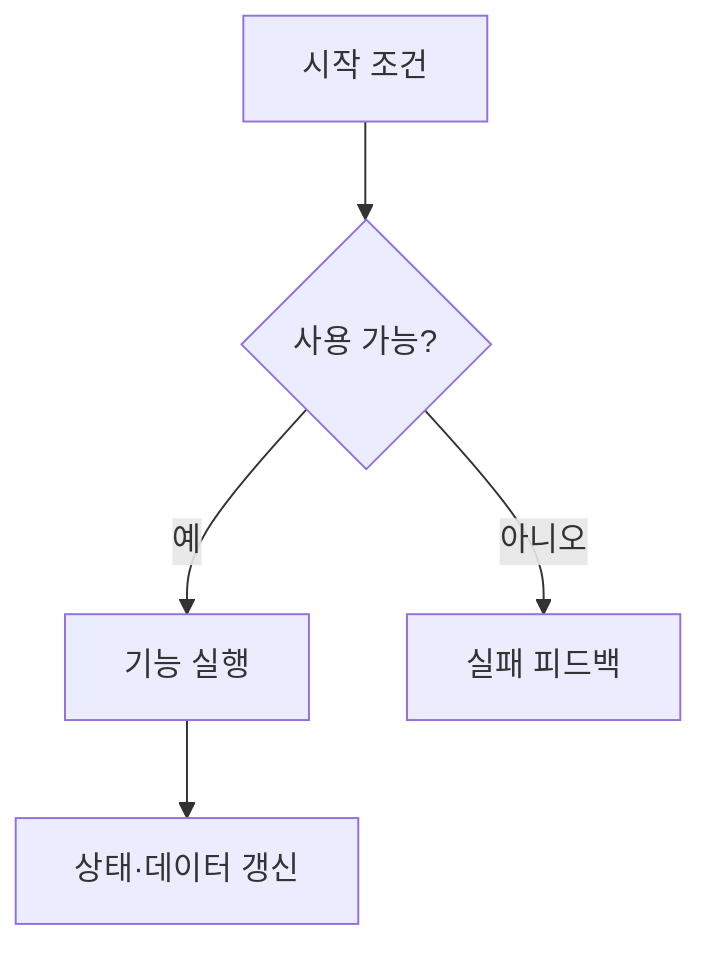

# [기능명] 기획 명세서

> [!IMPORTANT]
> 이 문서는 AI가 작성한 초안입니다.
> 기획자 검토 후 이 배너를 제거하면 확정 문서로 전환됩니다.

| 항목 | 내용 |
| --- | --- |
| 문서 상태 | 기획 |
| 우선순위 | P0 / P1 / P2 |
| 작성자 | [이름] |
| 관련 시스템 | [상대 링크] |
| 구현 상태 | 미구현 |

## 0. 기획 의도

- **목표 경험**:
- **해결하려는 문제**:
- **성공 기준**:

## 1. 기능 개요

- **한 줄 정의**:
- **진입 조건**:
- **입력**:
- **결과**:

## 2. 동작 흐름

## 3. 규칙과 예외

### 3.1 정상 규칙

- [규칙]

### 3.2 실패·취소

- [실패 조건과 결과]

### 3.3 엣지 케이스

- [동시 입력, 한계값, 연결 끊김 등]

## 4. 데이터 명세

| 기획 명칭 | Key | 타입 | 기본값 | 범위·비고 |
| --- | --- | --- | --- | --- |
| [항목] | `[key]` | `[type]` | `[default]` | [설명] |

## 5. UI·피드백

- **진입점**:
- **조작**:
- **화면 정보**:
- **성공 피드백**:
- **실패 피드백**:

## 6. 네트워크

| 항목 | 권한 주체 | 동기화 방식 | 발생 조건 |
| --- | --- | --- | --- |
| [상태] | Master / Owner / Local | RPC / Property / Local | [조건] |

## 7. 연동 시스템

| 시스템 | 관계 | 실패 영향 |
| --- | --- | --- |
| [시스템] | [데이터·이벤트] | [영향] |

## 8. QA 완료 기준

- [ ] 정상 흐름이 완료된다.
- [ ] 실패 조건에서 상태가 안전하게 복원된다.
- [ ] 멀티플레이어가 동일한 결과를 확인한다.
- [ ] 기획값과 구현값의 차이가 기록된다.

## 9. 미확정 사항

- [ ] TBD

## Revision History

| 날짜 | 버전 | 변경 내용 | 작성자 |
| --- | --- | --- | --- |
| YYYY-MM-DD | v0.1 | 초안 작성 | [이름] |
